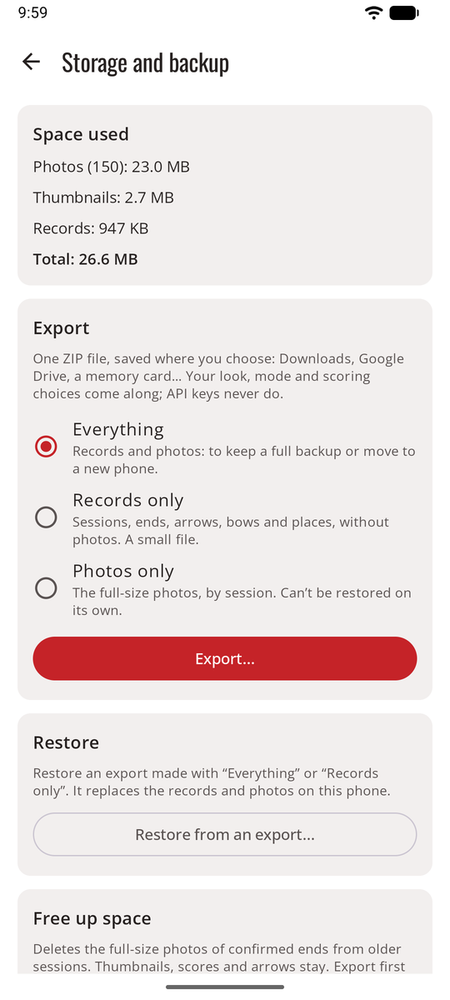
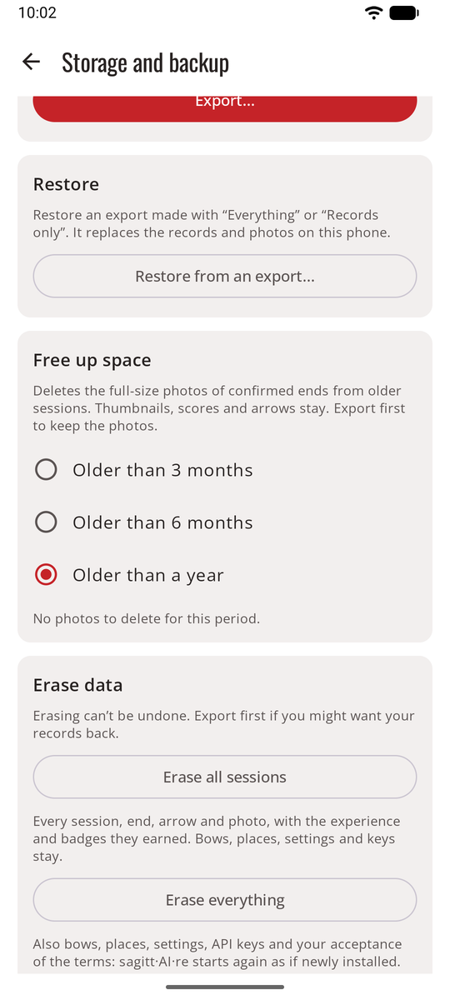

# Storage and backup

Everything is stored on your phone only, and uninstalling the app deletes it. **Settings → Storage and backup** shows the space used and keeps your records safe.

<figure markdown>
{ .shot }
<figcaption><b>Export and restore</b></figcaption>
</figure>

## Export

Export **everything**, **records only**, or **photos only**, as one ZIP file saved where you choose: Downloads, Google Drive, a memory card. Your look, mode and scoring choices come along. API keys and service addresses never do. Keep the file somewhere private.

## Restore

Restore an export on the same phone or a new one. sagitt·AI·re shows what the file holds and changes nothing until you confirm. On a new phone, enter your API key again (and, for an OpenAI-compatible service, its address).

## Free up space

Delete the full-size photos of sessions older than 3 months, 6 months or a year, after asking. Thumbnails, scores and arrows stay. Photos take about 0.6–1.2 MB per end.

## Erase data

<figure markdown>
{ .shot }
<figcaption><b>Erase data</b>, at the bottom of Storage and backup</figcaption>
</figure>

At the bottom of **Storage and backup**, **Erase data** offers two choices:

| Choice | What goes | What stays |
|--------|-----------|------------|
| **Erase all sessions** | Every session, end, arrow and photo, with the experience and badges they earned | Bows, places, settings and API keys |
| **Erase everything** | Also bows, places, every setting, API keys and your acceptance of the terms of use | Nothing: sagitt·AI·re starts again as if newly installed, with the terms screen first |

Both ask first, and the button stays off until you type **ERASE**, because erasing can't be undone. Export first if you might want your records back. To restart only your experience and badges while keeping your sessions, use **Reset experience and badges** at the trophy wall (see [Game mode](game.md#levels-badges-and-trophies)).
