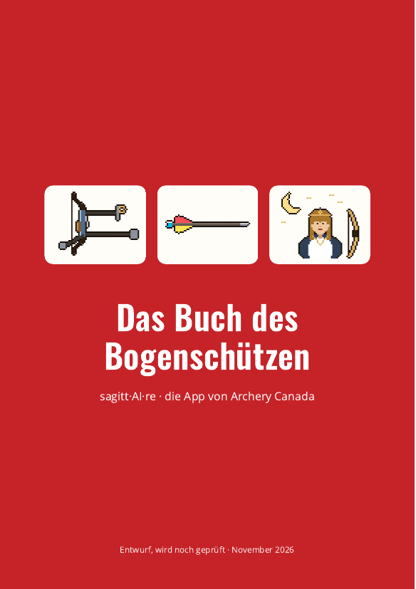
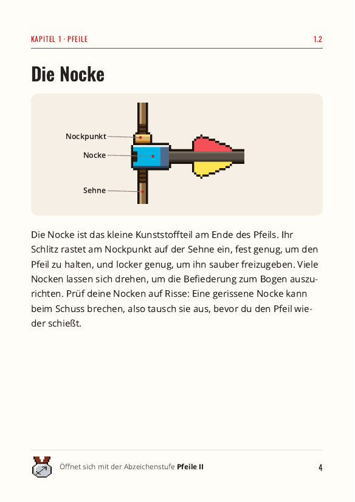

# Das Buch des Bogenschützen

**Ein Bildwörterbuch des Bogenschießens, zum Ausdrucken oder Lesen am Bildschirm.** Das Buch des Bogenschützen
liegt im Spielmodus von sagitt·AI·re auf dem Lesepult, und jede Abzeichenstufe öffnet eine seiner Seiten. Hier
gibt es das Buch zum Ausdrucken: 56 bebilderte Seiten in 11 Kapiteln, jede mit einer Zeichnung mit benannten
Teilen und einem kurzen Text, den ein Kind lesen kann.

!!! note "Ein Entwurf, noch nicht freigegeben"
    Die Texte wurden auf Englisch und Französisch geprüft und korrigiert (siehe unten), aber Archery Canada hat sie
    noch nicht freigegeben. Das Buch benennt Dinge und erklärt sie; es ist weder ein Regelwerk noch ein
    Trainingshandbuch. Für die Regeln des Sports siehe [Archery Canada](https://archerycanada.ca/).

## Herunterladen

A5-Heft, 59 Seiten, in Farbe (je etwa 1 MB):

- [Deutsch](images/book/sagittaire-archers-book-de.pdf){ download }
- [English](images/book/sagittaire-archers-book-en.pdf){ download }
- [Français](images/book/sagittaire-archers-book-fr.pdf){ download }
- [Español](images/book/sagittaire-archers-book-es.pdf){ download }

Zum Drucken wähle dein Papierformat (A4 oder Letter) und zwei Seiten pro Blatt, oder die Broschüren-Einstellung
deines Druckers, um es in der Mitte zu falten.

<figure markdown>
{ .shot }
<figcaption><b>Der Umschlag</b></figcaption>
</figure>
<figure markdown>
{ .shot }
<figcaption><b>Eine Seite:</b> die Zeichnung, ihre Teile, der Text und die Abzeichenstufe, die sie öffnet</figcaption>
</figure>

## Was drin ist

Pfeile, der Bogen, das Ziel, Zielen, die Ausrüstung, Pflege und Gewohnheiten, auf dem Bogenplatz, legendäre
Bogenschützen, Tuning, Arten des Bogenschießens und Bögen. Jede Seite endet mit der Abzeichenstufe, die sie in der
App öffnet, damit ein junger Bogenschütze sieht, was als Nächstes kommt. Die ganze Liste der Seiten mit ihren
Stufen steht unter [Lernen](education.md#the-11-chapters).

## Wie die Texte geprüft wurden

Am 15. November 2026 wurden die englischen und französischen Texte Seite für Seite anhand von World Archery,
Archery Canada und seinen französischen Regelbüchern 2026, dem französischen Verband, den Sicherheitshinweisen der
Pfeilhersteller (Easton, Gold Tip) und den alten Quellen der Legenden geprüft. Die Korrekturen wurden in allen vier
Sprachen übernommen, darunter:

- **Pfeile ziehen** (Die Scheibe und der Ständer): warten, bis alle fertig geschossen haben, seitlich stehen und
  schauen, dass niemand dahinter steht.
- **Pfeile prüfen:** Den Biegetest für Carbonpfeile zeigt eine Trainerin, ein Trainer oder ein Erwachsener, und
  der Pfeil wird weg von allen gebogen.
- **Tuning** (Standhöhe, Tiller): mit einer Trainerin, einem Trainer oder einem Erwachsenen, in den Grenzen der
  Anleitung des Bogens.
- **Der Recurvebogen:** Ab Los Angeles 2028 gibt es bei den Olympischen Spielen auch einen Compoundwettbewerb.

Deutsch und Spanisch tragen dieselben Korrekturen; ihr Wortlaut wurde noch nicht eigens geprüft.

## Woher es kommt

Das PDF wird aus der App selbst gemacht: dieselben Texte und Beschriftungen wie das Buch im Spielmodus und dieselben
Pixelzeichnungen. Wenn sich die Texte in der App ändern, wird das Buch neu gedruckt. sagitt·AI·re ist die App von
Archery Canada, pro bono entwickelt von Ashencroft Studio, für Training und Freizeit: Ergebnisse sind nie offiziell.
