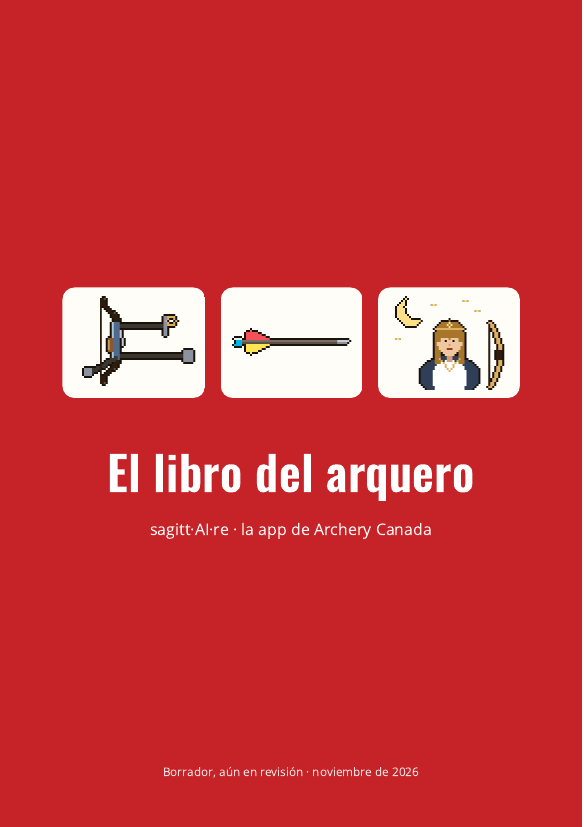
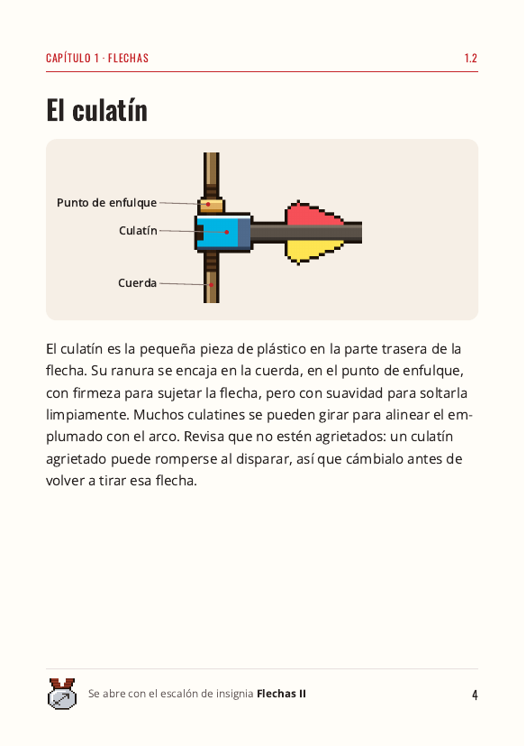

# El libro del arquero

**Un diccionario ilustrado del tiro con arco, para imprimir o leer en pantalla.** El libro del arquero está en el
atril del modo juego de sagitt·AI·re, donde cada escalón de insignia abre una de sus páginas. Aquí está como libro
para imprimir: 56 páginas ilustradas en 11 capítulos, cada una con un dibujo de partes nombradas y un texto corto
que un niño puede leer.

!!! note "Un borrador, aún por aprobar"
    Los textos se revisaron y corrigieron en inglés y francés (ver más abajo), pero Archery Canada todavía no los ha
    aprobado. El libro nombra las cosas y las explica; no es un reglamento ni un manual de entrenamiento. Para las
    reglas del deporte, consulta [Archery Canada](https://archerycanada.ca/).

## Descargar

Cuadernillo A5, 59 páginas, a color (alrededor de 1 MB cada uno):

- [Español](images/book/sagittaire-archers-book-es.pdf){ download }
- [English](images/book/sagittaire-archers-book-en.pdf){ download }
- [Français](images/book/sagittaire-archers-book-fr.pdf){ download }
- [Deutsch](images/book/sagittaire-archers-book-de.pdf){ download }

Para imprimirlo, elige tu tamaño de papel (A4 o Carta) y dos páginas por hoja, o el ajuste de folleto de tu
impresora para doblarlo por la mitad.

<figure markdown>
{ .shot }
<figcaption><b>La portada</b></figcaption>
</figure>
<figure markdown>
{ .shot }
<figcaption><b>Una página:</b> el dibujo, sus partes, el texto y el escalón de insignia que la abre</figcaption>
</figure>

## Qué contiene

Flechas, el arco, la diana, apuntar, el equipo del arquero, cuidados y hábitos, en el campo de tiro, arqueros de
leyenda, ajuste, modalidades y arcos. Cada página termina con el escalón de insignia que la abre en la app, para que
un arquero joven vea qué buscar después. La lista completa de páginas, con el escalón de cada una, está en
[Educación](education.md#the-11-chapters).

## Cómo se revisaron los textos

El 15 de noviembre de 2026, los textos en inglés y francés se revisaron página por página con World Archery, Archery
Canada y sus reglamentos franceses de 2026, la federación francesa, las indicaciones de seguridad de los fabricantes
de flechas (Easton, Gold Tip) y las fuentes antiguas de las leyendas. Las correcciones se hicieron en los cuatro
idiomas, entre ellas:

- **Sacar las flechas** (El parapeto y el caballete): esperar a que todos hayan terminado de tirar, ponerse a un lado
  y comprobar que no haya nadie detrás.
- **Revisar las flechas:** la prueba de flexión de las flechas de carbono la enseña un entrenador o un adulto,
  doblando la flecha lejos de todos.
- **Ajuste** (fistmele, tiller): con un entrenador o un adulto, dentro de los límites del manual del arco.
- **El arco recurvo:** el arco compuesto llega a los Juegos Olímpicos en Los Ángeles 2028.

El alemán y el español llevan las mismas correcciones; su redacción todavía no ha tenido una revisión aparte.

## De dónde viene

El PDF se hace a partir de la propia app: los mismos textos y nombres que el libro del modo juego, y los mismos
dibujos en píxeles. Cuando los textos cambian en la app, el libro se vuelve a imprimir. sagitt·AI·re es la app de
Archery Canada, creada pro bono por Estudio Ashencroft, para el entrenamiento y el ocio: sus puntuaciones nunca son
oficiales.
