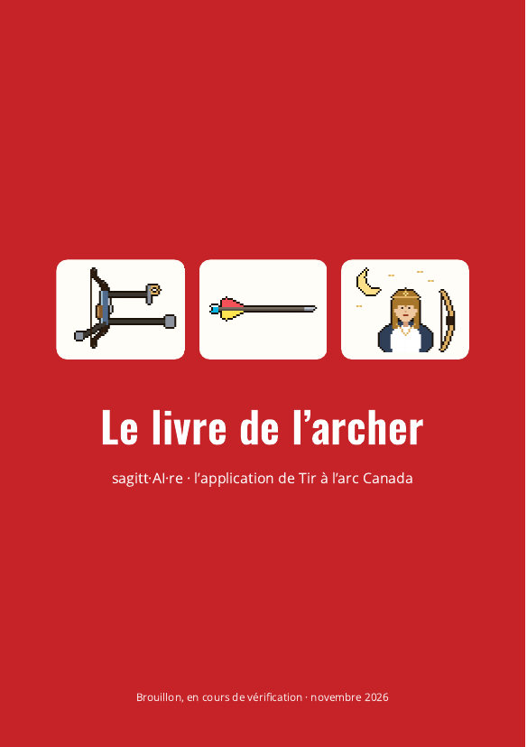
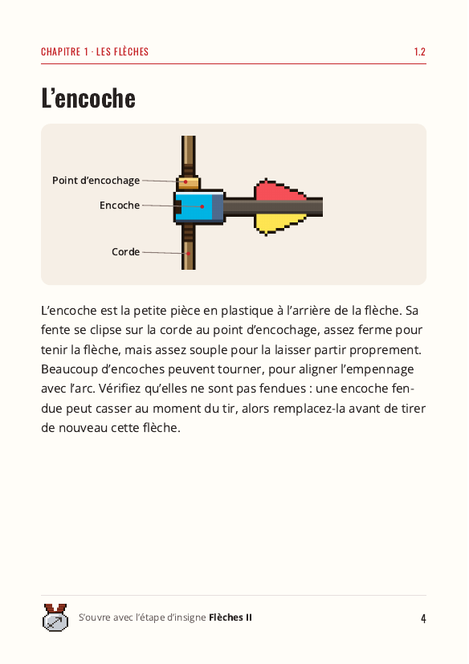

# Le livre de l’archer

**Un dictionnaire illustré du tir à l’arc, à imprimer ou à lire à l’écran.** Le livre de l’archer est posé sur le
lutrin du mode jeu de sagitt·AI·re, où chaque étape d’insigne ouvre une de ses pages. Le voici en livre à
imprimer : 56 pages illustrées en 11 chapitres, chacune avec un dessin dont les parties sont nommées et un court
texte qu’un enfant peut lire.

!!! note "Un brouillon, encore à approuver"
    Les textes ont été vérifiés et corrigés en anglais et en français (voir plus bas), mais Tir à l’arc Canada ne
    les a pas encore approuvés. Le livre nomme les choses et les explique ; ce n’est ni un règlement ni un manuel
    d’entraînement. Pour les règles du sport, voir [Tir à l’arc Canada](https://archerycanada.ca/).

## Télécharger

Livret A5, 59 pages, en couleur (environ 1 Mo chacun) :

- [Français](images/book/sagittaire-archers-book-fr.pdf){ download }
- [English](images/book/sagittaire-archers-book-en.pdf){ download }
- [Deutsch](images/book/sagittaire-archers-book-de.pdf){ download }
- [Español](images/book/sagittaire-archers-book-es.pdf){ download }

Pour l’imprimer, choisissez votre format de papier (Lettre ou A4) et deux pages par feuille, ou le réglage
« livret » de votre imprimante pour le plier en deux.

<figure markdown>
{ .shot }
<figcaption><b>La couverture</b></figcaption>
</figure>
<figure markdown>
{ .shot }
<figcaption><b>Une page :</b> le dessin, ses parties, le texte et l’étape d’insigne qui l’ouvre</figcaption>
</figure>

## Ce qu’il contient

Les flèches, l’arc, la cible, la visée, l’équipement de l’archer, les soins et habitudes, le tir sur le terrain,
les archers de légende, le réglage, les disciplines et les arcs. Chaque page se termine par l’étape d’insigne qui
l’ouvre dans l’application, pour qu’un jeune archer voie quoi viser ensuite. La liste complète des pages, avec
l’étape de chacune, se trouve sur [Éducation](education.md#the-11-chapters).

## Comment les textes ont été vérifiés

Le 15 novembre 2026, les textes anglais et français ont été vérifiés page par page à partir de World Archery, de
Tir à l’arc Canada et de ses règlements français 2026, de la fédération française, des consignes de sécurité des
fabricants de flèches (Easton, Gold Tip) et des sources anciennes des légendes. Les corrections ont été faites
dans les quatre langues, entre autres :

- **Retirer les flèches** (La butte et le chevalet) : attendre que tous aient fini de tirer, se placer sur le
  côté et vérifier que personne n’est derrière soi.
- **Vérifier ses flèches :** le test de flexion des flèches en carbone est montré par un entraîneur ou un adulte,
  en pliant la flèche loin de tous.
- **Réglage** (band, tiller) : avec un entraîneur ou un adulte, dans les limites du manuel de l’arc.
- **L’arc recourbé :** l’arc à poulies fait son entrée aux Jeux olympiques à Los Angeles 2028.
- **Les termes français** de Tir à l’arc Canada, par exemple *point de visée*, *bouton de pression* et *arc bandé*.

L’allemand et l’espagnol portent les mêmes corrections ; leur formulation n’a pas encore eu de vérification à part.

## D’où il vient

Le PDF est fait à partir de l’application elle-même : les mêmes textes et les mêmes noms que le livre du mode jeu,
et les mêmes dessins en pixels. Quand les textes changent dans l’application, le livre est réimprimé. sagitt·AI·re
est l’application de Tir à l’arc Canada, créée pro bono par le Studio Ashencroft, pour l’entraînement et le
loisir : ses pointages ne sont jamais officiels.
