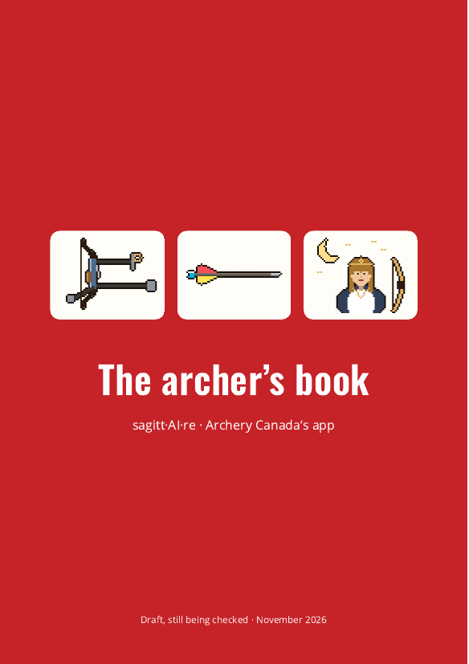
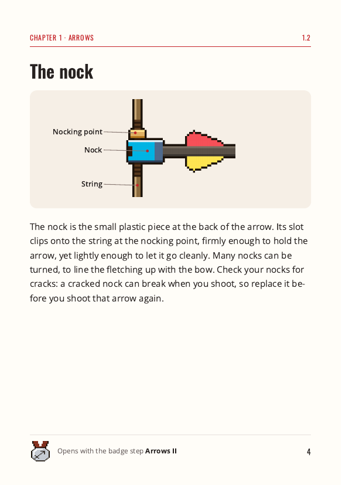

# The archer's book

**A picture dictionary of archery, to print or read on screen.** The archer's book lives on the lectern in
sagitt·AI·re's game mode, where each badge step opens one of its pages. Here it is as a printable book: 56
illustrated pages in 11 chapters, each with a drawing whose parts are named and a short text a child can read.

!!! note "A draft, still to be approved"
    The texts were researched and corrected in English and French (see below), but Archery Canada has not yet
    approved them. The book names things and explains them; it is not a rule book or a coaching manual. For the
    rules of the sport, see [Archery Canada](https://archerycanada.ca/).

## Download

A5 booklet, 59 pages, in colour (about 1 MB each):

- [English](images/book/sagittaire-archers-book-en.pdf){ download }
- [Français](images/book/sagittaire-archers-book-fr.pdf){ download }
- [Deutsch](images/book/sagittaire-archers-book-de.pdf){ download }
- [Español](images/book/sagittaire-archers-book-es.pdf){ download }

To print, choose your paper size (A4 or Letter) and two pages per sheet, or your printer's booklet setting to fold
it in half.

<figure markdown>
{ .shot }
<figcaption><b>The cover</b></figcaption>
</figure>
<figure markdown>
{ .shot }
<figcaption><b>A page:</b> the drawing, its parts, the text, and the badge step that opens it</figcaption>
</figure>

## What's inside

Arrows, the bow, the target, aiming, the archer's kit, care and habits, out on the range, archers of legend,
tuning, kinds of archery, and bows. Each page ends with the badge step that opens it in the app, so a young archer
can see what to aim for next. The full list of pages, with the step for each, is on [Education](education.md#the-11-chapters).

## How the texts were checked

On 15 November 2026, the English and French texts were checked page by page against World Archery, Archery Canada
and its 2026 French rulebooks, the French federation, arrow makers' safety notes (Easton, Gold Tip) and the old
sources of the legends. The corrections were made in all four languages, among them:

- **Pulling arrows** (The boss and stand): wait until everyone has stopped shooting, stand to one side and check
  that no one is behind you.
- **Checking arrows:** the flex test for carbon arrows is shown by a coach or an adult, bending away from everyone.
- **Tuning** (brace height, tiller): done with a coach or an adult, within the limits in the bow's manual.
- **Recurve:** a compound event joins the Olympic Games at Los Angeles 2028.
- **French terms** as Tir à l'arc Canada uses them, for example *point de visée*, *bouton de pression* and
  *arc bandé*.

German and Spanish carry the same corrections; their wording has not had a separate check yet.

## Where it comes from

The PDF is made from the app itself: the same texts and labels as the book in game mode, and the same pixel
drawings. When the texts change in the app, the book is printed again. sagitt·AI·re is Archery Canada's app,
created pro bono by Ashencroft Studio, for practice and leisure: its scores are never official.
