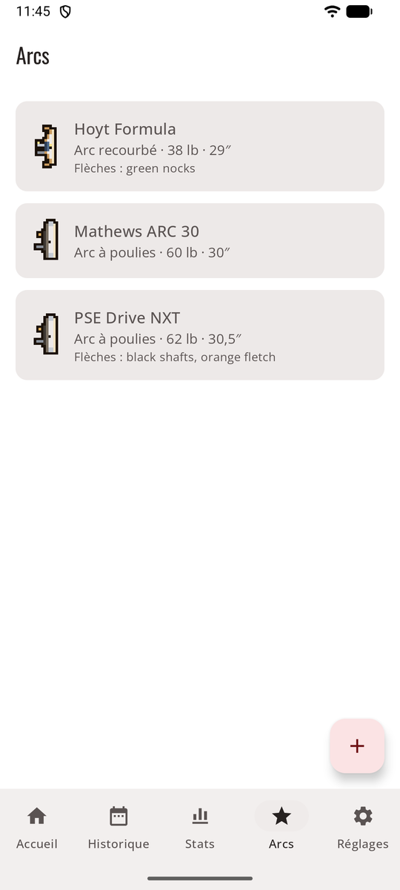
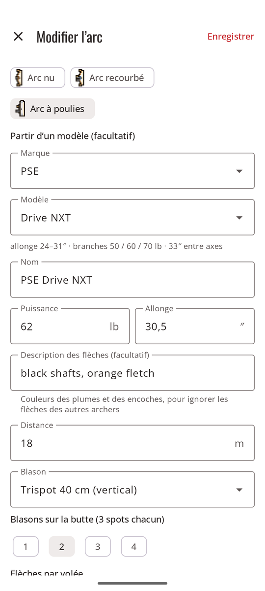
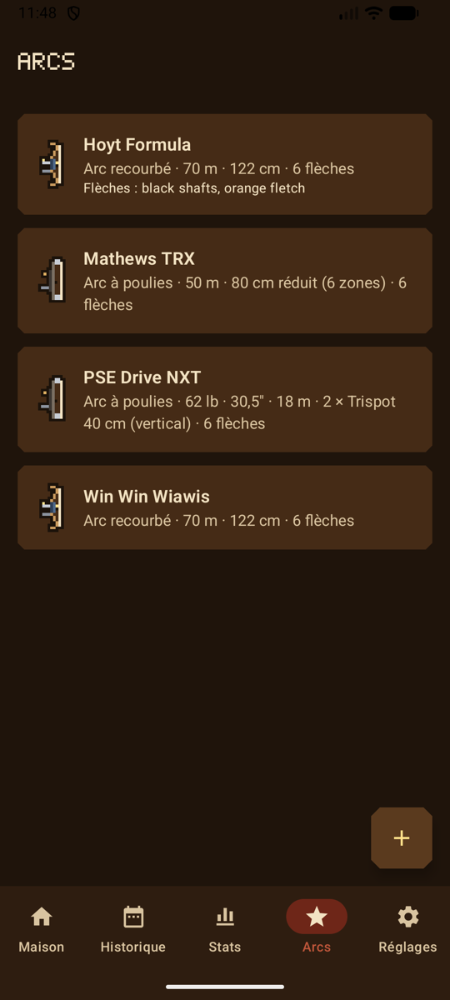
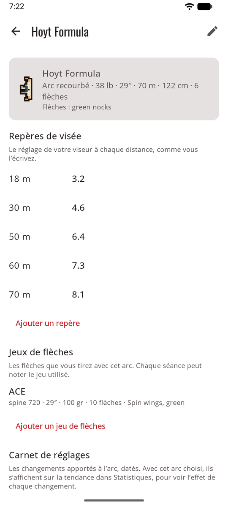
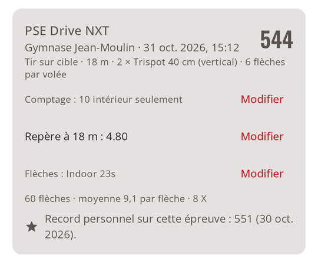

# Arcs

L’onglet **Arcs** liste vos arcs. Touchez-en un pour ouvrir sa page : ses réglages, ses **repères de visée**, ses **jeux de flèches** et son **carnet de réglages**. En mode jeu, ils sont accrochés au **râtelier à arcs** de la maison, chacun dessiné selon son type, et votre archer tient le type de votre premier arc.

<figure markdown>
{ .shot }
<figcaption><b>Vos arcs</b></figcaption>
</figure>
<figure markdown>
{ .shot }
<figcaption><b>Partir du catalogue</b></figcaption>
</figure>
<figure markdown>
{ .shot }
<figcaption><b>Vos arcs</b>, dans le style du jeu</figcaption>
</figure>

## Ajouter un arc

**Ajouter un arc** :

- **Nom** et **type d’arc**. Chaque type a un petit dessin qui marque l’arc dans les listes : arc nu ; arc recourbé avec viseur et stabilisateur ; arc à poulies avec ses cames.
- Pour un arc à poulies, vous pouvez partir d’une **marque** et d’un **modèle** du catalogue intégré (PSE, Hoyt, Mathews, Bowtech). Il remplit le nom, montre les caractéristiques du modèle, et vous prévient si votre allonge sort de la plage du modèle.
- **Puissance** (lb) et **allonge** (pouces). Les deux acceptent une virgule ou un point.
- **Description des flèches**, par exemple « tubes noirs, plumes orange ». Elle est envoyée avec la photo pour que l’IA ignore les flèches des autres archers sur la même butte.
- **Valeurs par défaut :** blason, blasons sur la butte, distance et flèches par volée, pour remplir les nouvelles séances.

## Repères de visée, jeux de flèches et carnet de réglages

<figure markdown>
{ .shot }
<figcaption><b>La page d’un arc</b></figcaption>
</figure>
<figure markdown>
{ .shot }
<figcaption><b>Sur la séance</b>, le repère et les flèches</figcaption>
</figure>

- **Repères de visée** : le réglage de votre viseur à chaque distance, écrit à votre façon : `5,2`, `3 tours + 12`, ou pour un arc nu votre position sur la corde (string walking) ou votre point de visée, avec une note si vous voulez. Un par distance. Le repère de l’arc et de la distance de la séance s’affiche quand vous commencez une séance et sur la séance elle-même, où **Modifier** le met à jour depuis le pas de tir.
- **Jeux de flèches** : nom, spine imprimé sur le tube, longueur, poids des pointes, nombre de flèches, empennage et notes. Une nouvelle séance commence avec le jeu que l’arc a utilisé la dernière fois ; choisissez-en un autre dans le formulaire, ou **Modifier** sur la séance. **Retirer ce jeu** le cache des nouvelles séances et le garde sur les séances tirées avec. Dans [Statistiques](stats.md#filtres), filtrez par jeu de flèches.
- **Carnet de réglages** : des notes datées de ce que vous avez changé : band, tiller, point d’encochage, une nouvelle corde. Avec l’arc choisi dans [Statistiques](stats.md#moyenne-par-fleche-par-seance), chaque note s’affiche sur la tendance, pour voir son effet.

## Modifier ou retirer un arc

**Modifier l’arc** (le crayon, en haut à droite de la page de l’arc) ouvre le formulaire. Modifier un arc plus tard ne change pas les séances passées. **Retirer cet arc** demande d’abord confirmation ; les séances passées tirées avec cet arc sont conservées.
