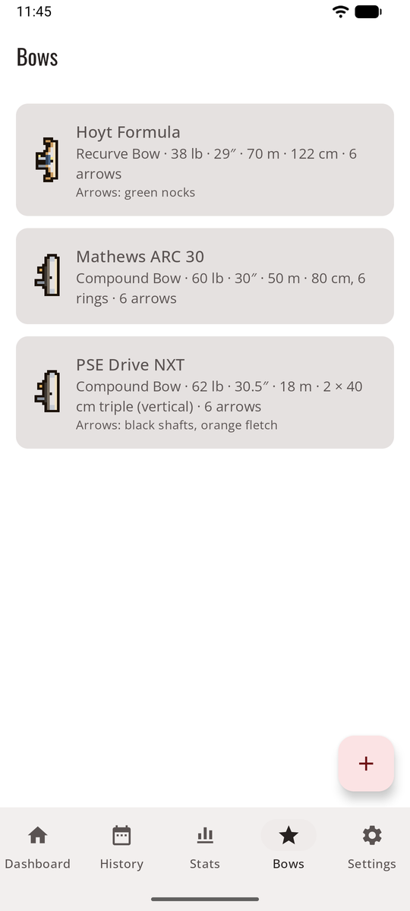
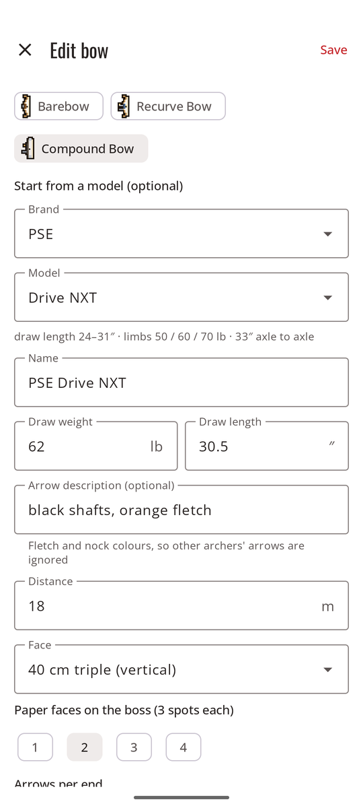
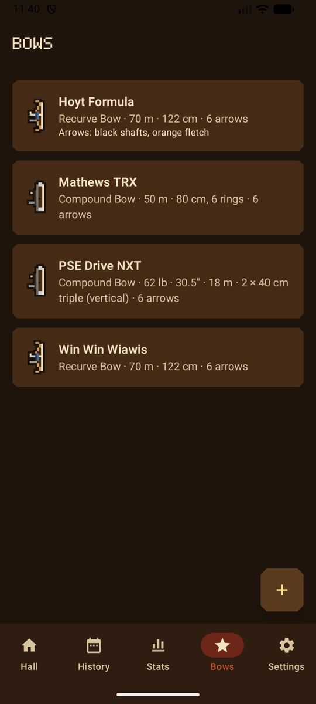
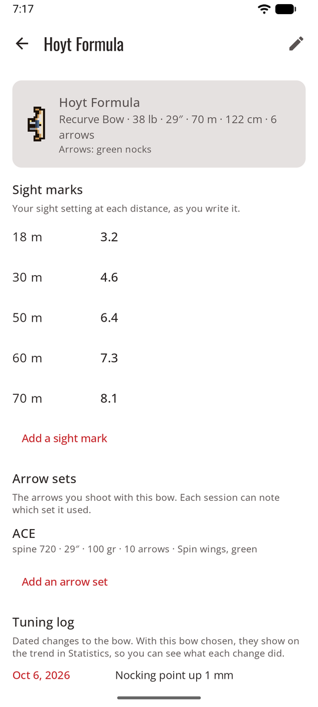
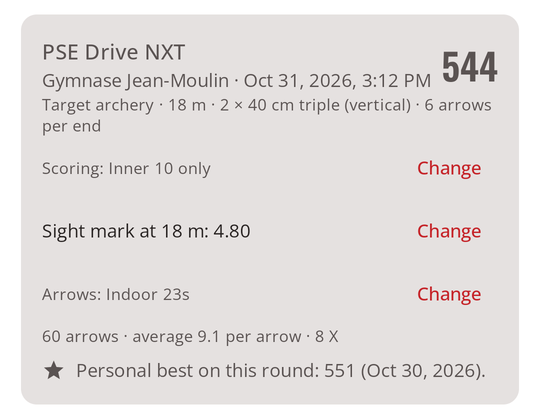

# Bows

The **Bows** tab lists your bows. Tap one to open its page: its setup, **sight marks**, **arrow sets** and **tuning log**. In game mode, they hang on the **bow rack** in the hall, each drawn as its type, and your archer holds the type of your first bow.

<figure markdown>
{ .shot }
<figcaption><b>Your bows</b></figcaption>
</figure>
<figure markdown>
{ .shot }
<figcaption><b>Starting from the catalog</b></figcaption>
</figure>
<figure markdown>
{ .shot }
<figcaption><b>Your bows</b>, in the game look</figcaption>
</figure>

## Add a bow

**Add bow**:

- **Name** and **bow type**. Each type has a small drawing that marks the bow in lists: barebow; recurve with sight and stabilizer; compound with cams.
- For a compound, you can start from a **brand and model** in the built-in catalog (PSE, Hoyt, Mathews, Bowtech). It fills in the name, shows the model's specs, and warns you if your draw length is outside the model's range.
- **Draw weight** (lb) and **draw length** (inches). Both accept a comma or a dot.
- **Arrow description**, for example "black shafts, orange fletching". It's sent with the photo so the AI ignores other archers' arrows on the same boss.
- **Defaults:** target face, paper faces, distance and arrows per end, used to fill in new sessions.

## Sight marks, arrow sets and tuning log

<figure markdown>
{ .shot }
<figcaption><b>A bow's page</b></figcaption>
</figure>
<figure markdown>
{ .shot }
<figcaption><b>On the session</b>, the mark and the arrows</figcaption>
</figure>

- **Sight marks**: your sight setting at each distance, written your way: `5.2`, `3 turns + 12`, or for a barebow your string walk or point of aim, with an optional note. One per distance. The mark for the session's bow and distance shows when you start a session and on the session itself, where **Change** updates it from the shooting line.
- **Arrow sets**: name, spine as printed on the shaft, length, point weight, number of arrows, fletching and notes. A new session starts with the set the bow used last time; pick another in the form, or **Change** it on the session. **Retire this set** hides it from new sessions and keeps it on the sessions shot with it. In [Statistics](stats.md#filters), filter by arrow set.
- **Tuning log**: dated notes of what you changed: brace height, tiller, nocking point, a new string. With the bow chosen in [Statistics](stats.md#average-per-arrow-by-session), each note shows on the trend, so you can see what it did.

## Change or remove a bow

**Edit** (the pencil, top right of the bow's page) opens the form. Changing a bow later doesn't change past sessions. **Remove this bow** asks first; past sessions shot with it are kept.
