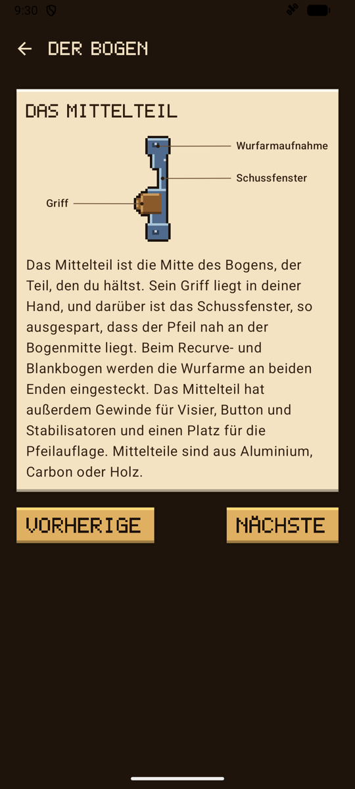
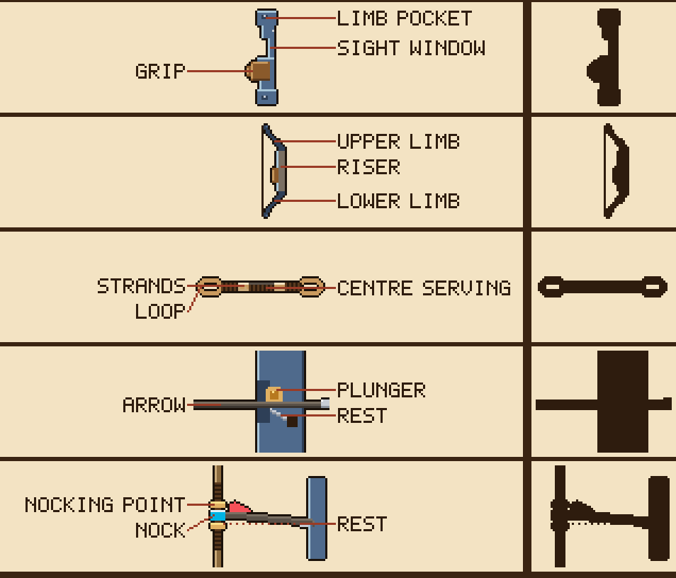

# Lernen

**Die Wörter des Bogenschießens beim Schießen lernen.** Im Spielmodus macht sagitt·AI·re das Training zu einem kleinen
Abenteuer: Jeder Fortschritt öffnet eine Seite im **Buch des Bogenschützen**, einem bebilderten Wörterbuch des
Bogenschießens. Kinder (und Erwachsene) lernen, was eine Nocke, ein Mittelteil oder ein Tab ist, weil sie sich die Seite
verdient haben, die es zeigt.

Diese Seite ist für Eltern, Trainerinnen und Trainer und Lehrkräfte, die das Spiel nutzen möchten, um jungen
Bogenschützen beim Lernen zu helfen. Das ganze Buch gibt es auch als PDF zum Ausdrucken, in vier Sprachen: [Das Buch des Bogenschützen](book.md).

!!! note "Das Buch ist ein Entwurf"
    Die 56 Seiten des Buchs werden noch geprüft, bevor die App breiter verteilt wird. Es benennt Dinge und erklärt, wozu
    sie dienen; es ist weder ein Regelwerk noch ein Trainingshandbuch. Für die Regeln des Sports siehe
    [Archery Canada](https://archerycanada.ca/).

## So funktioniert es

1. **Spielmodus einschalten:** Einstellungen → Aussehen und Spiel → Spiel (Vorschau). Die App wird zu einem Pixel-Spiel
   mit einer nordischen Halle und einem Bogenplatz. Beim Zurückschalten geht nichts verloren.
2. **Echte Pfeile schießen und erfassen.** Werte jede Passe von Hand (ohne KI) oder mit der KI und beende dann die
   Einheit. Nur echtes Schießen zählt: Es gibt nichts zu kaufen und keine Abkürzung.
3. **Abzeichenstufen verdienen.** Zwanzig Abzeichen steigen in Stufen: geschossene Pfeile, beendete Einheiten, X-Treffer,
   perfekte Passen, persönliche Bestleistungen, Trainingswochen, Entfernungen, Orte, Visiermarken und die ausprobierten
   Bogen- und Schießarten.
4. **Das Buch öffnen.** Jede Stufe schaltet eine Seite frei. Das Buch liegt auf dem **Lesepult** in der Halle: Neue Seiten
   sind als **Neu** markiert, und eine gesperrte Seite zeigt ihren Umriss und was sie öffnet („Verdiene Pfeile V, um diese
   Seite zu lesen“).

<figure markdown>
{ .shot }
<figcaption><b>Inhalt.</b> Neue Seiten sind markiert; gesperrte sagen, was sie öffnet.</figcaption>
</figure>
<figure markdown>
{ .shot }
<figcaption><b>Eine Seite:</b> eine Zeichnung mit benannten Teilen und ein kurzer Text.</figcaption>
</figure>

## Was eine Seite lehrt

Jede Seite hat eine **Zeichnung mit beschrifteten Teilen** und **einen kurzen Text**: was das Ding ist, wozu es dient, und
manchmal eine gute Gewohnheit. Die Seite über das Mittelteil zum Beispiel benennt jedes seiner Teile. **Vorherige** und
**Nächste** blättern um, und ein Screenreader liest den Text und jede Beschriftung vor.

Die ersten Seiten kommen schnell, so sieht ein Anfänger das Buch schon am ersten Abend wachsen: Eine beendete Einheit
öffnet **Das Mittelteil**, 100 geschossene Pfeile öffnen **Die Teile eines Pfeils**, eine zweite Entfernung öffnet
**Halle und draußen**, und Training in vier verschiedenen Wochen öffnet **Aufwärmen**. Spätere Seiten brauchen eine
Saison oder mehr.

{ width="480" .pixel }

## Die 11 Kapitel { #the-11-chapters }

Jede Seite und die Abzeichenstufe, die sie öffnet:

- **Pfeile:** Die Teile eines Pfeils (Pfeile I), Die Nocke (Pfeile II), Vanes und Federn (Pfeile III), Spitzen (Pfeile IV), Spine (Pfeile V).
- **Der Bogen:** Das Mittelteil (Einheiten I), Die Wurfarme (Einheiten II), Die Sehne (Einheiten III), Pfeilauflage und Button (Einheiten IV), Der Nockpunkt (Einheiten V).
- **Das Ziel:** Die Auflage und ihre Farben (X-Treffer I), Spot-Auflagen (X-Treffer II), Feldauflagen (X-Treffer III), 3D-Tiere (X-Treffer IV), Scheibe und Ständer (X-Treffer V).
- **Zielen:** Das Visier (Perfekte Passen I), Der Klicker (Perfekte Passen II), Stabilisatoren (Perfekte Passen III), Ankerpunkt und Kisser (Perfekte Passen IV), String-Walking und Face-Walking (Perfekte Passen V).
- **Die Ausrüstung:** Der Tab (Rekorde I), Der Armschutz (Rekorde II), Der Brustschutz (Rekorde III), Das Release (Rekorde IV), Die Bogenschlinge (Rekorde V).
- **Pflege und Gewohnheiten:** Aufwärmen (Wochen I), Ruhetage (Wochen II), Pfeile prüfen (Wochen III), Sehnenwachs (Wochen IV), Den Bogen aufbewahren (Wochen V).
- **Auf dem Bogenplatz:** Halle und draußen (Entfernungen I), Wind (Entfernungen II), Licht und Schatten (Entfernungen III), Bergauf und bergab (Entfernungen IV), Entfernungen schätzen (Entfernungen V).
- **Legendäre Bogenschützen:** Ullr (Orte I), Skadi (Orte II), Artemis (Orte III), Robin Hood (Orte IV), Hou Yi (Orte V), Ullrs Eibenbogen (Ullrs Gunst).
- **Tuning:** Visiermarken (Visiermarken I), Die Standhöhe (Visiermarken II), Der Tiller (Visiermarken III), Center-Shot (Visiermarken IV), Blankschaft-Tuning (Visiermarken V).
- **Arten des Bogenschießens:** Feldbogenschießen (Feld), 3D-Bogenschießen (3D), Para-Bogenschießen (Vielseitigkeit), Scheibenbogenschießen (Fernweh), Bogenschießen in Kanada (Beständigkeit).
- **Bögen:** Der Blankbogen (Blankbogen), Der Recurvebogen (Recurve), Der Compoundbogen (Compound), Der Langbogen (Drei Bögen), Der Reiterbogen (Treffsicherheit).

## In vier Sprachen

Das Buch, seine Beschriftungen und die ganze App sprechen **Deutsch, Englisch, Französisch und Spanisch**. Die App folgt
der Sprache des Handys; ab Android 13 legt **Einstellungen → Sprache** sie nur für sagitt·AI·re fest. Ein Sprachwechsel
macht das Buch zu einem kleinen zweisprachigen Wörterbuch: dieselbe Zeichnung, mit den Wörtern in der anderen Sprache.

## Für Eltern und Trainer

- **Zuerst das Bogenschießen.** Kinder schießen unter Aufsicht einer Trainerin, eines Trainers oder eines verantwortlichen
  Erwachsenen, nach den Sicherheitsregeln ihres Vereins. Die App erfasst das Training; sie bringt das Schießen nicht bei.
- **Echtes Training, im gesunden Tempo.** Die meisten Abzeichen belohnen das Wiederkommen: Einheiten beenden, Woche für
  Woche trainieren, neue Entfernungen und Orte ausprobieren. Pfeile summieren sich über Monate, nicht an einem Abend, und
  zwei Seiten, *Aufwärmen* und *Ruhetage*, handeln genau davon, das eigene Tempo zu finden.
- **Keine KI nötig.** Die Wertung von Hand, durch Antippen der Pfeile auf dem Foto oder der Ringe, sendet nichts und
  braucht keinen API-Schlüssel. Siehe [Wertung von Hand](scoring-manual.md).
- **Nichts zu kaufen, nichts geteilt.** Kein Konto, keine Werbung, kein Tracking. Das Spiel sendet nichts: das Aussehen des
  Bogenschützen, die Dekorationen und die gelesenen Seiten bleiben auf dem Handy. Siehe [Datenschutz](privacy.md).
- **Ein Bogenschütze pro Handy.** Die Einheiten und das Buch gehören dem Bogenschützen, dessen Einheiten es sind.
- **Erst ausprobieren:** *sagitt·AI·re Demo* wird neben der App installiert, mit sechs Monaten erfundener Einheiten, damit
  du das Spiel erkunden und Seiten öffnen kannst, bevor ein Kind anfängt.
- **Nur für Training und Freizeit.** Ergebnisse in sagitt·AI·re sind nie offiziell: Im Wettkampf zählen nur die offiziellen
  Schießzettel.

Jedes Abzeichen mit seiner Belohnung und seiner Seite steht unter [Spielmodus](game.md#levels-badges-and-trophies).
