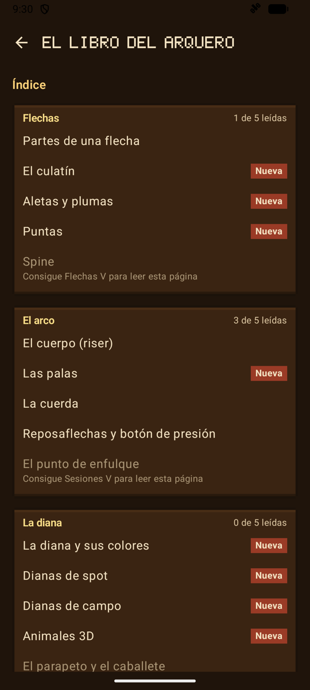
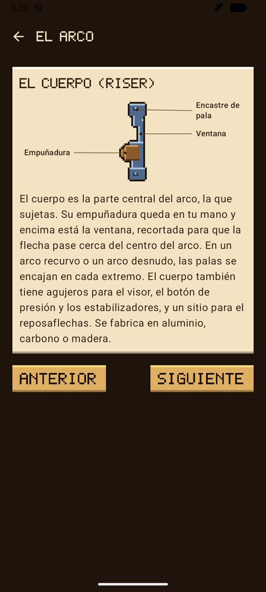
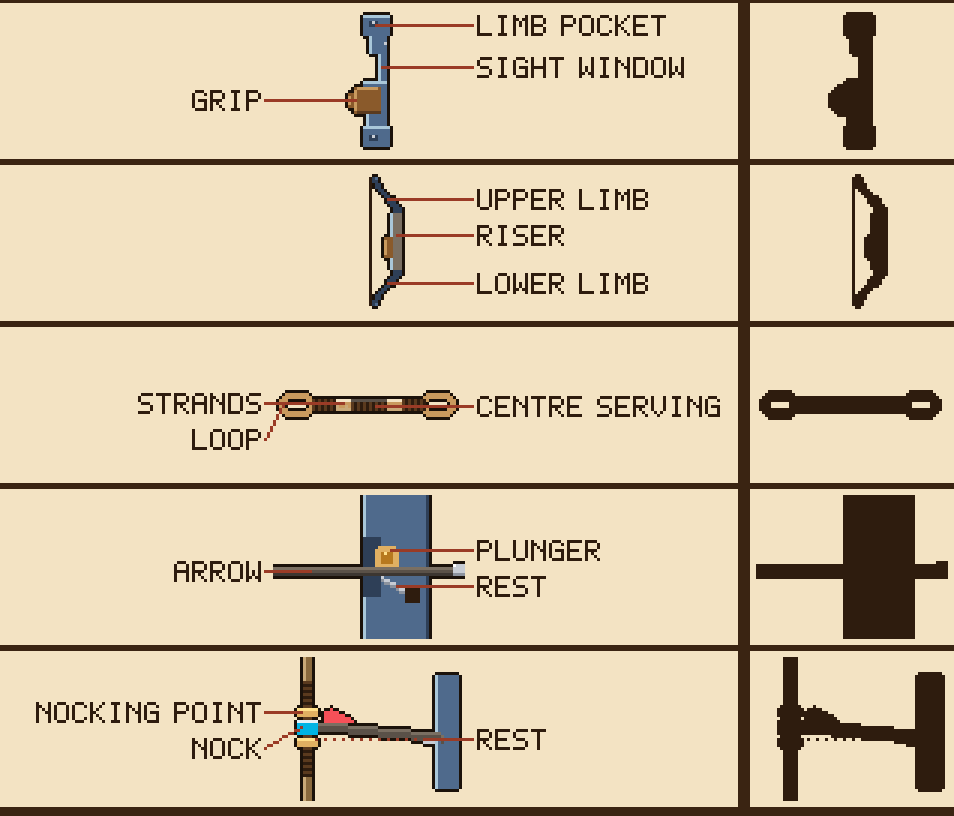

# Educación

**Aprender las palabras del tiro con arco tirando.** En el modo juego, sagitt·AI·re convierte el entrenamiento en una
pequeña aventura: cada avance abre una página del **libro del arquero**, un diccionario ilustrado del tiro con arco. Los
niños (y los mayores) aprenden qué es un culatín, el cuerpo del arco o una dactilera porque se ganaron la página que lo
muestra.

Esta página es para madres, padres, entrenadores y docentes que quieren usar el juego para ayudar a aprender a los
arqueros jóvenes.

!!! note "El libro es un borrador"
    Las 56 páginas del libro aún se están revisando antes de que la app se reparta más. Nombra las cosas y explica para qué
    sirven; no es un reglamento ni un manual de entrenamiento. Para las reglas del deporte, consulta
    [Archery Canada](https://archerycanada.ca/).

## Cómo funciona

1. **Activa el modo juego:** Ajustes → Apariencia y juego → Juego (vista previa). La app se convierte en un juego de
   píxeles, con un salón nórdico y un campo de tiro. Al volver al modo normal no se pierde nada.
2. **Tira flechas de verdad y regístralas.** Puntúa cada tanda a mano (sin IA) o con la IA, y luego termina la sesión.
   Solo cuenta el tiro de verdad: no hay nada que comprar ni atajos.
3. **Gana escalones de insignias.** Veinte insignias suben por escalones: flechas tiradas, sesiones terminadas, X, tandas
   perfectas, mejores marcas personales, semanas de práctica, distancias, lugares, marcas de visor, y los tipos de arco y
   de tiro probados.
4. **Abre el libro.** Cada escalón desbloquea una página. El libro está en el **atril** del salón: las páginas nuevas están
   marcadas como **Nueva**, y una página bloqueada muestra su silueta y qué la abrirá («Consigue Flechas V para leer esta
   página»).

<figure markdown>
{ .shot }
<figcaption><b>El índice.</b> Las páginas nuevas están marcadas; las bloqueadas dicen qué las abre.</figcaption>
</figure>
<figure markdown>
{ .shot }
<figcaption><b>Una página:</b> un dibujo con sus partes nombradas y un texto corto.</figcaption>
</figure>

## Lo que enseña una página

Cada página tiene un **dibujo con sus partes nombradas** y **un texto corto**: qué es la cosa, para qué sirve y, a veces, un
buen hábito. La página del cuerpo del arco, por ejemplo, nombra cada una de sus partes. **Anterior** y **Siguiente** pasan
las páginas, y un lector de pantalla lee el texto y cada nombre.

Las primeras páginas llegan rápido, así que un principiante ve crecer el libro desde la primera tarde: terminar una sesión
abre **El cuerpo (riser)**, tirar 100 flechas abre **Partes de una flecha**, tirar a una segunda distancia abre **En sala y
al aire libre**, y practicar en cuatro semanas distintas abre **El calentamiento**. Las últimas páginas piden una temporada
o más.

{ width="480" .pixel }

## Los 11 capítulos

Cada página y el escalón de insignia que la abre:

- **Flechas:** Partes de una flecha (Flechas I), El culatín (Flechas II), Aletas y plumas (Flechas III), Puntas (Flechas IV), Spine (Flechas V).
- **El arco:** El cuerpo (riser) (Sesiones I), Las palas (Sesiones II), La cuerda (Sesiones III), Reposaflechas y botón de presión (Sesiones IV), El punto de enfulque (Sesiones V).
- **La diana:** La diana y sus colores (X I), Dianas de spot (X II), Dianas de campo (X III), Animales 3D (X IV), El parapeto y el caballete (X V).
- **Apuntar:** El visor (Tandas perfectas I), El clicker (Tandas perfectas II), Estabilizadores (Tandas perfectas III), Anclaje y kisser (Tandas perfectas IV), String walking y face walking (Tandas perfectas V).
- **El equipo del arquero:** La dactilera (Récords I), El protector de brazo (Récords II), El protector de pecho (Récords III), El disparador (Récords IV), La dragonera (Récords V).
- **Cuidados y hábitos:** El calentamiento (Semanas I), Días de descanso (Semanas II), Revisar las flechas (Semanas III), Cera para cuerda (Semanas IV), Guardar el arco (Semanas V).
- **En el campo de tiro:** En sala y al aire libre (Distancias I), El viento (Distancias II), Luz y sombra (Distancias III), Cuesta arriba y cuesta abajo (Distancias IV), Calcular la distancia (Distancias V).
- **Arqueros de leyenda:** Ullr (Lugares I), Skadi (Lugares II), Artemisa (Lugares III), Robin Hood (Lugares IV), Hou Yi (Lugares V), El arco de tejo de Ullr (El favor de Ullr).
- **Ajuste:** Marcas de visor (Marcas de visor I), El fistmele (Marcas de visor II), El tiller (Marcas de visor III), El centrado (Marcas de visor IV), Ajuste con flechas sin emplumar (Marcas de visor V).
- **Modalidades:** Tiro de campo (Campo), Tiro 3D (3D), Tiro con arco adaptado (Versatilidad), Tiro a diana (Trotamundos), El tiro con arco en Canadá (Constancia).
- **Arcos:** El arco desnudo (Arco desnudo), El arco recurvo (Recurvo), El arco compuesto (Compuesto), El arco largo (Tres arcos), El arco ecuestre (Puntería).

## En cuatro idiomas

El libro, sus nombres y toda la app hablan **español, inglés, francés y alemán**. La app sigue el idioma del teléfono; en
Android 13 y posteriores, **Ajustes → Idioma** lo fija solo para sagitt·AI·re. Cambiar de idioma convierte el libro en un
pequeño diccionario bilingüe: el mismo dibujo, con las palabras en el otro idioma.

## Para familias y entrenadores

- **Primero, el tiro con arco.** Los niños tiran bajo la mirada de un entrenador o de un adulto responsable, con las normas
  de seguridad de su club. La app registra la práctica; no enseña a tirar.
- **Práctica de verdad, a buen ritmo.** La mayoría de las insignias premian volver: terminar sesiones, practicar semana tras
  semana, probar distancias y lugares nuevos. Las flechas se suman a lo largo de meses, no en una tarde, y dos páginas,
  *El calentamiento* y *Días de descanso*, tratan justamente de dosificar el esfuerzo.
- **Sin IA.** Puntuar a mano, tocando las flechas en la foto o las zonas, no envía nada a ningún sitio ni pide clave de
  API. Consulta [Puntuación manual](scoring-manual.md).
- **Nada que comprar, nada compartido.** Sin cuenta, sin anuncios, sin rastreo. El juego no envía nada: el aspecto del
  arquero, las decoraciones y las páginas leídas se quedan en el teléfono. Consulta [Privacidad](privacy.md).
- **Un arquero por teléfono.** Las sesiones y el libro son del arquero al que pertenecen.
- **Pruébalo antes:** *sagitt·AI·re Demo* se instala junto a la app con seis meses de sesiones inventadas, para explorar el
  juego y abrir páginas antes de que empiece un niño.
- **Solo para el entrenamiento y el ocio.** Las puntuaciones de sagitt·AI·re nunca son oficiales: en competición, solo
  cuentan las hojas de puntuación oficiales.

Para ver cada insignia, su recompensa y su página, consulta [Modo juego](game.md#levels-badges-and-trophies).
