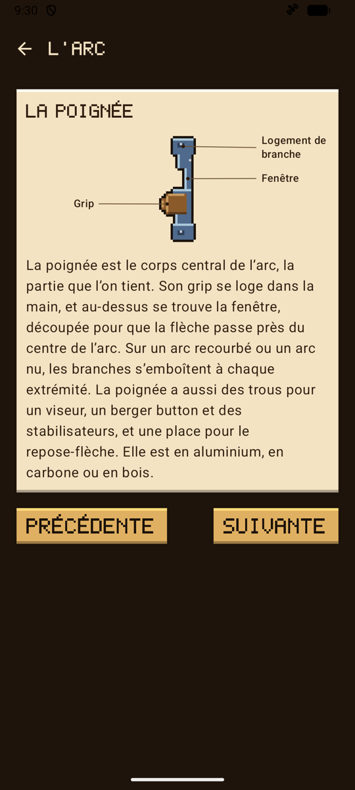

# Éducation

**Apprendre les mots du tir à l’arc en tirant.** En mode jeu, sagitt·AI·re fait de l’entraînement une petite quête : chaque
progrès ouvre une page du **livre de l’archer**, un dictionnaire illustré du tir à l’arc. Les enfants (et les grands)
apprennent ce qu’est une encoche, une poignée ou une palette parce qu’ils ont gagné la page qui les montre.

Cette page s’adresse aux parents, aux entraîneurs et aux enseignants qui veulent se servir du jeu pour aider de jeunes
archers à apprendre.

!!! note "Le livre est un brouillon"
    Les 56 pages du livre sont encore en cours de vérification avant une diffusion plus large de l’application. Il nomme
    les choses et explique à quoi elles servent ; ce n’est ni un règlement ni un manuel d’entraînement. Pour les règles
    du sport, voir [Tir à l’arc Canada](https://archerycanada.ca/).

## Comment ça marche

1. **Activez le mode jeu :** Réglages → Apparence et jeu → Jeu (aperçu). L’application devient un jeu en pixels, avec une
   maison nordique et un pas de tir. Rien n’est perdu en revenant au mode normal.
2. **Tirez de vraies flèches et enregistrez-les.** Comptez chaque volée à la main (sans IA) ou avec l’IA, puis terminez la
   séance. Seul le vrai tir compte : il n’y a rien à acheter et aucun moyen de sauter des étapes.
3. **Gagnez des étapes d’insignes.** Vingt insignes montent par étapes : flèches tirées, séances terminées, X, volées
   parfaites, records personnels, semaines d’entraînement, distances, lieux, repères de visée, et les types d’arc et de
   tir essayés.
4. **Ouvrez le livre.** Chaque étape débloque une page. Le livre est posé sur le **lutrin** de la maison : les nouvelles pages
   sont marquées **Nouvelle**, et une page verrouillée montre sa silhouette et ce qui l’ouvrira (« Obtenez Flèches V pour
   lire cette page »).

<figure markdown>
{ .shot }
<figcaption><b>Le sommaire.</b> Les nouvelles pages sont marquées ; les pages verrouillées disent ce qui les ouvre.</figcaption>
</figure>
<figure markdown>
{ .shot }
<figcaption><b>Une page :</b> un dessin avec ses parties nommées, et un court texte.</figcaption>
</figure>

## Ce qu’apprend une page

Chaque page a un **dessin avec ses parties nommées** et **un court texte** : ce qu’est la chose, à quoi elle sert, et parfois
une bonne habitude à garder. La page sur la poignée, par exemple, nomme le logement de branche, la fenêtre et le grip.
**Précédente** et **Suivante** tournent les pages, et un lecteur d’écran lit le texte et chaque nom.

Les premières pages arrivent vite : un débutant voit le livre se remplir dès la première soirée. Terminer une séance ouvre
**La poignée**, tirer 100 flèches ouvre **Les parties d’une flèche**, tirer à une deuxième distance ouvre **En salle et
dehors**, et s’entraîner pendant quatre semaines différentes ouvre **L’échauffement**. Les dernières pages demandent une
saison ou plus.

{ width="480" .pixel }

## Les 11 chapitres

Chaque page et l’étape d’insigne qui l’ouvre :

- **Les flèches :** Les parties d’une flèche (Flèches I), L’encoche (Flèches II), Empennes et plumes (Flèches III), Les pointes (Flèches IV), Le spine (Flèches V).
- **L’arc :** La poignée (Séances I), Les branches (Séances II), La corde (Séances III), Repose-flèche et berger button (Séances IV), Le point d’encochage (Séances V).
- **La cible :** Le blason et ses couleurs (X I), Les blasons spot (X II), Les blasons de campagne (X III), Les animaux 3D (X IV), La butte et le chevalet (X V).
- **La visée :** Le viseur (Volées parfaites I), Le clicker (Volées parfaites II), Les stabilisateurs (Volées parfaites III), Ancrage et kisser (Volées parfaites IV), String walking et face walking (Volées parfaites V).
- **L’équipement de l’archer :** La palette (Records I), Le protège-bras (Records II), Le plastron (Records III), Le décocheur (Records IV), La dragonne (Records V).
- **Soins et habitudes :** L’échauffement (Semaines I), Les jours de repos (Semaines II), Vérifier ses flèches (Semaines III), La cire à corde (Semaines IV), Ranger son arc (Semaines V).
- **Sur le terrain :** En salle et dehors (Distances I), Le vent (Distances II), Lumière et ombre (Distances III), En montée et en descente (Distances IV), Estimer la distance (Distances V).
- **Archers de légende :** Ullr (Lieux I), Skadi (Lieux II), Artémis (Lieux III), Robin des Bois (Lieux IV), Hou Yi (Lieux V), L’arc en if d’Ullr (Faveur d’Ullr).
- **Le réglage :** Les repères de visée (Repères de visée I), Le band (Repères de visée II), Le tiller (Repères de visée III), Le centrage (Repères de visée IV), Le réglage au tube nu (Repères de visée V).
- **Les disciplines :** Le tir en campagne (Campagne), Le tir 3D (3D), Le para-tir à l’arc (Polyvalence), Le tir sur cible (Globe-trotter), Le tir à l’arc au Canada (Régularité).
- **Les arcs :** L’arc nu (Arc nu), L’arc recourbé (Arc recourbé), L’arc à poulies (Arc à poulies), L’arc long (Trois arcs), L’arc de cavalier (Tir d’élite).

## En quatre langues

Le livre, ses noms et toute l’application parlent **français, anglais, allemand et espagnol**. L’application suit la langue
du téléphone ; sur Android 13 et plus récent, **Réglages → Langue** la choisit pour sagitt·AI·re seulement. Changer de
langue fait du livre un petit dictionnaire bilingue : le même dessin, avec les mots dans l’autre langue.

## Pour les parents et les entraîneurs

- **Le tir à l’arc d’abord.** Les enfants tirent sous l’œil d’un entraîneur ou d’un adulte responsable, avec les règles de
  sécurité de leur club. L’application enregistre l’entraînement ; elle n’apprend pas à tirer.
- **Un vrai entraînement, à un bon rythme.** La plupart des insignes récompensent le fait de revenir : terminer des séances,
  s’entraîner semaine après semaine, essayer de nouvelles distances et de nouveaux lieux. Les flèches s’additionnent sur
  des mois, pas en une soirée, et deux pages, *L’échauffement* et *Les jours de repos*, parlent justement de doser l’effort.
- **Pas besoin d’IA.** Le comptage à la main, en touchant les flèches sur la photo ou les points, n’envoie rien nulle part
  et ne demande aucune clé API. Voir [Comptage manuel](scoring-manual.md).
- **Rien à acheter, rien de partagé.** Pas de compte, pas de publicité, pas de pistage. Le jeu n’envoie rien : l’allure de
  l’archer, les décorations et les pages lues restent sur le téléphone. Voir [Confidentialité](privacy.md).
- **Un archer par téléphone.** Les séances et le livre suivent l’archer à qui ils appartiennent.
- **Essayez d’abord :** *sagitt·AI·re Demo* s’installe à côté de l’application avec six mois de séances inventées, pour
  explorer le jeu et ouvrir des pages avant qu’un enfant commence.
- **Pour l’entraînement et le loisir seulement.** Les pointages de sagitt·AI·re ne sont jamais officiels : en compétition,
  seules les feuilles de marque officielles comptent.

Pour voir chaque insigne, sa récompense et sa page, voir [Mode jeu](game.md#levels-badges-and-trophies).
