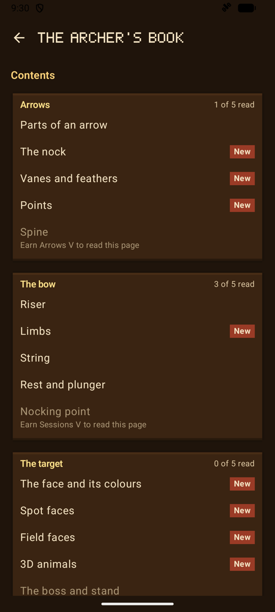
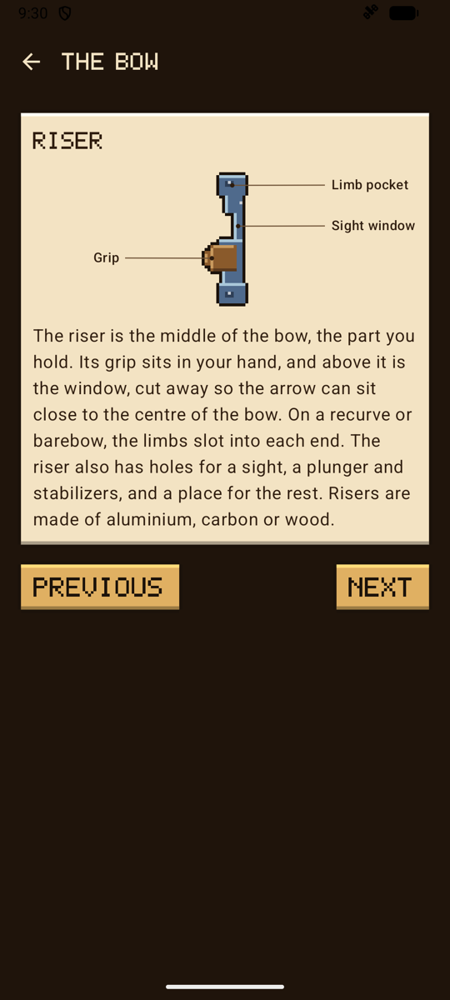

# Education

**Learn the words of archery by shooting.** In game mode, sagitt·AI·re turns practice into a small quest: every
step forward opens a page of **the archer's book**, an illustrated picture dictionary of archery. Children (and
grown-ups) learn what a nock, a riser or a finger tab is because they earned the page that shows it.

This page is for parents, coaches and teachers who want to use the game to help young archers learn. The whole book is also a printable PDF, in four languages: [The archer's book](book.md).

!!! note "The book is a draft"
    The book's 56 pages are still being checked before the app is handed out more widely. It names things and
    explains what they do; it is not a rule book or a coaching manual. For the rules of the sport, see
    [Archery Canada](https://archerycanada.ca/).

## How it works

1. **Turn on game mode:** Settings → Appearance and game → Game (preview). The app becomes a pixel-art game with a
   Norse hall and an archery range. Nothing is lost when you switch back.
2. **Shoot real arrows and record them.** Score each end by hand (no AI needed) or with the AI, then finish the
   session. Only real shooting counts: there is nothing to buy and no way to skip ahead.
3. **Earn badge steps.** Twenty badges climb in steps: arrows shot, sessions finished, Xs, perfect ends, personal
   bests, weeks of practice, distances, places, sight marks, and the kinds of bow and archery tried.
4. **Open the book.** Each step unlocks one page. The book sits on the **lectern** in the hall: new pages are
   marked **New**, and a locked page shows its silhouette and what will open it ("Earn Arrows V to read this page").

<figure markdown>
{ .shot }
<figcaption><b>Contents.</b> New pages are marked; locked ones say what opens them.</figcaption>
</figure>
<figure markdown>
{ .shot }
<figcaption><b>A page:</b> a drawing with its parts named, and a short text.</figcaption>
</figure>

## What a page teaches

Each page has a **drawing with its parts labelled** and **a short text**: what the thing is, what it does, and
sometimes a habit worth keeping. The page about the riser, for example, names the limb pocket, the sight window and
the grip. **Previous** and **Next** turn the pages, and a screen reader reads the text and every label.

The first pages come quickly, so a beginner sees the book fill up from the first evening: finishing one session
opens **Riser**, shooting 100 arrows opens **Parts of an arrow**, shooting at a second distance opens **Indoors and
outdoors**, and practising in four different weeks opens **Warming up**. Later pages take a season or more.

{ width="480" .pixel }

## The 11 chapters { #the-11-chapters }

Each page and the badge step that opens it:

- **Arrows:** Parts of an arrow (Arrows I), The nock (Arrows II), Vanes and feathers (Arrows III), Points (Arrows IV), Spine (Arrows V).
- **The bow:** Riser (Sessions I), Limbs (Sessions II), String (Sessions III), Rest and plunger (Sessions IV), Nocking point (Sessions V).
- **The target:** The face and its colours (Xs I), Spot faces (Xs II), Field faces (Xs III), 3D animals (Xs IV), The boss and stand (Xs V).
- **Aiming:** The sight (Perfect ends I), The clicker (Perfect ends II), Stabilizers (Perfect ends III), Anchor and kisser (Perfect ends IV), String walking and face walking (Perfect ends V).
- **The archer's kit:** Finger tab (Records I), Arm guard (Records II), Chest guard (Records III), Release aid (Records IV), Bow sling (Records V).
- **Care and habits:** Warming up (Weeks I), Rest days (Weeks II), Checking arrows (Weeks III), String wax (Weeks IV), Storing a bow (Weeks V).
- **Out on the range:** Indoors and outdoors (Distances I), Wind (Distances II), Light and shade (Distances III), Uphill and downhill (Distances IV), Judging distance (Distances V).
- **Archers of legend:** Ullr (Places I), Skadi (Places II), Artemis (Places III), Robin Hood (Places IV), Hou Yi (Places V), Ullr’s yew bow (Ullr’s chosen).
- **Tuning:** Sight marks (Sight marks I), Brace height (Sight marks II), Tiller (Sight marks III), Centre shot (Sight marks IV), Bare-shaft tuning (Sight marks V).
- **Kinds of archery:** Field archery (Field), 3D archery (3D), Para archery (All-rounder), Target archery (Wanderer), Archery in Canada (Steady).
- **Bows:** Barebow (Barebow), Recurve (Recurve), Compound (Compound), Longbow (Three bows), Horsebow (Sharpshooter).

## In four languages

The book, its labels and the whole app speak **English, French, German and Spanish**. The app follows the phone's
language; on Android 13 and later, **Settings → Language** sets it for sagitt·AI·re alone. Switching language turns
the book into a small bilingual dictionary: the same drawing, with the words in the other language.

## For parents and coaches

- **Archery comes first.** Children shoot under the eye of a coach or a responsible adult, with the safety rules of
  their club. The app records the practice; it doesn't teach shooting.
- **Real practice, at a healthy pace.** Most badges reward coming back: finishing sessions, practising week after
  week, trying new distances and places. Arrow counts add up over months, not in one evening, and two pages,
  *Warming up* and *Rest days*, are about pacing yourself.
- **No AI needed.** Scoring by hand, by tapping arrows on the photo or the scores, sends nothing anywhere and needs
  no API key. See [Manual scoring](scoring-manual.md).
- **Nothing to buy, nothing shared.** No account, no ads, no tracking. The game sends nothing: the archer's look,
  the decorations and the pages read stay on the phone. See [Privacy](privacy.md).
- **One archer per phone.** The records and the book follow the archer whose sessions they are.
- **Try it first:** *sagitt·AI·re Demo* installs alongside the app with six months of made-up sessions, so you can
  look around the game and open pages before a child starts.
- **Practice and leisure only.** Scores in sagitt·AI·re are never official: in competition, only the official
  scorecards count.

To see every badge, its reward and its page, see [Game mode](game.md#levels-badges-and-trophies).
