# Spielmodus { #game-mode }

sagitt·AI·re lässt sich auch ganz anders nutzen: **dieselbe App als kleines Pixel-Art-Videospiel.** Deine Figur läuft durch eine nordische Halle und über einen Bogenplatz, und jeder Ort öffnet einen Bildschirm. Deine Bögen, Einheiten und Ergebnisse sind genau dieselben wie im Normalmodus, und die Wertungsbildschirme funktionieren gleich.

Schalte ihn ein unter **Einstellungen → Aussehen und Spiel → Spiel (Vorschau)**. **Normal** schaltet jederzeit zurück; dabei geht nichts verloren.

<figure markdown>
{ .shot }
<figcaption><b>Die Halle.</b> Tippe auf einen Ort, und deine Figur geht dorthin.</figcaption>
</figure>
<figure markdown>
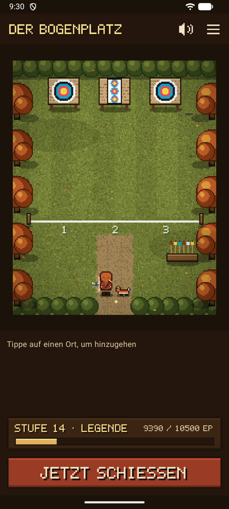{ .shot }
<figcaption><b>Der Bogenplatz.</b> An der Schießlinie beginnt eine Einheit.</figcaption>
</figure>
<figure markdown>
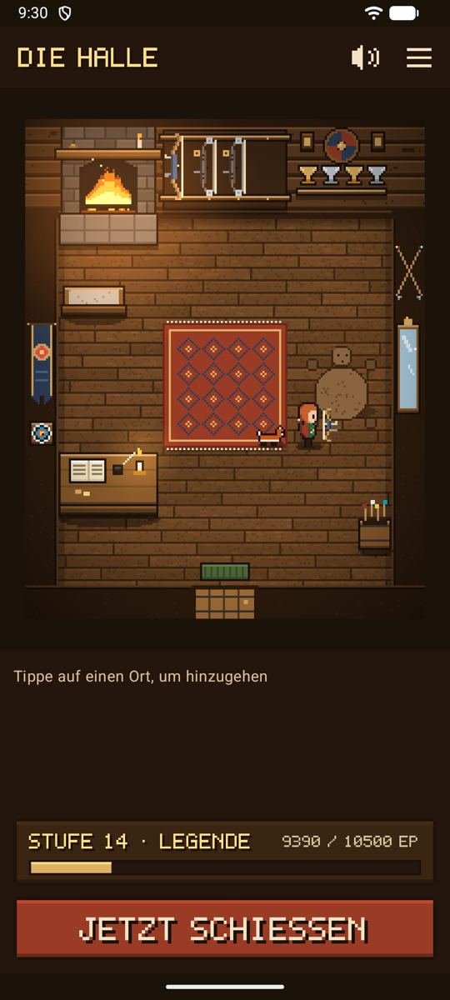{ .shot }
<figcaption><b>Ein Begleiter</b> folgt dir überallhin.</figcaption>
</figure>

## Unterwegs { #getting-around }

- **Tippe auf einen Ort:** Deine Figur geht auf dem kürzesten Weg dorthin, um die Möbel herum, dann öffnet sich der Ort. Sein Name steht darüber und im Feld unten, mit **Los** oder **Öffnen**.
- **Tippe auf den Boden**, um einfach dorthin zu gehen.
- **Orte** (☰, oben rechts) listet jeden Ort in beiden Räumen auf und öffnet ihn sofort, ohne Laufen. Praktisch, wenn du es eilig hast, und einfach mit einem Screenreader zu bedienen.
- **Jetzt schießen**, ganz unten, führt direkt zur Kamera für deine laufende Einheit oder zu einer neuen Einheit. Auf dem Bogenplatz hält dich das Spiel nie auf.
- **Zurück** bringt dich von jedem Bildschirm ins Spiel zurück, genau dorthin, wo deine Figur stand.

| In der Halle | Öffnet |
|-------------|-------|
| **Bogenständer** (deine eigenen Bögen hängen daran, jeder nach seinem Typ gezeichnet: Blankbogen, Recurvebogen mit Visier und Stabilisator, Compoundbogen mit Cams; deine Figur hält denselben Typ) | Deine Bögen |
| **Trophäenwand** | Deine Trophäen: Stufe, Abzeichen und Bestleistungen |
| **Schreibpult** | Einstellungen |
| **Spiegel** | Deine Figur |
| **Feuerstelle** | Deine Statistik, „am Feuer“ |
| **Truhe** | Halle und Bogenplatz [dekorieren](#decorate) |
| **Lesepult** | [Das Buch des Bogenschützen](#the-archers-book) |
| **Tür** | Den Bogenplatz |

| Auf dem Bogenplatz | Öffnet |
|--------------|-------|
| **Schießlinie** | Eine neue Einheit oder die laufende |
| **Scheiben** | Die laufende Einheit (solange eine offen ist, stecken Pfeile in den Scheiben) |
| **Pfeilständer** | Die Passe, die auf deine Prüfung wartet. Ein **!** erscheint über dem Ständer, wenn eine wartet. |
| **Heimweg** | Die Halle |

## Deine Figur { #your-archer }

Geh zum **Spiegel**, um deine Figur einzukleiden. Die Vorschau bleibt oben, während du durch die Auswahl scrollst, und jede Änderung wird sofort gespeichert.

<figure markdown>
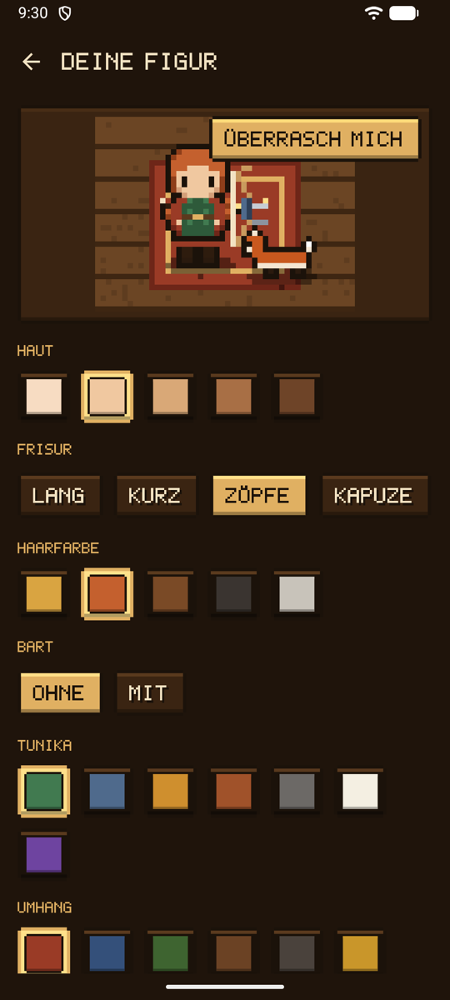{ .shot }
<figcaption><b>Der Spiegel.</b> Auswählen und sofort sehen.</figcaption>
</figure>
<figure markdown>
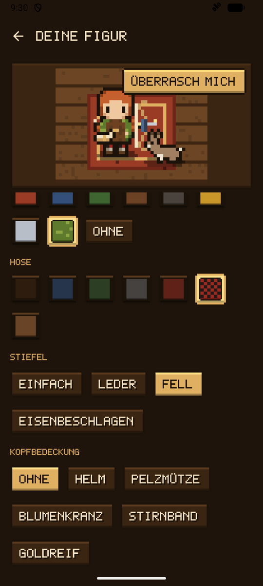{ .shot }
<figcaption><b>Stiefel</b> und Kleidung, die du mit Abzeichen verdienst.</figcaption>
</figure>

| Auswahl | Möglichkeiten |
|--------|---------|
| Haut | Fünf Töne |
| Frisur | Lang, kurz, Zöpfe oder Kapuze, in fünf Farben |
| Bart | Mit oder ohne |
| Tunika, Umhang, Hose | Sechs, fünf und fünf Farben, und auf Wunsch kein Umhang; mehr zum Verdienen (siehe unten) |
| Stiefel | Einfach; Leder-, Fell-, Reit- und eisenbeschlagene Stiefel zum Verdienen |
| Kopfbedeckung | Helm, Pelzmütze, Blumenkranz, Stirnband; mehr zum Verdienen |
| Accessoire | Pelzkragen, Schal, Hammeramulett, Brille; mehr zum Verdienen |

{ width="360" .pixel }

**Kleidung zum Verdienen.** Stufen und Abzeichen schalten mehr frei: einen **Goldreif** (Stufe 3), einen **goldenen Umhang** (Stufe 5) und eine **königspurpurne Tunika** (Stufe 8), und für jede Abzeichenstufe ein Teil: eine Geweihkrone, eine Bommelmütze und eine Wolfsfellkapuze; Bärenfell-, Polarlicht-, Wald- und Reiseumhang; ein Kettenhemd und ein Lederwams; eine karierte Hose und eine Lederhose; ein Kriegshorn, ein Fernrohr, eine Umhängetasche und ein Armschutz; Leder-, Fell-, Reit- und eisenbeschlagene Stiefel. Welches Abzeichen was bringt, steht in den [Abzeichen-Tabellen](#milestones).

{ .pixel }

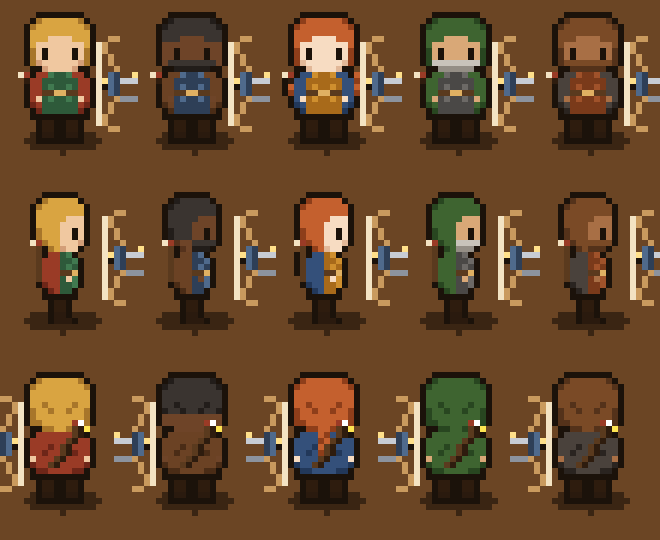{ width="330" .pixel }

**Überrasch mich** wählt ein zufälliges Aussehen aus dem, was du freigeschaltet hast. Deine Figur hält den Typ deines ersten Bogens: Blankbogen, Recurvebogen oder Compoundbogen.

**Bogenlegenden.** Oben am Spiegel stellen vier fertige Figuren mit einem Tippen das ganze Aussehen samt Begleiter ein: **Artemis**, griechische Göttin der Jagd, mit ihrem Jagdhund; **Ullr**, nordischer Gott des Bogenschießens und des Winters, in Pelzen, mit einem Raben; **Robin Hood** in Lincoln-Grün, mit einem Fuchs; und **Hou Yi**, der chinesische Bogenschütze, der neun Sonnen vom Himmel schoss. Danach kannst du jedes Teil ändern.

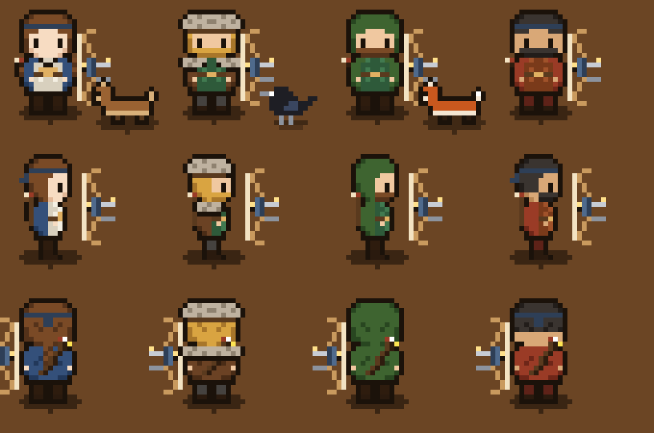{ width="420" .pixel }

## Begleiter { #companions }

Wähle am Spiegel einen Begleiter: von Anfang an einen **Hund**, eine **Katze**, einen **Fuchs** oder einen **Raben**, und noch einen, den du selbst entdecken darfst. Elf weitere kommen mit Abzeichen: eine **Eule**, ein **Sperber**, ein **Hase**, ein **Luchs**, ein **Wolf**, ein **Bärenjunges**, eine **Ziege**, ein **Eichhörnchen**, ein **Biber**, ein **Elchkalb** und ein **Seetaucher**. Dein Begleiter folgt dem Weg, den deine Figur gegangen ist, etwa einen Schritt dahinter, läuft also nie durch die Möbel, und setzt sich neben dich, wenn du stehen bleibst. Die Vierbeiner traben, die Vögel hüpfen, und manche blinzeln oder wedeln mit dem Schwanz.

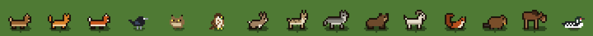{ .pixel }

## Stufen, Abzeichen und Trophäen { #levels-badges-and-trophies }

Nur echtes Schießen bringt etwas ein: **10 Erfahrungspunkte** für jede bestätigte Passe, **30** für jede abgeschlossene Einheit und **50** für jede Abzeichenstufe. Nichts zu kaufen, und nichts nur fürs Öffnen der App. Deine Stufe und ihr Balken stehen unten im Spiel, mit einem Titel, der von **Neuling** über **Schütze**, **Meisterschütze** und **Bogenmeister** bis zur **Legende** wächst.

<figure markdown>
{ .shot }
<figcaption><b>Meilensteine</b>, an der Trophäenwand.</figcaption>
</figure>
<figure markdown>
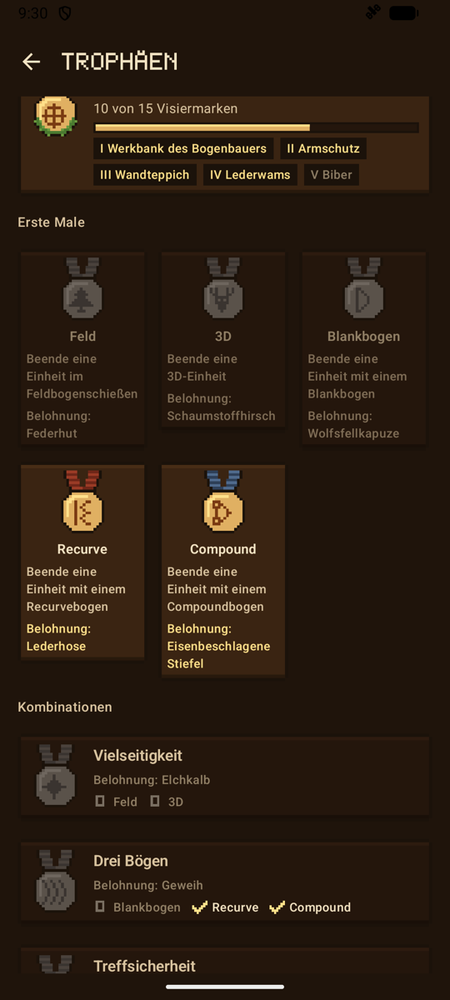{ .shot }
<figcaption><b>Erste Male</b> und <b>Kombinationen</b>, mit dem, was jeweils noch fehlt.</figcaption>
</figure>
<figure markdown>
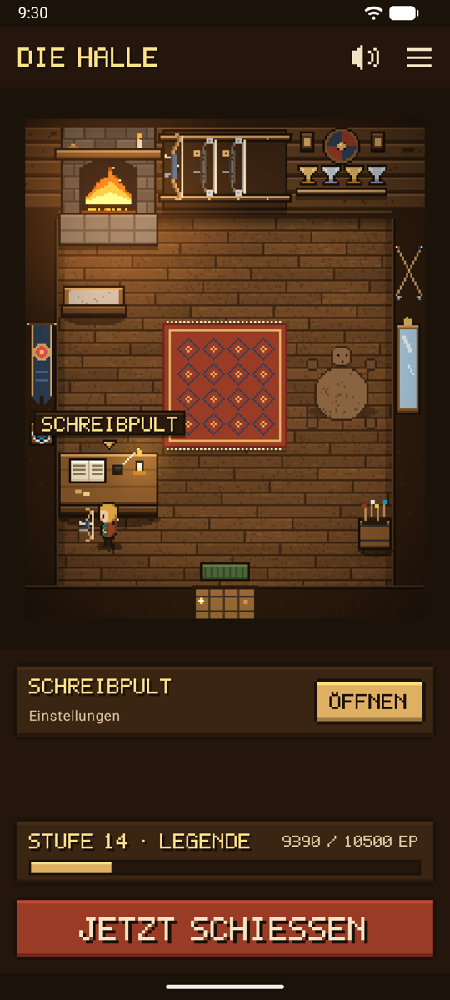{ .shot }
<figcaption>Deine Stufe und ein Pokal für jeden Rekord.</figcaption>
</figure>

Es gibt **20 Abzeichen in drei Gruppen**, golden, sobald verdient, und bis dahin grau. Jede Stufe eines Abzeichens bringt dir **ein Teil** (Kleidung, einen Begleiter oder eine Dekoration) **und eine Seite** im [Buch des Bogenschützen](#the-archers-book): 56 Stufen insgesamt.

- **Meilensteine** steigen in fünf Stufen, I bis V: Bronze, Silber, Gold, Gold mit Lorbeer und Gold mit blauem Edelstein. Die Trophäenwand zeigt, wie weit du bist („4.332 von 5.000 Pfeilen“), und die fünf Stufen mit ihren Teilen.
- **Erste Male** verdienst du einmal: deine erste Einheit im Feldbogenschießen, deine erste 3D-Einheit und deine erste Einheit mit jeder Bogenart.
- **Kombinationen** kommen, wenn du zwei oder drei andere Abzeichen hast; die Trophäenwand hakt ab, was jeweils noch fehlt.

Alles zählt insgesamt, nie pro Tag: 300 Pfeile heute bringen nicht mehr, als nächste Woche wiederzukommen. Wochen zählen, wenn du darin geschossen hast, **ob am Stück oder nicht**: Eine Ruhewoche oder eine Verletzung macht nie etwas kaputt.

### Meilensteine { #milestones }

| Medaille | Abzeichen | So verdienst du es | Belohnung | Buchseite |
|:-:|-------|----------------|--------|-----------|
| 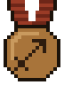{ width="36" .pixel } | **Pfeile I** | Schieße 100 Pfeile | Gekreuzte Pfeile in der Halle | Die Teile eines Pfeils |
| 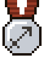{ width="36" .pixel } | **Pfeile II** | Schieße 500 Pfeile | Lederstiefel | Die Nocke |
| 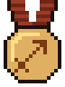{ width="36" .pixel } | **Pfeile III** | Schieße 1.000 Pfeile | Ein Fell neben dem Teppich | Vanes und Federn |
| 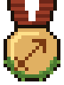{ width="36" .pixel } | **Pfeile IV** | Schieße 2.500 Pfeile | Werkbank des Pfeilmachers | Spitzen |
| { width="36" .pixel } | **Pfeile V** | Schieße 5.000 Pfeile | Sperber | Spine |
| 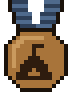{ width="36" .pixel } | **Einheiten I** | Beende 1 Einheit | Köcher | Das Mittelteil |
| 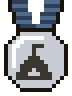{ width="36" .pixel } | **Einheiten II** | Beende 10 Einheiten | Ein Banner in der Halle | Die Wurfarme |
| 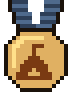{ width="36" .pixel } | **Einheiten III** | Beende 25 Einheiten | Hase | Die Sehne |
| 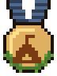{ width="36" .pixel } | **Einheiten IV** | Beende 50 Einheiten | Schildwall | Pfeilauflage und Button |
| 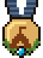{ width="36" .pixel } | **Einheiten V** | Beende 100 Einheiten | Bärenfellumhang | Der Nockpunkt |
| 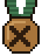{ width="36" .pixel } | **X-Treffer I** | Schieße 1 X | Eine bemalte Scheibe in der Halle | Die Auflage und ihre Farben |
| 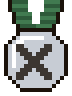{ width="36" .pixel } | **X-Treffer II** | Schieße 10 X | Silberner Umhang | Spot-Auflagen |
| 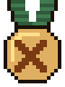{ width="36" .pixel } | **X-Treffer III** | Schieße 50 X | Strohballenscheibe | Feldauflagen |
| 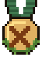{ width="36" .pixel } | **X-Treffer IV** | Schieße 100 X | Trophäe „Goldener Pfeil“ | 3D-Tiere |
| 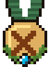{ width="36" .pixel } | **X-Treffer V** | Schieße 250 X | Luchs | Scheibe und Ständer |
| 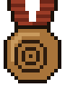{ width="36" .pixel } | **Perfekte Passen I** | Schieße 1 perfekte Passe | Lorbeerkranz | Das Visier |
| 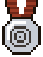{ width="36" .pixel } | **Perfekte Passen II** | Schieße 5 perfekte Passen | Kettenhemd | Der Klicker |
| 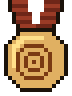{ width="36" .pixel } | **Perfekte Passen III** | Schieße 10 perfekte Passen | Runenwimpel | Stabilisatoren |
| 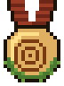{ width="36" .pixel } | **Perfekte Passen IV** | Schieße 25 perfekte Passen | Geweihkrone | Ankerpunkt und Kisser |
| 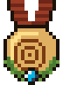{ width="36" .pixel } | **Perfekte Passen V** | Schieße 50 perfekte Passen | Wolf | String-Walking und Face-Walking |
| 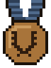{ width="36" .pixel } | **Rekorde I** | Übertriff 1 persönliche Bestleistung | Medaille | Der Tab |
| 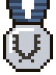{ width="36" .pixel } | **Rekorde II** | Übertriff 3 persönliche Bestleistungen | Kriegshorn | Der Armschutz |
| 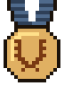{ width="36" .pixel } | **Rekorde III** | Übertriff 10 persönliche Bestleistungen | Runenstein | Der Brustschutz |
| 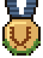{ width="36" .pixel } | **Rekorde IV** | Übertriff 25 persönliche Bestleistungen | Polarlicht-Umhang | Das Release |
| 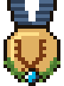{ width="36" .pixel } | **Rekorde V** | Übertriff 50 persönliche Bestleistungen | Bärenjunges | Die Bogenschlinge |
| 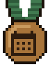{ width="36" .pixel } | **Wochen I** | Schieße in 4 verschiedenen Wochen, ob am Stück oder nicht | Eine Eule als Begleiter | Aufwärmen |
| 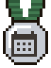{ width="36" .pixel } | **Wochen II** | Schieße in 12 verschiedenen Wochen, ob am Stück oder nicht | Fellstiefel | Ruhetage |
| 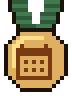{ width="36" .pixel } | **Wochen III** | Schieße in 26 verschiedenen Wochen, ob am Stück oder nicht | Laternenpfähle | Pfeile prüfen |
| 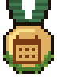{ width="36" .pixel } | **Wochen IV** | Schieße in 52 verschiedenen Wochen, ob am Stück oder nicht | Bommelmütze | Sehnenwachs |
| 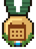{ width="36" .pixel } | **Wochen V** | Schieße in 104 verschiedenen Wochen, ob am Stück oder nicht | Langschiffmodell | Den Bogen aufbewahren |
| 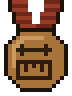{ width="36" .pixel } | **Entfernungen I** | Schieße auf 2 verschiedene Entfernungen | Wandkarte | Halle und draußen |
| 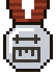{ width="36" .pixel } | **Entfernungen II** | Schieße auf 3 verschiedene Entfernungen | Karierte Hose | Wind |
| 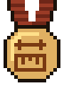{ width="36" .pixel } | **Entfernungen III** | Schieße auf 5 verschiedene Entfernungen | Wetterfahne | Licht und Schatten |
| 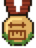{ width="36" .pixel } | **Entfernungen IV** | Schieße auf 7 verschiedene Entfernungen | Fernrohr | Bergauf und bergab |
| 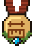{ width="36" .pixel } | **Entfernungen V** | Schieße auf 9 verschiedene Entfernungen | Ziege | Entfernungen schätzen |
| 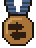{ width="36" .pixel } | **Orte I** | Schieße an 2 verschiedenen Orten | Waldumhang | Ullr |
| 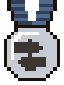{ width="36" .pixel } | **Orte II** | Schieße an 3 verschiedenen Orten | Umhängetasche | Skadi |
| 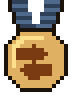{ width="36" .pixel } | **Orte III** | Schieße an 5 verschiedenen Orten | Vogelhaus | Artemis |
| 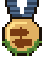{ width="36" .pixel } | **Orte IV** | Schieße an 10 verschiedenen Orten | Reitstiefel | Robin Hood |
| 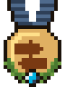{ width="36" .pixel } | **Orte V** | Schieße an 20 verschiedenen Orten | Eichhörnchen | Hou Yi |
| 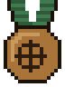{ width="36" .pixel } | **Visiermarken I** | Notiere 1 Visiermarke | Werkbank des Bogenbauers | Visiermarken |
| 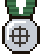{ width="36" .pixel } | **Visiermarken II** | Notiere 3 Visiermarken | Armschutz | Die Standhöhe |
| { width="36" .pixel } | **Visiermarken III** | Notiere 6 Visiermarken | Wandteppich | Der Tiller |
| { width="36" .pixel } | **Visiermarken IV** | Notiere 10 Visiermarken | Lederwams | Center-Shot |
| { width="36" .pixel } | **Visiermarken V** | Notiere 15 Visiermarken | Biber | Blankschaft-Tuning |

Eine **perfekte Passe** ist eine Passe, in der jeder Pfeil den höchsten Wert der Auflage erzielt hat: die 10 (oder das X) auf einer Scheibenauflage, die 6 auf einer Feldauflage, die 11 auf einem 3D-Tier, so wie deine Wertungsregel zählt. **Rekorde** zählen jede Einheit, die alle früheren derselben Runde übertrifft; das erste Mal, dass du eine Runde schießt, ist nie ein Rekord. **Visiermarken** zählen die Marken, die du an deinen Bögen notierst.

### Erste Male { #firsts }

| Medaille | Abzeichen | So verdienst du es | Belohnung | Buchseite |
|:-:|-------|----------------|--------|-----------|
| { width="36" .pixel } | **Feld** | Beende eine Einheit im Feldbogenschießen | Federhut | Feldbogenschießen |
| { width="36" .pixel } | **3D** | Beende eine 3D-Einheit | Schaumstoffhirsch | 3D-Bogenschießen |
| { width="36" .pixel } | **Blankbogen** | Beende eine Einheit mit einem Blankbogen | Wolfsfellkapuze | Der Blankbogen |
| { width="36" .pixel } | **Recurve** | Beende eine Einheit mit einem Recurvebogen | Lederhose | Der Recurvebogen |
| { width="36" .pixel } | **Compound** | Beende eine Einheit mit einem Compoundbogen | Eisenbeschlagene Stiefel | Der Compoundbogen |

Para-Schützen verdienen jedes Abzeichen: Eine Para-Einheit zählt für jeden Meilenstein und für den Bogen, mit dem sie geschossen wurde.

### Kombinationen { #combos }

| Medaille | Abzeichen | Dafür brauchst du | Belohnung | Buchseite |
|:-:|-------|----------------|--------|-----------|
| { width="36" .pixel } | **Vielseitigkeit** | Verdiene Feld und 3D | Elchkalb | Para-Bogenschießen |
| { width="36" .pixel } | **Drei Bögen** | Verdiene Blankbogen, Recurve und Compound | Geweih | Der Langbogen |
| { width="36" .pixel } | **Treffsicherheit** | Verdiene X-Treffer III, Perfekte Passen III und Rekorde II | Seetaucher | Der Reiterbogen |
| { width="36" .pixel } | **Fernweh** | Verdiene Orte III und Entfernungen III | Reiseumhang | Scheibenbogenschießen |
| { width="36" .pixel } | **Beständigkeit** | Verdiene Wochen III und Einheiten III | Bücherregal | Bogenschießen in Kanada |
| { width="36" .pixel } | **Ullrs Gunst** | Bringe alle neun Meilensteine auf V | Ullrs Skier | Ullrs Eibenbogen |

{ width="36" .pixel } Ein noch nicht verdientes Abzeichen bleibt grau. Jede Medaille hat ihr eigenes kleines Bild und eine Farbe für ihre Stufe, daher liest sie sich auf Englisch, Französisch, Deutsch und Spanisch gleich.

{ width="200" .pixel }

### Trophäen, Fanfaren und Neubeginn { #trophies-cheers-and-starting-again }

- **Bestleistungen** für jede Runde (Entfernung, Auflage und Pfeilzahl). Jede stellt einen Pokal auf das Trophäenregal, und die Plaketten leuchten auf, wenn Abzeichen dazukommen. Tippe auf einen Rekord, um seine Einheit zu öffnen.
- Eine neue Stufe oder ein neues Abzeichen wird einmal mit **Fanfare und Banner** verkündet: „Pfeile II · Neu: Lederstiefel“, dann ein zweites Banner für die Seite, „Neue Seite: Die Nocke“. Mehrere auf einmal teilen sich ein Banner. Übertriffst du deine Bestleistung auf einer Runde, die du schon geschossen hast, ertönt das **Kriegshorn**.
- Alles wird aus deinen Einheiten berechnet: Löschst du eine Einheit, verschwindet auch, was sie eingebracht hat.
- **Wenn du schon vor dieser Version gespielt hast,** bleibt alles, was du verdient hattest, ohne Fanfarenflut: Beim ersten Öffnen merkt sich das Spiel still, wo du stehst, und gefeiert wird nur, was danach kommt. Deine Dekorationen bleiben, wo sie waren.
- **Erfahrung und Abzeichen zurücksetzen**, unten bei den Trophäen, beginnt nach einer Rückfrage wieder bei Stufe 1 ohne Abzeichen. Deine Einheiten, Ergebnisse und Bestleistungen bleiben; ab dann bringt dein Schießen wieder Erfahrung und Abzeichen, und die Trophäen zeigen, seit wann. Was du trägst und die platzierten Dekorationen bleiben; in den Listen erscheinen sie wieder als gesperrt. Um auch Einheiten zu löschen, siehe [Speicher und Sicherung](backup.md#erase-data).

## Die Wochenherausforderung { #this-weeks-challenge }

Wenn du [Trainingsziele](normal.md#training-goals) festgelegt hast, zeigt die Trophäenwand die **Wochenherausforderung**: die Pfeile, die du diese Woche schießen willst, mit einem goldenen Balken, und den Schnitt pro Pfeil, den du erreichen willst. Erreichst du das Pfeilziel einer Woche zum ersten Mal, spielt die Halle eine **Fanfare** mit dem Banner **Herausforderung geschafft!**. Ziele bringen keine Erfahrung, deshalb verändert das Ändern eines Ziels nie deinen Fortschritt.

{ .shot width="320" }

## Belohnungen { #rewards }

Was du beim Schießen verdienst, schaltet **Belohnungen** frei. Nichts wird gekauft, und alle anderen Outfits sind von Anfang an frei.

- **Stufen:** ein **Goldreif** (Stufe 3), ein **goldener Umhang** (Stufe 5) und eine **königspurpurne Tunika** (Stufe 8), am Spiegel. Die Trophäenwand listet sie unter **Belohnungen**.
- **Abzeichen:** Jede Stufe bringt ein Teil, an der Trophäenwand bei seinem Abzeichen und in den [Tabellen oben](#milestones): 24 Kleidungsstücke, 11 Begleiter, 14 Dekorationen für die Halle und 7 für den Bogenplatz.

<figure markdown>
{ .shot }
<figcaption><b>Belohnungen</b> für Stufen, an der Trophäenwand.</figcaption>
</figure>
<figure markdown>
{ .shot }
<figcaption><b>Zu verdienen</b>, am Spiegel.</figcaption>
</figure>

Kleidung und Begleiter, die du noch verdienen musst, warten unten am Spiegel unter **Zu verdienen**, jeweils mit dem Abzeichen, das es braucht; sobald du sie verdient hast, erscheinen sie bei den anderen, und **Überrasch mich** kann sie wählen. Nach einem Zurücksetzen bleibt eine Belohnung, die du gerade trägst, an.

## Halle und Bogenplatz dekorieren { #decorate }

Dekorationen, die du verdienst, erscheinen von selbst: Jede hat ihren Platz, und eine neue übernimmt ihn. Um selbst zu wählen, öffne die **Truhe** in der Halle.

<figure markdown>
{ .shot }
<figcaption><b>Dekorieren</b>, über die Truhe.</figcaption>
</figure>
<figure markdown>
{ .shot }
<figcaption>Die Halle, dekoriert.</figcaption>
</figure>

- Reiter **Halle** und **Schießplatz**, oben eine Vorschau des Raums. Die Halle hat **sechs Plätze** (vier an den Wänden, zwei auf dem Boden), der Bogenplatz **vier**.
- Tippe auf einen Platz, um zu wählen: **Automatisch** (die Voreinstellung) zeigt das Teil deiner höchsten Abzeichenstufe, das dorthin gehört; **Leer** lässt ihn frei; oder wähle eine beliebige verdiente Dekoration, die zum Platz passt. Gesperrte Teile stehen auch in der Liste, mit dem Abzeichen, das sie freischaltet.
- Ein Teil kann nur an einem Platz sein: Wählst du es für einen anderen Platz, zieht es dorthin um.
- Die Plätze sind feste Stellen im Raum, wie die Möbel, und deine Figur geht um sie herum.
- Auf dem Bogenplatz bleiben die Dekorationen in jeder Jahreszeit stehen, im Winter mit Schnee darauf.

{ width="288" .pixel } { width="288" .pixel }

## Das Buch des Bogenschützen { #the-archers-book }

Auf dem **Lesepult** in der Halle liegt **das Buch des Bogenschützen**: 56 bebilderte Seiten in 11 Kapiteln, eine Seite für jede Abzeichenstufe. Eine freundliche Art, die Namen der Teile von Bogen und Pfeil zu lernen, dazu die Ausrüstung, das Tuning, die Arten des Bogenschießens und ein paar legendäre Bogenschützen.

<figure markdown>
{ .shot }
<figcaption><b>Inhalt.</b> Neue Seiten sind markiert.</figcaption>
</figure>
<figure markdown>
{ .shot }
<figcaption><b>Eine Seite:</b> eine Zeichnung mit benannten Teilen und ein kurzer Text.</figcaption>
</figure>

- **Kapitel:** Pfeile, Der Bogen, Das Ziel, Zielen, Die Ausrüstung, Pflege und Gewohnheiten, Auf dem Bogenplatz, Legendäre Bogenschützen, Tuning, Arten des Bogenschießens, Bögen.
- **Eine Seite** hat eine Zeichnung mit beschrifteten Teilen und einen kurzen Text. **Vorherige** und **Nächste** blättern um.
- Eine Seite, die du noch nicht geöffnet hast, ist als **Neu** markiert. Eine gesperrte Seite zeigt, was sie freischaltet („Verdiene Pfeile V, um diese Seite zu lesen“).
- Das Buch benennt Dinge und erklärt, wozu sie dienen. Es ist kein Regelwerk: Für die Wettkampfregeln siehe [World Archery](https://www.worldarchery.sport/) oder deinen nationalen Verband.
- Die Seitentexte sind Entwürfe und werden noch geprüft.
- Screenreader lesen den Text und die Beschriftungen jeder Zeichnung vor.
- Für Eltern, Trainer und Lehrkräfte: wie das Buch Kindern hilft, die Wörter des Bogenschießens zu lernen, unter [Lernen](education.md). Das ganze Buch zum Ausdrucken: [Das Buch des Bogenschützen](book.md).

{ width="480" .pixel }

## Jahreszeiten { #seasons }

Der Bogenplatz folgt dem Kalender: Schnee und Nadelbäume im Winter (Dezember bis Februar), Blüten und Wildblumen im Frühling, sattes Grün im Sommer und rote und goldene Bäume mit fallendem Laub im Herbst (September bis November).

## Ton und Musik { #sound-and-music }

Schritte auf dem Holzboden und im Gras, ein kleiner Piepton, wenn du einen Ort wählst, ein Glockenklang, wenn er sich öffnet, das Knarren der Tür, das Knistern des Feuers in der Halle, Wind und Vögel auf dem Bogenplatz und eine leise Lautenmelodie. Alles wurde eigens für sagitt·AI·re gemacht.

- Der Ton läuft mit der **Medien**-Lautstärke des Handys, wie bei anderen Spielen: Lautlos und Vibration schalten Anrufe und Benachrichtigungen stumm, nicht Spiele.
- Der **Lautsprecher-Knopf** oben im Spiel schaltet den Ton aus und wieder an. **Einstellungen → Aussehen und Spiel → Spielgeräusche** und **Musik** schalten beides getrennt aus.
- Der Ton verstummt, sobald die App im Hintergrund ist.

## Jeder Bildschirm im Spiel-Look { #every-screen-in-the-game-look }

Im Spielmodus trägt jeder Bildschirm den Stil des Spiels: dunkles Holz und Gold, Pixelschrift für Titel, Knöpfe und große Ergebnisse, und jedes Ergebnis in der Farbe seines Rings.

<figure markdown>
{ .shot }
<figcaption>Eine Zusammenfassung der Einheit</figcaption>
</figure>
<figure markdown>
{ .shot }
<figcaption>Deine Bögen</figcaption>
</figure>
<figure markdown>
{ .shot }
<figcaption>Einstellungen, nach Thema gruppiert</figcaption>
</figure>

## Datenschutz { #privacy }

Der Spielmodus sendet nichts. Das Aussehen deiner Figur, dein Begleiter, deine Dekorationen, die gelesenen Seiten und deine Toneinstellungen bleiben mit den anderen Einstellungen auf dem Handy. Die Bilder zeichnet die App selbst, und die Klänge sind Teil der App: Nichts wird heruntergeladen, und es kommt keine Berechtigung hinzu.

## Wie es weitergeht { #whats-next }

Der Spielmodus ist eine Vorschau. Was als Nächstes kommt, steht in der [Roadmap](roadmap.md).
