# Modo juego { #game-mode }

sagitt·AI·re tiene una segunda forma de usarse: **la misma app, como un pequeño videojuego de pixel art.** Tu arquero recorre un salón nórdico y un campo de tiro, y cada lugar abre una pantalla. Tus arcos, sesiones y puntuaciones son exactamente los mismos que en el modo normal, y las pantallas de puntuación funcionan igual.

Actívalo en **Ajustes → Apariencia y juego → Juego (vista previa)**. **Normal** vuelve atrás en cualquier momento; en ningún caso se pierde nada.

<figure markdown>
{ .shot }
<figcaption><b>El salón.</b> Toca un lugar y tu arquero camina hasta allí.</figcaption>
</figure>
<figure markdown>
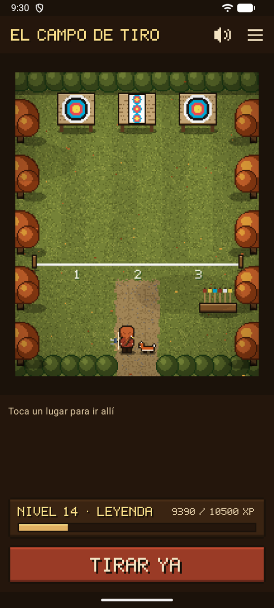{ .shot }
<figcaption><b>El campo de tiro.</b> La línea de tiro empieza una sesión.</figcaption>
</figure>
<figure markdown>
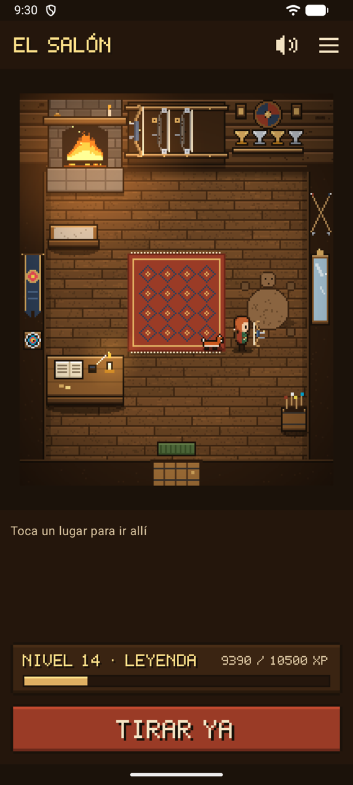{ .shot }
<figcaption><b>Un compañero</b> te sigue a todas partes.</figcaption>
</figure>

## Cómo moverse { #getting-around }

- **Toca un lugar:** tu arquero va hasta allí por el camino más corto, rodeando los muebles, y luego el lugar se abre. Su nombre aparece encima y en el panel de abajo, con **Ir** o **Abrir**.
- **Toca el suelo** para ir simplemente hasta allí.
- **Lugares** (☰, arriba a la derecha) muestra todos los lugares de las dos salas y abre el que elijas al momento, sin caminar. Práctico cuando tienes prisa, y fácil de usar con un lector de pantalla.
- **Tirar ya**, abajo, va directo a la cámara de tu sesión en curso, o a una sesión nueva. El juego nunca te hace perder tiempo en el campo de tiro.
- **Atrás**, desde cualquier pantalla, te devuelve al juego, donde estaba tu arquero.

| En el salón | Abre |
|-------------|-------|
| **Armero de arcos** (en él cuelgan tus propios arcos, cada uno dibujado según su tipo: arco desnudo, recurvo con visor y estabilizador, compuesto con poleas; tu arquero lleva el mismo tipo) | Tus arcos |
| **Muro de trofeos** | Tus trofeos: nivel, insignias y mejores marcas personales |
| **Escritorio** | Ajustes |
| **Espejo** | Tu arquero |
| **Hogar** | Tus estadísticas, «junto al fuego» |
| **Arcón** | [Decorar](#decorate) el salón y el campo de tiro |
| **Atril** | [El libro del arquero](#the-archers-book) |
| **Puerta** | El campo de tiro |

| En el campo de tiro | Abre |
|--------------|-------|
| **Línea de tiro** | Una sesión nueva, o la que está en curso |
| **Dianas** | La sesión en curso (mientras haya una abierta, las flechas se ven en las dianas) |
| **Soporte de flechas** | La tanda que espera tu revisión. Aparece un **!** sobre el soporte cuando hay una esperando. |
| **Camino a casa** | El salón |

## Tu arquero { #your-archer }

Ve al **espejo** para vestir a tu arquero. La vista previa se queda arriba mientras recorres las opciones, y cada cambio se guarda al instante.

<figure markdown>
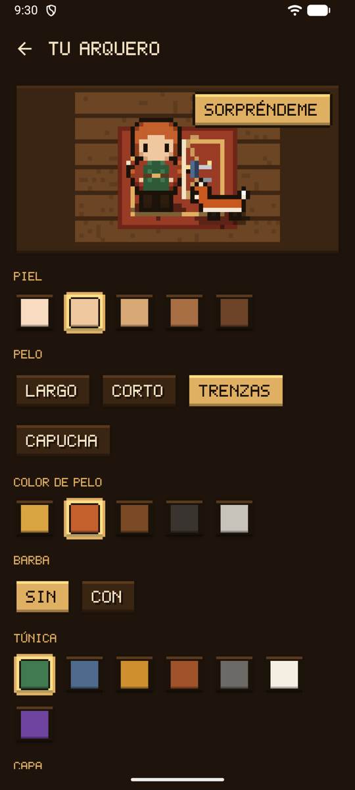{ .shot }
<figcaption><b>El espejo.</b> Elige y míralo al momento.</figcaption>
</figure>
<figure markdown>
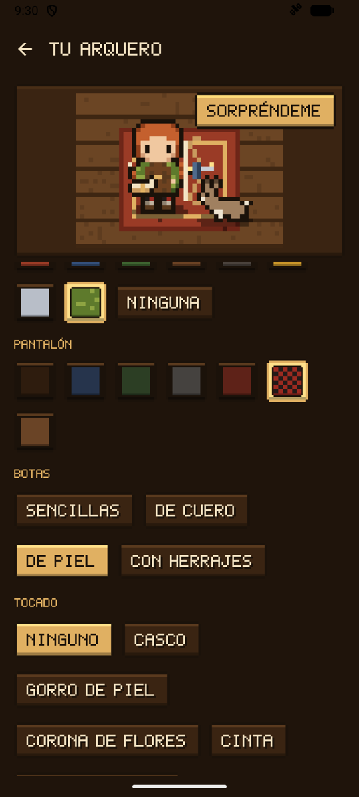{ .shot }
<figcaption><b>Botas</b>, y ropa conseguida con las insignias.</figcaption>
</figure>

| Opción | Posibilidades |
|--------|---------|
| Piel | Cinco tonos |
| Pelo | Largo, corto, trenzas o capucha, en cinco colores |
| Barba | Con o sin |
| Túnica, capa, pantalón | Seis, cinco y cinco colores, y sin capa si lo prefieres; más por conseguir (abajo) |
| Botas | Sencillas; botas de cuero, de piel, de montar y con herrajes por conseguir |
| Tocado | Casco, gorro de piel, corona de flores, cinta; más por conseguir |
| Accesorio | Manto de piel, bufanda, amuleto de martillo, gafas; más por conseguir |

{ width="360" .pixel }

**Ropa por conseguir.** Los niveles y las insignias desbloquean más: una **diadema de oro** (nivel 3), una **capa dorada** (nivel 5) y una **túnica púrpura real** (nivel 8), y una pieza por cada escalón de insignia: una corona de astas, un gorro de lana y una capucha de piel de lobo; capas de piel de oso, de aurora boreal, del bosque y de viajero; una cota de malla y un jubón de cuero; un pantalón de cuadros y uno de cuero; un cuerno de guerra, un catalejo, un morral de viaje y un protector de brazo; botas de cuero, de piel, de montar y con herrajes. Qué insignia da cada cosa está en las [tablas de insignias](#milestones).

{ .pixel }

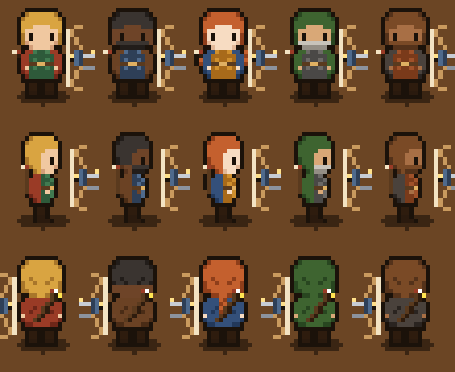{ width="330" .pixel }

**Sorpréndeme** elige un aspecto al azar entre lo que has desbloqueado. Tu arquero lleva el tipo de tu primer arco: arco desnudo, recurvo o compuesto.

**Arqueros legendarios.** En la parte de arriba del espejo, cuatro arqueros ya preparados fijan todo el aspecto y el compañero de un solo toque: **Artemisa**, diosa griega de la caza, con su perro; **Ullr**, dios nórdico del tiro con arco y del invierno, con pieles y un cuervo; **Robin Hood** vestido de verde Lincoln, con un zorro; y **Hou Yi**, el arquero chino que derribó nueve soles. Después puedes cambiar cualquier pieza.

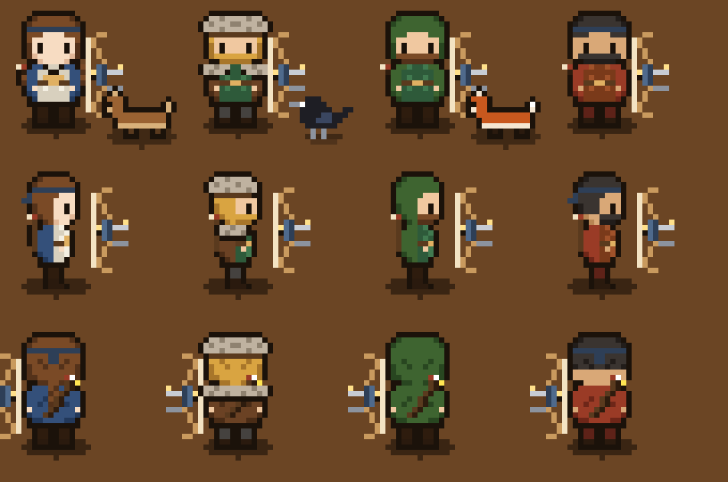{ width="420" .pixel }

## Compañeros { #companions }

Elige un compañero en el espejo: desde el principio, un **perro**, un **gato**, un **zorro** o un **cuervo**, y uno más por descubrir. Otros once llegan con las insignias: un **búho**, un **gavilán**, una **liebre**, un **lince**, un **lobo**, un **osezno**, una **cabra**, una **ardilla roja**, un **castor**, una **cría de alce** y un **colimbo**. Tu compañero sigue el camino que recorrió tu arquero, más o menos un paso por detrás, así que nunca atraviesa los muebles, y se sienta a tu lado cuando te paras. Los de cuatro patas trotan, los pájaros dan saltitos, y algunos parpadean o mueven la cola.

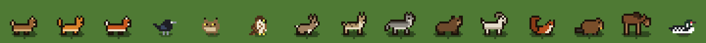{ .pixel }

## Niveles, insignias y trofeos { #levels-badges-and-trophies }

Solo el tiro real da algo: **10 de experiencia** por cada tanda confirmada, **30** por cada sesión terminada y **50** por cada escalón de insignia. Nada que comprar, y nada por solo abrir la app. Tu nivel y su barra se ven en la parte de abajo del juego, con un título que crece de **Aprendiz** a **Arquero**, **Tirador**, **Maestro arquero** y **Leyenda**.

<figure markdown>
{ .shot }
<figcaption><b>Hitos</b>, en el muro de trofeos.</figcaption>
</figure>
<figure markdown>
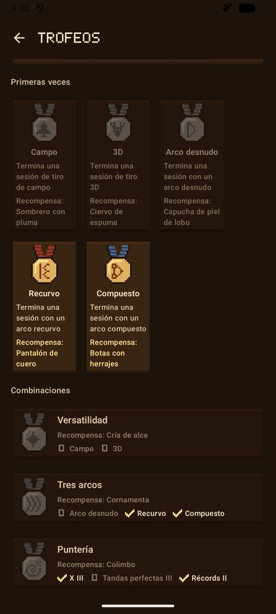{ .shot }
<figcaption><b>Primeras veces</b> y <b>combinaciones</b>, con lo que le falta a cada una.</figcaption>
</figure>
<figure markdown>
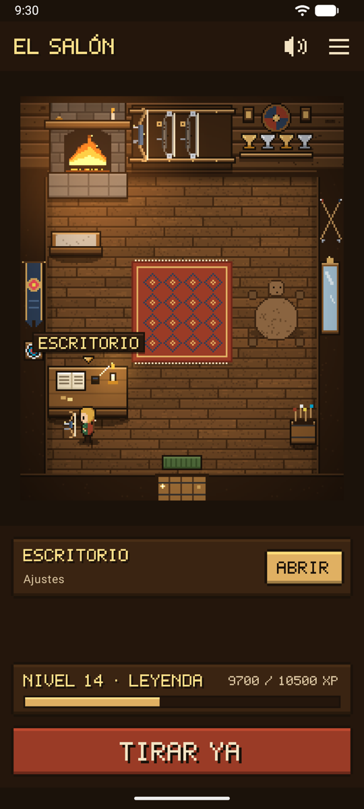{ .shot }
<figcaption>Tu nivel, y una copa por cada récord.</figcaption>
</figure>

Hay **20 insignias en tres grupos**, en oro una vez conseguidas y en gris hasta entonces. Cada escalón de una insignia te da **una pieza** (ropa, un compañero o una decoración) **y una página** de [el libro del arquero](#the-archers-book): 56 escalones en total.

- **Los hitos** suben en cinco escalones, de I a V: bronce, plata, oro, oro con laurel y oro con una gema azul. El muro de trofeos muestra por dónde vas («4.332 de 5.000 flechas») y los cinco escalones con sus piezas.
- **Las primeras veces** se consiguen una sola vez: tu primera sesión de tiro de campo, tu primera sesión 3D y tu primera sesión con cada tipo de arco.
- **Las combinaciones** llegan cuando tienes otras dos o tres insignias; el muro de trofeos marca lo que le falta a cada una.

Todo cuenta en total, nunca por día: 300 flechas hoy no dan más que volver la semana que viene. Las semanas cuentan si tiraste en ellas, **seguidas o no**, así que una semana de descanso o una lesión nunca rompe nada.

### Hitos { #milestones }

| Medalla | Insignia | Cómo conseguirla | Recompensa | Página del libro |
|:-:|-------|----------------|--------|-----------|
| 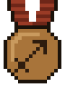{ width="36" .pixel } | **Flechas I** | Tira 100 flechas | Flechas cruzadas en el salón | Partes de una flecha |
| 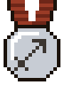{ width="36" .pixel } | **Flechas II** | Tira 500 flechas | Botas de cuero | El culatín |
| 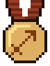{ width="36" .pixel } | **Flechas III** | Tira 1.000 flechas | Una piel junto a la alfombra | Aletas y plumas |
| 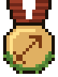{ width="36" .pixel } | **Flechas IV** | Tira 2.500 flechas | Banco del flechero | Puntas |
| { width="36" .pixel } | **Flechas V** | Tira 5.000 flechas | Gavilán | Rigidez (spine) |
| 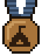{ width="36" .pixel } | **Sesiones I** | Termina 1 sesión | Carcaj | El cuerpo (riser) |
| 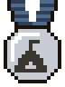{ width="36" .pixel } | **Sesiones II** | Termina 10 sesiones | Un estandarte en el salón | Las palas |
| 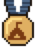{ width="36" .pixel } | **Sesiones III** | Termina 25 sesiones | Liebre | La cuerda |
| 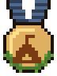{ width="36" .pixel } | **Sesiones IV** | Termina 50 sesiones | Muro de escudos | Reposaflechas y botón de presión |
| 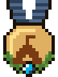{ width="36" .pixel } | **Sesiones V** | Termina 100 sesiones | Capa de piel de oso | El punto de enfulque |
| 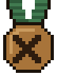{ width="36" .pixel } | **X I** | Tira 1 X | Una diana pintada en el salón | La diana y sus colores |
| 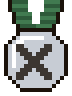{ width="36" .pixel } | **X II** | Tira 10 X | Capa plateada | Dianas de spot |
| 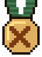{ width="36" .pixel } | **X III** | Tira 50 X | Parapeto de pacas de paja | Dianas de campo |
| 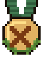{ width="36" .pixel } | **X IV** | Tira 100 X | Trofeo de la flecha dorada | Animales 3D |
| 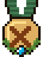{ width="36" .pixel } | **X V** | Tira 250 X | Lince | El parapeto y el caballete |
| 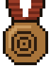{ width="36" .pixel } | **Tandas perfectas I** | Tira 1 tanda perfecta | Corona de laurel | El visor |
| 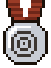{ width="36" .pixel } | **Tandas perfectas II** | Tira 5 tandas perfectas | Cota de malla | El clicker |
| 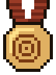{ width="36" .pixel } | **Tandas perfectas III** | Tira 10 tandas perfectas | Banderines rúnicos | Estabilizadores |
| 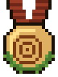{ width="36" .pixel } | **Tandas perfectas IV** | Tira 25 tandas perfectas | Corona de astas | Anclaje y kisser |
| 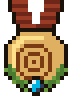{ width="36" .pixel } | **Tandas perfectas V** | Tira 50 tandas perfectas | Lobo | String walking y face walking |
| 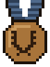{ width="36" .pixel } | **Récords I** | Supera 1 mejor marca personal | Medalla | La dactilera |
| 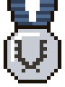{ width="36" .pixel } | **Récords II** | Supera 3 mejores marcas personales | Cuerno de guerra | El protector de brazo |
| 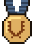{ width="36" .pixel } | **Récords III** | Supera 10 mejores marcas personales | Piedra rúnica | El protector de pecho |
| 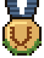{ width="36" .pixel } | **Récords IV** | Supera 25 mejores marcas personales | Capa de aurora boreal | El disparador |
| 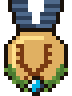{ width="36" .pixel } | **Récords V** | Supera 50 mejores marcas personales | Osezno | La dragonera |
| 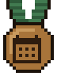{ width="36" .pixel } | **Semanas I** | Tira en 4 semanas distintas, seguidas o no | Un búho como compañero | El calentamiento |
| 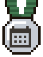{ width="36" .pixel } | **Semanas II** | Tira en 12 semanas distintas, seguidas o no | Botas de piel | Días de descanso |
| 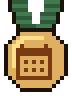{ width="36" .pixel } | **Semanas III** | Tira en 26 semanas distintas, seguidas o no | Postes con faroles | Revisar las flechas |
| 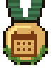{ width="36" .pixel } | **Semanas IV** | Tira en 52 semanas distintas, seguidas o no | Gorro de lana | Cera para cuerda |
| 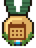{ width="36" .pixel } | **Semanas V** | Tira en 104 semanas distintas, seguidas o no | Maqueta de barco vikingo | Guardar el arco |
| 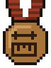{ width="36" .pixel } | **Distancias I** | Tira a 2 distancias distintas | Mapa en la pared | En sala y al aire libre |
| 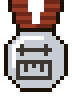{ width="36" .pixel } | **Distancias II** | Tira a 3 distancias distintas | Pantalón de cuadros | El viento |
| 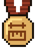{ width="36" .pixel } | **Distancias III** | Tira a 5 distancias distintas | Veleta | Luz y sombra |
| 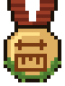{ width="36" .pixel } | **Distancias IV** | Tira a 7 distancias distintas | Catalejo | Cuesta arriba y cuesta abajo |
| 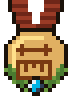{ width="36" .pixel } | **Distancias V** | Tira a 9 distancias distintas | Cabra | Calcular la distancia |
| 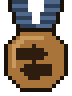{ width="36" .pixel } | **Lugares I** | Tira en 2 lugares distintos | Capa del bosque | Ullr |
| 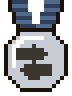{ width="36" .pixel } | **Lugares II** | Tira en 3 lugares distintos | Morral de viaje | Skadi |
| 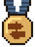{ width="36" .pixel } | **Lugares III** | Tira en 5 lugares distintos | Casita para pájaros | Artemisa |
| 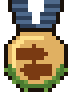{ width="36" .pixel } | **Lugares IV** | Tira en 10 lugares distintos | Botas de montar | Robin Hood |
| 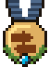{ width="36" .pixel } | **Lugares V** | Tira en 20 lugares distintos | Ardilla roja | Hou Yi |
| 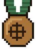{ width="36" .pixel } | **Marcas de visor I** | Anota 1 marca de visor | Banco del artesano de arcos | Marcas de visor |
| 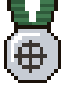{ width="36" .pixel } | **Marcas de visor II** | Anota 3 marcas de visor | Protector de brazo | El fistmele |
| { width="36" .pixel } | **Marcas de visor III** | Anota 6 marcas de visor | Tapiz | El tiller |
| { width="36" .pixel } | **Marcas de visor IV** | Anota 10 marcas de visor | Jubón de cuero | El centrado |
| { width="36" .pixel } | **Marcas de visor V** | Anota 15 marcas de visor | Castor | Ajuste con flechas sin emplumar |

Una **tanda perfecta** es una tanda en la que cada flecha marcó el valor más alto de la diana: el 10 (o la X) en una diana de blanco, el 6 en una diana de campo, el 11 en un animal 3D, según cuente tu regla de puntuación. Los **récords** cuentan cada sesión que supera a todas las anteriores de su tirada; la primera vez que tiras una tirada nunca es un récord. Las **marcas de visor** cuentan las marcas que anotas en tus arcos.

### Primeras veces { #firsts }

| Medalla | Insignia | Cómo conseguirla | Recompensa | Página del libro |
|:-:|-------|----------------|--------|-----------|
| { width="36" .pixel } | **Campo** | Termina una sesión de tiro de campo | Sombrero con pluma | Tiro de campo |
| { width="36" .pixel } | **3D** | Termina una sesión de tiro 3D | Ciervo de espuma | Tiro 3D |
| { width="36" .pixel } | **Arco desnudo** | Termina una sesión con un arco desnudo | Capucha de piel de lobo | El arco desnudo |
| { width="36" .pixel } | **Recurvo** | Termina una sesión con un arco recurvo | Pantalón de cuero | El arco recurvo |
| { width="36" .pixel } | **Compuesto** | Termina una sesión con un arco compuesto | Botas con herrajes | El arco compuesto |

Los arqueros de tiro adaptado consiguen todas las insignias: una sesión de tiro adaptado cuenta para cada hito y para el arco con el que se tiró.

### Combinaciones { #combos }

| Medalla | Insignia | Necesita | Recompensa | Página del libro |
|:-:|-------|----------------|--------|-----------|
| { width="36" .pixel } | **Versatilidad** | Consigue Campo y 3D | Cría de alce | Tiro con arco adaptado |
| { width="36" .pixel } | **Tres arcos** | Consigue Arco desnudo, Recurvo y Compuesto | Cornamenta | El arco largo |
| { width="36" .pixel } | **Puntería** | Consigue X III, Tandas perfectas III y Récords II | Colimbo | El arco ecuestre |
| { width="36" .pixel } | **Trotamundos** | Consigue Lugares III y Distancias III | Capa de viajero | Tiro a diana |
| { width="36" .pixel } | **Constancia** | Consigue Semanas III y Sesiones III | Estantería | El tiro con arco en Canadá |
| { width="36" .pixel } | **El favor de Ullr** | Lleva los nueve hitos hasta V | Esquís de Ullr | El arco de tejo de Ullr |

{ width="36" .pixel } Una insignia que aún no has conseguido se queda en gris. Cada medalla tiene su propio dibujo y un color para su escalón, así que se lee igual en inglés, francés, alemán y español.

{ width="200" .pixel }

### Trofeos, fanfarrias y volver a empezar { #trophies-cheers-and-starting-again }

- **Mejores marcas personales** para cada tirada (distancia, diana y número de flechas). Cada una pone una copa en la repisa de trofeos, y las placas se iluminan a medida que llegan las insignias. Toca un récord para abrir su sesión.
- Un nuevo nivel o una nueva insignia se anuncia con una **fanfarria y un estandarte**, una sola vez: «Flechas II · Nuevo: Botas de cuero», y después un segundo estandarte para la página, «Nueva página: El culatín». Si llegan varias a la vez, comparten un estandarte. Superar tu mejor marca personal en una tirada que ya has tirado antes hace sonar el **cuerno de guerra**.
- Todo se calcula a partir de tus sesiones: si eliminas una sesión, lo que ganó se va con ella.
- **Si ya jugabas antes de esta versión,** lo que habías conseguido se mantiene, sin una lluvia de fanfarrias: la primera vez que abres el juego, anota en silencio por dónde vas, y solo se celebra lo que venga después. Tus decoraciones se quedan donde estaban.
- **Reiniciar experiencia e insignias**, al final de los trofeos, vuelve a empezar en el nivel 1 sin insignias, después de preguntarte. Tus sesiones, puntuaciones y mejores marcas personales se quedan; a partir de entonces, lo que tires vuelve a dar experiencia e insignias, y los trofeos indican desde cuándo. Lo que llevas puesto y las decoraciones colocadas se quedan; en las listas vuelven a aparecer como bloqueadas. Para borrar también las sesiones, consulta [Almacenamiento y copia de seguridad](backup.md#erase-data).

## Reto de la semana { #this-weeks-challenge }

Con [objetivos de entrenamiento](normal.md#training-goals) fijados, el muro de trofeos muestra el **Reto de la semana**: las flechas que tirar esta semana, con una barra dorada, y la media por flecha a alcanzar. La primera vez que cumples el objetivo de flechas en una semana, el salón toca una **fanfarria** con un estandarte **¡Reto cumplido!**. Los objetivos no dan experiencia, así que cambiar uno nunca reescribe tu progreso.

{ .shot width="320" }

## Recompensas { #rewards }

Lo que ganas tirando desbloquea **recompensas**. No se compra nada, y todos los demás atuendos son gratis desde el principio.

- **Niveles:** una **diadema de oro** (nivel 3), una **capa dorada** (nivel 5) y una **túnica púrpura real** (nivel 8), en el espejo. El muro de trofeos las muestra en **Recompensas**.
- **Insignias:** cada escalón da una pieza, que aparece junto a su insignia en el muro de trofeos y en las [tablas de arriba](#milestones): 24 prendas, 11 compañeros, 14 decoraciones para el salón y 7 para el campo de tiro.

<figure markdown>
{ .shot }
<figcaption><b>Recompensas</b> por nivel, en el muro de trofeos.</figcaption>
</figure>
<figure markdown>
{ .shot }
<figcaption><b>Por conseguir</b>, en el espejo.</figcaption>
</figure>

La ropa y los compañeros aún por conseguir esperan al final del espejo, en **Por conseguir**, cada uno con la insignia que necesita; una vez conseguidos, aparecen con los demás y **Sorpréndeme** puede elegirlos. Después de un reinicio, la recompensa que llevas puesta se queda.

## Decorar el salón y el campo de tiro { #decorate }

Las decoraciones que consigues aparecen solas: cada una tiene su sitio, y una nueva lo ocupa. Para elegir tú, abre el **arcón** del salón.

<figure markdown>
{ .shot }
<figcaption><b>Decorar</b>, desde el arcón.</figcaption>
</figure>
<figure markdown>
{ .shot }
<figcaption>El salón, decorado.</figcaption>
</figure>

- Pestañas **Salón** y **Campo de tiro**, con una vista previa de la sala arriba. El salón tiene **seis sitios** (cuatro en las paredes y dos en el suelo), el campo de tiro **cuatro**.
- Toca un sitio para elegir: **Auto** (lo predeterminado) muestra la pieza de tu escalón de insignia más alto que va en ese sitio; **Vacío** lo deja libre; o elige cualquier decoración conseguida que encaje en el sitio. Las piezas aún bloqueadas también aparecen, con la insignia que las desbloquea.
- Una pieza solo puede estar en un sitio: si la eliges para otro, se cambia allí.
- Los sitios son lugares fijos de la sala, como los muebles, y tu arquero los rodea.
- En el campo de tiro, las decoraciones se quedan en todas las estaciones, con nieve encima en invierno.

{ width="288" .pixel } { width="288" .pixel }

## El libro del arquero { #the-archers-book }

El **atril** del salón sostiene **el libro del arquero**: 56 páginas ilustradas en 11 capítulos, una página por cada escalón de insignia. Es una forma amable de aprender los nombres de las partes de un arco y de una flecha, el equipo, el ajuste, las modalidades y algunos arqueros de leyenda.

<figure markdown>
{ .shot }
<figcaption><b>El índice.</b> Las páginas nuevas están marcadas.</figcaption>
</figure>
<figure markdown>
{ .shot }
<figcaption><b>Una página:</b> un dibujo con sus partes nombradas y un texto corto.</figcaption>
</figure>

- **Capítulos:** Flechas, El arco, La diana, Apuntar, El equipo del arquero, Cuidados y hábitos, En el campo de tiro, Arqueros de leyenda, Ajuste, Modalidades, Arcos.
- **Una página** tiene un dibujo con sus partes nombradas y un texto corto. **Anterior** y **Siguiente** pasan las páginas.
- Una página que aún no has abierto está marcada como **Nueva**. Una página bloqueada indica qué la desbloquea («Consigue Flechas V para leer esta página»).
- El libro nombra las cosas y explica para qué sirven. No es un reglamento: para las reglas de competición, consulta [World Archery](https://www.worldarchery.sport/) o tu federación nacional.
- Los textos de las páginas son borradores que aún se están revisando.
- Los lectores de pantalla leen el texto y los nombres de cada dibujo.
- Para familias, entrenadores y docentes: cómo el libro ayuda a los niños a aprender las palabras del tiro con arco, en [Educación](education.md). El libro completo, para imprimir: [El libro del arquero](book.md).

{ width="480" .pixel }

## Estaciones { #seasons }

El campo de tiro sigue el calendario: nieve y árboles de hoja perenne en invierno (de diciembre a febrero), flores en los árboles y flores silvestres en primavera, verde en verano, y árboles rojos y dorados con hojas que caen en otoño (de septiembre a noviembre).

## Sonido y música { #sound-and-music }

Pasos sobre el suelo de madera y sobre la hierba, un pequeño pitido cuando eliges un lugar, un tintineo cuando se abre, el crujido de la puerta, el chisporroteo del fuego en el salón, viento y pájaros en el campo de tiro, y una tranquila melodía de laúd. Todo se ha hecho para sagitt·AI·re.

- El sonido suena al volumen **multimedia** del teléfono, como otros juegos: los modos silencio y vibración silencian llamadas y notificaciones, no los juegos.
- El **botón del altavoz**, en la parte de arriba del juego, desactiva y activa el sonido. **Ajustes → Apariencia y juego → Sonido del juego** y **Música** los desactivan por separado.
- El sonido se detiene en cuanto la app pasa a segundo plano.

## Todas las pantallas con el aspecto del juego { #every-screen-in-the-game-look }

En el modo juego, todas las pantallas llevan el estilo del juego: madera oscura y oro, letras de píxeles para los títulos, los botones y las puntuaciones grandes, y cada puntuación en el color de su zona.

<figure markdown>
{ .shot }
<figcaption>Un resumen de sesión</figcaption>
</figure>
<figure markdown>
{ .shot }
<figcaption>Tus arcos</figcaption>
</figure>
<figure markdown>
{ .shot }
<figcaption>Ajustes, agrupados por tema</figcaption>
</figure>

## Privacidad { #privacy }

El modo juego no envía nada. El aspecto de tu arquero, tu compañero, tus decoraciones, las páginas leídas y tus ajustes de sonido se guardan en el teléfono con los demás ajustes. Los dibujos los hace la app y los sonidos forman parte de ella: no se descarga nada y no se añade ningún permiso.

## Próximamente { #whats-next }

El modo juego es una vista previa. Consulta la [hoja de ruta](roadmap.md) para ver lo que viene.
