# Modo juego { #game-mode }

sagitt·AI·re tiene una segunda forma de usarse: **la misma app, como un pequeño videojuego de pixel art.** Tu arquero recorre un salón nórdico y un campo de tiro, y cada lugar abre una pantalla. Tus arcos, sesiones y puntuaciones son exactamente los mismos que en el modo normal, y las pantallas de puntuación funcionan igual.

Actívalo en **Ajustes → Apariencia y juego → Juego (vista previa)**. **Normal** vuelve atrás en cualquier momento; en ningún caso se pierde nada.

<figure markdown>
{ .shot }
<figcaption><b>El salón.</b> Toca un lugar y tu arquero camina hasta allí.</figcaption>
</figure>
<figure markdown>
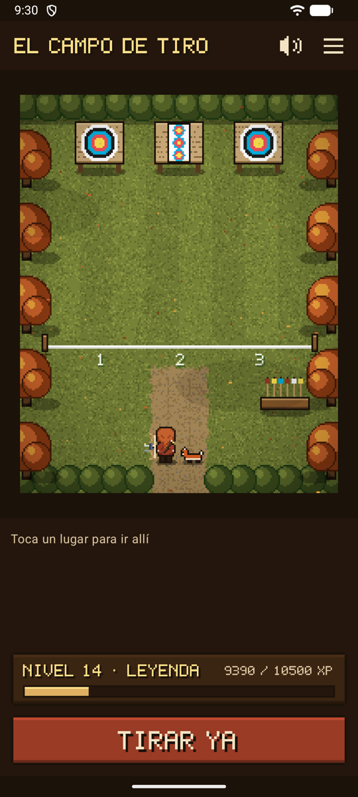{ .shot }
<figcaption><b>El campo de tiro.</b> La línea de tiro empieza una sesión.</figcaption>
</figure>
<figure markdown>
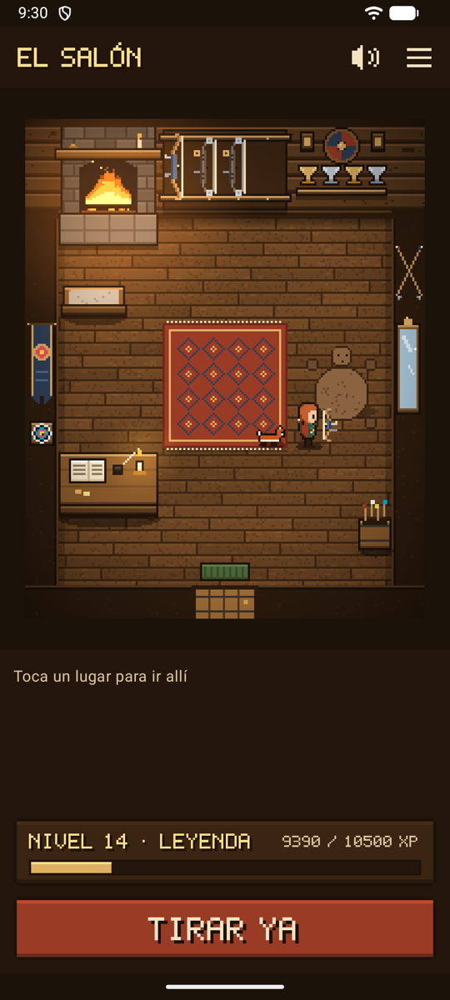{ .shot }
<figcaption><b>Un compañero</b> te sigue a todas partes.</figcaption>
</figure>

## Cómo moverse { #getting-around }

- **Toca un lugar:** tu arquero va hasta allí por el camino más corto, rodeando los muebles, y luego el lugar se abre. Su nombre aparece encima y en el panel de abajo, con **Ir** o **Abrir**.
- **Toca el suelo** para ir simplemente hasta allí.
- **Lugares** (☰, arriba a la derecha) muestra todos los lugares de las dos salas y abre el que elijas al momento, sin caminar. Práctico cuando tienes prisa, y fácil de usar con un lector de pantalla.
- **Tirar ya**, abajo, va directo a la cámara de tu sesión en curso, o a una sesión nueva. El juego nunca te hace perder tiempo en el campo de tiro.
- **Atrás**, desde cualquier pantalla, te devuelve al juego, donde estaba tu arquero.

| En el salón | Abre |
|-------------|-------|
| **Armero de arcos** (en él cuelgan tus propios arcos, cada uno dibujado según su tipo: arco desnudo, recurvo con visor y estabilizador, compuesto con poleas; tu arquero lleva el mismo tipo) | Tus arcos |
| **Muro de trofeos** | Tus trofeos: nivel, insignias y mejores marcas personales |
| **Escritorio** | Ajustes |
| **Espejo** | Tu arquero |
| **Hogar** | Tus estadísticas, «junto al fuego» |
| **Puerta** | El campo de tiro |

| En el campo de tiro | Abre |
|--------------|-------|
| **Línea de tiro** | Una sesión nueva, o la que está en curso |
| **Dianas** | La sesión en curso (mientras haya una abierta, las flechas se ven en las dianas) |
| **Soporte de flechas** | La tanda que espera tu revisión. Aparece un **!** sobre el soporte cuando hay una esperando. |
| **Camino a casa** | El salón |

## Tu arquero { #your-archer }

Ve al **espejo** para vestir a tu arquero. La vista previa se queda arriba mientras recorres las opciones, y cada cambio se guarda al instante.

<figure markdown>
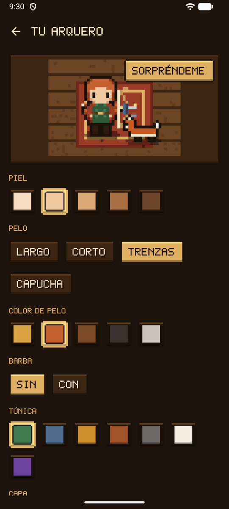{ .shot }
<figcaption><b>El espejo.</b> Elige y míralo al momento.</figcaption>
</figure>
<figure markdown>
{ width="360" .pixel }
<figcaption><b>Atuendos</b>, dibujados desde todos los lados.</figcaption>
</figure>

| Opción | Posibilidades |
|--------|---------|
| Piel | Cinco tonos |
| Pelo | Largo, corto, trenzas o capucha, en cinco colores |
| Barba | Con o sin |
| Túnica, capa, pantalón | Seis, cinco y cinco colores, y sin capa si lo prefieres; una **túnica púrpura real** (nivel 8), una **capa dorada** (nivel 5) y una **capa plateada** (insignia *Diez X*) por conseguir |
| Tocado | Casco, gorro de piel, corona de flores, cinta; una **diadema de oro** (nivel 3), una **corona de laurel** (insignia *Tanda perfecta*) y un **sombrero con pluma** (insignia *Explorador*) por conseguir |
| Accesorio | Manto de piel, bufanda, amuleto de martillo, gafas; un **carcaj** (insignia *Primera tanda*) y una **medalla** (insignia *Nuevo récord*) por conseguir |

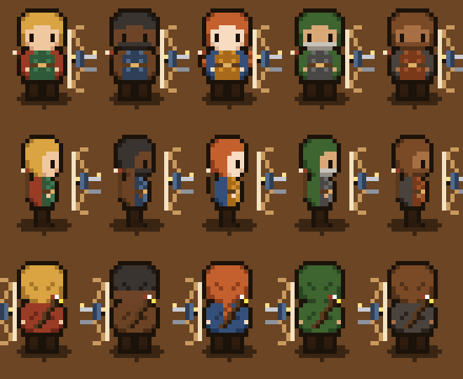{ width="330" .pixel }

**Sorpréndeme** elige un aspecto al azar. Tu arquero lleva el tipo de tu primer arco: arco desnudo, recurvo o compuesto.

**Arqueros legendarios.** En la parte de arriba del espejo, cuatro arqueros ya preparados fijan todo el aspecto y el compañero de un solo toque: **Artemisa**, diosa griega de la caza, con su perro; **Ullr**, dios nórdico del tiro con arco y del invierno, con pieles y un cuervo; **Robin Hood** vestido de verde Lincoln, con un zorro; y **Hou Yi**, el arquero chino que derribó nueve soles. Después puedes cambiar cualquier pieza.

{ width="420" .pixel }

## Compañeros { #companions }

Elige un compañero en el espejo: un **perro**, un **gato**, un **zorro** o un **cuervo**, un **búho** cuando hayas tirado cuatro semanas seguidas, y uno más por descubrir. Sigue el camino que recorrió tu arquero, más o menos un paso por detrás, así que nunca atraviesa los muebles, y se sienta a tu lado cuando te paras. El perro, el gato y el zorro trotan y mueven la cola, el cuervo da saltitos, y el búho da saltitos y parpadea con sus grandes ojos.

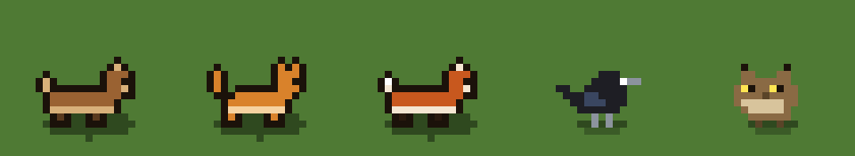{ width="420" .pixel }

## Niveles, insignias y trofeos { #levels-badges-and-trophies }

Solo el tiro real da algo: **10 de experiencia** por cada tanda confirmada, **30** por cada sesión terminada y **50** por cada insignia. Nada que comprar, y nada por solo abrir la app. Tu nivel y su barra se ven en la parte de abajo del juego, con un título que crece de **Aprendiz** a **Arquero**, **Tirador**, **Maestro arquero** y **Leyenda**.

<figure markdown>
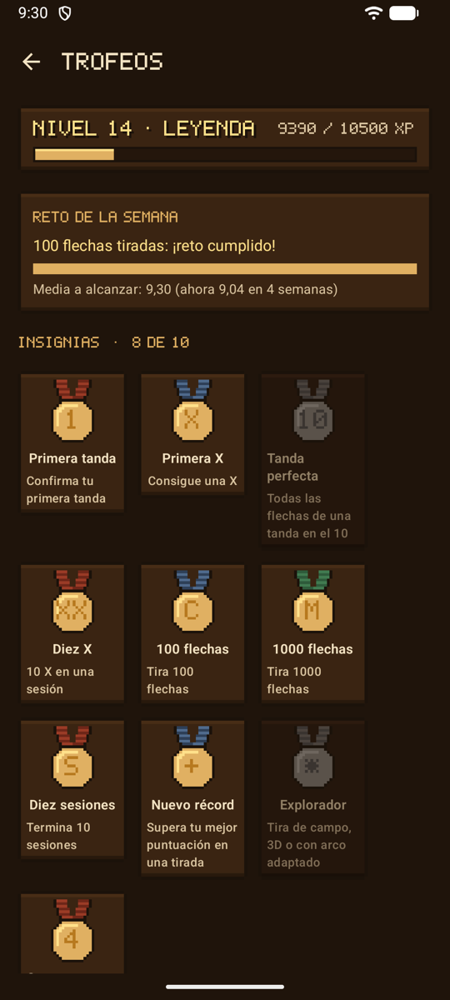{ .shot }
<figcaption><b>Trofeos</b>, en el muro de trofeos.</figcaption>
</figure>
<figure markdown>
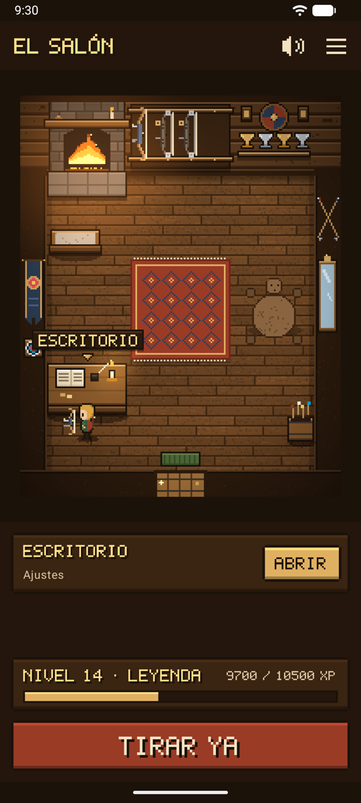{ .shot }
<figcaption>Tu nivel, y una copa por cada récord.</figcaption>
</figure>

- **Diez insignias** por hitos reales, en oro una vez conseguidas y en gris hasta entonces. Cada una da además una [recompensa](#rewards):

| Medalla | Insignia | Cómo conseguirla | Recompensa |
|:-:|-------|----------------|--------|
| 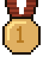{ width="36" .pixel } | **Primera tanda** | Confirma tu primera tanda | Carcaj |
| 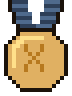{ width="36" .pixel } | **Primera X** | Consigue una X | Diana pintada en el salón |
| 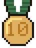{ width="36" .pixel } | **Tanda perfecta** | Todas las flechas de una tanda en el 10 | Corona de laurel |
| 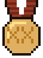{ width="36" .pixel } | **Diez X** | 10 X en una sesión | Capa plateada |
| 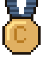{ width="36" .pixel } | **100 flechas** | Tira 100 flechas | Flechas cruzadas en el salón |
| 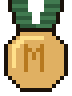{ width="36" .pixel } | **1000 flechas** | Tira 1000 flechas | Piel junto a la alfombra |
| 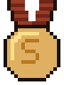{ width="36" .pixel } | **Diez sesiones** | Termina 10 sesiones | Estandarte en el salón |
| 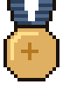{ width="36" .pixel } | **Nuevo récord** | Supera tu mejor puntuación en una tirada | Medalla |
| 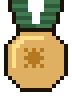{ width="36" .pixel } | **Explorador** | Tira de campo, 3D o con arco adaptado | Sombrero con pluma |
| 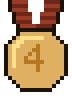{ width="36" .pixel } | **Cuatro semanas** | Tira cuatro semanas seguidas | Búho como compañero |

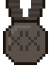{ width="36" .pixel } Una medalla que aún no has conseguido se queda en gris. La marca de cada medalla (números, números romanos) se lee igual en inglés, francés, alemán y español.

- **Mejores marcas personales** para cada tirada (distancia, diana y número de flechas). Cada una pone una copa en la repisa de trofeos, y las placas se iluminan a medida que llegan las insignias. Toca un récord para abrir su sesión.
- Un nuevo nivel o una nueva insignia se anuncia con una **fanfarria y un estandarte**, una sola vez. Superar tu mejor marca personal en una tirada que ya has tirado antes hace sonar el **cuerno de guerra**.
- Todo se calcula a partir de tus sesiones: si eliminas una sesión, lo que ganó se va con ella.
- **Reiniciar experiencia e insignias**, al final de los trofeos, vuelve a empezar en el nivel 1 sin insignias, después de preguntarte. Tus sesiones, puntuaciones y mejores marcas personales se quedan; a partir de entonces, lo que tires vuelve a dar experiencia e insignias, y los trofeos indican desde cuándo. Para borrar también las sesiones, consulta [Almacenamiento y copia de seguridad](backup.md#erase-data).

## Reto de la semana { #this-weeks-challenge }

Con [objetivos de entrenamiento](normal.md#training-goals) fijados, el muro de trofeos muestra el **Reto de la semana**: las flechas que tirar esta semana, con una barra dorada, y la media por flecha a alcanzar. La primera vez que cumples el objetivo de flechas en una semana, el salón toca una **fanfarria** con un estandarte **¡Reto cumplido!**. Los objetivos no dan experiencia, así que cambiar uno nunca reescribe tu progreso.

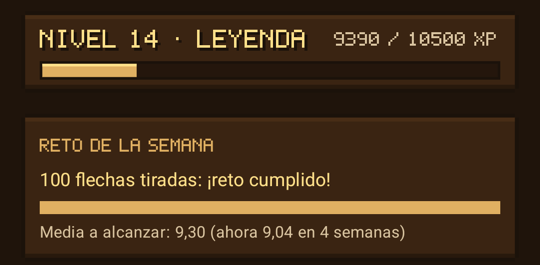{ .shot width="320" }

## Recompensas { #rewards }

Lo que ganas tirando desbloquea **recompensas**, que aparecen en el muro de trofeos. No se compra nada, y todos los demás atuendos son gratis desde el principio.

| Recompensa | Cómo conseguirla |
|--------|----------------|
| **Diadema de oro**, en el espejo | Alcanza el nivel 3 |
| **Capa dorada**, en el espejo | Alcanza el nivel 5 |
| **Túnica púrpura real**, en el espejo | Alcanza el nivel 8 |
| **Carcaj**, en el espejo | Consigue la insignia *Primera tanda* |
| **Una diana pintada en el salón**, en la pared izquierda | Consigue la insignia *Primera X* |
| **Corona de laurel**, en el espejo | Consigue la insignia *Tanda perfecta* |
| **Capa plateada**, en el espejo | Consigue la insignia *Diez X* |
| **Flechas cruzadas en el salón**, encima del espejo | Consigue la insignia *100 flechas* |
| **Una piel junto a la alfombra** | Consigue la insignia *1000 flechas* |
| **Un estandarte en el salón**, en la pared izquierda | Consigue la insignia *Diez sesiones* |
| **Medalla**, en el espejo | Consigue la insignia *Nuevo récord* |
| **Sombrero con pluma**, en el espejo | Consigue la insignia *Explorador* |
| **Búho**, un compañero en el espejo | Consigue la insignia *Cuatro semanas* |

<figure markdown>
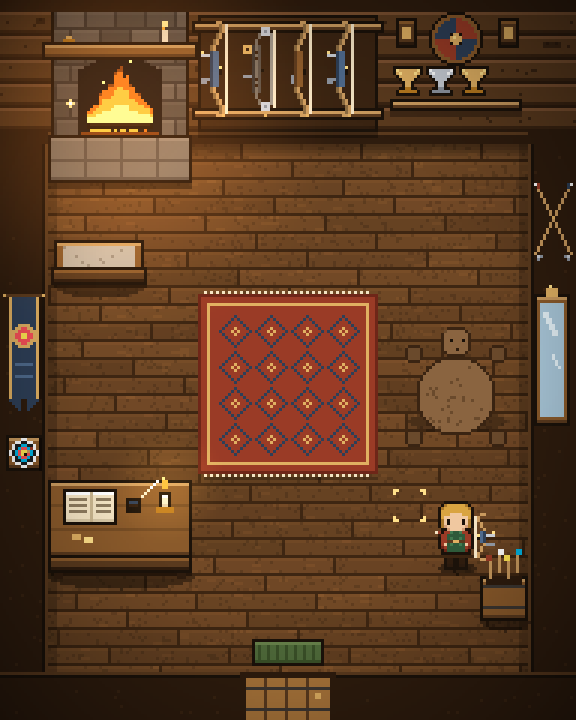{ .shot }
<figcaption>Todas las decoraciones, conseguidas.</figcaption>
</figure>
<figure markdown>
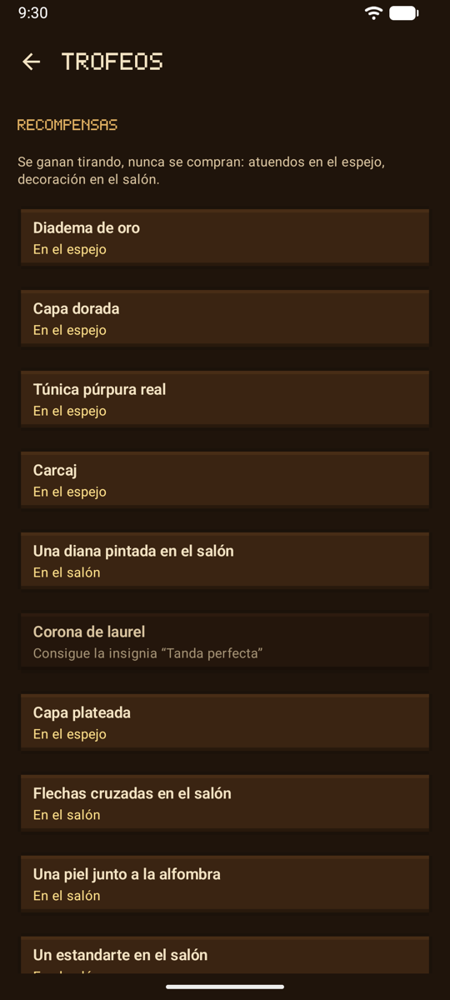{ .shot }
<figcaption><b>Recompensas</b>, en el muro de trofeos.</figcaption>
</figure>
<figure markdown>
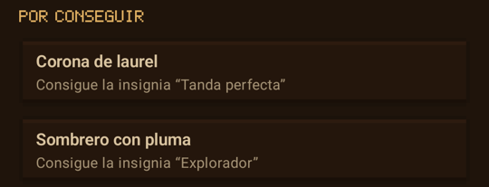{ .shot }
<figcaption><b>Por conseguir</b>, en el espejo.</figcaption>
</figure>

Los atuendos aún por conseguir esperan al final del espejo, en **Por conseguir**; una vez conseguidos, aparecen con los demás y **Sorpréndeme** puede elegirlos. Después de un reinicio, la recompensa que llevas puesta se queda.

## Estaciones { #seasons }

El campo de tiro sigue el calendario: nieve y árboles de hoja perenne en invierno (de diciembre a febrero), flores en los árboles y flores silvestres en primavera, verde en verano, y árboles rojos y dorados con hojas que caen en otoño (de septiembre a noviembre).

## Sonido y música { #sound-and-music }

Pasos sobre el suelo de madera y sobre la hierba, un pequeño pitido cuando eliges un lugar, un tintineo cuando se abre, el crujido de la puerta, el chisporroteo del fuego en el salón, viento y pájaros en el campo de tiro, y una tranquila melodía de laúd. Todo se ha hecho para sagitt·AI·re.

- El sonido suena al volumen **multimedia** del teléfono, como otros juegos: los modos silencio y vibración silencian llamadas y notificaciones, no los juegos.
- El **botón del altavoz**, en la parte de arriba del juego, desactiva y activa el sonido. **Ajustes → Apariencia y juego → Sonido del juego** y **Música** los desactivan por separado.
- El sonido se detiene en cuanto la app pasa a segundo plano.

## Todas las pantallas con el aspecto del juego { #every-screen-in-the-game-look }

En el modo juego, todas las pantallas llevan el estilo del juego: madera oscura y oro, letras de píxeles para los títulos, los botones y las puntuaciones grandes, y cada puntuación en el color de su zona.

<figure markdown>
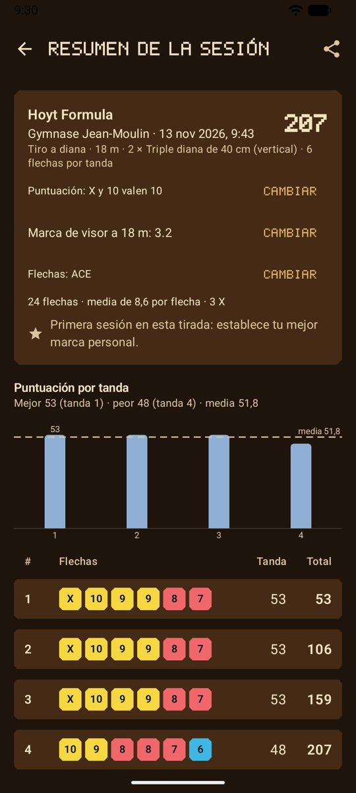{ .shot }
<figcaption>Un resumen de sesión</figcaption>
</figure>
<figure markdown>
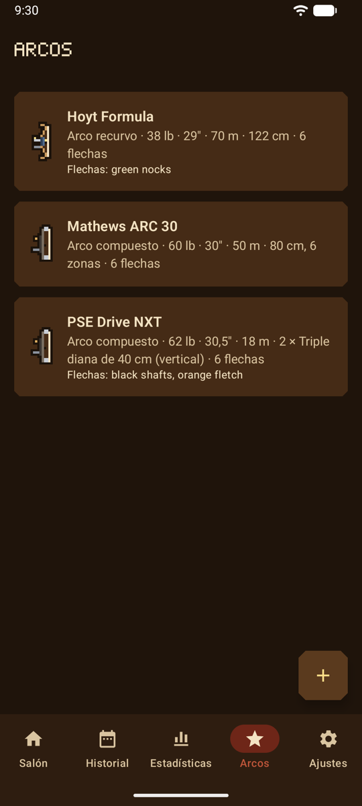{ .shot }
<figcaption>Tus arcos</figcaption>
</figure>
<figure markdown>
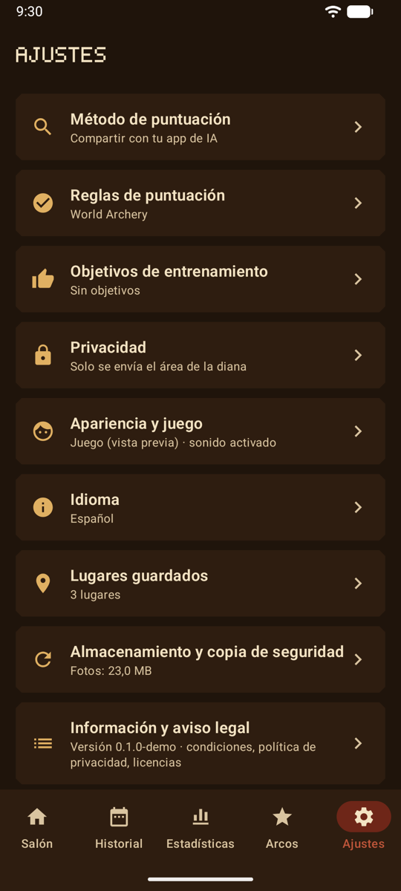{ .shot }
<figcaption>Ajustes, agrupados por tema</figcaption>
</figure>

## Privacidad { #privacy }

El modo juego no envía nada. El aspecto de tu arquero, tu compañero y tus ajustes de sonido se guardan en el teléfono con los demás ajustes. Los dibujos los hace la app y los sonidos forman parte de ella: no se descarga nada y no se añade ningún permiso.

## Próximamente { #whats-next }

El modo juego es una vista previa. Consulta la [hoja de ruta](roadmap.md) para ver lo que viene.
