# Mode jeu { #game-mode }

sagitt·AI·re s’utilise aussi autrement : **la même application, en petit jeu vidéo en pixel art.** Votre archer se promène dans une maison nordique et sur un pas de tir, et chaque endroit ouvre un écran. Vos arcs, vos séances et vos scores sont exactement les mêmes qu’en mode normal, et les écrans de comptage fonctionnent de la même façon.

Activez-le dans **Réglages → Apparence et jeu → Jeu (aperçu)**. **Normal** revient en arrière à tout moment, sans rien perdre.

<figure markdown>
{ .shot }
<figcaption><b>La maison.</b> Touchez un endroit et votre archer s’y rend.</figcaption>
</figure>
<figure markdown>
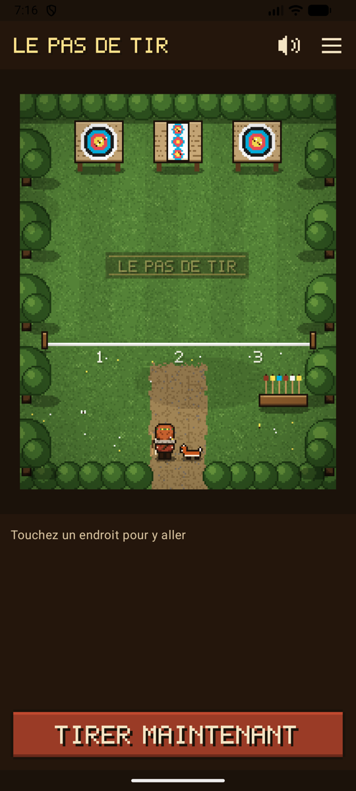{ .shot }
<figcaption><b>Le pas de tir.</b> La ligne de tir commence une séance.</figcaption>
</figure>
<figure markdown>
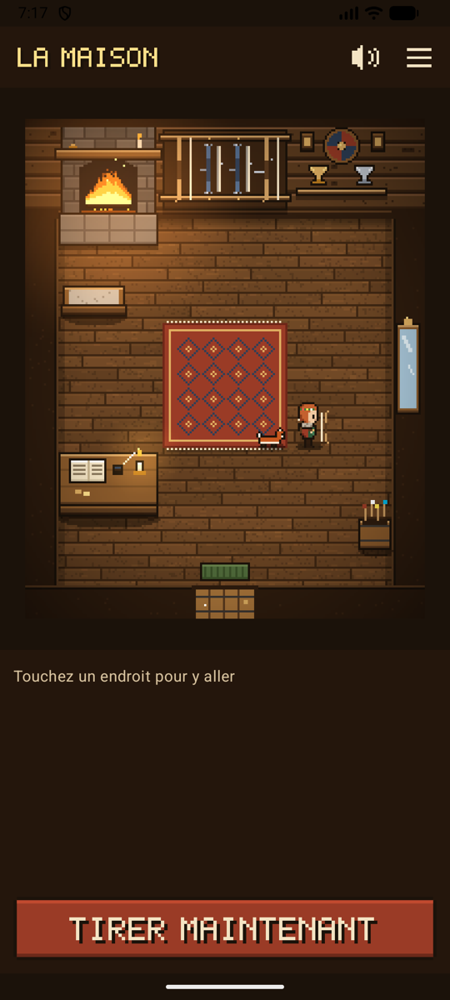{ .shot }
<figcaption><b>Un compagnon</b> vous suit partout.</figcaption>
</figure>

## Se déplacer { #getting-around }

- **Touchez un endroit :** votre archer s’y rend par le plus court chemin, en contournant les meubles, puis l’endroit s’ouvre. Son nom s’affiche au-dessus et dans le panneau du bas, avec **Y aller** ou **Ouvrir**.
- **Touchez le plancher** pour simplement y marcher.
- **Endroits** (☰, en haut à droite) liste tous les endroits des deux pièces et les ouvre directement, sans marcher. Pratique quand on est pressé, et facile avec un lecteur d’écran.
- **Tirer maintenant**, en bas, ouvre directement l’appareil photo de votre séance en cours, ou une nouvelle séance. Le jeu ne vous ralentit jamais au pas de tir.
- **Retour**, depuis n’importe quel écran, vous ramène au jeu, là où se tenait votre archer.

| Dans la maison | Ouvre |
|----------------|-------|
| **Râtelier à arcs** (vos propres arcs y sont accrochés, chacun dessiné selon son type : arc nu, arc recourbé avec viseur et stabilisateur, arc à poulies avec ses cames ; votre archer tient le même type) | Vos arcs |
| **Mur des trophées** | Vos trophées : niveau, insignes et records personnels |
| **Bureau** | Les réglages |
| **Miroir** | Votre archer |
| **Âtre** | Vos statistiques, « au coin du feu » |
| **Coffre** | [Décorer](#decorate) la maison et le pas de tir |
| **Lutrin** | [Le livre de l’archer](#the-archers-book) |
| **Porte** | Le pas de tir |

| Sur le pas de tir | Ouvre |
|-------------------|-------|
| **Ligne de tir** | Une nouvelle séance, ou celle en cours |
| **Cibles** | La séance en cours (pendant une séance, des flèches sont plantées dans les cibles) |
| **Porte-flèches** | La volée qui attend votre vérification. Un **!** apparaît au-dessus quand une volée attend. |
| **Chemin de la maison** | La maison |

## Votre archer { #your-archer }

Rendez-vous au **miroir** pour habiller votre archer. L’aperçu reste en haut pendant que vous faites défiler les choix, et chaque changement est enregistré aussitôt.

<figure markdown>
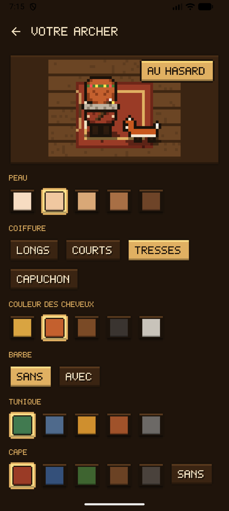{ .shot }
<figcaption><b>Le miroir.</b> Choisissez, et voyez le résultat tout de suite.</figcaption>
</figure>
<figure markdown>
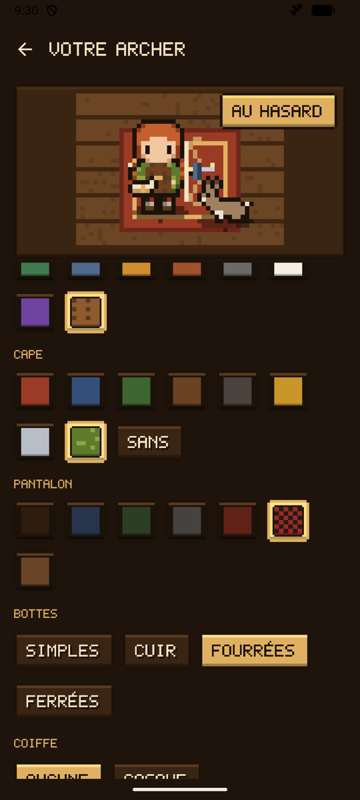{ .shot }
<figcaption><b>Les bottes</b>, et des tenues gagnées avec les insignes.</figcaption>
</figure>

| Choix | Options |
|-------|---------|
| Peau | Cinq teintes |
| Cheveux | Longs, courts, tresses ou capuchon, en cinq couleurs |
| Barbe | Avec ou sans |
| Tunique, cape, pantalon | Six, cinq et cinq couleurs, et pas de cape si vous préférez ; d’autres à gagner (plus bas) |
| Bottes | Simples ; des bottes de cuir, fourrées, de cavalier et ferrées à gagner |
| Coiffe | Casque, toque de fourrure, couronne de fleurs, bandeau ; d’autres à gagner |
| Accessoire | Mantelet de fourrure, écharpe, amulette marteau, lunettes ; d’autres à gagner |

{ width="360" .pixel }

**Les tenues à gagner.** Les niveaux et les insignes en débloquent d’autres : un **diadème d’or** (niveau 3), une **cape dorée** (niveau 5) et une **tunique pourpre royale** (niveau 8), et un objet à chaque étape d’insigne : une couronne de bois de cerf, une tuque et une capuche en peau de loup ; des capes en peau d’ours, aurore boréale, de la forêt et de voyageur ; une cotte de mailles et un pourpoint de cuir ; un pantalon à carreaux et un pantalon de cuir ; un cor de guerre, une longue-vue, une besace de voyage et un protège-bras ; des bottes de cuir, fourrées, de cavalier et ferrées. Quel insigne donne quoi : voir les [tableaux des insignes](#milestones).

{ .pixel }

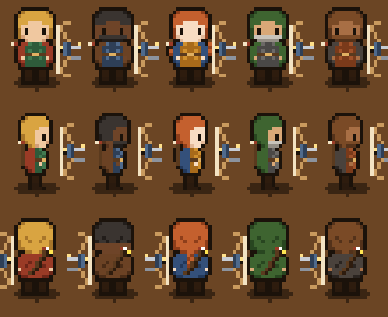{ width="330" .pixel }

**Au hasard** choisit une apparence au hasard parmi ce que vous avez débloqué. Votre archer tient le type de votre premier arc : arc nu, arc recourbé ou arc à poulies.

**Archers légendaires.** En haut du miroir, quatre archers tout prêts règlent toute l’apparence et le compagnon en une touche : **Artémis**, déesse grecque de la chasse, avec son chien ; **Ullr**, dieu nordique du tir à l’arc et de l’hiver, en fourrures, avec un corbeau ; **Robin des Bois**, tout en vert, avec un renard ; et **Hou Yi**, l’archer chinois qui abattit neuf soleils. Changez ensuite ce que vous voulez.

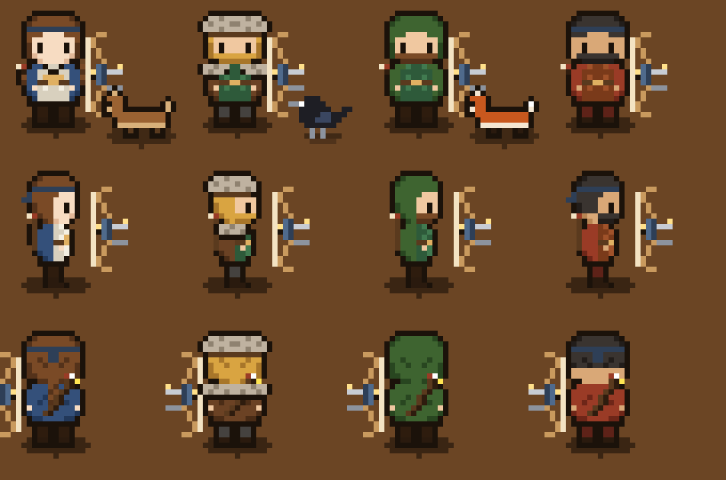{ width="420" .pixel }

## Les compagnons { #companions }

Choisissez un compagnon au miroir : un **chien**, un **chat**, un **renard** ou un **corbeau** dès le départ, et un autre à découvrir. Onze autres viennent avec les insignes : un **hibou**, un **épervier**, un **lièvre**, un **lynx**, un **loup**, un **ourson**, une **chèvre**, un **écureuil roux**, un **castor**, un **jeune orignal** et un **huard**. Votre compagnon suit le chemin parcouru par votre archer, environ un pas derrière, sans jamais traverser les meubles, et s’assoit à côté de vous quand vous vous arrêtez. Les animaux à quatre pattes trottinent, les oiseaux sautillent, et certains clignent des yeux ou remuent la queue.

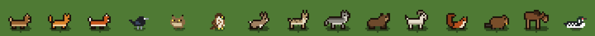{ .pixel }

## Niveaux, insignes et trophées { #levels-badges-and-trophies }

Seul le vrai tir rapporte : **10 points d’expérience** par volée confirmée, **30** par séance terminée et **50** par étape d’insigne. Rien à acheter, et rien pour simplement ouvrir l’application. Votre niveau et sa barre s’affichent en bas du jeu, avec un titre qui passe de **Novice** à **Archer**, **Tireur d’élite**, **Maître archer** et **Légende**.

<figure markdown>
{ .shot }
<figcaption><b>Les jalons</b>, au mur des trophées.</figcaption>
</figure>
<figure markdown>
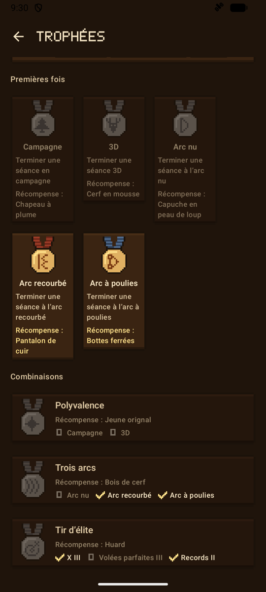{ .shot }
<figcaption><b>Premières fois</b> et <b>combinaisons</b>, avec ce qu’il manque à chacune.</figcaption>
</figure>
<figure markdown>
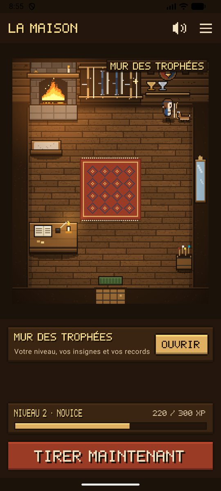{ .shot }
<figcaption>Votre niveau, et une coupe par record.</figcaption>
</figure>

Il y a **20 insignes en trois groupes**, en or une fois gagnés, en gris d’ici là. Chaque étape d’un insigne vous donne **un objet** (une tenue, un compagnon ou une décoration) **et une page** du [livre de l’archer](#the-archers-book) : 56 étapes en tout.

- **Les jalons** montent en cinq étapes, de I à V : bronze, argent, or, or avec un laurier, et or avec une gemme bleue. Le mur des trophées montre où vous en êtes (« 4 332 sur 5 000 flèches ») et les cinq étapes avec leurs objets.
- **Les premières fois** se gagnent une seule fois : votre première séance en campagne, votre première séance 3D, et votre première séance avec chaque sorte d’arc.
- **Les combinaisons** arrivent quand vous avez deux ou trois autres insignes ; le mur des trophées coche ce qu’il manque à chacune.

Tout se compte au total, jamais par jour : 300 flèches aujourd’hui ne rapportent pas plus que revenir la semaine prochaine. Les semaines comptent quand vous y avez tiré, **à la suite ou non** : une semaine de repos ou une blessure ne casse jamais rien.

### Jalons { #milestones }

| Médaille | Insigne | Comment l’obtenir | Récompense | Page du livre |
|:-:|-------|----------------|--------|-----------|
| 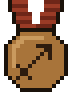{ width="36" .pixel } | **Flèches I** | Tirer 100 flèches | Des flèches croisées dans la maison | Les parties d’une flèche |
| 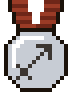{ width="36" .pixel } | **Flèches II** | Tirer 500 flèches | Bottes de cuir | L’encoche |
| 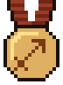{ width="36" .pixel } | **Flèches III** | Tirer 1 000 flèches | Une peau de bête près du tapis | Empennes et plumes |
| 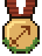{ width="36" .pixel } | **Flèches IV** | Tirer 2 500 flèches | Établi d’empenneur | Les pointes |
| { width="36" .pixel } | **Flèches V** | Tirer 5 000 flèches | Épervier | Le spine |
| { width="36" .pixel } | **Séances I** | Terminer 1 séance | Carquois | La poignée |
| { width="36" .pixel } | **Séances II** | Terminer 10 séances | Une bannière dans la maison | Les branches |
| { width="36" .pixel } | **Séances III** | Terminer 25 séances | Lièvre | La corde |
| { width="36" .pixel } | **Séances IV** | Terminer 50 séances | Mur de boucliers | Repose-flèche et berger button |
| { width="36" .pixel } | **Séances V** | Terminer 100 séances | Cape en peau d’ours | Le point d’encochage |
| 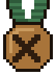{ width="36" .pixel } | **X I** | Tirer 1 X | Une cible peinte dans la maison | Le blason et ses couleurs |
| 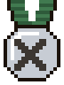{ width="36" .pixel } | **X II** | Tirer 10 X | Cape argentée | Les blasons spot |
| 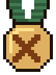{ width="36" .pixel } | **X III** | Tirer 50 X | Butte en bottes de paille | Les blasons de campagne |
| 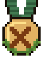{ width="36" .pixel } | **X IV** | Tirer 100 X | Trophée de la flèche d’or | Les animaux 3D |
| 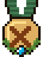{ width="36" .pixel } | **X V** | Tirer 250 X | Lynx | La butte et le chevalet |
| 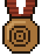{ width="36" .pixel } | **Volées parfaites I** | Tirer 1 volée parfaite | Couronne de laurier | Le viseur |
| 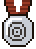{ width="36" .pixel } | **Volées parfaites II** | Tirer 5 volées parfaites | Cotte de mailles | Le clicker |
| 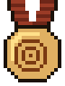{ width="36" .pixel } | **Volées parfaites III** | Tirer 10 volées parfaites | Fanions runiques | Les stabilisateurs |
| 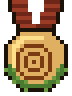{ width="36" .pixel } | **Volées parfaites IV** | Tirer 25 volées parfaites | Couronne de bois de cerf | Ancrage et kisser |
| 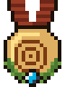{ width="36" .pixel } | **Volées parfaites V** | Tirer 50 volées parfaites | Loup | Déplacer les doigts ou l’ancrage |
| 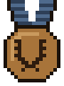{ width="36" .pixel } | **Records I** | Battre 1 record personnel | Médaille | La palette |
| { width="36" .pixel } | **Records II** | Battre 3 records personnels | Cor de guerre | Le protège-bras |
| 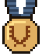{ width="36" .pixel } | **Records III** | Battre 10 records personnels | Pierre runique | Le plastron |
| 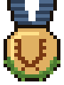{ width="36" .pixel } | **Records IV** | Battre 25 records personnels | Cape aurore boréale | Le décocheur |
| 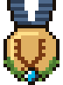{ width="36" .pixel } | **Records V** | Battre 50 records personnels | Ourson | La dragonne |
| { width="36" .pixel } | **Semaines I** | Tirer pendant 4 semaines différentes, à la suite ou non | Un hibou compagnon | L’échauffement |
| { width="36" .pixel } | **Semaines II** | Tirer pendant 12 semaines différentes, à la suite ou non | Bottes fourrées | Les jours de repos |
| { width="36" .pixel } | **Semaines III** | Tirer pendant 26 semaines différentes, à la suite ou non | Poteaux à lanternes | Vérifier ses flèches |
| { width="36" .pixel } | **Semaines IV** | Tirer pendant 52 semaines différentes, à la suite ou non | Tuque | La cire à corde |
| { width="36" .pixel } | **Semaines V** | Tirer pendant 104 semaines différentes, à la suite ou non | Maquette de drakkar | Ranger son arc |
| 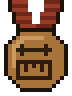{ width="36" .pixel } | **Distances I** | Tirer à 2 distances différentes | Carte murale | En salle et dehors |
| 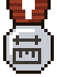{ width="36" .pixel } | **Distances II** | Tirer à 3 distances différentes | Pantalon à carreaux | Le vent |
| { width="36" .pixel } | **Distances III** | Tirer à 5 distances différentes | Girouette | Lumière et ombre |
| { width="36" .pixel } | **Distances IV** | Tirer à 7 distances différentes | Longue-vue | En montée et en descente |
| { width="36" .pixel } | **Distances V** | Tirer à 9 distances différentes | Chèvre | Estimer la distance |
| { width="36" .pixel } | **Lieux I** | Tirer dans 2 lieux différents | Cape de la forêt | Ullr |
| { width="36" .pixel } | **Lieux II** | Tirer dans 3 lieux différents | Besace de voyage | Skadi |
| { width="36" .pixel } | **Lieux III** | Tirer dans 5 lieux différents | Nichoir | Artémis |
| { width="36" .pixel } | **Lieux IV** | Tirer dans 10 lieux différents | Bottes de cavalier | Robin des Bois |
| { width="36" .pixel } | **Lieux V** | Tirer dans 20 lieux différents | Écureuil roux | Hou Yi |
| { width="36" .pixel } | **Repères de visée I** | Noter 1 repère de visée | Établi du facteur d’arcs | Les repères de visée |
| { width="36" .pixel } | **Repères de visée II** | Noter 3 repères de visée | Protège-bras | Le band |
| { width="36" .pixel } | **Repères de visée III** | Noter 6 repères de visée | Tapisserie | Le tiller |
| { width="36" .pixel } | **Repères de visée IV** | Noter 10 repères de visée | Pourpoint de cuir | Le centrage |
| { width="36" .pixel } | **Repères de visée V** | Noter 15 repères de visée | Castor | Le réglage au tube nu |

Une **volée parfaite** est une volée où chaque flèche a marqué la plus haute valeur du blason : le 10 (ou le X) sur un blason de cible, le 6 sur un blason de campagne, le 11 sur un animal 3D, selon votre règle de comptage. Les **records** comptent chaque séance qui bat toutes les précédentes de son épreuve ; la première fois que vous tirez une épreuve n’est jamais un record. Les **repères de visée** comptent les repères que vous notez sur vos arcs.

### Premières fois { #firsts }

| Médaille | Insigne | Comment l’obtenir | Récompense | Page du livre |
|:-:|-------|----------------|--------|-----------|
| 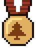{ width="36" .pixel } | **Campagne** | Terminer une séance en campagne | Chapeau à plume | Le tir en campagne |
| 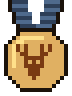{ width="36" .pixel } | **3D** | Terminer une séance 3D | Cerf en mousse | Le tir 3D |
| 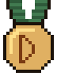{ width="36" .pixel } | **Arc nu** | Terminer une séance à l’arc nu | Capuche en peau de loup | L’arc nu |
| 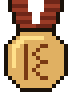{ width="36" .pixel } | **Arc recourbé** | Terminer une séance à l’arc recourbé | Pantalon de cuir | L’arc recourbé |
| { width="36" .pixel } | **Arc à poulies** | Terminer une séance à l’arc à poulies | Bottes ferrées | L’arc à poulies |

Les para-archers gagnent tous les insignes : une séance de para-tir compte pour chaque jalon, et pour l’arc avec lequel elle a été tirée.

### Combinaisons { #combos }

| Médaille | Insigne | Il faut | Récompense | Page du livre |
|:-:|-------|----------------|--------|-----------|
| 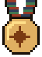{ width="36" .pixel } | **Polyvalence** | Obtenir Campagne et 3D | Jeune orignal | Le para-tir à l’arc |
| 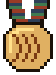{ width="36" .pixel } | **Trois arcs** | Obtenir Arc nu, Arc recourbé et Arc à poulies | Bois de cerf | L’arc long |
| 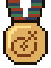{ width="36" .pixel } | **Tir d’élite** | Obtenir X III, Volées parfaites III et Records II | Huard | L’arc de cavalier |
| { width="36" .pixel } | **Globe-trotter** | Obtenir Lieux III et Distances III | Cape de voyageur | Le tir sur cible |
| 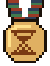{ width="36" .pixel } | **Régularité** | Obtenir Semaines III et Séances III | Étagère à livres | Le tir à l’arc au Canada |
| 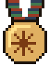{ width="36" .pixel } | **Faveur d’Ullr** | Atteindre V dans les neuf jalons | Skis d’Ullr | L’arc en if d’Ullr |

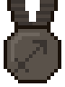{ width="36" .pixel } Un insigne pas encore gagné reste gris. Chaque médaille a son petit dessin et une couleur pour son étape : elle se lit pareil en français, en anglais, en allemand et en espagnol.

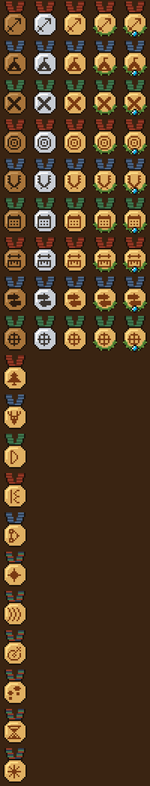{ width="200" .pixel }

### Trophées, fanfares et remise à zéro { #trophies-cheers-and-starting-again }

- **Records personnels** pour chaque épreuve (distance, blason et nombre de flèches). Chacun pose une coupe sur l’étagère, et les plaques s’allument au fil des insignes. Touchez un record pour ouvrir sa séance.
- Un nouveau niveau ou un nouvel insigne est annoncé par **une fanfare et une bannière**, une seule fois : « Flèches II · Nouveauté : Bottes de cuir », puis une deuxième bannière pour la page, « Nouvelle page : L’encoche ». Plusieurs à la fois partagent une bannière. Battre un record personnel sur une épreuve déjà tirée fait sonner **le cor de guerre**.
- Tout est calculé à partir de vos séances : supprimez une séance et ce qu’elle a rapporté disparaît avec elle.
- **Si vous jouiez avant cette version,** ce que vous aviez déjà gagné est gardé, sans avalanche de fanfares : la première fois que vous ouvrez le jeu, il note discrètement où vous en êtes, et seul ce qui vient ensuite est fêté. Vos décorations restent où elles étaient.
- **Remettre à zéro l’expérience et les insignes**, au bas des trophées, vous ramène au niveau 1 sans insigne, après confirmation. Vos séances, vos scores et vos records restent ; à partir de là, ce que vous tirez rapporte de nouveau de l’expérience et des insignes, et les trophées indiquent depuis quand. Ce que vous portez et les décorations placées restent ; elles s’affichent de nouveau comme verrouillées dans les listes. Pour effacer aussi les séances, voir [Stockage et sauvegarde](backup.md#effacer-les-donnees).

## Défi de la semaine { #this-weeks-challenge }

Avec des [objectifs d’entraînement](normal.md#objectifs-dentrainement), le mur des trophées affiche le **défi de la semaine** : les flèches à tirer cette semaine, avec une barre dorée, et la moyenne par flèche à atteindre. La première fois que vous atteignez l’objectif de flèches dans la semaine, la maison joue une **fanfare** avec une bannière **Défi relevé !**. Les objectifs ne rapportent pas d’expérience : en changer un ne réécrit jamais votre progression.

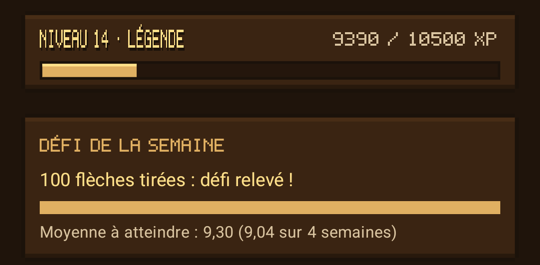{ .shot width="320" }

## Récompenses { #rewards }

Ce que vous gagnez en tirant débloque des **récompenses**. Rien ne s’achète, et toutes les autres tenues sont libres dès le départ.

- **Niveaux :** un **diadème d’or** (niveau 3), une **cape dorée** (niveau 5) et une **tunique pourpre royale** (niveau 8), au miroir. Le mur des trophées les liste sous **Récompenses**.
- **Insignes :** chaque étape donne un objet, affiché avec son insigne au mur des trophées et dans les [tableaux plus haut](#milestones) : 24 tenues et accessoires, 11 compagnons, 14 décorations pour la maison et 7 pour le pas de tir.

<figure markdown>
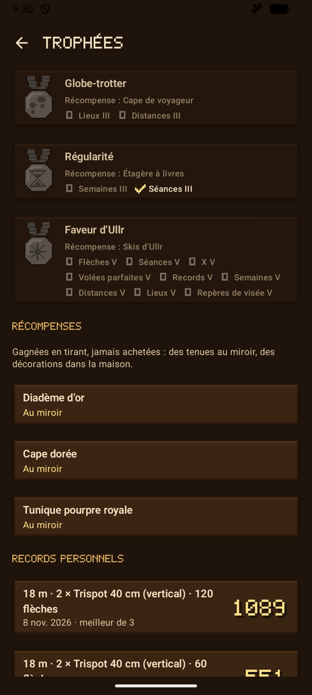{ .shot }
<figcaption><b>Récompenses</b> des niveaux, au mur des trophées.</figcaption>
</figure>
<figure markdown>
{ .shot }
<figcaption><b>À gagner</b>, au miroir.</figcaption>
</figure>

Les tenues et les compagnons à gagner attendent au bas du miroir sous **À gagner**, chacun avec l’insigne qu’il faut ; une fois gagnés, ils rejoignent les autres, et **Au hasard** peut les choisir. Après une remise à zéro, une récompense que vous portez reste en place.

## Décorer la maison et le pas de tir { #decorate }

Les décorations que vous gagnez s’installent toutes seules : chacune a sa place, et une nouvelle la reprend. Pour choisir vous-même, ouvrez le **coffre** de la maison.

<figure markdown>
{ .shot }
<figcaption><b>Décorer</b>, depuis le coffre.</figcaption>
</figure>
<figure markdown>
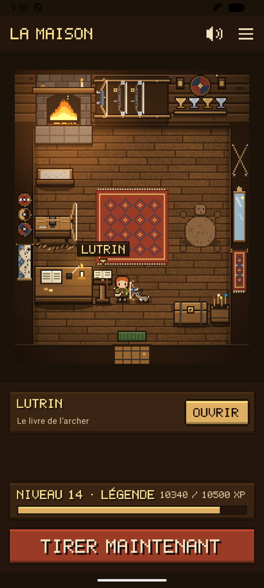{ .shot }
<figcaption>La maison, décorée.</figcaption>
</figure>

- Onglets **Maison** et **Pas de tir**, avec un aperçu de la pièce en haut. La maison a **six emplacements** (quatre aux murs, deux au sol), le pas de tir **quatre**.
- Touchez un emplacement pour choisir : **Auto** (par défaut) montre la pièce de votre plus haute étape d’insigne qui va à cet endroit ; **Vide** le laisse nu ; ou choisissez n’importe quelle décoration gagnée qui convient à l’emplacement. Les pièces encore verrouillées sont aussi listées, avec l’insigne qui les débloque.
- Une pièce ne peut être qu’à un seul endroit : la choisir pour un autre emplacement l’y déplace.
- Les emplacements sont des places fixes dans la pièce, comme les meubles, et votre archer en fait le tour.
- Sur le pas de tir, les décorations restent en toute saison, avec de la neige dessus en hiver.

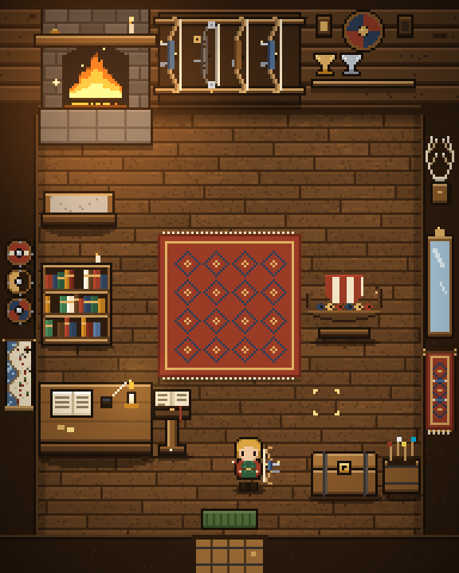{ width="288" .pixel } 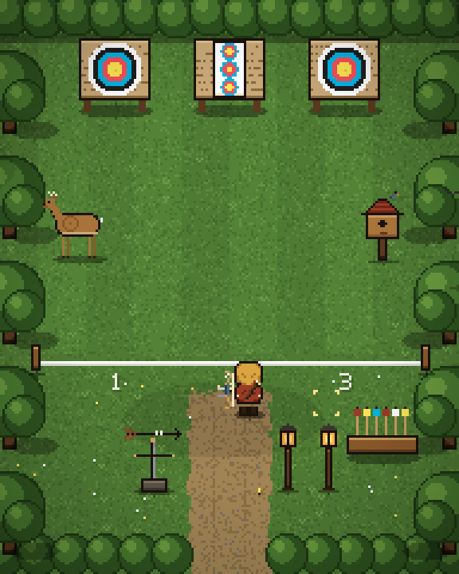{ width="288" .pixel }

## Le livre de l’archer { #the-archers-book }

Le **lutrin** de la maison porte **le livre de l’archer** : 56 pages illustrées en 11 chapitres, une page pour chaque étape d’insigne. Une façon agréable d’apprendre le nom des parties d’un arc et d’une flèche, l’équipement, le réglage, les disciplines et quelques archers de légende.

<figure markdown>
{ .shot }
<figcaption><b>Le sommaire.</b> Les nouvelles pages sont marquées.</figcaption>
</figure>
<figure markdown>
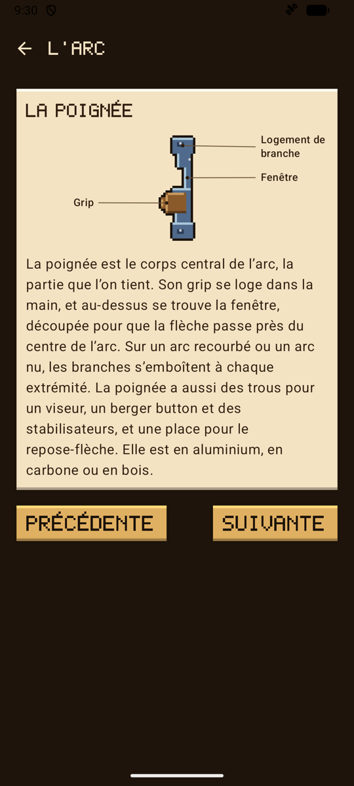{ .shot }
<figcaption><b>Une page :</b> un dessin avec ses parties nommées, et un court texte.</figcaption>
</figure>

- **Chapitres :** Les flèches, L’arc, La cible, La visée, L’équipement de l’archer, Soins et habitudes, Sur le terrain, Archers de légende, Le réglage, Les disciplines, Les arcs.
- **Une page** a un dessin avec ses parties nommées et un court texte. **Précédente** et **Suivante** tournent les pages.
- Une page pas encore ouverte est marquée **Nouvelle**. Une page verrouillée indique ce qui la débloque (« Obtenez Flèches V pour lire cette page »).
- Le livre nomme les choses et explique à quoi elles servent. Ce n’est pas un règlement : pour les règles de compétition, voir [Tir à l’arc Canada](https://archerycanada.ca/).
- Les textes des pages sont des brouillons, encore en cours de vérification.
- Les lecteurs d’écran lisent le texte et les noms de chaque dessin.
- Pour les parents, les entraîneurs et les enseignants : comment le livre aide les enfants à apprendre les mots du tir à l’arc, dans [Éducation](education.md). Le livre entier, à imprimer : [Le livre de l’archer](book.md).

{ width="480" .pixel }

## Les saisons { #seasons }

Le pas de tir suit le calendrier : neige et conifères en hiver (de décembre à février), fleurs et arbres en fleurs au printemps, vert en été, et arbres rouges et dorés aux feuilles qui tombent en automne (de septembre à novembre).

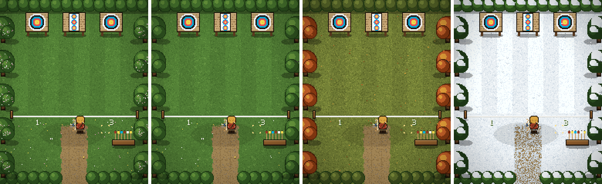

## Sons et musique { #sound-and-music }

Des pas sur le plancher et dans l’herbe, un petit son quand vous choisissez un endroit, un carillon quand il s’ouvre, le grincement de la porte, le crépitement du feu dans la maison, le vent et les oiseaux sur le pas de tir, et un petit air de luth. Tout a été composé pour sagitt·AI·re.

- Le son joue au volume **multimédia** du téléphone, comme les autres jeux : les modes silencieux et vibreur coupent les appels et les notifications, pas les jeux.
- Le **bouton haut-parleur**, en haut du jeu, coupe et remet le son. **Réglages → Apparence et jeu → Sons du jeu** et **Musique** les coupent séparément.
- Le son s’arrête dès que l’application passe en arrière-plan.

## Tous les écrans au style du jeu { #every-screen-in-the-game-look }

En mode jeu, chaque écran prend le style du jeu : bois sombre et or, lettres en pixels pour les titres, les boutons et les gros scores, et chaque score dans la couleur de sa zone.

<figure markdown>
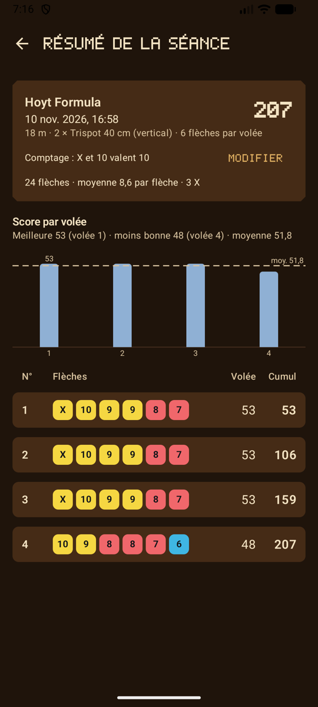{ .shot }
<figcaption>Un résumé de séance</figcaption>
</figure>
<figure markdown>
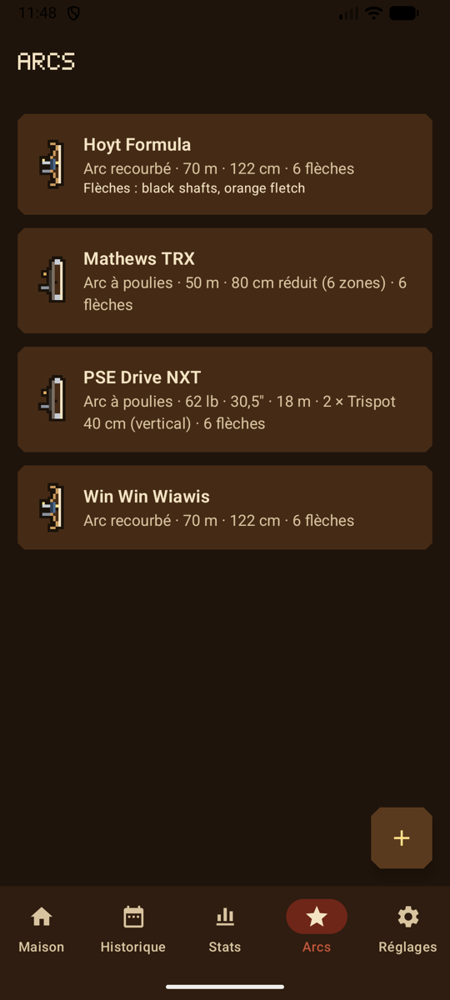{ .shot }
<figcaption>Vos arcs</figcaption>
</figure>
<figure markdown>
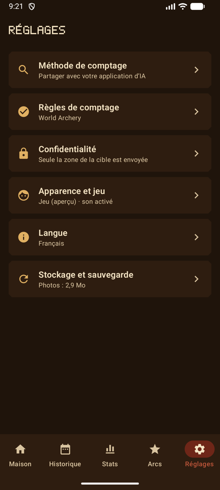{ .shot }
<figcaption>Les réglages, regroupés par thème</figcaption>
</figure>

## Confidentialité { #privacy }

Le mode jeu n’envoie rien. L’apparence de votre archer, votre compagnon, vos décorations, les pages lues et vos réglages de son restent sur le téléphone avec les autres réglages. Les images sont dessinées par l’application et les sons en font partie : rien n’est téléchargé, et aucune permission n’est ajoutée.

## La suite { #whats-next }

Le mode jeu est un aperçu. Voir la [feuille de route](roadmap.md) pour la suite.
