# Game mode

sagitt·AI·re has a second way to use it: **the same app, as a small pixel-art video game.** Your archer walks around a Norse hall and an archery range, and each place opens a screen. Your bows, sessions and scores are exactly the same as in the normal mode, and the scoring screens work the same way.

Turn it on in **Settings → Appearance and game → Game (preview)**. **Normal** switches back at any time; nothing is lost either way.

<figure markdown>
{ .shot }
<figcaption><b>The hall.</b> Tap a place and your archer walks there.</figcaption>
</figure>
<figure markdown>
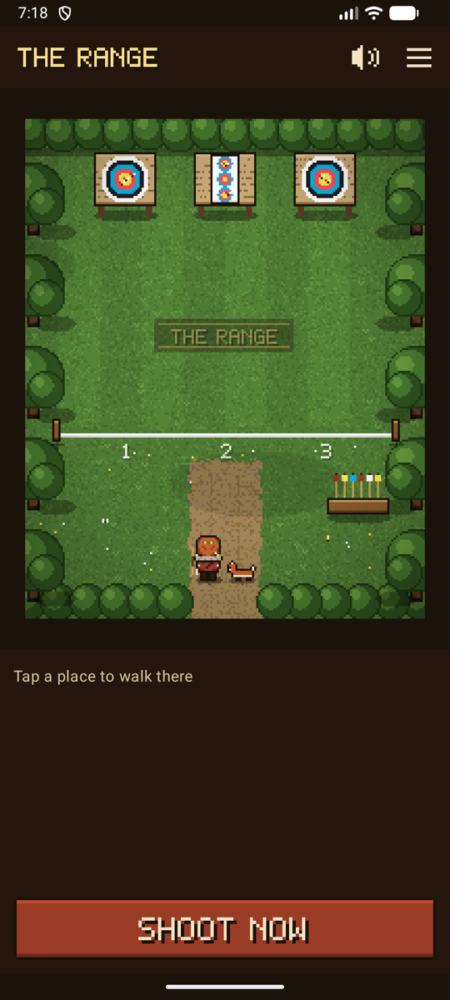{ .shot }
<figcaption><b>The range.</b> The shooting line starts a session.</figcaption>
</figure>
<figure markdown>
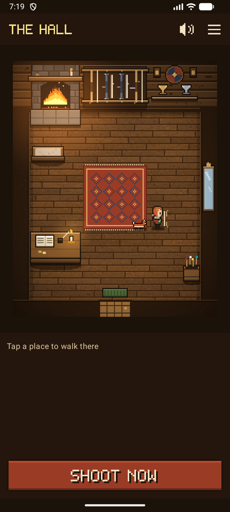{ .shot }
<figcaption><b>A companion</b> follows you around.</figcaption>
</figure>

## Getting around

- **Tap a place:** your archer walks there by the shortest way, around the furniture, then the place opens. Its name shows above it and in the panel at the bottom, with **Go** or **Open**.
- **Tap the floor** to just walk there.
- **Places** (☰, top right) lists every place in both rooms and opens it straight away, without walking. Handy when you're in a hurry, and easy to use with a screen reader.
- **Shoot now**, at the bottom, goes straight to the camera for your session in progress, or to a new session. The game never slows you down at the range.
- **Back** from any screen returns you to the game, where your archer was standing.

| In the hall | Opens |
|-------------|-------|
| **Bow rack** (your own bows hang on it, each drawn as its type: barebow, recurve with sight and stabilizer, compound with cams; your archer holds the same type) | Your bows |
| **Trophy wall** | Your trophies: level, badges and personal bests |
| **Writing desk** | Settings |
| **Mirror** | Your archer |
| **Hearth** | Your statistics, "by the fire" |
| **Storage chest** | [Decorate](#decorate) the hall and the range |
| **Lectern** | [The archer's book](#the-archers-book) |
| **Door** | The range |

| On the range | Opens |
|--------------|-------|
| **Shooting line** | A new session, or the one in progress |
| **Targets** | The session in progress (while one is open, arrows show in the targets) |
| **Arrow stand** | The end waiting for your check. A **!** shows over the stand when one is waiting. |
| **Path home** | The hall |

## Your archer

Walk to the **mirror** to dress your archer. The preview stays at the top while you scroll through the choices, and every change is saved at once.

<figure markdown>
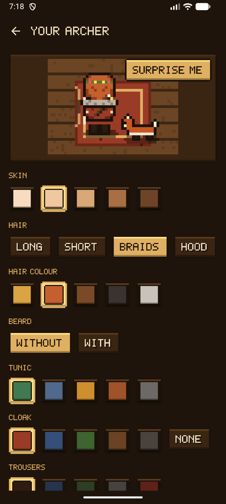{ .shot }
<figcaption><b>The mirror.</b> Pick, and see it at once.</figcaption>
</figure>
<figure markdown>
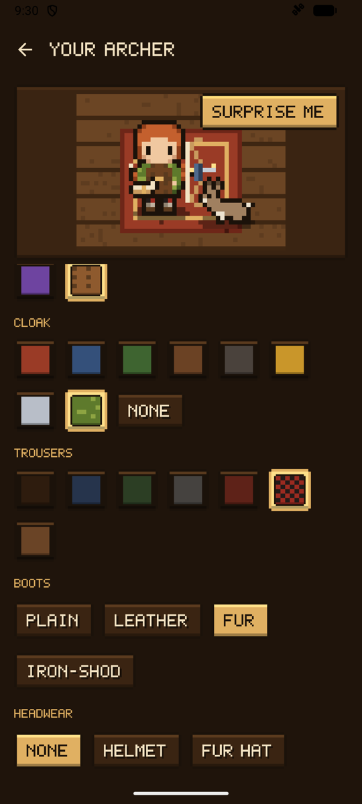{ .shot }
<figcaption><b>Boots</b>, and clothes earned with badges.</figcaption>
</figure>

| Choice | Options |
|--------|---------|
| Skin | Five tones |
| Hair | Long, short, braids or a hood, in five colours |
| Beard | With or without |
| Tunic, cloak, trousers | Six, five and five colours, and no cloak if you prefer; more to earn (below) |
| Boots | Plain; leather, fur, riding and iron-shod boots to earn |
| Headwear | Helmet, fur hat, flower crown, headband; more to earn |
| Accessory | Fur mantle, scarf, hammer amulet, glasses; more to earn |

{ width="360" .pixel }

**Clothes to earn.** Levels and badges unlock more: a **gold circlet** (level 3), a **gold cloak** (level 5) and a **royal purple tunic** (level 8), and one item for every badge step: an antler crown, a tuque and a wolf-pelt hood; bearskin, northern-lights, forest and traveller's cloaks; a chainmail shirt and a leather jerkin; plaid and leather trousers; a war horn, a spyglass, a traveller's satchel and an arm guard; leather, fur, riding and iron-shod boots. Which badge gives which is in the [badge tables](#milestones).

{ .pixel }

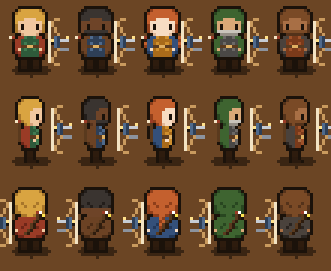{ width="330" .pixel }

**Surprise me** picks a random look from what you have unlocked. Your archer holds the type of your first bow: barebow, recurve or compound.

**Legendary archers.** At the top of the mirror, four ready-made archers set the whole look and companion in one tap: **Artemis**, Greek goddess of the hunt, with her hound; **Ullr**, Norse god of archery and winter, in furs, with a raven; **Robin Hood** in Lincoln green, with a fox; and **Hou Yi**, the Chinese archer who shot down nine suns. Change any piece after.

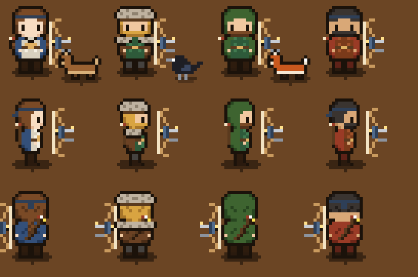{ width="420" .pixel }

## Companions

Choose a companion at the mirror: a **dog**, a **cat**, a **fox** or a **raven** from the start, and one more to discover. Eleven more come with badges: an **owl**, a **hawk**, a **hare**, a **lynx**, a **wolf**, a **bear cub**, a **goat**, a **red squirrel**, a **beaver**, a **moose calf** and a **loon**. Your companion follows the path your archer walked, about a step behind, so it never cuts through the furniture, and sits beside you when you stop. The four-legged ones trot, the birds hop, and some blink or wag their tails.

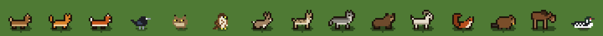{ .pixel }

## Levels, badges and trophies

Only real shooting earns anything: **10 experience** for each confirmed end, **30** for each finished session and **50** for each badge step. Nothing to buy, and nothing for just opening the app. Your level and its bar show at the bottom of the game, with a title that grows from **Novice** to **Archer**, **Marksman**, **Master archer** and **Legend**.

<figure markdown>
{ .shot }
<figcaption><b>Milestones</b>, at the trophy wall.</figcaption>
</figure>
<figure markdown>
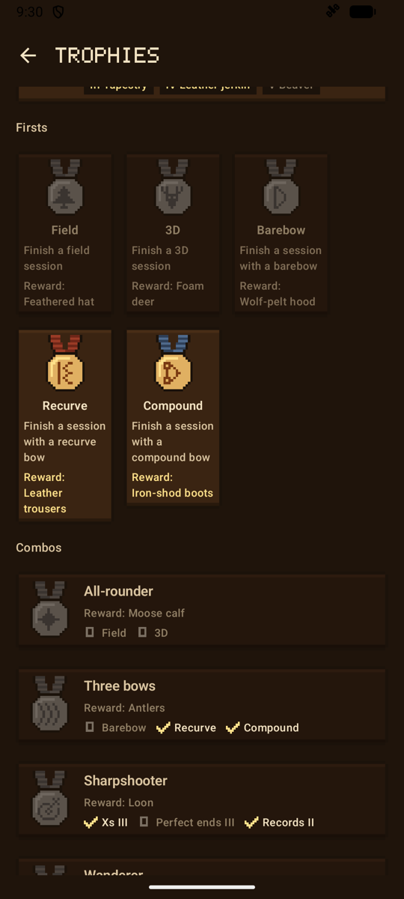{ .shot }
<figcaption><b>Firsts</b> and <b>combos</b>, with what each still needs.</figcaption>
</figure>
<figure markdown>
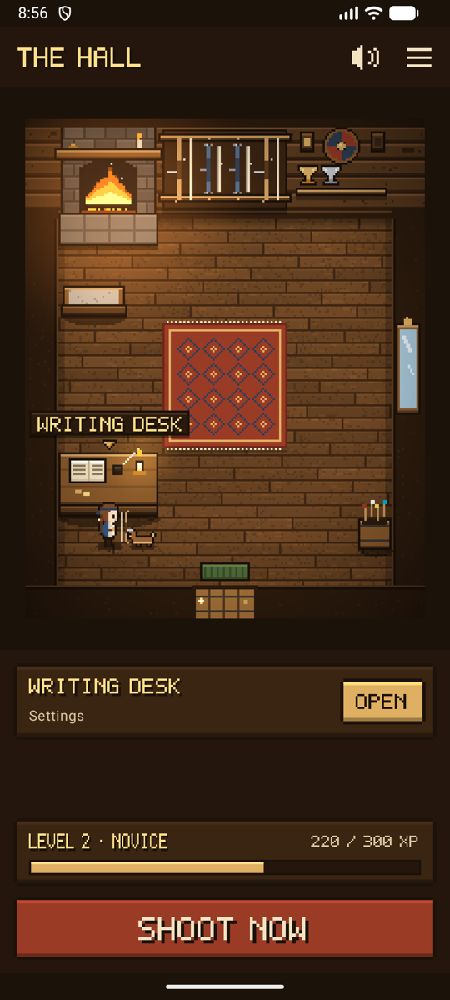{ .shot }
<figcaption>Your level, and a cup for each record.</figcaption>
</figure>

There are **20 badges in three groups**, gold once earned and grey until then. Each step of a badge gives you **an item** (clothing, a companion or a decoration) **and a page** of [the archer's book](#the-archers-book): 56 steps in all.

- **Milestones** climb in five steps, I to V: bronze, silver, gold, gold with a laurel, and gold with a blue gem. The trophy wall shows how far you are ("4,332 of 5,000 arrows") and the five steps with their items.
- **Firsts** are earned once: your first field session, your first 3D session, and your first session with each kind of bow.
- **Combos** come when you hold two or three other badges; the trophy wall ticks off what each one still needs.

Everything counts in total, never per day: 300 arrows today earn no more than coming back next week. Weeks count when you shot in them, **in a row or not**, so a rest week or an injury never breaks anything.

### Milestones

| Medal | Badge | How to earn it | Reward | Book page |
|:-:|-------|----------------|--------|-----------|
| 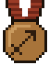{ width="36" .pixel } | **Arrows I** | Shoot 100 arrows | Crossed arrows in the hall | Parts of an arrow |
| 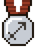{ width="36" .pixel } | **Arrows II** | Shoot 500 arrows | Leather boots | The nock |
| 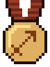{ width="36" .pixel } | **Arrows III** | Shoot 1,000 arrows | A pelt by the rug | Vanes and feathers |
| 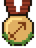{ width="36" .pixel } | **Arrows IV** | Shoot 2,500 arrows | Fletcher’s bench | Points |
| { width="36" .pixel } | **Arrows V** | Shoot 5,000 arrows | Hawk | Spine |
| 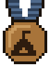{ width="36" .pixel } | **Sessions I** | Finish 1 session | Quiver | Riser |
| { width="36" .pixel } | **Sessions II** | Finish 10 sessions | A banner in the hall | Limbs |
| { width="36" .pixel } | **Sessions III** | Finish 25 sessions | Hare | String |
| { width="36" .pixel } | **Sessions IV** | Finish 50 sessions | Shield wall | Rest and plunger |
| { width="36" .pixel } | **Sessions V** | Finish 100 sessions | Bearskin cloak | Nocking point |
| 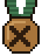{ width="36" .pixel } | **Xs I** | Shoot 1 X | A painted target in the hall | The face and its colours |
| 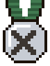{ width="36" .pixel } | **Xs II** | Shoot 10 Xs | Silver cloak | Spot faces |
| 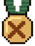{ width="36" .pixel } | **Xs III** | Shoot 50 Xs | Hay-bale butt | Field faces |
| 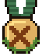{ width="36" .pixel } | **Xs IV** | Shoot 100 Xs | Golden arrow trophy | 3D animals |
| 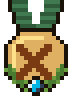{ width="36" .pixel } | **Xs V** | Shoot 250 Xs | Lynx | The boss and stand |
| 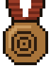{ width="36" .pixel } | **Perfect ends I** | Shoot 1 perfect end | Laurel wreath | The sight |
| 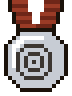{ width="36" .pixel } | **Perfect ends II** | Shoot 5 perfect ends | Chainmail shirt | The clicker |
| 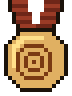{ width="36" .pixel } | **Perfect ends III** | Shoot 10 perfect ends | Rune pennants | Stabilizers |
| 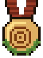{ width="36" .pixel } | **Perfect ends IV** | Shoot 25 perfect ends | Antler crown | Anchor and kisser |
| 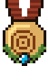{ width="36" .pixel } | **Perfect ends V** | Shoot 50 perfect ends | Wolf | String walking and face walking |
| 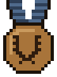{ width="36" .pixel } | **Records I** | Beat 1 personal best | Medal | Finger tab |
| { width="36" .pixel } | **Records II** | Beat 3 personal bests | War horn | Arm guard |
| 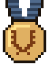{ width="36" .pixel } | **Records III** | Beat 10 personal bests | Runestone | Chest guard |
| { width="36" .pixel } | **Records IV** | Beat 25 personal bests | Northern-lights cloak | Release aid |
| { width="36" .pixel } | **Records V** | Beat 50 personal bests | Bear cub | Bow sling |
| { width="36" .pixel } | **Weeks I** | Shoot in 4 different weeks, in a row or not | An owl companion | Warming up |
| { width="36" .pixel } | **Weeks II** | Shoot in 12 different weeks, in a row or not | Fur boots | Rest days |
| { width="36" .pixel } | **Weeks III** | Shoot in 26 different weeks, in a row or not | Lantern posts | Checking arrows |
| { width="36" .pixel } | **Weeks IV** | Shoot in 52 different weeks, in a row or not | Tuque | String wax |
| { width="36" .pixel } | **Weeks V** | Shoot in 104 different weeks, in a row or not | Longship model | Storing a bow |
| 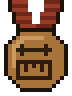{ width="36" .pixel } | **Distances I** | Shoot at 2 different distances | Map on the wall | Indoors and outdoors |
| { width="36" .pixel } | **Distances II** | Shoot at 3 different distances | Plaid trousers | Wind |
| { width="36" .pixel } | **Distances III** | Shoot at 5 different distances | Weather vane | Light and shade |
| { width="36" .pixel } | **Distances IV** | Shoot at 7 different distances | Spyglass | Uphill and downhill |
| { width="36" .pixel } | **Distances V** | Shoot at 9 different distances | Goat | Judging distance |
| { width="36" .pixel } | **Places I** | Shoot at 2 different places | Forest cloak | Ullr |
| { width="36" .pixel } | **Places II** | Shoot at 3 different places | Traveller’s satchel | Skadi |
| { width="36" .pixel } | **Places III** | Shoot at 5 different places | Birdhouse | Artemis |
| { width="36" .pixel } | **Places IV** | Shoot at 10 different places | Riding boots | Robin Hood |
| { width="36" .pixel } | **Places V** | Shoot at 20 different places | Red squirrel | Hou Yi |
| { width="36" .pixel } | **Sight marks I** | Note 1 sight mark | Bow-maker’s workbench | Sight marks |
| { width="36" .pixel } | **Sight marks II** | Note 3 sight marks | Arm guard | Brace height |
| { width="36" .pixel } | **Sight marks III** | Note 6 sight marks | Tapestry | Tiller |
| { width="36" .pixel } | **Sight marks IV** | Note 10 sight marks | Leather jerkin | Centre shot |
| { width="36" .pixel } | **Sight marks V** | Note 15 sight marks | Beaver | Bare-shaft tuning |

A **perfect end** is an end where every arrow scored the face's top value: the 10 (or the X) on a target face, the 6 on a field face, the 11 on a 3D animal, as your scoring rule counts it. **Records** count each time a session beats every earlier one of its round; the first time you shoot a round is never a record. **Sight marks** count the marks you note on your bows.

### Firsts

| Medal | Badge | How to earn it | Reward | Book page |
|:-:|-------|----------------|--------|-----------|
| 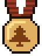{ width="36" .pixel } | **Field** | Finish a field session | Feathered hat | Field archery |
| 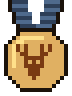{ width="36" .pixel } | **3D** | Finish a 3D session | Foam deer | 3D archery |
| 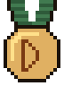{ width="36" .pixel } | **Barebow** | Finish a session with a barebow | Wolf-pelt hood | Barebow |
| 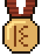{ width="36" .pixel } | **Recurve** | Finish a session with a recurve bow | Leather trousers | Recurve |
| { width="36" .pixel } | **Compound** | Finish a session with a compound bow | Iron-shod boots | Compound |

Para archers earn every badge: a para session counts for every milestone, and for the bow it was shot with.

### Combos

| Medal | Badge | Needs | Reward | Book page |
|:-:|-------|----------------|--------|-----------|
| { width="36" .pixel } | **All-rounder** | Earn Field and 3D | Moose calf | Para archery |
| 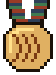{ width="36" .pixel } | **Three bows** | Earn Barebow, Recurve and Compound | Antlers | Longbow |
| 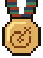{ width="36" .pixel } | **Sharpshooter** | Earn Xs III, Perfect ends III and Records II | Loon | Horsebow |
| { width="36" .pixel } | **Wanderer** | Earn Places III and Distances III | Traveller’s cloak | Target archery |
| 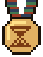{ width="36" .pixel } | **Steady** | Earn Weeks III and Sessions III | Bookshelf | Archery in Canada |
| 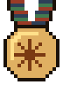{ width="36" .pixel } | **Ullr’s chosen** | Reach V in all nine milestones | Ullr’s skis | Ullr’s yew bow |

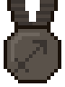{ width="36" .pixel } A badge not earned yet stays grey. Each medal has its own small picture and a colour for its step, so it reads the same in English, French, German and Spanish.

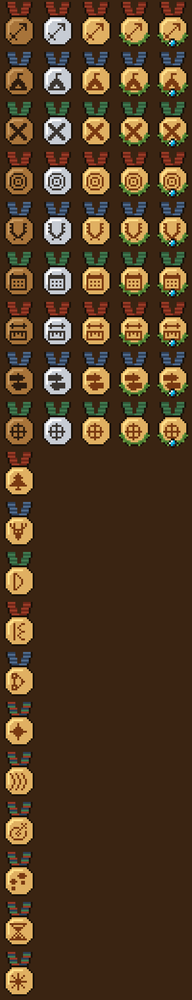{ width="200" .pixel }

### Trophies, cheers and starting again { #trophies-cheers-and-starting-again }

- **Personal bests** for each round (distance, face and number of arrows). Each one puts a cup on the trophy shelf, and the plaques light up as badges come in. Tap a record to open its session.
- A new level or badge is announced with a **fanfare and a banner**, once: "Arrows II · New: Leather boots", then a second banner for the page, "New page: The nock". Several at once share one banner. Beating a personal best on a round you've shot before sounds the **war horn**.
- It's all worked out from your sessions: delete a session and what it earned goes with it.
- **If you played before this version,** what you had already earned is kept, without a burst of fanfares: the first time you open the game, it quietly notes where you are, and only what comes after is cheered. Your decorations stay where they were.
- **Reset experience and badges**, at the bottom of the trophies, starts again at level 1 with no badges, after asking. Your sessions, scores and personal bests stay; from then on, what you shoot earns experience and badges again, and the trophies say since when. What you wear and the decorations you placed stay; they show as locked again in the lists. To erase sessions too, see [Storage and backup](backup.md#erase-data).

## This week's challenge

With [training goals](normal.md#training-goals) set, the trophy wall shows **this week's challenge**: the arrows to shoot this week, with a gold bar, and the average per arrow to reach. The first time you meet the arrows goal in a week, the hall plays a **fanfare** with a **Challenge met!** banner. Goals earn no experience, so changing one never rewrites your progress.

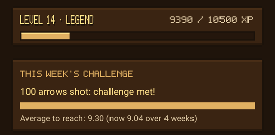{ .shot width="320" }

## Rewards

What you earn by shooting unlocks **rewards**. Nothing is bought, and every other outfit is free from the start.

- **Levels:** a **gold circlet** (level 3), a **gold cloak** (level 5) and a **royal purple tunic** (level 8), at the mirror. The trophy wall lists them under **Rewards**.
- **Badges:** every step gives one item, shown with its badge on the trophy wall and in the [tables above](#milestones): 24 pieces of clothing, 11 companions, 14 decorations for the hall and 7 for the range.

<figure markdown>
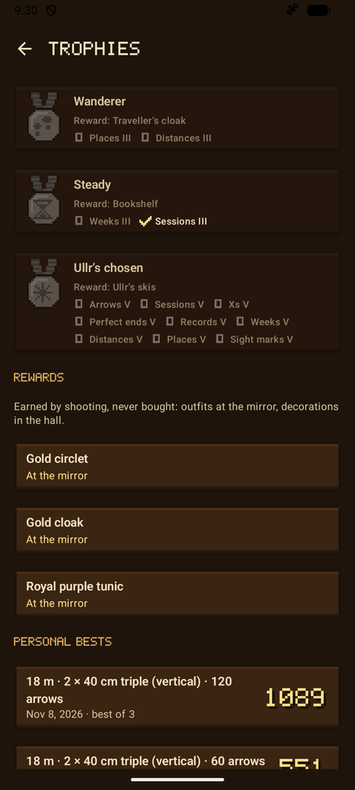{ .shot }
<figcaption><b>Rewards</b> for levels, at the trophy wall.</figcaption>
</figure>
<figure markdown>
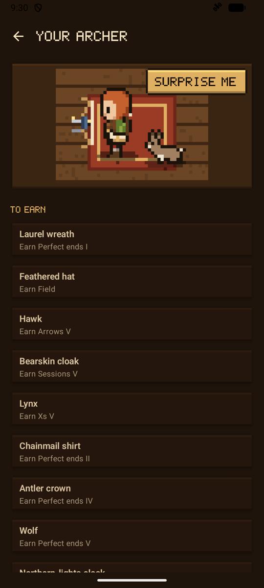{ .shot }
<figcaption><b>To earn</b>, at the mirror.</figcaption>
</figure>

Outfits and companions still to earn wait at the bottom of the mirror under **To earn**, each with the badge it needs; once earned, they appear with the others, and **Surprise me** can pick them. After a reset, a reward you're wearing stays on.

## Decorate the hall and the range { #decorate }

Decorations you earn appear on their own: each one has a place it belongs to, and a new one takes it over. To choose for yourself, open the **storage chest** in the hall.

<figure markdown>
{ .shot }
<figcaption><b>Decorate</b>, from the storage chest.</figcaption>
</figure>
<figure markdown>
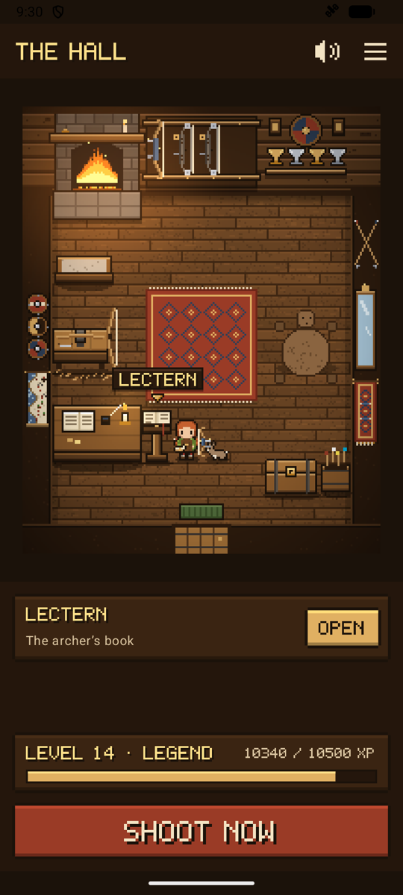{ .shot }
<figcaption>The hall, decorated.</figcaption>
</figure>

- **Hall** and **Range** tabs, with a preview of the room at the top. The hall has **six spots** (four on the walls, two on the floor), the range **four**.
- Tap a spot to choose: **Auto** (the default) shows the piece from your highest badge step that belongs there; **Empty** leaves it bare; or pick any decoration you have earned that fits the spot. Pieces still locked are listed too, with the badge that earns them.
- A piece can be in one spot at a time: choosing it for another spot moves it.
- The spots are fixed places in the room, like the furniture, and your archer walks around them.
- On the range, decorations stay in every season, with snow on them in winter.

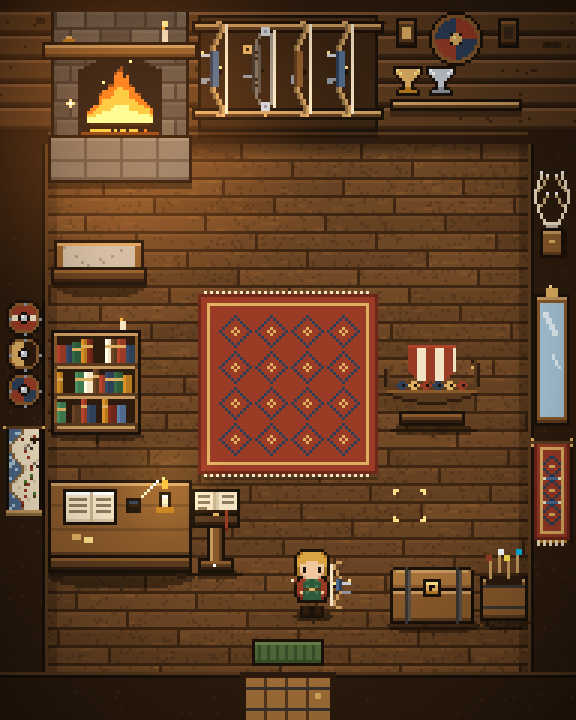{ width="288" .pixel } 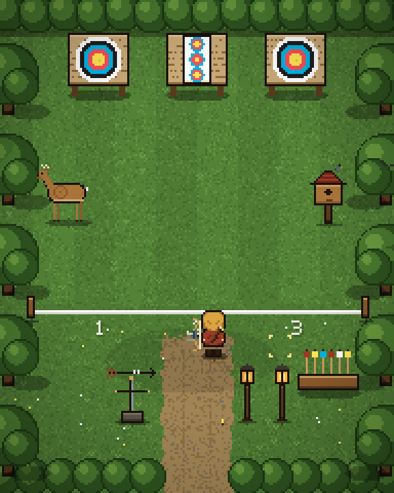{ width="288" .pixel }

## The archer's book { #the-archers-book }

The **lectern** in the hall holds **the archer's book**: 56 illustrated pages in 11 chapters, one page for every badge step. It's a friendly way to learn the names of the parts of a bow and an arrow, the kit, tuning, the kinds of archery, and a few archers of legend.

<figure markdown>
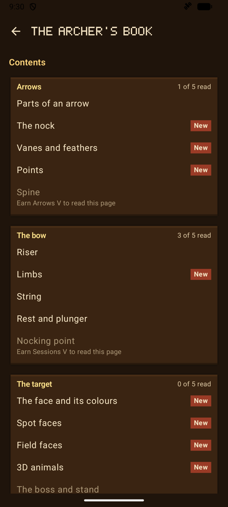{ .shot }
<figcaption><b>Contents.</b> New pages are marked.</figcaption>
</figure>
<figure markdown>
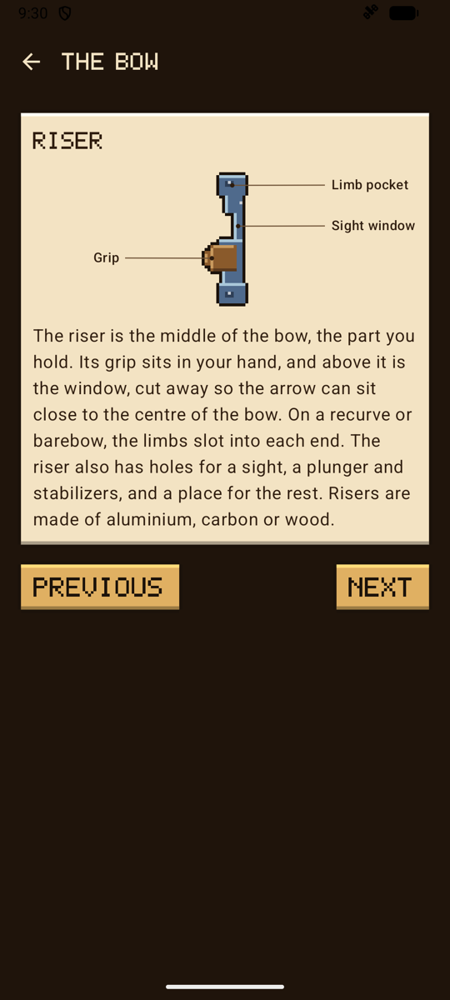{ .shot }
<figcaption><b>A page:</b> a drawing with its parts named, and a short text.</figcaption>
</figure>

- **Chapters:** Arrows, The bow, The target, Aiming, The archer's kit, Care and habits, Out on the range, Archers of legend, Tuning, Kinds of archery, Bows.
- **A page** has a drawing with its parts labelled and a short text. **Previous** and **Next** turn the pages.
- A page you haven't opened yet is marked **New**. A locked page shows what earns it ("Earn Arrows V to read this page").
- The book names things and explains what they do. It is not a rule book: for the rules of competition, see [Archery Canada](https://archerycanada.ca/).
- The page texts are drafts, still being checked.
- Screen readers read the text and the labels of each drawing.
- For parents, coaches and teachers: how the book helps children learn the words of archery, in [Education](education.md).

{ width="480" .pixel }

## Seasons

The range follows the calendar: snow and evergreens in winter (December to February), blossom and wildflowers in spring, green in summer, and red and gold trees with falling leaves in autumn (September to November).

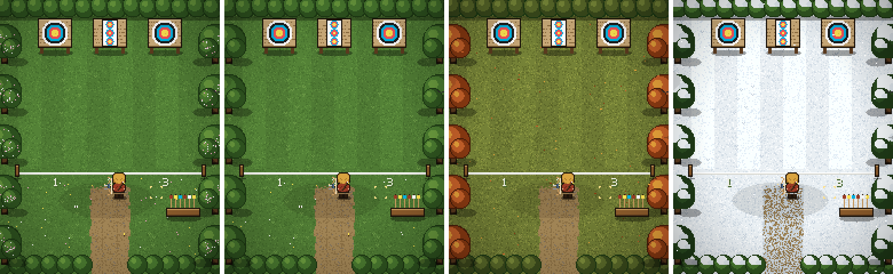

## Sound and music

Footsteps on the wooden floor and on the grass, a small blip when you choose a place, a chime when it opens, the creak of the door, the crackle of the fire in the hall, wind and birds on the range, and a quiet lute tune. All of it was made for sagitt·AI·re.

- Sound plays at the phone's **media** volume, like other games: silent and vibrate mute calls and notifications, not games.
- The **speaker button** at the top of the game turns the sound off and on. **Settings → Appearance and game → Game sound** and **Music** turn them off separately.
- Sound stops as soon as the app is in the background.

## Every screen in the game look

In game mode, every screen wears the game's style: dark wood and gold, pixel letters for titles, buttons and big scores, and each score in its ring's colour.

<figure markdown>
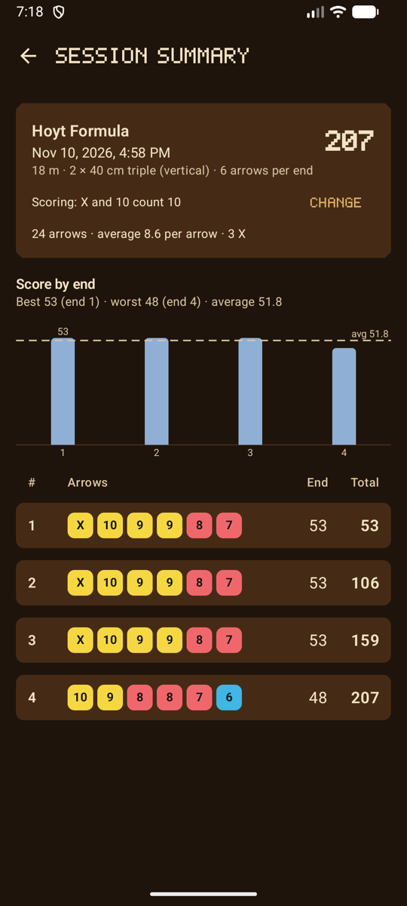{ .shot }
<figcaption>A session summary</figcaption>
</figure>
<figure markdown>
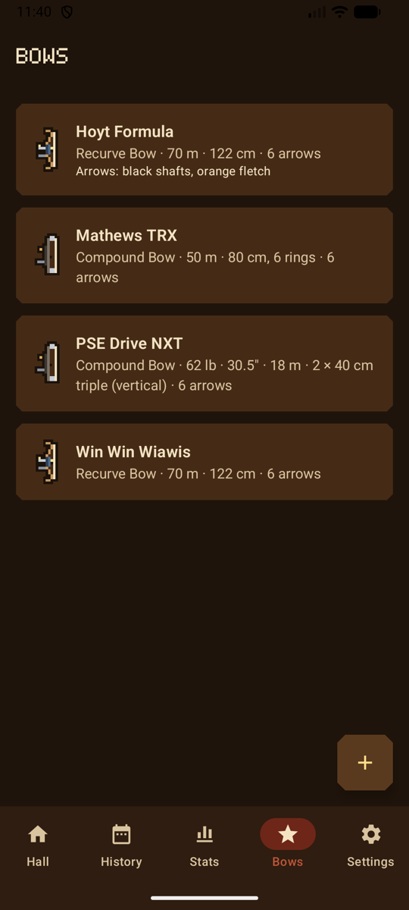{ .shot }
<figcaption>Your bows</figcaption>
</figure>
<figure markdown>
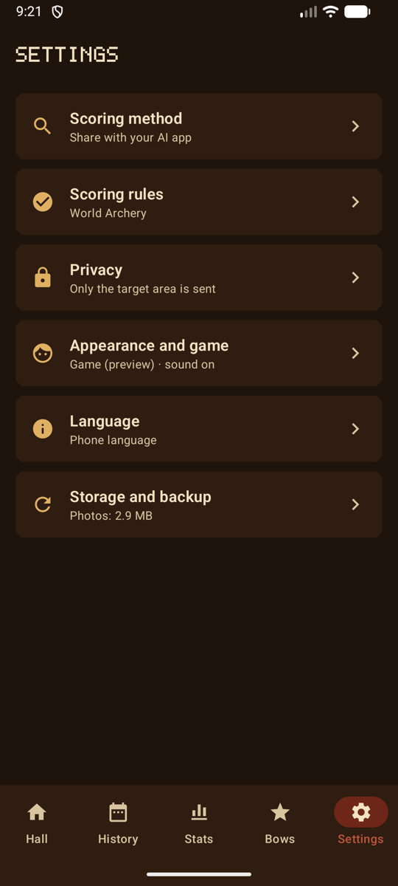{ .shot }
<figcaption>Settings, grouped by topic</figcaption>
</figure>

## Privacy

Game mode sends nothing. How your archer looks, your companion, your decorations, the pages you've read and your sound settings are kept on the phone with the other settings. The pictures are drawn by the app and the sounds are part of it: nothing is downloaded, and no permission is added.

## What's next

Game mode is a preview. See the [roadmap](roadmap.md) for what's coming.
