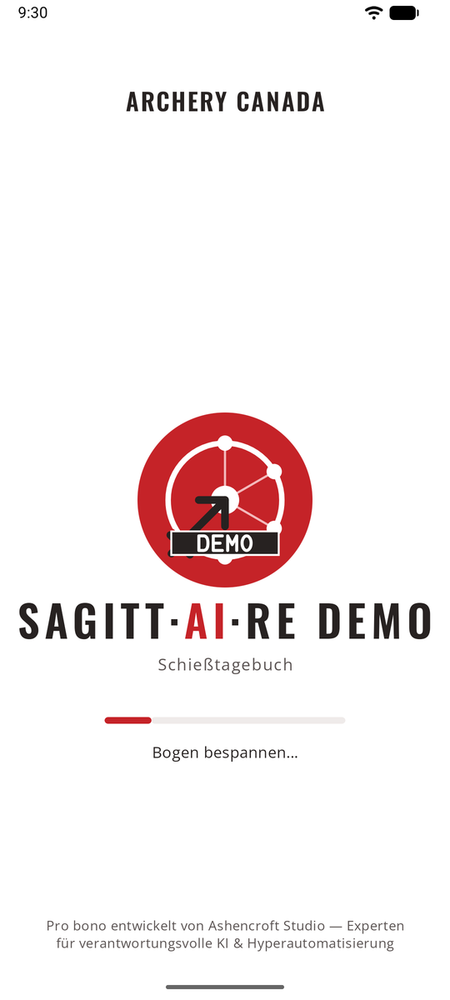
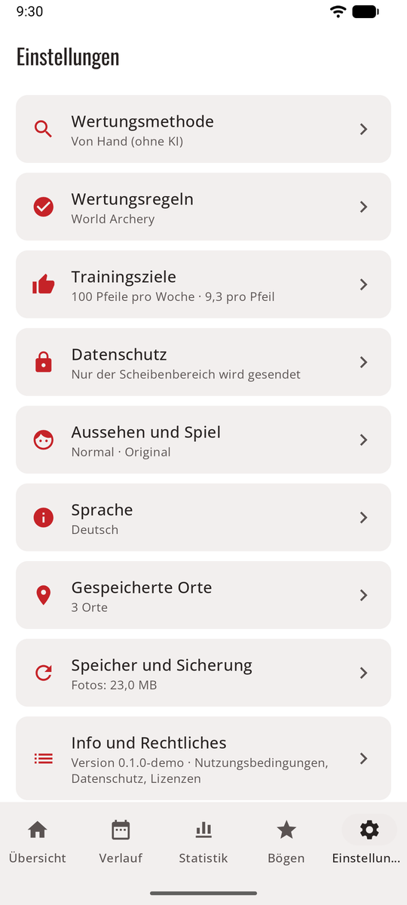
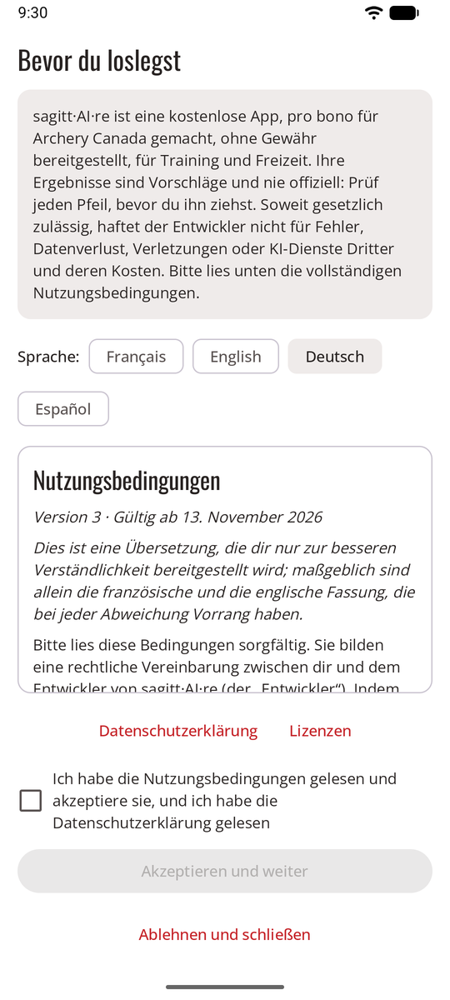

# Erste Schritte { #getting-started }

Vom Öffnen der App bis zu deiner ersten bestätigten Passe, in wenigen Schritten. Jeder Schritt führt zu seiner eigenen Seite. Die Schaltflächen heißen hier so wie in der deutschen App, zum Beispiel **Einheit starten**.

<figure markdown>
{ .shot }
<figcaption>Der Ladebildschirm</figcaption>
</figure>
<figure markdown>
{ .shot }
<figcaption>Einstellungen, eine Seite pro Thema</figcaption>
</figure>

## 0. Die Nutzungsbedingungen akzeptieren { #0-accept-the-terms-of-use }

{ .shot width="220" align=right }

Beim ersten Öffnen zeigt sagitt·AI·re seine [Nutzungsbedingungen](terms.md), mit Links zu seiner [Datenschutzerklärung](privacy-policy.md) und seinen [Open-Source-Lizenzen](licences.md). Auf Deutsch sind sie eine Übersetzung; maßgeblich sind die französische und die englische Fassung. Hake **Ich habe die Nutzungsbedingungen gelesen und akzeptiere sie, und ich habe die Datenschutzerklärung gelesen** an und tippe auf **Akzeptieren und weiter**. Kurz gesagt: sagitt·AI·re ist kostenlos und wird bereitgestellt, wie es ist, seine Ergebnisse sind Vorschläge, die du prüfst, und soweit das Gesetz es zulässt, haftet sein Entwickler nicht für Fehler, verlorene Daten, Verletzungen oder KI-Dienste Dritter. **Ablehnen und schließen** schließt die App. Du kannst alle drei jederzeit unter **Einstellungen → Info und Rechtliches** wieder lesen. Wenn sich die Bedingungen oder die Datenschutzerklärung ändern, fragt sagitt·AI·re erneut.

## 1. Einen Modus wählen { #1-pick-a-mode }

Die App öffnet sich im [Normalmodus](normal.md): Tabs und Bildschirme. Wenn du lieber eine Figur durch eine Pixel-Art-Halle laufen lässt, schalte den [Spielmodus](game.md) unter **Einstellungen → Aussehen und Spiel** ein. Du kannst jederzeit zurückwechseln.

Die App folgt der Sprache deines Handys (Englisch, Französisch, Deutsch oder Spanisch). Ab Android 13 kannst du sie auch unter **Einstellungen → Sprache** wählen.

## 2. Wählen, wie Passen gewertet werden { #2-choose-how-ends-are-scored }

**Einstellungen → Wertungsmethode**:

| Methode | Du brauchst | Seite |
|--------|----------|------|
| **Dein eigener API-Schlüssel** (automatisch) | Einen Schlüssel von einem KI-Dienst | [Dein eigener API-Schlüssel](scoring-api.md) |
| **Mit deiner KI-App teilen** | Eine KI-App auf deinem Handy | [Mit deiner KI-App teilen](scoring-share.md) |
| **Von Hand** (ohne KI) | Nichts | [Wertung von Hand](scoring-manual.md) |

Nicht sicher? Fang mit **Von Hand** an: Das funktioniert sofort, und du kannst die Methode später ändern. Frühere Einheiten bleiben, wie sie sind.

## 3. Einen Bogen hinzufügen { #3-add-a-bow }

**Bögen → Bogen hinzufügen**: ein Name, der Bogentyp und die Vorgaben für neue Einheiten. Siehe [Bögen](bows.md).

## 4. Eine Einheit schießen { #4-shoot-a-session }

**Einheit starten**, Ort, Bogen, Entfernung und Auflage eintragen, die erste Passe schießen und dann die Scheibe fotografieren. Siehe [Einheiten](sessions.md).

## 5. Die Passe prüfen und bestätigen { #5-check-and-confirm-the-end }

Prüf die eingekreisten Pfeile (oder setz deine Pfeile, bei der Wertung von Hand), dann **Bestätigen · nächste Passe**. Siehe [Pfeile prüfen](review.md).

!!! warning "Prüfen, bevor du die Pfeile ziehst"
    Die Pfeile in der Scheibe sind der Beweis. Wenn du später nach dem Foto wertest, zoom auf die eingekreisten Pfeile.

## Nichts wird gelöscht, ohne zu fragen { #nothing-is-removed-without-asking }

Einen Bogen, einen Schlüssel oder einen Pfeil entfernen, eine Passe löschen, eine Einheit verwerfen, die Adresse eines Dienstes ändern (was seinen Schlüssel entfernt), Speicher freigeben, einen Export wiederherstellen, Erfahrung und Abzeichen zurücksetzen und Daten löschen: Bei all dem fragt sagitt·AI·re zuerst nach (zum Löschen der Daten musst du außerdem **LÖSCHEN** eintippen), im Normal- wie im Spielmodus. **Behalten** bricht ab.

## Tipps für gute Fotos { #tips-for-good-photos }

- Stell dich gerade vor die Scheibe, nicht schräg.
- Bring die ganze Auflage, oder alle Auflagen, ins Bild, mit etwas Rand drumherum.
- Vermeide starke Schatten und Spiegelungen, und halt das Handy ruhig.
- Auf einer vollen Scheibe hilft eine genaue Pfeilbeschreibung an deinem Bogen (Farben von Befiederung und Nocken).
- Zwei Dreifach-Auflagen auf einem Foto machen jeden Spot klein. Wenn Linienschüsse oft falsch sind, geh näher heran.

## Fragen { #questions }

**Bei der Passe steht „nicht gewertet“.** Öffne sie, um den Grund zu sehen:

- *Kein API-Schlüssel:* Füg den Schlüssel des gewählten Dienstes unter **Einstellungen → Wertungsmethode** hinzu.
- *Nicht eingerichtet:* Ein OpenAI-kompatibler Dienst braucht auch seine Adresse und sein Modell.
- *Schlüssel abgelehnt:* Der Schlüssel wurde gelöscht oder falsch eingegeben. Prüf ihn in den Einstellungen.
- *Dienst nicht erreichbar:* Die App hat es dreimal versucht. Tippe später auf **Erneut versuchen**.
- *Kein Guthaben mehr:* Lade bei diesem Dienst Guthaben auf oder erhöhe sein Limit, und versuch es dann erneut.
- *Unbrauchbare Antwort:* Versuch es erneut, teile stattdessen mit deiner KI-App oder werte von Hand.

**Kein Empfang am Bogenplatz.** Schieß einfach weiter. Die Fotos werden gespeichert und gewertet, sobald das Handy wieder online ist. Bei der Wertung von Hand braucht nichts das Netz.

**Der Pfeil eines anderen Schützen wurde mitgezählt.** Entferne ihn, und füg an deinem Bogen eine Pfeilbeschreibung hinzu oder verbessere sie.

**Die KI hat einen Pfeil übersehen** (zum Beispiel einen Robin Hood). Schalte **Oder tippe auf die Stelle im Foto** ein, tippe dorthin, wo der Pfeil steckt, und wähle dann seinen Ring.

**Die App wurde während einer Einheit geschlossen.** Nichts geht verloren. Die Einheit erscheint in der Übersicht mit **Fortsetzen**, und Passen, die auf ihre Wertung warten, kommen wieder in die Warteschlange.

**Wie viel Platz brauchen die Fotos?** Etwa 0,6–1,2 MB pro Passe. **Einstellungen → Speicher und Sicherung** zeigt die Summe. Siehe [Speicher und Sicherung](backup.md).
