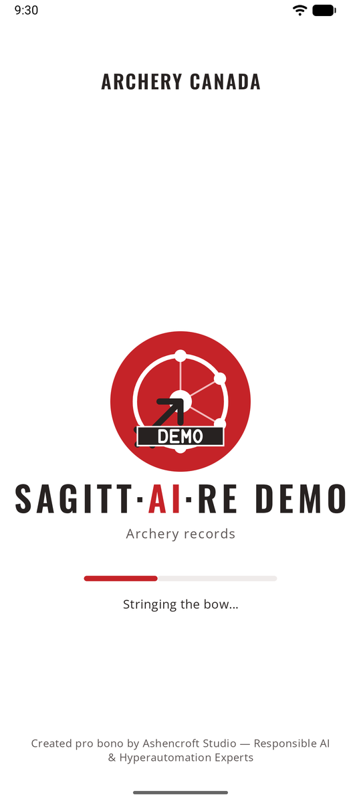
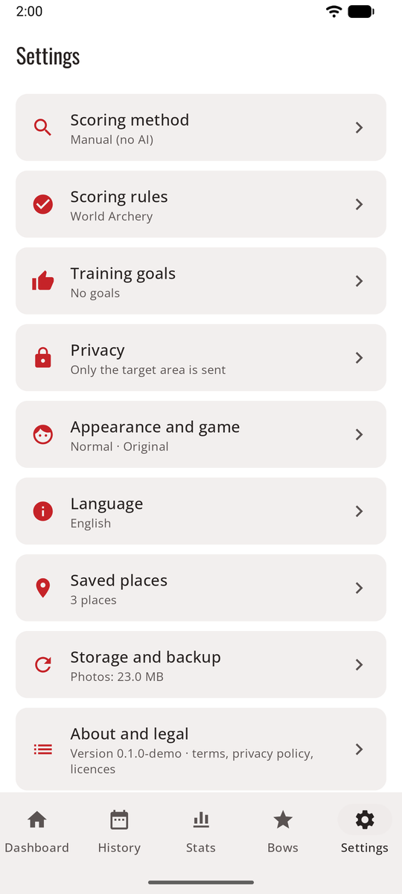
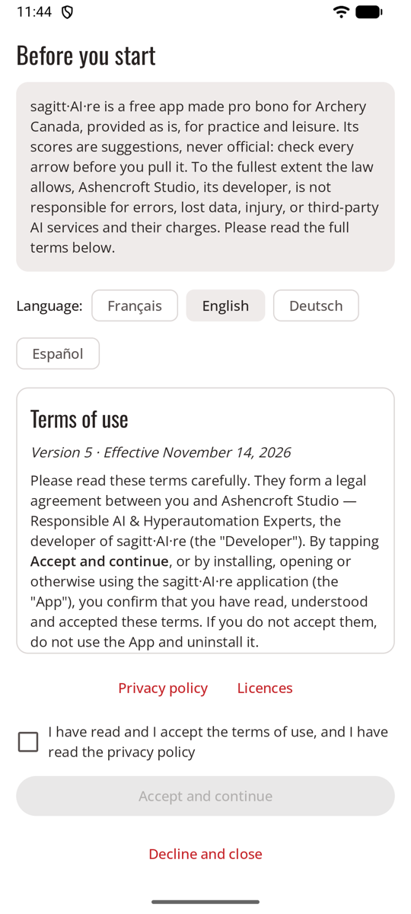

# Getting started

From opening the app to your first confirmed end, in a few steps. Each step links to its own page. Button names are those of the English app, for example **Start session**.

<figure markdown>
{ .shot }
<figcaption>The loading screen</figcaption>
</figure>
<figure markdown>
{ .shot }
<figcaption>Settings, one page per topic</figcaption>
</figure>

## 0. Accept the terms of use

{ .shot width="220" align=right }

The first time you open sagitt·AI·re, it shows its [terms of use](terms.md), with links to its [privacy policy](privacy-policy.md) and its [open-source licences](licences.md), in English, French, German or Spanish: the French and English versions are binding, the German and Spanish ones are translations. Tick **I have read and I accept the terms of use, and I have read the privacy policy** and tap **Accept and continue**. In short: sagitt·AI·re is free and provided as is, its scores are suggestions to check, and to the fullest extent the law allows its developer isn't responsible for errors, lost data, injury or third-party AI services. **Decline and close** closes the app. You can read all three again in **Settings → About and legal**. When the terms or the privacy policy change, sagitt·AI·re asks again.

## 1. Pick a mode

The app opens in [normal mode](normal.md): tabs and screens. If you'd rather walk an archer around a pixel-art hall, turn on [game mode](game.md) in **Settings → Appearance and game**. You can switch back at any time.

The app follows your phone's language (English, French, German or Spanish). On Android 13 and later you can also choose it in **Settings → Language**.

## 2. Choose how ends are scored

**Settings → Scoring method**:

| Method | You need | Page |
|--------|----------|------|
| **Your own API key** (automatic) | A key from an AI service | [Your own API key](scoring-api.md) |
| **Share with your AI app** | An AI app on your phone | [Share with your AI app](scoring-share.md) |
| **Manual** (no AI) | Nothing | [Manual scoring](scoring-manual.md) |

Not sure? Start with **Manual**: it works right away, and you can change the method later. Past sessions stay as they are.

## 3. Add a bow

**Bows → Add bow**: a name and the bow type (the face and distance are chosen with each session). See [Bows](bows.md).

## 4. Shoot a session

**Start session**, fill in the place, bow, distance and face, shoot your first end, then photograph the target. See [Sessions](sessions.md).

## 5. Check and confirm the end

Check the circled arrows (or place your arrows, in manual scoring), then **Confirm · shoot next end**. See [Checking arrows](review.md).

!!! warning "Check before you pull your arrows"
    The arrows in the target are the proof. If you score from the photo later, zoom in on the circled arrows.

## Nothing is removed without asking

Removing a bow, a key or an arrow, deleting an end, discarding a session, changing a service's address (which removes its key), freeing up space, restoring an export, resetting experience and badges, and erasing data all ask for confirmation first (erasing data also asks you to type **ERASE**), in normal and game mode. **Keep** cancels.

## Tips for good photos

- Stand straight in front of the target, not at an angle.
- Get the whole face, or all the paper faces, in the frame, with a little space around them.
- Avoid strong shadows and glare, and keep the phone steady.
- On a busy boss, a precise arrow description on your bow helps (fletching and nock colours).
- Two 3-spot faces in one photo make each spot small. If line-cutters are often wrong, get closer.

## Questions

**The end says "not scored".** Open it to see why:

- *No API key:* add the chosen service's key in **Settings → Scoring method**.
- *Not set up:* an OpenAI-compatible service needs its address and model too.
- *Key refused:* the key was deleted or mistyped. Check it in Settings.
- *Service unavailable:* the app retried three times. Tap **Retry** later.
- *No credit left:* add credit with that service, or raise its limit, then retry.
- *Bad answer:* retry, share with your AI app instead, or score by hand.

**No signal at the range.** Keep shooting. Photos are saved and scored when the phone is back online. With manual scoring, nothing needs the network at all.

**Another archer's arrow was counted.** Remove it, and add or improve the arrow description on your bow.

**The AI missed an arrow** (a Robin Hood, for example). Turn on **Or tap the photo where it is**, tap where the arrow is, then pick its ring.

**The app was closed during a session.** Nothing is lost. The session shows on the Dashboard with **Resume**, and ends waiting to be scored are queued again.

**How much space do photos take?** About 0.6–1.2 MB per end. **Settings → Storage and backup** shows the total. See [Storage and backup](backup.md).
