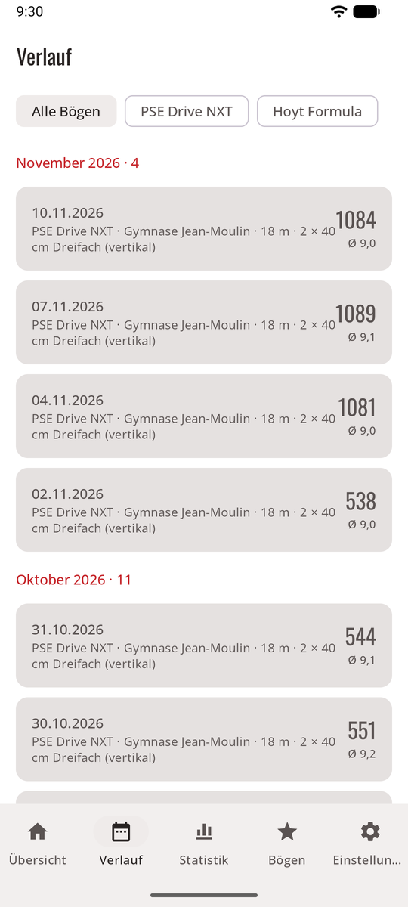
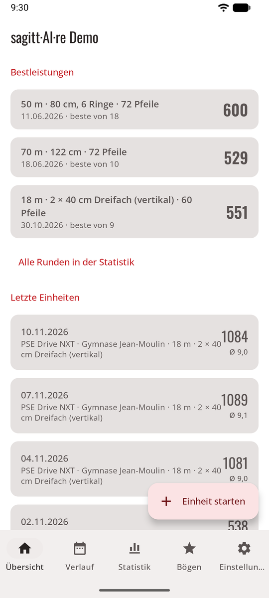

# Verlauf { #history }

Jede Einheit bleibt mit ihren Fotos auf deinem Handy. Der Tab **Verlauf** listet sie auf; im Spielmodus führt ein Link an der **Trophäenwand** zu allen.

<figure markdown>
{ .shot }
<figcaption><b>Verlauf</b>, nach Bogen gefiltert</figcaption>
</figure>
<figure markdown>
{ .shot }
<figcaption><b>Bestleistungen</b> in der Übersicht</figcaption>
</figure>

- **Übersicht:** Einheiten, Schnitt pro Pfeil, bestes Gesamtergebnis, Anzahl X, deine **Bestleistungen** für die Runden, die du am häufigsten schießt, und die letzten Einheiten.
- **Verlauf:** jede abgeschlossene Einheit, die neueste zuerst, nach Monat gruppiert und nach Bogen gefiltert. Öffne eine für ihren Schießzettel, ihr Diagramm der Ergebnisse pro Passe, ihre Bestleistungszeile und das Foto jeder Passe. **Teilen** sendet ihre Zusammenfassung (siehe [Einheiten](sessions.md#share-a-session)).

Für Entwicklung, Ringe, Gruppierung und Rekorde pro Runde siehe [Statistik](stats.md).
