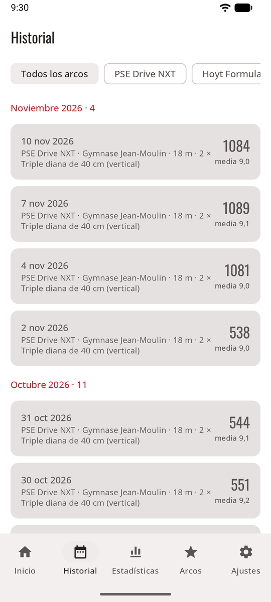
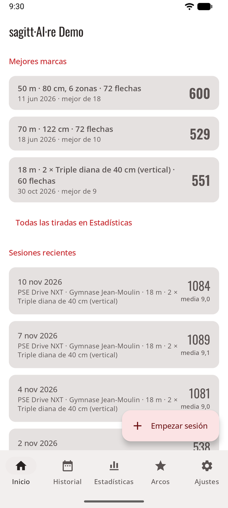

# Historial { #history }

Cada sesión se queda en tu teléfono con sus fotos. La pestaña **Historial** las muestra; en el modo juego, el **muro de trofeos** tiene un enlace a todas ellas.

<figure markdown>
{ .shot }
<figcaption><b>Historial</b>, filtrado por arco</figcaption>
</figure>
<figure markdown>
{ .shot }
<figcaption><b>Mejores marcas personales</b> en Inicio</figcaption>
</figure>

- **Inicio:** sesiones, media por flecha, mejor total, número de X, tus **mejores marcas personales** en las tiradas que más haces y las sesiones recientes.
- **Historial:** todas las sesiones terminadas, de la más reciente a la más antigua, agrupadas por mes y filtradas por arco. Abre una para ver su hoja de puntuación, su gráfico de puntuación por tanda, su línea de mejor marca personal y la foto de cada tanda. **Compartir** envía su resumen (consulta [Sesiones](sessions.md#share-a-session)).

Para tendencias, zonas, agrupación y récords por tirada, consulta [Estadísticas](stats.md).
