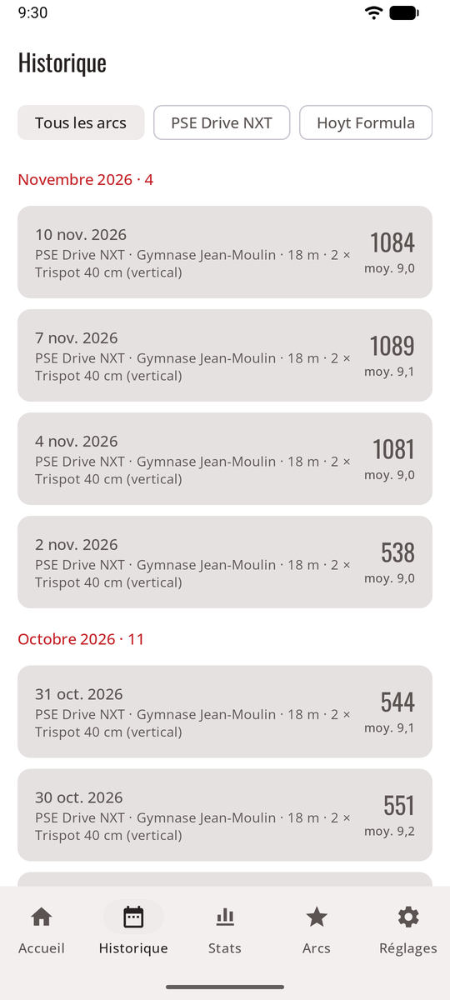
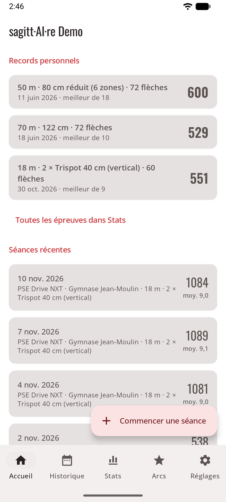

# Historique

Chaque séance reste sur votre téléphone avec ses photos. L’onglet **Historique** les liste; en mode jeu, le **mur des trophées** mène à toutes vos séances.

<figure markdown>
{ .shot }
<figcaption><b>Historique</b>, filtré par arc</figcaption>
</figure>
<figure markdown>
{ .shot }
<figcaption><b>Records personnels</b> à l’accueil</figcaption>
</figure>

- **Accueil :** les séances, la moyenne par flèche, le meilleur total, le nombre de X, vos **records personnels** pour les épreuves que vous tirez le plus, et les séances récentes.
- **Historique :** toutes les séances terminées, de la plus récente à la plus ancienne, regroupées par mois, filtrées par arc. Ouvrez-en une pour sa feuille de marque, son graphique du score par volée, sa ligne de record personnel et la photo de chaque volée. **Partager** envoie son résumé (voir [Séances](sessions.md#partager-une-seance)).

Pour les tendances, les zones, le groupement et les records par épreuve, voir [Statistiques](stats.md).
