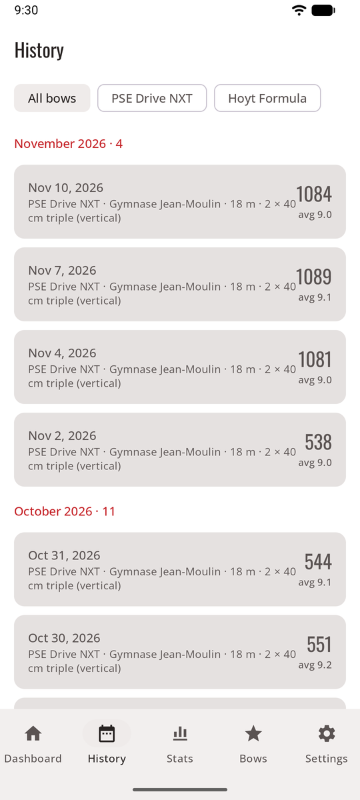
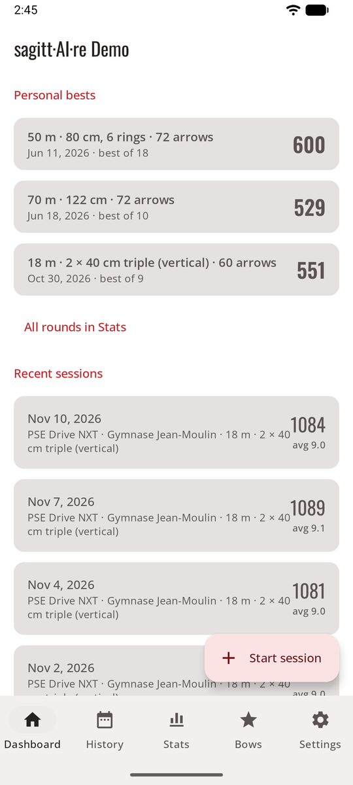

# History

Every session stays on your phone with its photos. The **History** tab lists them; in game mode, the **trophy wall** has a link to all of them.

<figure markdown>
{ .shot }
<figcaption><b>History</b>, filtered by bow</figcaption>
</figure>
<figure markdown>
{ .shot }
<figcaption><b>Personal bests</b> on the Dashboard</figcaption>
</figure>

- **Dashboard:** sessions, average per arrow, best total, X count, your **personal bests** for the rounds you shoot most, and the recent sessions.
- **History:** every finished session, newest first, grouped by month, filtered by bow. Open one for its scoresheet, its score-by-end chart, its personal-best line and the photo of each end. **Share** sends its summary (see [Sessions](sessions.md#share-a-session)).

For trends, rings, grouping and records per round, see [Statistics](stats.md).
