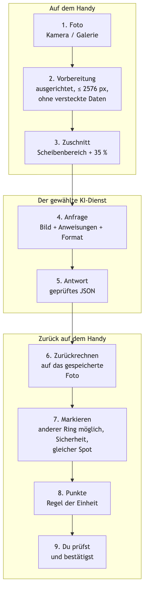
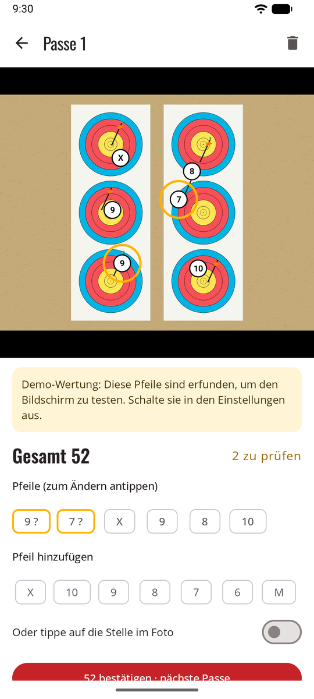
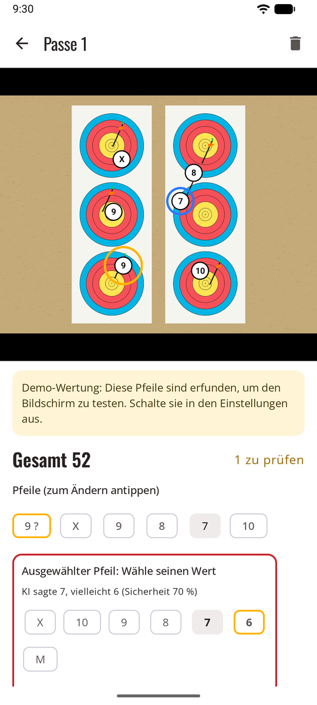
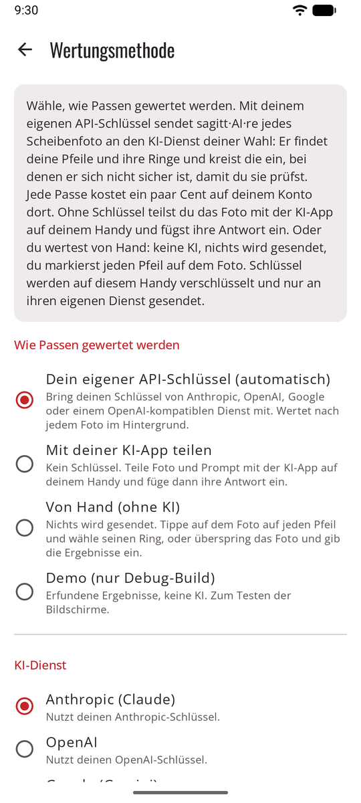

# So funktioniert es { #how-it-works }

Vom Foto der Scheibe zum bestätigten Ergebnis, in fünf Schritten. Die KI liest die Scheibe. sagitt·AI·re entscheidet, was eingekreist wird, wendet deine Wertungsregel an und führt die Aufzeichnung. Du bestätigst jede Passe.

{ width="250" align=right }

## 1. Du machst das Foto { #1-you-take-the-photo }

Nach der Passe fotografierst du die Scheibe von vorn und bringst die Auflage in den Kreis auf dem Bildschirm. Bevor irgendetwas anderes passiert, speichert sagitt·AI·re das Foto auf dem Handy:

- richtig herum gedreht und verkleinert (ein Handyfoto ist viel größer als nötig);
- **ohne seine versteckten Daten**: kein Standort, kein Handymodell, kein Datum;
- mit einer kleinen Kopie für die Listen.

Standardmäßig wird die Kopie, die gesendet wird, außerdem **auf den Scheibenbereich zugeschnitten**, sodass Personen oder Dinge rund um die Scheibe auf deinem Handy bleiben.

## 2. Das Foto geht mit Anweisungen an die KI { #2-the-photo-goes-to-the-ai-with-instructions }

sagitt·AI·re sendet eine Anfrage an den KI-Dienst deiner Wahl. Sie enthält:

| Teil | Was er sagt |
|------|--------------|
| **Das Foto** | Die zugeschnittene Scheibe. |
| **Wie man eine Scheibe liest** | Für jede Passe gleich. Finde die Pfeile, die in der Auflage stecken, nicht alte Löcher oder die Pfeile anderer Schützen. Gib den Punkt an, an dem jeder Schaft in die Auflage eintritt, nicht die Nocke. Wende die Linienregel an: Ein Schaft, der eine Linie berührt, zählt die höhere Zone. Sag, wenn ein Pfeil nah an einer Linie ist, und wie sicher du dir bist. |
| **Deine Angaben** | Aus der Einheit zusammengestellt: die Auflage und ihre Ringe, wie viele Auflagen und Spots (2 Dreifach-Auflagen = 6 Spots), wie viele Pfeile zu suchen sind, deine Wertungsregel mit dem Wert jedes Rings, und deine Pfeilbeschreibung. |
| **Das Antwortformat** | Eine feste Liste von Feldern, damit die Antwort immer gelesen werden kann. |

## 3. Die KI antwortet { #3-the-ai-answers }

Für jeden Pfeil gibt die KI an:

- seine Position auf dem Foto;
- seinen **Ring** (X, 10 … 1 oder M);
- einen **zweiten Ring**, wenn der Pfeil auf oder nah an einer Linie ist;
- wie **sicher** sie sich ist.

Sie meldet den Ring so, wie er gezeichnet ist, nicht Punkte. Das ist Absicht: sagitt·AI·re macht aus Ringen Punkte, mit deiner Regel. So kannst du die Regel einer Einheit später ändern, und jedes Ergebnis wird neu berechnet, ohne die KI noch einmal zu fragen.

## 4. sagitt·AI·re kreist ein, was du prüfen solltest { #4-ullr-circles-what-you-should-check }

<figure markdown>
{ .shot }
<figcaption>Zwei Pfeile zum Prüfen eingekreist</figcaption>
</figure>

Ein Pfeil wird bernsteinfarben eingekreist, wenn:

- die KI einen zweiten Ring angegeben hat (er ist nah an einer Linie);
- ihre Sicherheit gering ist;
- auf einer Dreifach-Auflage zwei Pfeile im selben Spot stecken.

Ein Hinweisbanner warnt dich außerdem, wenn die Zahl der gefundenen Pfeile nicht der Zahl der geschossenen entspricht, wenn keine Scheibe gefunden wurde oder wenn das Foto Probleme hat (Spiegelung, Unschärfe, abgeschnittene Auflage).

Warum mehrere Signale? Die Sicherheit einer KI stimmt nicht immer. Gefährlich ist ein Pfeil, der falsch und mit großer Sicherheit gewertet wird. Die getrennte Frage „Ist er nah an einer Linie?“ fängt viele davon ab.

## 5. Du bestätigst { #5-you-confirm }

<figure markdown>
{ .shot }
<figcaption>Den richtigen Ring wählen, dann bestätigen</figcaption>
</figure>

Du korrigierst jeden eingekreisten Pfeil mit einem Tippen, fügst einen übersehenen Pfeil hinzu oder entfernst den eines anderen Schützen und bestätigst. Erst dann zählt die Passe. Jede Passe behält ihr Foto, du kannst sie also jederzeit noch einmal prüfen.

## Drei Arten zu werten { #three-ways-to-score }

<figure markdown>
{ .shot }
<figcaption>Die Methode in den Einstellungen wählen</figcaption>
</figure>

| Methode | Wie |
|--------|-----|
| **[Dein eigener API-Schlüssel](scoring-api.md)** | Automatisch, im Hintergrund. Anthropic (Claude), Google (Gemini), OpenAI oder jeder OpenAI-kompatible Dienst unter der Adresse, die du angibst. |
| **[Mit deiner KI-App teilen](scoring-share.md)** | Kein Schlüssel: Teile Foto und Anweisung mit der KI-App auf deinem Handy und füge ihre Antwort ein. |
| **[Von Hand](scoring-manual.md)** | Keine KI: Tippe jeden Pfeil auf dem Foto an und wähle seinen Ring. Nichts wird gesendet. |
| **Direkt eintippen** | Immer möglich, bei jeder Passe, egal mit welcher Methode. |

Jede KI bekommt genau dieselben Anweisungen. Nimm, was dir lieber ist, und ändere es jederzeit. Siehe [Drei Arten zu werten](scoring.md).

## Am Bogenplatz { #at-the-range }

Am Bogenplatz gibt es oft keinen Empfang. sagitt·AI·re speichert jedes Foto zuerst, und die automatische Wertung wartet auf das Netz. Sie startet von selbst, sobald das Handy wieder online ist. Wenn du das Ergebnis sofort brauchst, gib es von Hand ein, oder nutze die [Wertung von Hand](scoring-manual.md), die nie das Netz braucht. Beim Schließen der App geht nichts verloren.

## Zuverlässigkeit { #reliability }

Es gibt keine Garantie für die Zuverlässigkeit. Wie genau die Wertung ist, hängt stark von der Qualität des Fotos ab, vom Winkel, aus dem es aufgenommen wurde, und vom KI-Modell, das du gewählt hast. Die KI kann jederzeit Fehler machen. Deshalb werden unsichere Pfeile eingekreist, und deshalb bestätigst du jede Passe: Prüf deine Pfeile immer in der Scheibe, bevor du sie ziehst.
