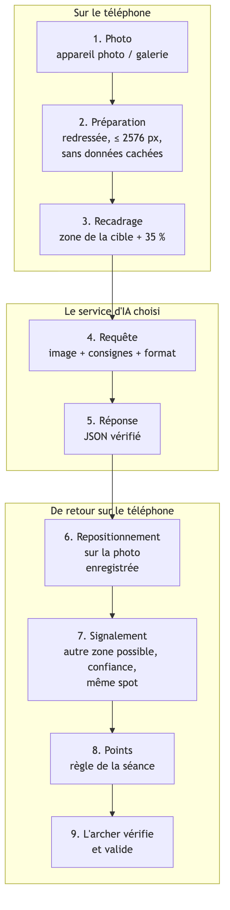
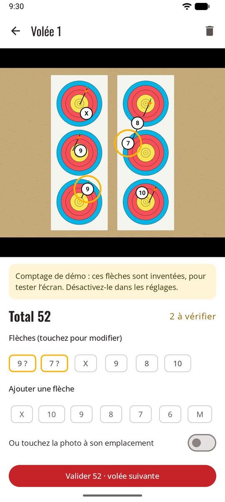
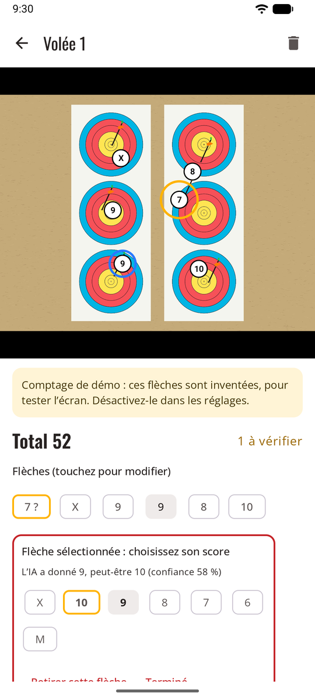
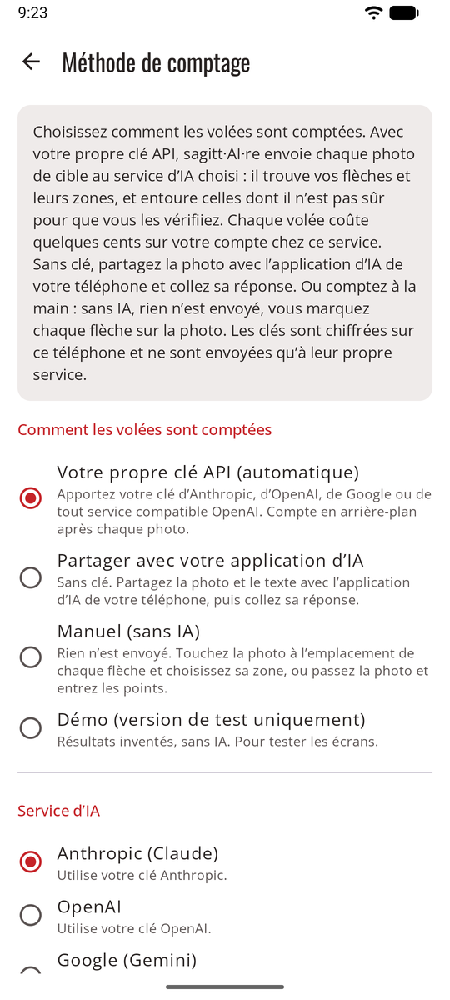

# Comment ça marche

De la photo de la cible au score validé, en cinq étapes. L'IA lit la cible. sagitt·AI·re décide quoi entourer, applique votre règle de comptage et garde l'historique. Vous validez chaque volée.

{ width="250" align=right }

## 1. Vous prenez la photo

Après la volée, vous photographiez la cible de face, en cadrant le blason dans le cercle à l'écran. Avant tout, sagitt·AI·re enregistre la photo sur le téléphone :

- remise dans le bon sens et réduite (une photo de téléphone est bien plus grande que nécessaire) ;
- **sans ses données cachées** : ni position, ni modèle de téléphone, ni date ;
- avec une petite copie pour les listes.

Par défaut, la copie qui sera envoyée est aussi **recadrée sur le carré autour du cercle de cadrage** : l'essentiel de ce qui entoure la cible reste sur votre téléphone.

## 2. La photo part vers l'IA, avec des consignes

sagitt·AI·re envoie une seule requête au service d'IA que vous avez choisi. Elle contient :

| Partie | Ce qu'elle dit |
|--------|----------------|
| **La photo** | La cible, recadrée. |
| **Comment lire une cible** | La même pour chaque volée. Trouver les flèches plantées dans le blason, pas les anciens trous ni les flèches des autres archers. Donner le point où chaque tube entre dans le blason, pas l'encoche. Appliquer la règle de la ligne : un tube qui touche une ligne prend la zone la plus haute. Signaler une flèche proche d'une ligne, et dire à quel point elle est sûre. |
| **Les paramètres de la séance** | Tirés de la séance : le blason et ses zones, le nombre de blasons et de spots (2 trispots = 6 spots), le nombre de flèches à chercher, votre règle de comptage avec la valeur de chaque zone, et la description de vos flèches. |
| **Le format de réponse** | Une liste de champs fixe, pour que la réponse soit toujours lisible. |

## 3. L'IA répond

Pour chaque flèche, l'IA donne :

- sa position sur la photo ;
- sa **zone** (X, 10 … 1, ou M) ;
- une **deuxième zone** si la flèche est sur une ligne ou tout près ;
- son niveau de **confiance**.

Elle donne la zone telle qu'elle est dessinée, pas les points. C'est voulu : sagitt·AI·re transforme les zones en points avec votre règle, donc vous pouvez changer la règle d'une séance plus tard et tous les totaux sont recalculés, sans redemander à l'IA.

## 4. sagitt·AI·re entoure ce qu'il faut vérifier

<figure markdown>
{ .shot }
<figcaption>Deux flèches entourées à vérifier</figcaption>
</figure>

Une flèche est entourée en orange quand :

- l'IA a donné une deuxième zone (elle est près d'une ligne) ;
- sa confiance est faible ;
- sur un trispot, deux flèches sont dans le même spot.

Un bandeau vous prévient aussi quand le nombre de flèches trouvées n'est pas le nombre tiré, quand aucune cible n'a été trouvée, ou quand la photo pose problème (reflet, flou, blason coupé).

Pourquoi plusieurs signaux ? La confiance d'une IA n'est pas toujours juste. Le cas dangereux, c'est une flèche mal comptée avec assurance. Demander à part « est-elle près d'une ligne ? » en rattrape beaucoup.

## 5. Vous validez

<figure markdown>
{ .shot }
<figcaption>Choisir la bonne zone, puis valider</figcaption>
</figure>

Vous corrigez une flèche entourée d'une touche, ajoutez une flèche oubliée ou retirez celle d'un autre archer, et validez. C'est seulement alors que la volée compte. Chaque volée garde sa photo : vous pouvez toujours la revoir.

## Trois façons de compter

<figure markdown>
{ .shot }
<figcaption>Choisir la méthode dans les réglages</figcaption>
</figure>

| Méthode | Comment |
|---------|---------|
| **[Votre propre clé API](scoring-api.md)** | Automatique, en arrière-plan. Anthropic (Claude), Google (Gemini), OpenAI, ou tout service compatible OpenAI à l’adresse que vous indiquez. |
| **[Partager avec votre application d’IA](scoring-share.md)** | Sans clé : partagez la photo et le texte avec l’application d’IA de votre téléphone, puis collez sa réponse. |
| **[Manuel](scoring-manual.md)** | Sans IA : touchez chaque flèche sur la photo et choisissez sa zone. Rien n’est envoyé. |
| **À la main** | Toujours possible, sur chaque volée, quelle que soit la méthode. |

Chaque IA reçoit exactement les mêmes consignes. Choisissez ce que vous préférez, et changez à tout moment. Voir [Trois façons de compter](scoring.md).

## Au pas de tir

Il y a souvent peu de réseau sur un terrain de tir. sagitt·AI·re enregistre d’abord chaque photo, et le comptage automatique attend le réseau. Il démarre tout seul dès que le téléphone est de nouveau en ligne. Si vous voulez le score tout de suite, saisissez-le à la main, ou utilisez le [comptage manuel](scoring-manual.md), qui n’a jamais besoin du réseau. Fermer l’application ne fait rien perdre.

## Fiabilité

Il n'y a aucune garantie de fiabilité. La justesse du comptage dépend beaucoup de la qualité de la photo, de l'angle de prise de vue et du modèle d'IA choisi. En tout temps, l'IA peut se tromper. C'est pourquoi les flèches incertaines sont entourées, et c'est pourquoi c'est vous qui validez chaque volée : vérifiez toujours vos flèches dans la cible avant de les retirer.
