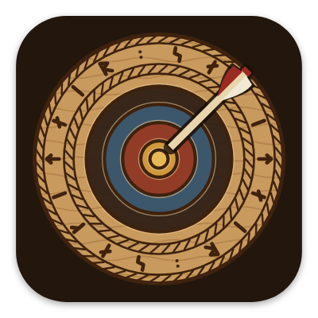
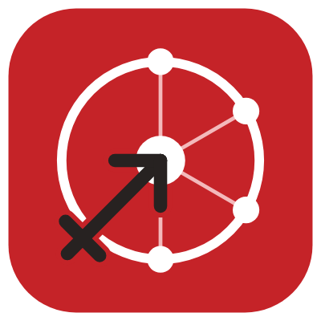
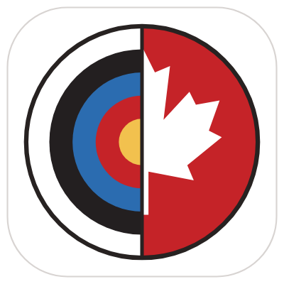
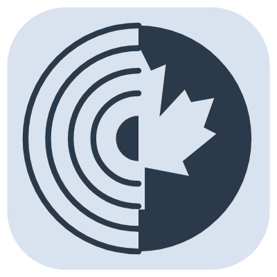

# Das App-Symbol { #the-app-icon }

Das heutige Symbol ist halb Scheibe, halb Ahornblatt: ein Kreis, dessen linke Hälfte eine World-Archery-Scheibe ist und dessen rechte Hälfte ein weißes Ahornblatt auf dem Rot von Archery Canada. Davor gab es ein rotes Zeichen mit Neuronen und dem Zeichen des Schützen und eine geschnitzte Holzscheibe im nordischen Stil.

## Wie es entstand { #how-it-evolved }

<figure markdown>
{ width="180" }
<figcaption><b>1. Die erste Scheibe.</b> Klar, aber das hätte jede beliebige Bogensport-App sein können.</figcaption>
</figure>
<figure markdown>
{ width="180" }
<figcaption><b>2. Ein Wikingerschild.</b> „Mach es wikingerhafter“ ergab einen Schild. Abgelehnt: Es musste eine Scheibe sein.</figcaption>
</figure>
<figure markdown>
{ width="180" }
<figcaption><b>3. Die geschnitzte Scheibe.</b> Die erste Idee, neu umgesetzt als nordische Holzschnitzerei. Gewählt.</figcaption>
</figure>
<figure markdown>
{ width="180" }
<figcaption><b>4. Der neue Name.</b> Als aus Ullr sagitt·AI·re wurde, schreiben die Runen nun den neuen Namen.</figcaption>
</figure>
<figure markdown>
{ width="180" }
<figcaption><b>5. Archery Canada.</b> sagitt·AI·re wird die App von Archery Canada: ein neues Zeichen, in ihrem Rot.</figcaption>
</figure>
<figure markdown>
{ width="180" }
<figcaption><b>6. Scheibe und Ahornblatt.</b> Bogenschießen und Kanada, halb und halb, die sich in der Mitte treffen.</figcaption>
</figure>

## Das heutige Symbol { #todays-icon }

- **Die linke Hälfte** ist eine World-Archery-Scheibe: Weiß, Schwarz, Blau, Rot und Gold.
- **Die rechte Hälfte** ist ein weißes Ahornblatt auf dem Rot von Archery Canada.
- Sie treffen sich auf der Mittellinie, sodass Scheibe und Blatt einen Kreis bilden.
- **Ein weißer Hintergrund**, wie die Website von Archery Canada, und auch der Startbildschirm ist weiß.

## Varianten { #variants }

<figure markdown>
{ width="180" }
<figcaption><b>Designsymbol.</b> Einfarbig, von Android 13+ passend zu deinem Hintergrundbild eingefärbt.</figcaption>
</figure>
<figure markdown>
{ width="180" }
<figcaption><b>sagitt·AI·re Demo.</b> Ein DEMO-Banner, damit sie nicht mit der echten App verwechselt werden kann.</figcaption>
</figure>

Das Symbol wird von einem kleinen Programm gezeichnet statt von Hand, sodass jede Größe, vom Launcher bis zum Play Store, aus derselben Zeichnung stammt.
