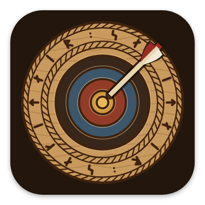
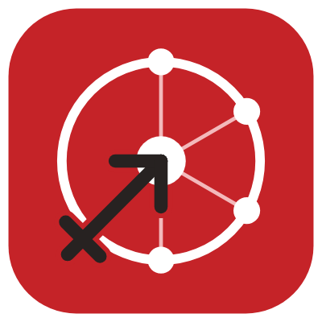
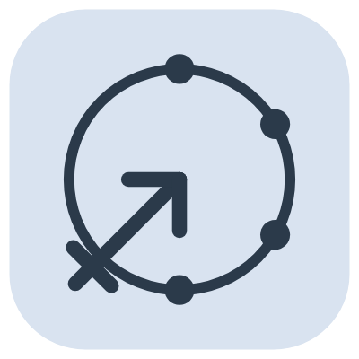

# El icono de la app { #the-app-icon }

El icono de hoy es rojo Archery Canada: un anillo de diana con cuatro neuronas unidas a su centro (la IA), y el signo de Sagitario, cuya flecha acaba en el centro. Antes, la app tenía una diana de madera tallada al estilo nórdico.

## Cómo evolucionó { #how-it-evolved }

<figure markdown>
{ width="180" }
<figcaption><b>1. La primera diana.</b> Clara, pero podría ser la de cualquier app de tiro con arco.</figcaption>
</figure>
<figure markdown>
{ width="180" }
<figcaption><b>2. Un escudo vikingo.</b> «Hazlo más vikingo» dio un escudo. Descartado: tenía que ser una diana.</figcaption>
</figure>
<figure markdown>
{ width="180" }
<figcaption><b>3. La diana tallada.</b> La primera idea, rehecha como talla nórdica en madera. La elegida.</figcaption>
</figure>
<figure markdown>
{ width="180" }
<figcaption><b>4. El nuevo nombre.</b> Cuando Ullr pasó a ser sagitt·AI·re, las runas cambiaron para formar el nuevo nombre.</figcaption>
</figure>
<figure markdown>
{ width="180" }
<figcaption><b>5. Archery Canada.</b> sagitt·AI·re pasa a ser la app de Archery Canada: un nuevo símbolo, en su rojo.</figcaption>
</figure>

## El icono de hoy { #todays-icon }

- **El anillo de la diana**, el tiro con arco.
- **Cuatro neuronas** en el anillo, unidas al centro: la IA que lee tu diana.
- **El signo de Sagitario** ♐, el arquero del zodiaco, que da nombre a la app; su flecha termina en el centro.
- **El rojo de Archery Canada** detrás, blanco y negro para el símbolo. La pantalla de arranque es blanca, como el sitio web de Archery Canada.

## Variantes { #variants }

<figure markdown>
{ width="180" }
<figcaption><b>Icono temático.</b> Un solo color, teñido por Android 13+ para combinar con tu fondo de pantalla.</figcaption>
</figure>
<figure markdown>
{ width="180" }
<figcaption><b>sagitt·AI·re Demo.</b> Una banda DEMO, para que no se confunda con la app real.</figcaption>
</figure>

El icono lo dibuja un pequeño programa y no se hace a mano, así que todos los tamaños, del lanzador a la Play Store, salen del mismo dibujo.
