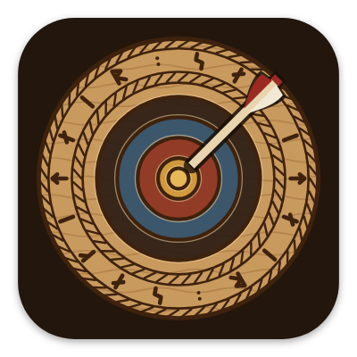
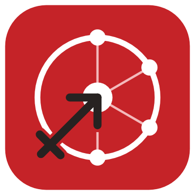
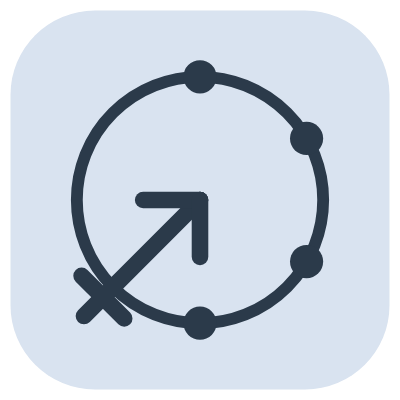

# L'icône

L'icône d'aujourd'hui est rouge Tir à l'arc Canada : un anneau de cible avec quatre neurones reliés au centre (l'IA), et le signe du Sagittaire, dont la flèche se plante dans le centre. Avant elle, l'application avait une cible de bois sculptée, à la manière nordique.

## Son évolution

<figure markdown>
{ width="180" }
<figcaption><b>1. La première cible.</b> Claire, mais elle aurait pu être celle de n'importe quelle application de tir à l'arc.</figcaption>
</figure>
<figure markdown>
{ width="180" }
<figcaption><b>2. Un bouclier viking.</b> « Plus viking » a donné un bouclier. Refusé : il fallait une cible.</figcaption>
</figure>
<figure markdown>
{ width="180" }
<figcaption><b>3. La cible sculptée.</b> La première idée, refaite en bois sculpté nordique. Retenue.</figcaption>
</figure>
<figure markdown>
{ width="180" }
<figcaption><b>4. Le nouveau nom.</b> Quand Ullr est devenue sagitt·AI·re, les runes ont changé pour écrire le nouveau nom.</figcaption>
</figure>
<figure markdown>
{ width="180" }
<figcaption><b>5. Tir à l'arc Canada.</b> sagitt·AI·re devient l'application de Tir à l'arc Canada : un nouveau symbole, dans son rouge.</figcaption>
</figure>

## L'icône d'aujourd'hui

- **L'anneau de cible**, pour le tir à l'arc.
- **Quatre neurones** sur l'anneau, reliés au centre : l'IA qui lit votre cible.
- **Le signe du Sagittaire** ♐, l'archer du zodiaque, qui donne son nom à l'application ; sa flèche finit dans le centre.
- **Le rouge de Tir à l'arc Canada** derrière, du blanc et du noir pour le symbole. L'écran de lancement est blanc, comme le site de Tir à l'arc Canada.

## Les variantes

<figure markdown>
{ width="180" }
<figcaption><b>Icône thématique.</b> Une seule couleur, teintée par Android 13 et plus selon votre fond d'écran.</figcaption>
</figure>
<figure markdown>
{ width="180" }
<figcaption><b>sagitt·AI·re Demo.</b> Un bandeau DEMO, pour ne pas la confondre avec la vraie application.</figcaption>
</figure>

L'icône est dessinée par un petit programme plutôt qu'à la main : toutes les tailles, du lanceur jusqu'au Play Store, viennent du même dessin.
