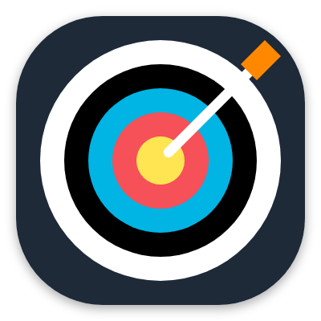
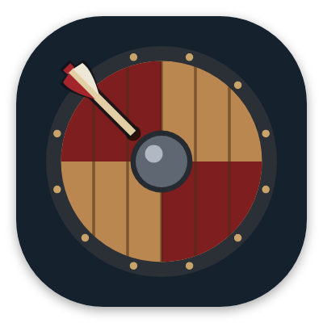
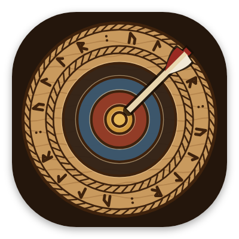
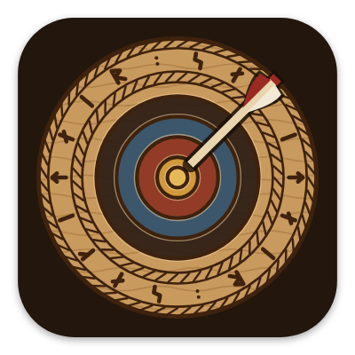
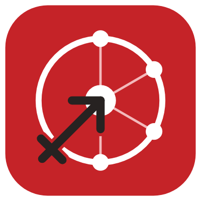
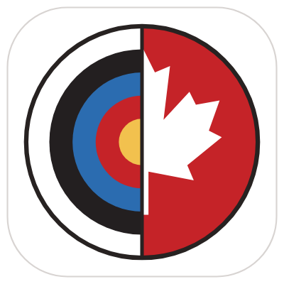
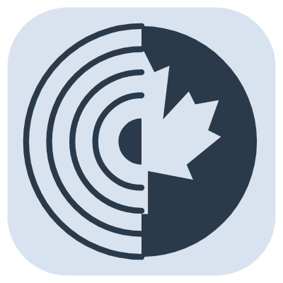
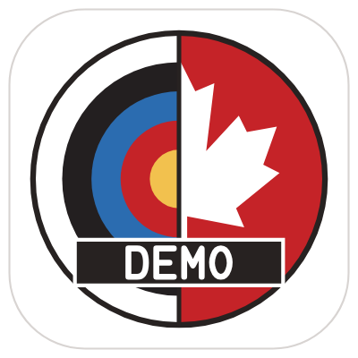

# The app icon

Today's icon is half a target and half a maple leaf: a circle whose left half is a World Archery target and whose right half is a white maple leaf on Archery Canada red. Before it came a red mark with neurons and the Sagittarius sign, and a carved wooden target, Norse style.

## How it evolved

<figure markdown>
{ width="180" }
<figcaption><b>1. The first target.</b> Clear, but it could be any archery app.</figcaption>
</figure>
<figure markdown>
{ width="180" }
<figcaption><b>2. A Viking shield.</b> "Make it look more Viking" gave a shield. Rejected: it had to be a target.</figcaption>
</figure>
<figure markdown>
{ width="180" }
<figcaption><b>3. The carved target.</b> The first idea, redone as Norse wood carving. Chosen.</figcaption>
</figure>
<figure markdown>
{ width="180" }
<figcaption><b>4. Renamed.</b> When Ullr became sagitt·AI·re, the runes changed to spell the new name.</figcaption>
</figure>
<figure markdown>
{ width="180" }
<figcaption><b>5. Archery Canada.</b> sagitt·AI·re becomes Archery Canada's app: a new mark, in its red.</figcaption>
</figure>
<figure markdown>
{ width="180" }
<figcaption><b>6. Target and maple leaf.</b> Archery and Canada, half and half, meeting in the middle.</figcaption>
</figure>

## Today's icon

- **The left half** is a World Archery target: white, black, blue, red and gold.
- **The right half** is a white maple leaf on Archery Canada red.
- They meet on the centre line, so the target and the leaf make one circle.
- **A white background**, like Archery Canada's website, and the launch screen is white too.

## Variants

<figure markdown>
{ width="180" }
<figcaption><b>Themed icon.</b> One colour, tinted by Android 13+ to match your wallpaper.</figcaption>
</figure>
<figure markdown>
{ width="180" }
<figcaption><b>sagitt·AI·re Demo.</b> A DEMO banner, so it can't be confused with the real app.</figcaption>
</figure>

The icon is drawn by a small program rather than by hand, so every size, from the launcher to the Play Store, comes from the same drawing.
