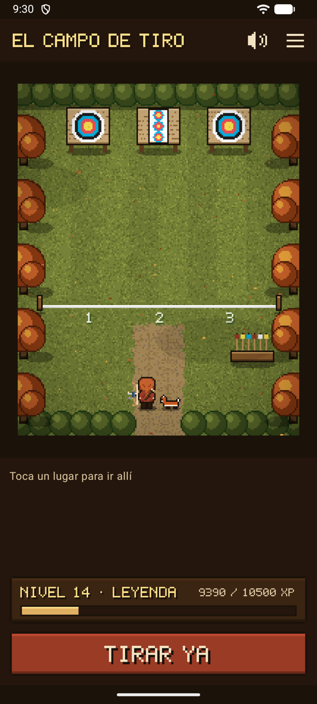
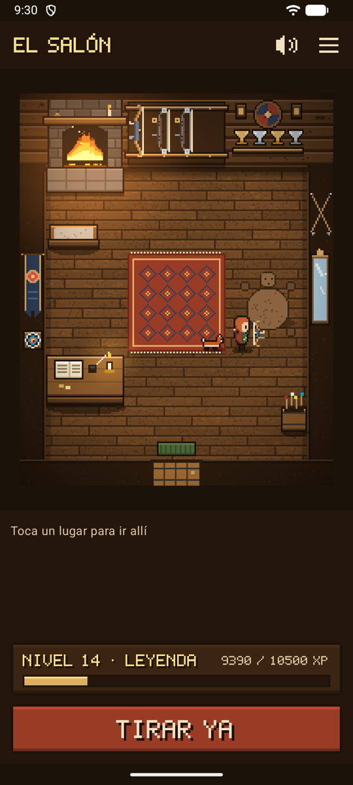
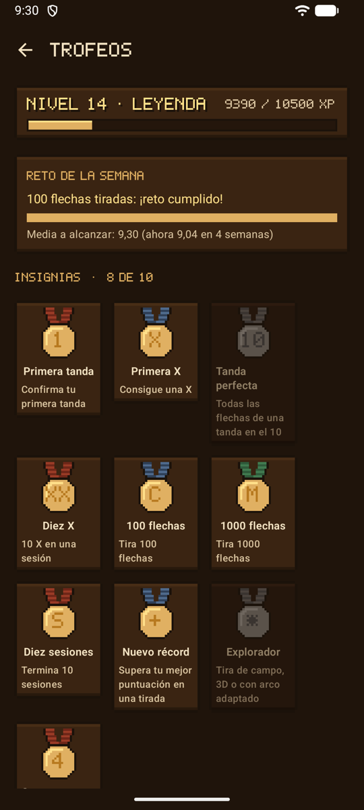
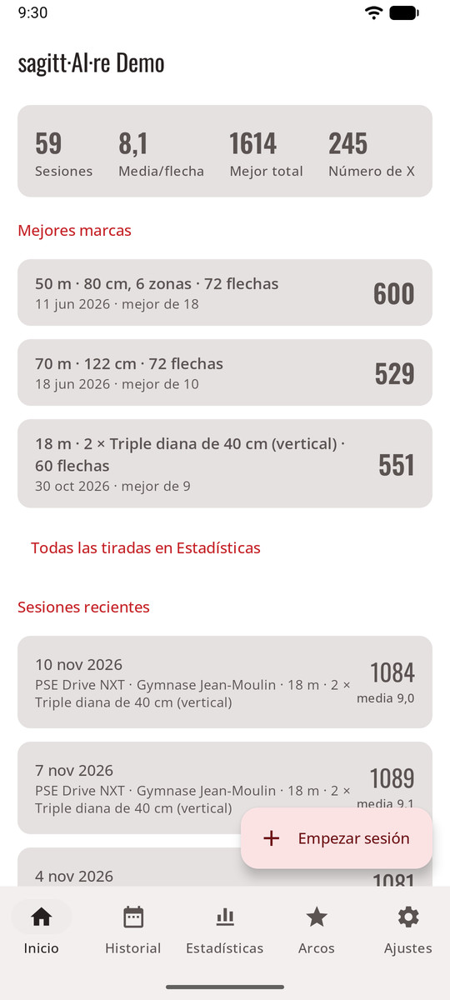
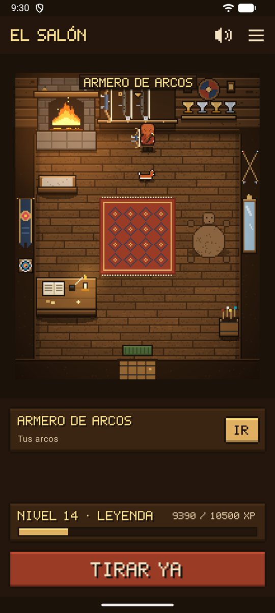

# sagitt·AI·re { #sagittaire }

**Tu hoja de puntuación de tiro con arco, guardada por ti.** Después de cada tanda, haz una foto de la diana. Una IA encuentra tus flechas, las puntúa y marca con un círculo las que no tiene claras. O prescinde de la IA y toca tú mismo tus flechas en la foto. Cada sesión se guarda en tu teléfono con sus fotos.

*Su nombre: Sagittaire, Sagitario en francés, el arquero de las estrellas, con la IA (AI) en el centro.*

**sagitt·AI·re es la app de Archery Canada**, creada pro bono por Estudio Ashencroft. Es para el entrenamiento y el ocio: sus puntuaciones nunca son oficiales, y en competición solo cuentan las hojas de puntuación oficiales.

## O juégalo como un videojuego { #game-band }

Activa el **modo juego** y sagitt·AI·re se convierte en un pequeño videojuego en pixel art. Tu arquero recorre un salón nórdico y un campo de tiro: el **armero de arcos** abre tus arcos, la **línea de tiro** empieza una sesión, el **hogar** muestra tus estadísticas. Los mismos registros, la misma puntuación: solo el tiro real te hace ganar algo.

<figure markdown>
{ .shot }
<figcaption><b>Ve al campo de tiro</b> y tira</figcaption>
</figure>
<figure markdown>
{ .shot }
<figcaption><b>Viste a tu arquero</b>, elige un compañero</figcaption>
</figure>
<figure markdown>
{ .shot }
<figcaption><b>Niveles, insignias</b>, un reto de la semana</figcaption>
</figure>

{ .pixel width="360" }

Atuendos y decoraciones del salón por ganar, un búho por cuatro semanas seguidas, un cuerno de guerra por una mejor marca personal, el campo de tiro en las cuatro estaciones, música y sonidos hechos para sagitt·AI·re.

[Descubre el modo juego](game.md){ .md-button .md-button--primary }

## Dos formas de usarlo { #two-ways-to-use-it }

Los mismos registros, la misma puntuación: elige la que te guste y cambia cuando quieras en **Ajustes → Apariencia y juego**.

-   :material-view-dashboard-outline: **Modo normal**

    ---

    { .shot width="200" }

    Una app clara con pestañas: Inicio, Historial, Arcos, Estadísticas y Ajustes. Rápida en el campo de tiro.

    [Modo normal](normal.md)

-   :material-gamepad-variant-outline: **Modo juego**

    ---

    { .shot width="200" }

    ¿Quién quiere orientarse por menús de texto? Pasea a tu arquero por un salón nórdico y un campo de tiro: el armero de arcos abre tus arcos, la línea de tiro empieza una sesión. Pixel art, música, un compañero.

    [Modo juego](game.md)

## Tres formas de puntuar { #three-ways-to-score }

-   :material-key-outline: **Tu propia clave de API**

    ---

    Automático. Cada foto se puntúa en segundo plano con el servicio de IA que elijas, con tu propia clave: un servicio importante, o cualquier servicio compatible con OpenAI en la dirección que indiques.

    [Tu propia clave de API](scoring-api.md)

-   :material-share-variant-outline: **Compartir con tu app de IA**

    ---

    Sin clave. Comparte la foto y un prompt ya preparado con la app de IA que ya tienes en el teléfono, y luego pega su respuesta.

    [Compartir con tu app de IA](scoring-share.md)

-   :material-gesture-tap: **Manual**

    ---

    Sin IA, sin enviar nada. Toca cada flecha en la foto y elige su zona, o prescinde de la foto y toca las puntuaciones.

    [Puntuación manual](scoring-manual.md)

[Compara los tres](scoring.md){ .md-button }

## Funciones { #features }

-   :material-camera-outline: **[Sesiones](sessions.md)**

    ---

    Lugar, disciplina, arco, distancia, diana y flechas por tanda. Una foto por tanda, incluso sin cobertura. Mejores marcas personales por tirada, y un resumen para compartir.

-   :material-target: **[Revisar las flechas](review.md)**

    ---

    Las flechas dudosas, marcadas con un círculo ámbar. Toca una y elige la zona correcta. Se aplica la regla de la línea.

-   :material-scale-balance: **[Reglas de puntuación](rules.md)**

    ---

    X = 10, solo el 10 interior o X = 11, por sesión. Cámbiala más tarde y todos los totales se vuelven a calcular.

-   :material-bow-arrow: **[Arcos](bows.md)**

    ---

    Todos tus arcos, dibujados según su tipo, con un catálogo de arcos compuestos actuales.

-   :material-chart-bar: **[Estadísticas](stats.md)**

    ---

    Cada sesión con sus fotos, un gráfico de puntuación por tanda, tendencias, regularidad, dónde se agrupan tus flechas y un mapa de calor por spot, por distancia y diana.

-   :material-archive-outline: **[Almacenamiento y copia de seguridad](backup.md)**

    ---

    Exporta a un solo archivo, restaura en un teléfono nuevo, libera espacio de fotos antiguas.

-   :material-palette-outline: **[Aspecto e idioma](look.md)**

    ---

    Tres temas, uno de ellos para pleno sol. Inglés, francés, alemán y español.

-   :material-shield-lock-outline: **[Privacidad](privacy.md)**

    ---

    Los registros se quedan en el teléfono. Sin cuenta, sin anuncios, sin seguimiento. Nada se elimina sin preguntar.

[Todas las capturas](screenshots.md){ .md-button } [Cómo funciona](how-it-works.md){ .md-button } [Primeros pasos](guide.md){ .md-button .md-button--primary }

## Estado { #status }

sagitt·AI·re es un proyecto pro bono del Estudio Ashencroft, en desarrollo activo. Funciona en Android 8 y posteriores. **No está en Google Play:** se instala directamente en el teléfono. Consulta la [hoja de ruta](roadmap.md) para ver lo que está hecho y lo que viene. Usar sagitt·AI·re significa aceptar sus [condiciones de uso](terms.md): se ofrece tal cual. Su [política de privacidad](privacy-policy.md) explica qué se queda en tu teléfono y qué se envía.
