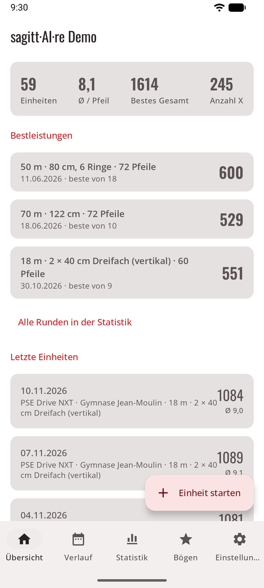
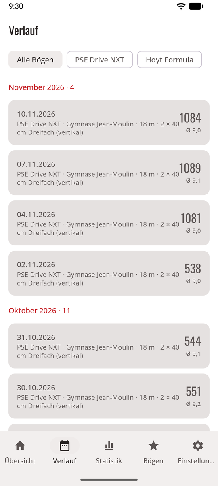
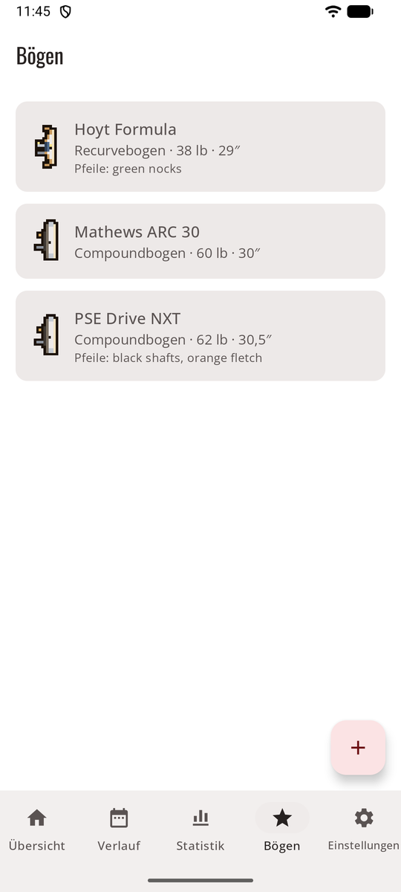
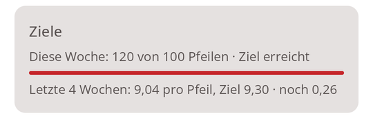

# Normalmodus { #normal-mode }

Die App, wie du sie erwartest: eine Tab-Leiste unten und Bildschirme, die sich von dort öffnen. So kommst du am Bogenplatz am schnellsten ans Ziel, und so öffnet sich sagitt·AI·re beim ersten Mal.

<figure markdown>
{ .shot }
<figcaption><b>Übersicht.</b> Deine Zahlen und letzten Einheiten.</figcaption>
</figure>
<figure markdown>
{ .shot }
<figcaption><b>Verlauf.</b> Jede abgeschlossene Einheit.</figcaption>
</figure>
<figure markdown>
{ .shot }
<figcaption><b>Bögen.</b> Deine Bögen und ihre Einstellungen.</figcaption>
</figure>

## Die Tabs { #the-tabs }

| Tab | Was du dort findest |
|-----|--------------|
| **Übersicht** | Einheiten, Schnitt pro Pfeil, bestes Gesamt, Anzahl X, deine [Trainingsziele](#training-goals), deine **Bestleistungen** pro Runde und die letzten Einheiten. Eine laufende Einheit steht oben, mit **Fortsetzen**. **Einheit starten** ist der runde Knopf. |
| **Verlauf** | Jede abgeschlossene Einheit, nach Monat, gefiltert nach Bogen. Siehe [Verlauf](history.md). |
| **Bögen** | Deine Bögen. Siehe [Bögen](bows.md). |
| **Statistik** | Trends, Ringe, Konstanz, Gruppierung, Heatmap und Bestwerte pro Runde. Siehe [Statistik](stats.md). |
| **Einstellungen** | Ein Eintrag pro Seite, jeder zeigt, was gerade gewählt ist. |

## Einstellungen { #settings }

Jede Einstellungsseite beginnt mit einer kurzen Erklärung, dann folgen ihre Optionen.

| Seite | Was du einstellst |
|------|--------------|
| **Wertungsmethode** | Dein eigener API-Schlüssel, Teilen mit deiner KI-App oder von Hand. Siehe [Drei Arten zu werten](scoring.md). |
| **Wertungsregeln** | Die Regel, mit der neue Einheiten beginnen. Siehe [Wertungsregeln](rules.md). |
| **Trainingsziele** | Pfeile pro Woche und ein Schnitt pro Pfeil, den du erreichen willst. Siehe [Trainingsziele](#training-goals). |
| **Datenschutz** | Nur den Scheibenbereich senden, und was gesendet wird. Siehe [Datenschutz](privacy.md). |
| **Aussehen und Spiel** | Normal- oder Spielmodus, das Design, Spielgeräusche und Musik. Siehe [Aussehen und Sprache](look.md). |
| **Sprache** | Englisch, Französisch, Deutsch, Spanisch oder die Sprache des Handys (Android 13 und neuer). |
| **Gespeicherte Orte** | Die Orte deiner Einheiten umbenennen, zusammenführen oder löschen. Siehe [Gespeicherte Orte](sessions.md#saved-places). |
| **Speicher und Sicherung** | Belegter Speicher, Export, Wiederherstellen, Speicher freigeben. Siehe [Speicher und Sicherung](backup.md). |
| **Info und Rechtliches** | Die Version, den Fingerabdruck des Zertifikats, mit dem diese Kopie signiert ist ([prüfen](index.md#status)), die [Nutzungsbedingungen](terms.md), die [Datenschutzerklärung](privacy-policy.md) und die [Open-Source-Lizenzen](licences.md). |

## Trainingsziele { #training-goals }

**Einstellungen → Trainingsziele**: wie viele **Pfeile pro Woche** du schießen willst (10 bis 999) und ein **Schnitt pro Pfeil**, den du erreichen willst (zum Beispiel 9,2). Lass eines leer, um es auszuschalten; **Beide Ziele entfernen** schaltet beide aus.

{ .shot width="320" }

Die Übersicht zeigt dann eine Karte **Ziele**: die Pfeile dieser Woche (Montag bis Sonntag, die laufende Einheit eingeschlossen) im Vergleich zu deinem Ziel, mit einem Balken, und deinen Schnitt pro Pfeil über die letzten vier Wochen abgeschlossener Einheiten im Vergleich zu deinem Ziel. Tipp darauf, um die Ziele zu ändern. Im Spielmodus macht die Trophäenwand daraus die [Wochenherausforderung](game.md#this-weeks-challenge).

## Zum Spielmodus wechseln { #switching-to-game-mode }

**Einstellungen → Aussehen und Spiel → Spiel (Vorschau)**. Alles, was du aufgezeichnet hast, ist auch im Spiel da, und **Normal** bringt dich zurück. Siehe [Spielmodus](game.md).
