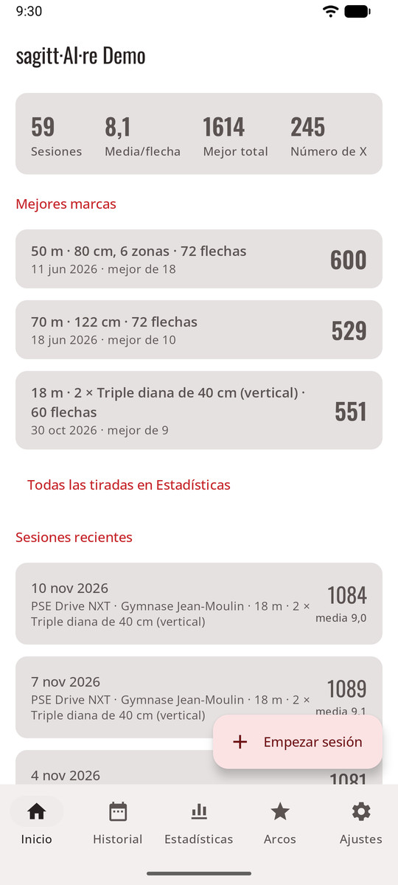
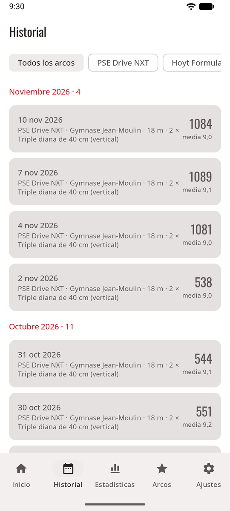
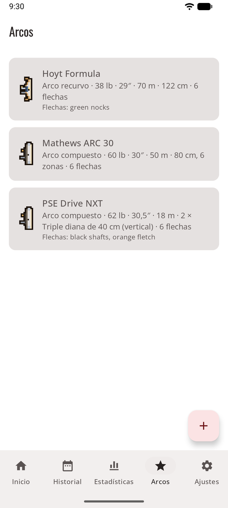
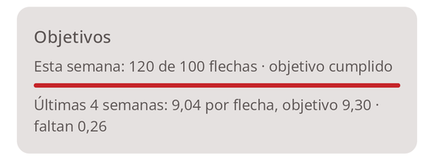

# Modo normal { #normal-mode }

La app tal como la esperas: una barra de pestañas abajo y pantallas que se abren desde ella. Es la forma más rápida de moverte en el campo de tiro, y es como se abre sagitt·AI·re la primera vez.

<figure markdown>
{ .shot }
<figcaption><b>Inicio.</b> Tus números y tus sesiones recientes.</figcaption>
</figure>
<figure markdown>
{ .shot }
<figcaption><b>Historial.</b> Todas las sesiones terminadas.</figcaption>
</figure>
<figure markdown>
{ .shot }
<figcaption><b>Arcos.</b> Tus arcos y sus valores predeterminados.</figcaption>
</figure>

## Las pestañas { #the-tabs }

| Pestaña | Qué hay |
|-----|--------------|
| **Inicio** | Sesiones, media por flecha, mejor total, número de X, tus [objetivos de entrenamiento](#training-goals), tus **Mejores marcas** por tirada y las sesiones recientes. Una sesión en curso aparece arriba con **Reanudar**. **Empezar sesión** es el botón redondo. |
| **Historial** | Todas las sesiones terminadas, por mes, filtradas por arco. Consulta [Historial](history.md). |
| **Arcos** | Tus arcos. Consulta [Arcos](bows.md). |
| **Estadísticas** | Tendencias, zonas, regularidad, agrupación, mapa de calor y récords por tirada. Consulta [Estadísticas](stats.md). |
| **Ajustes** | Una entrada por página, cada una con lo que está elegido ahora. |

## Ajustes { #settings }

Cada página de Ajustes empieza con una breve explicación y luego sus opciones.

| Página | Qué ajustas |
|------|--------------|
| **Método de puntuación** | Tu propia clave de API, compartir con tu app de IA, o manual. Consulta [Tres formas de puntuar](scoring.md). |
| **Reglas de puntuación** | La regla con la que empiezan las sesiones nuevas. Consulta [Reglas de puntuación](rules.md). |
| **Objetivos de entrenamiento** | Flechas por semana y una media por flecha que alcanzar. Consulta [Objetivos de entrenamiento](#training-goals). |
| **Privacidad** | Enviar solo el área de la diana, y qué se envía. Consulta [Privacidad](privacy.md). |
| **Apariencia y juego** | Modo normal o modo juego, el tema, el sonido y la música del juego. Consulta [Aspecto e idioma](look.md). |
| **Idioma** | Inglés, francés, alemán, español o el idioma del teléfono (Android 13 y posteriores). |
| **Lugares guardados** | Cambiar el nombre, fusionar o eliminar los lugares de tus sesiones. Consulta [Lugares guardados](sessions.md#saved-places). |
| **Almacenamiento y copia de seguridad** | Espacio usado, exportar, restaurar, liberar espacio. Consulta [Almacenamiento y copia de seguridad](backup.md). |
| **Información y aviso legal** | La versión, las [condiciones de uso](terms.md), la [política de privacidad](privacy-policy.md) y las [licencias de código abierto](licences.md). |

## Objetivos de entrenamiento { #training-goals }

**Ajustes → Objetivos de entrenamiento**: cuántas **flechas por semana** quieres tirar (de 10 a 999) y una **media por flecha** que alcanzar (por ejemplo 9,2). Deja uno vacío para desactivarlo; **Quitar ambos objetivos** desactiva los dos.

{ .shot width="320" }

Inicio muestra entonces una tarjeta **Objetivos**: las flechas de esta semana (de lunes a domingo, incluida la sesión en curso) frente a tu objetivo, con una barra, y tu media por flecha en las últimas cuatro semanas de sesiones terminadas frente a tu meta. Tócala para cambiar los objetivos. En el modo juego, el muro de trofeos los convierte en el [reto de la semana](game.md#this-weeks-challenge).

## Pasar al modo juego { #switching-to-game-mode }

**Ajustes → Apariencia y juego → Juego (vista previa)**. Todo lo que has registrado está también en el juego, y **Normal** te devuelve aquí. Consulta [Modo juego](game.md).
