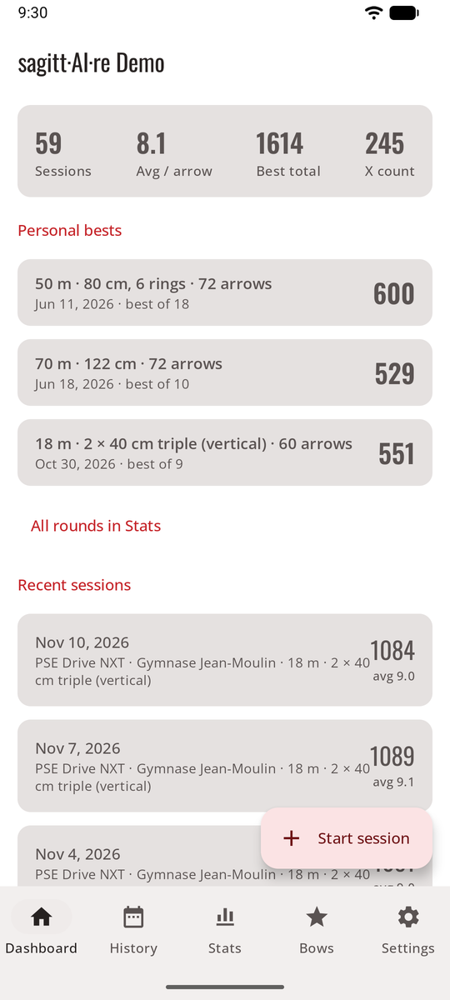
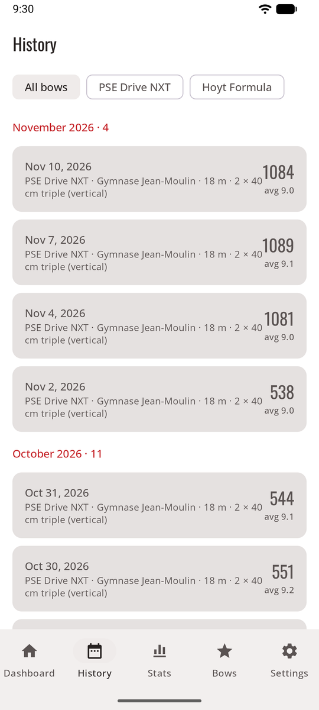
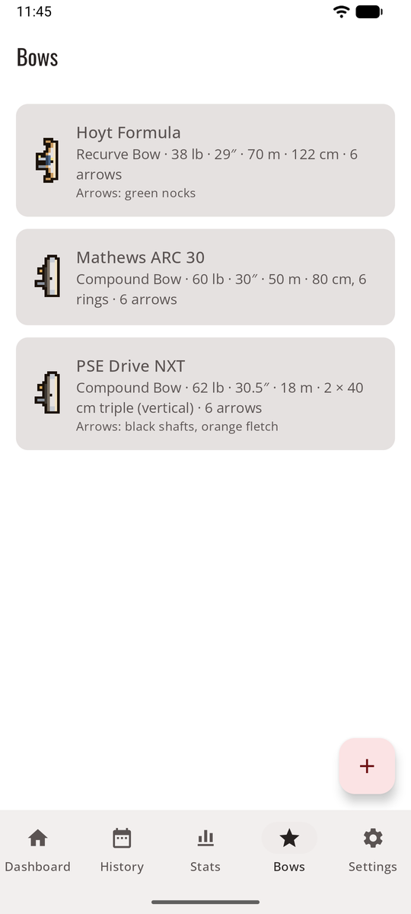
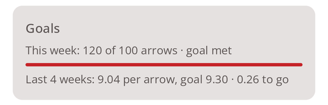

# Normal mode

The app as you'd expect it: a tab bar at the bottom, and screens that open from it. It's the quickest way around at the range, and it's how sagitt·AI·re opens the first time.

<figure markdown>
{ .shot }
<figcaption><b>Dashboard.</b> Your numbers and recent sessions.</figcaption>
</figure>
<figure markdown>
{ .shot }
<figcaption><b>History.</b> Every finished session.</figcaption>
</figure>
<figure markdown>
{ .shot }
<figcaption><b>Bows.</b> Your bows and their defaults.</figcaption>
</figure>

## The tabs

| Tab | What's there |
|-----|--------------|
| **Dashboard** | Sessions, average per arrow, best total, X count, your [training goals](#training-goals), your **personal bests** per round and recent sessions. A session in progress shows at the top with **Resume**. **Start session** is the round button. |
| **History** | Every finished session, by month, filtered by bow. See [History](history.md). |
| **Bows** | Your bows. See [Bows](bows.md). |
| **Stats** | Trends, rings, consistency, grouping, heat map and records per round. See [Statistics](stats.md). |
| **Settings** | One entry per page, each showing what is chosen now. |

## Settings

Each Settings page starts with a short explanation, then its choices.

| Page | What you set |
|------|--------------|
| **Scoring method** | Your own API key, sharing with your AI app, or manual. See [Three ways to score](scoring.md). |
| **Scoring rules** | The rule new sessions start with. See [Scoring rules](rules.md). |
| **Training goals** | Arrows per week and an average per arrow to reach. See [Training goals](#training-goals). |
| **Privacy** | Send only the target area, and what is sent. See [Privacy](privacy.md). |
| **Appearance and game** | Normal or game mode, the theme, game sound and music. See [Look and language](look.md). |
| **Language** | English, French, German, Spanish or the phone's language (Android 13 and later). |
| **Saved places** | Rename, merge or delete the places of your sessions. See [Saved places](sessions.md#saved-places). |
| **Storage and backup** | Space used, export, restore, free up space. See [Storage and backup](backup.md). |
| **About and legal** | The version, the fingerprint of the certificate that signed this copy ([check it](index.md#status)), the [terms of use](terms.md), the [privacy policy](privacy-policy.md) and the [open-source licences](licences.md). |

## Training goals

**Settings → Training goals**: how many **arrows per week** you want to shoot (10 to 999), and an **average per arrow** to reach (for example 9.2). Leave one empty to turn it off; **Remove both goals** turns both off.

{ .shot width="320" }

The Dashboard then shows a **Goals** card: this week's arrows (Monday to Sunday, the session in progress included) against your goal, with a bar, and your average per arrow over the last four weeks of finished sessions against your target. Tap it to change the goals. In game mode, the trophy wall turns them into [this week's challenge](game.md#this-weeks-challenge).

## Switching to game mode

**Settings → Appearance and game → Game (preview)**. Everything you've recorded is there in the game too, and **Normal** brings you back. See [Game mode](game.md).
