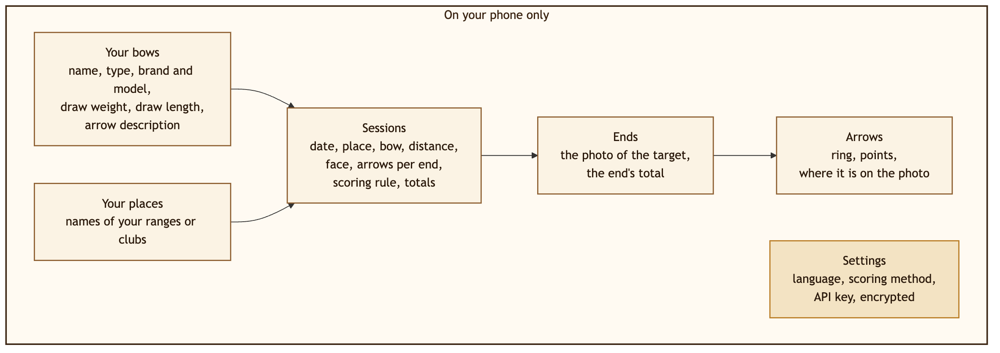
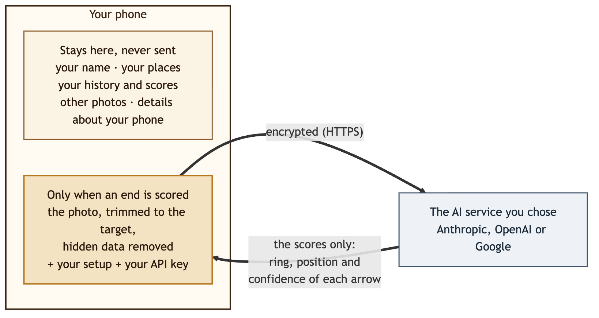
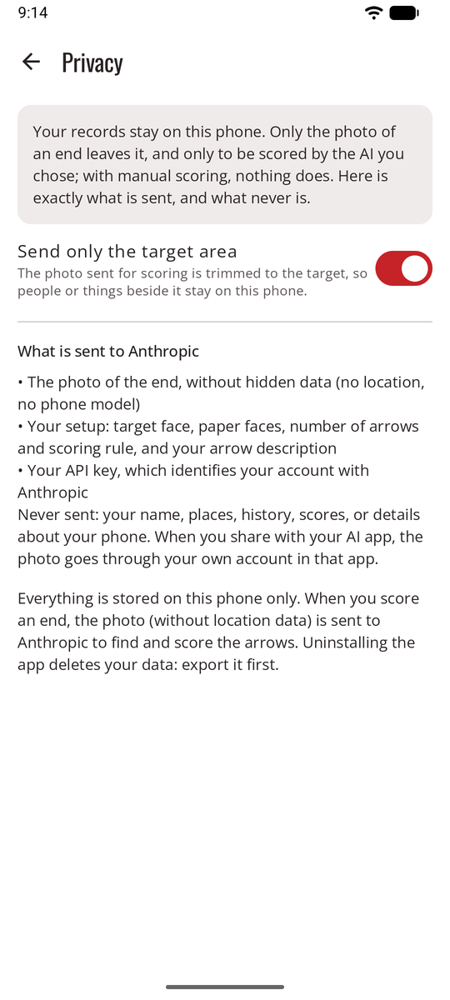

# Privacy

Short version: **your records stay on your phone.** Only the photo of the target leaves it, and only to be scored, by the AI service you chose. With [manual scoring](scoring-manual.md), nothing leaves it at all.

This page explains it in plain words. The formal text is the [privacy policy](privacy-policy.md), also in the app under **Settings → About and legal**.

## What sagitt·AI·re keeps, and where

That's all of it: your bows and places, your sessions, each end with its photo, and each arrow. Nothing about you as a person, no account, no contacts. All of it is kept in sagitt·AI·re's private storage on the phone.

- Other apps can't read them, and the photos are not in your gallery.
- Nothing goes to a cloud backup or to a new phone automatically.
- There's no account, no advertising, no analytics and no tracking.
- **Uninstalling the app deletes everything**, so export first: **Settings → Storage and backup** saves everything to one file you keep, and restores it on the same or a new phone. API keys and service addresses are never put in an export.

## What is sent, and when

{ width="560" }

Only when an end is scored with an AI service, over an encrypted connection, to that service only:

- **the photo of the end**, without hidden data (no location, no phone model) and, by default, trimmed to the target area;
- **your setup**: target face, paper faces, number of arrows and scoring rule, and your arrow description;
- **your API key**, which identifies your account with that service.

**Never sent:** your name, your places, your history, your scores, or details about your phone. The technical information that apps usually send about the phone (Android version, processor) is replaced with "unknown".

{ .shot width="240" }

Settings shows the same list, under **What is sent to …**, for the service you chose.

### With each scoring method

| Method | What leaves the phone |
|--------|-----------------------|
| [Your own API key](scoring-api.md) | The photo, your setup and your key, sent by sagitt·AI·re to that service only. For an OpenAI-compatible service, to the address you gave. |
| [Share with your AI app](scoring-share.md) | The same photo and the prompt, shared **by you** with the app you pick. No key. It goes through your own account in that app, under its terms. |
| [Manual](scoring-manual.md) | Nothing: no photo, no score, no key. |

**Sharing a session** sends its summary (and, if you choose, a picture of the scoresheet) only to the app you pick, when you tap [Share](sessions.md#share-a-session). Never the photos of your ends.

## What each service does with it

| Service | Used to train AI? | Kept |
|---------|-------------------|------|
| **Anthropic** | No | Under Anthropic's commercial terms |
| **OpenAI** | No, unless you opt in on your account | sagitt·AI·re asks OpenAI not to store the request. Safety logs are kept up to 30 days. |
| **Google Gemini**, with billing on | No | Logged for a limited time for abuse detection |
| **Google Gemini**, free tier | **Yes**: may be used to improve Google's products, and read by human reviewers | Not stated |
| **An OpenAI-compatible service**, or **your AI app** | Depends on that service: check its terms | Depends on that service |

!!! warning "Gemini: use a key with billing on"
    On Google's free tier, your target photos may be used by Google and seen by reviewers. Use a key from a Google Cloud project with billing turned on. sagitt·AI·re can't check this for you.

## Your API key

- It's stored encrypted on the phone, never shown again, and never put in an export.
- It's only sent to the service it belongs to, at the address it was saved for. Changing a service's address deletes its key, after asking.
- **Remove key** in Settings deletes it.

Create a key just for sagitt·AI·re and set a spending limit with the service. If you lose your phone, delete the key there.

## Game mode

Game mode sends nothing. Your archer's look, your companion and your sound settings stay on the phone with the other settings. The pictures and sounds are part of the app: nothing is downloaded and no permission is added.

## Permissions

| Permission | Why |
|------------|-----|
| Camera | To photograph the target, asked the first time |
| Internet | For automatic scoring with an AI service (not used in manual scoring) |

No location, contacts, microphone or storage permissions. Importing a photo uses Android's photo picker, which only gives sagitt·AI·re the photo you choose.

More on how your data is protected: [Security](security.md).
