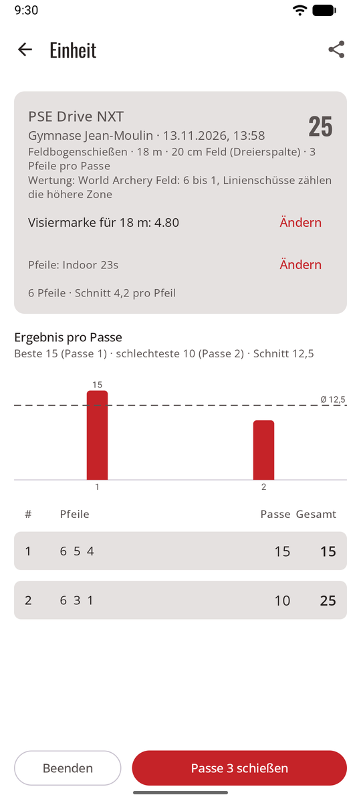
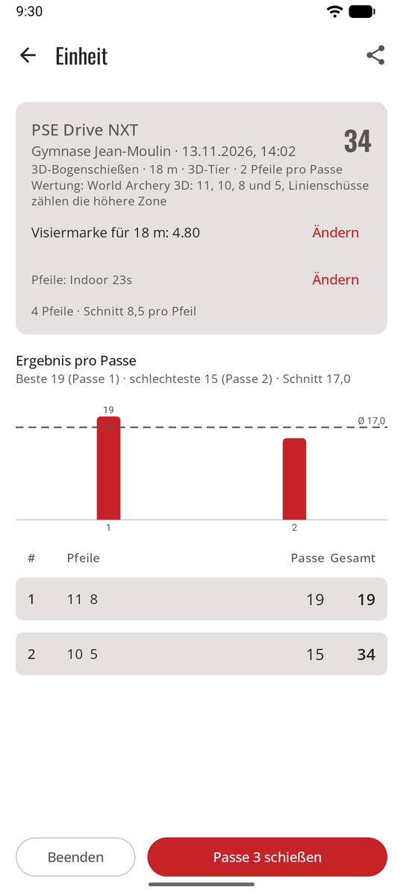

# Wertungsregeln { #scoring-rules }

Die Regel macht aus Ringen Punkte. Jeder Pfeil behält den Ring, den er getroffen hat, sodass du die Regel einer Einheit später ändern kannst und jedes Gesamt neu berechnet wird.

| Regel | Punkte |
|------|--------|
| **X und 10 zählen 10** | Der ganze 10er-Ring zählt 10. X werden für Gleichstände gezählt. World Archery Recurve und Blankbogen, die meisten Vereine. |
| **Nur Innenzehn** | Nur der kleine innere Ring zählt 10; der Rest des Golds zählt 9. World Archery Compound; USA Archery und Archery Canada folgen World Archery. |
| **X zählt 11** | Der X-Ring zählt 11. Einige US-Turniere, etwa die Lancaster Classic. |

**Linienregel (alle Regeln):** Ein Pfeil, der die Linie zwischen zwei Zonen berührt, zählt die höhere Zone. Ein Pfeil in der 8, der die Linie 8/9 berührt, ist eine 9.

## Der Standard für neue Einheiten { #the-default-for-new-sessions }

**Einstellungen → Wertungsregeln** legt die Regel fest, mit der neue Einheiten beginnen:

- **World Archery** (der Standard): Innenzehn für Compound, X = 10 für andere Bögen.
- **X = 10 für alle Bögen**.
- **X = 11 für Compound**, X = 10 für andere Bögen.

## Für eine Einheit { #for-one-session }

Im Formular für eine neue Einheit, oder später im Bildschirm der Einheit mit **Ändern**: zum Beispiel, um die Regel deines Vereins zu übernehmen. (sagitt·AI·re ist für Training und Freizeit: Seine Ergebnisse sind nie offiziell.) Das Gesamt der Einheit wird sofort neu berechnet.

## Feld und 3D { #field-and-3d }

Feldauflagen und 3D-Tiere werden so gewertet, wie sie gezeichnet sind, wie es die Regeln von World Archery vorsehen (Buch 2, Art. 8.2.1.2 und 8.2.2.1; Buch 4, Art. 22.2): Es gibt keine Regel zu wählen, und eine Einheit darauf zeigt ihre Wertung statt **Ändern**.

<figure markdown>
{ .shot }
<figcaption><b>Feld</b>: 6 bis 1</figcaption>
</figure>
<figure markdown>
{ .shot }
<figcaption><b>3D</b>: 11, 10, 8 und 5</figcaption>
</figure>

| | Zonen und Punkte | Auflagen |
|-|------------------|-------|
| **Feld** | Eine gelbe Mitte: Der kleine innere Kreis zählt **6**, der Rest des Gelbs **5**; dann vier schwarze (oder petrolfarbene) Zonen mit **4, 3, 2, 1**. Kein X. | Auflagen mit 80, 60, 40 cm, und 20-cm-Auflagen in einer Dreierspalte (ein Pfeil pro Auflage). Bei Gleichstand zählen die 6er, dann die 5er. |
| **3D** | **11** ist der kleine Kreis in der Mitte der 10; **10** der größere Kreis innerhalb der Kill-Zone; **8** der Rest der Kill-Zone; **5** der Rest des Körpers. Ein Horn oder ein Huf ist ein Fehlschuss; Schwanz oder Flügel eines Vogels zählen. | Ein Tier. Bei Gleichstand zählen die 11er, dann die 10er. |

**Linienregel:** Wie bei Scheibenauflagen zählt ein Pfeil, der eine Trennlinie oder den Umriss der Wertungszone eines 3D-Tiers berührt, die höhere Zone.

Wähl **Feldbogenschießen** oder **3D-Bogenschießen** als Disziplin, wenn du eine Einheit startest: Die Liste der Auflagen zeigt dann nur Feldauflagen oder das 3D-Tier, mit 3 Pfeilen pro Scheibe im Feld und 2 bei 3D (das kannst du ändern).

