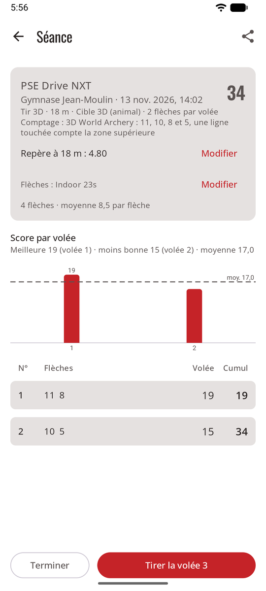

# Règles de comptage

La règle transforme les zones en points. Chaque flèche garde la zone qu’elle a touchée : vous pouvez donc changer la règle d’une séance plus tard, et tous les totaux sont recalculés.

| Règle | Points |
|-------|--------|
| **X et 10 valent 10** | Tout le 10 vaut 10. Les X départagent les égalités. Arc recourbé et arc nu World Archery, la plupart des clubs. |
| **10 intérieur seulement** | Seul le petit cercle intérieur vaut 10 ; le reste du jaune vaut 9. Arc à poulies World Archery ; USA Archery et Tir à l’arc Canada suivent World Archery. |
| **X vaut 11** | Le X vaut 11. Certains tournois américains, comme le Lancaster Classic. |

**Règle de la ligne (toutes les règles) :** une flèche qui touche la ligne entre deux zones prend la zone la plus haute. Une flèche dans le 8 qui touche la ligne entre le 8 et le 9 vaut 9.

## La règle par défaut des nouvelles séances

**Réglages → Règles de comptage** fixe la règle de départ des nouvelles séances :

- **World Archery** (par défaut) : 10 intérieur pour l’arc à poulies, X = 10 pour les autres arcs.
- **X = 10 pour tous les arcs**.
- **X = 11 pour l’arc à poulies**, X = 10 pour les autres arcs.

## Pour une seule séance

Sur le formulaire de nouvelle séance, ou plus tard sur l’écran de la séance avec **Modifier** : par exemple pour suivre la règle de votre club. (sagitt·AI·re sert à l’entraînement et au loisir : ses pointages ne sont jamais officiels.) Les totaux de la séance sont recalculés aussitôt.

## Campagne et 3D

Les blasons de campagne et les cibles 3D se comptent tels que dessinés, comme le prévoient les règles de World Archery (livre 2, art. 8.2.1.2 et 8.2.2.1; livre 4, art. 22.2) : il n’y a pas de règle à choisir, et une séance sur ces cibles affiche son comptage au lieu de **Modifier**.

<figure markdown>
{ .shot }
<figcaption><b>Campagne</b> : de 6 à 1</figcaption>
</figure>
<figure markdown>
{ .shot }
<figcaption><b>3D</b> : 11, 10, 8 et 5</figcaption>
</figure>

| | Zones et points | Blasons |
|-|-----------------|---------|
| **Campagne** | Un centre jaune : le petit cercle intérieur vaut **6**, le reste du jaune **5**; puis quatre zones noires (ou sarcelle) qui valent **4, 3, 2, 1**. Pas de X. | 80, 60, 40 cm, et blasons de 20 cm en colonne de trois (une flèche par blason). Les égalités se départagent au nombre de 6, puis de 5. |
| **3D** | **11**, le petit cercle au centre du 10 ; **10**, le grand cercle dans la zone vitale ; **8**, le reste de la zone vitale ; **5**, le reste du corps. Une corne ou un sabot, c’est un manqué ; la queue ou les ailes d’un oiseau comptent. | Un animal. Les égalités se départagent au nombre de 11, puis de 10. |

**Règle de la ligne :** comme sur les blasons de tir sur cible, une flèche qui touche une ligne de séparation, ou le contour de la zone de points d’une cible 3D, prend la zone la plus haute.

Choisissez **Tir en campagne** ou **Tir 3D** comme discipline en commençant une séance : la liste des blasons ne montre alors que les blasons de campagne, ou la cible 3D, avec 3 flèches par cible en campagne et 2 en 3D (vous pouvez le changer).

