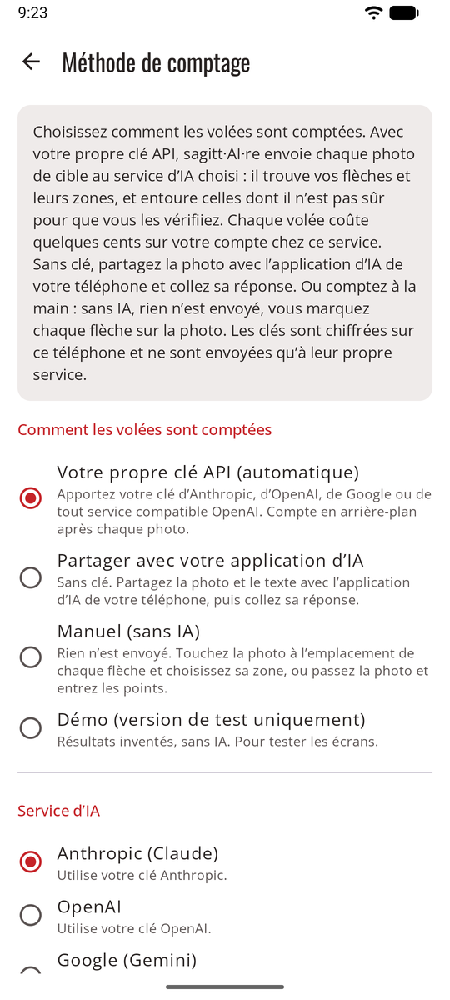
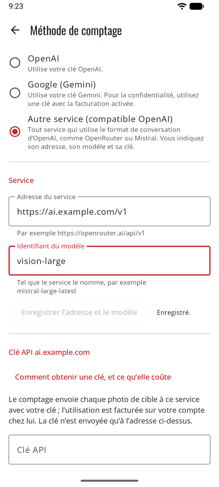
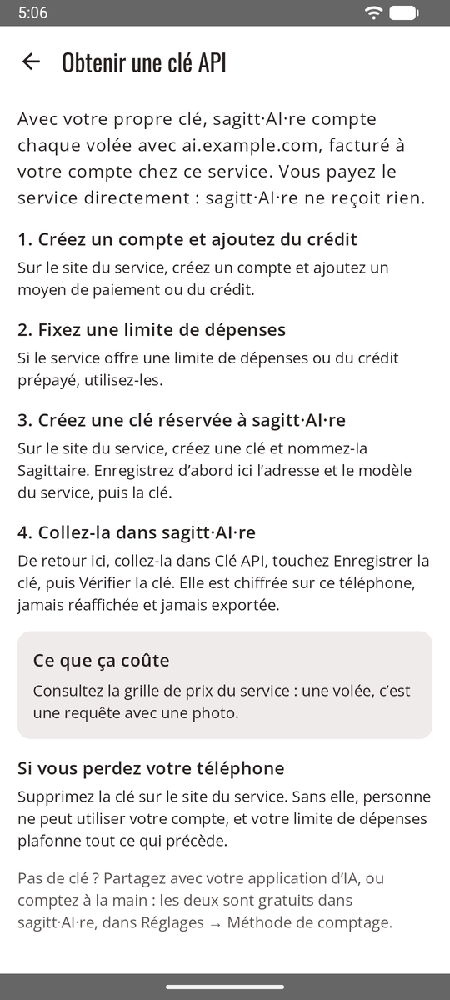

# Votre propre clé API

La méthode automatique : après chaque photo, sagitt·AI·re envoie la cible au service d’IA de votre choix, avec **votre propre clé**. Le service trouve chaque flèche et sa zone, et la volée est prête à vérifier quelques secondes plus tard. Les flèches dont il n’est pas sûr sont entourées en orange, pour que vous les [vérifiiez](review.md).

**Réglages → Méthode de comptage → Votre propre clé API (automatique)**.

<figure markdown>
{ .shot }
<figcaption>Choisir la méthode et le service</figcaption>
</figure>
<figure markdown>
{ .shot }
<figcaption>Tout service compatible OpenAI</figcaption>
</figure>

## Choisir le service d’IA

| Service | Modèles |
|---------|---------|
| **Anthropic (Claude)** | Opus 5.5 (par défaut), Sonnet 5.5 (moins cher) |
| **OpenAI** | GPT-6.1 Sol (par défaut), GPT-6 Astra (le plus puissant, environ 5 fois plus cher) |
| **Google (Gemini)** | Gemini 4 Carbon (par défaut), Gemini 3.8 Flash (plus rapide, moins cher). Utilisez une clé d’un projet avec la facturation activée (voir [Confidentialité](privacy.md)). |
| **Autre service (compatible OpenAI)** | N’importe quel modèle que vous nommez, sur tout service qui utilise le format de conversation d’OpenAI : OpenRouter, Mistral, Groq, une passerelle d’entreprise… |

Chaque service reçoit les mêmes consignes. Chacun garde sa propre clé : vous pouvez changer de service et revenir sans retaper de clé.

## Un service compatible OpenAI

Choisissez **Autre service (compatible OpenAI)**, puis remplissez la section **Service** :

1. **Adresse du service** : l’adresse que le service donne pour son API, avec sa version, par exemple `https://openrouter.ai/api/v1`. Elle doit commencer par `https://`.
2. **Identifiant du modèle** : exactement comme le service le nomme. Choisissez un modèle capable de lire les images.
3. **Enregistrer l’adresse et le modèle**, puis collez la clé plus bas.

La section de la clé porte le nom de l’adresse du service (par exemple *Clé API openrouter.ai*) : vous savez toujours où va votre clé.

!!! note "Une nouvelle adresse supprime la clé"
    Changer l’adresse d’un service supprime la clé enregistrée pour lui, après confirmation : une clé n’est ainsi jamais envoyée à une adresse pour laquelle elle n’a pas été enregistrée. Collez-la de nouveau pour la nouvelle adresse.

## Avancé : une autre adresse ou un autre modèle

Pour les trois grands services, **Avancé : adresse et modèle**, sous les modèles, permet d’indiquer :

- une **adresse du service**, pour un proxy ou une passerelle d’entreprise placée devant le service ;
- un **identifiant du modèle** absent de la liste, par exemple un modèle plus récent.

Laissez un champ vide pour utiliser la valeur par défaut affichée en dessous.

## Obtenir et enregistrer une clé API

{ .shot width="220" align=right }

L’application vous guide : sous la clé, **Comment obtenir une clé, et ce qu’elle coûte** donne les étapes pour le service choisi, du compte jusqu’à une clé réservée à sagitt·AI·re, avec une limite de dépenses, et le coût par volée.

- **Anthropic :** créez une clé dans la console Anthropic (console.anthropic.com → API keys). Elle commence d’habitude par `sk-ant-`.
- **OpenAI :** créez une clé sur platform.openai.com → API keys. Elle commence d’habitude par `sk-`.
- **Google Gemini :** créez une clé dans Google AI Studio (aistudio.google.com → Get API key), dans un projet avec la facturation activée. Elle commence d’habitude par `AIza`.
- **Autre service :** créez une clé sur le site du service.

Collez-la ensuite dans **Clé API**, touchez **Enregistrer la clé**, puis **Vérifier la clé**. L’application vous dit si la clé fonctionne. **Toute clé peut être enregistrée** : si elle n’a pas le format habituel de ce service (la clé d’un revendeur, par exemple), l’application se contente de le signaler.

!!! tip "Protégez votre clé"
    Créez une clé réservée à sagitt·AI·re et fixez une limite de dépenses mensuelle basse auprès du service. Si vous perdez le téléphone, supprimez la clé chez le service : personne ne pourra dépenser plus que la limite.

La clé est chiffrée sur le téléphone. Elle n’est plus jamais affichée, jamais exportée, et **Supprimer la clé** l’efface, après confirmation.

## Coût

Vous payez le service directement, une requête par volée. Estimations, en attendant de les mesurer sur de vraies photos :

| Modèle | Par volée | Séance de 30 volées |
|--------|-----------|---------------------|
| Claude Opus 5.5 | environ 0,05–0,10 $ US | environ 1,50–3,00 $ US |
| Claude Sonnet 5.5 | environ 0,03–0,05 $ US | environ 0,90–1,50 $ US |
| GPT-6.1 Sol | environ 0,02–0,05 $ US | environ 0,60–1,50 $ US |
| GPT-6 Astra | environ 0,10–0,25 $ US | environ 3–7,50 $ US |
| Gemini 4 Carbon | environ 0,02–0,05 $ US | environ 0,60–1,50 $ US |
| Gemini 3.8 Flash | environ 0,01–0,02 $ US | environ 0,30–0,60 $ US |

Pour un autre service, consultez ses tarifs : une volée, c’est une requête avec une photo.

## Au pas de tir

Pas de réseau ? Continuez à tirer. Les photos sont enregistrées et comptées dès le retour du réseau, même si l’application a été fermée. Tirez la volée suivante pendant que la précédente est comptée.

| État | Signification |
|------|---------------|
| en attente de comptage | Pas encore de réseau, ou en file d’attente. Le comptage démarre tout seul au retour du réseau. |
| comptage en cours… | L’IA lit la photo. |
| à vérifier | Ouvrez-la et validez. |
| non comptée | Un problème est survenu. Ouvrez-la pour réessayer, partager plutôt avec votre application d’IA, ou saisir la volée à la main. |
