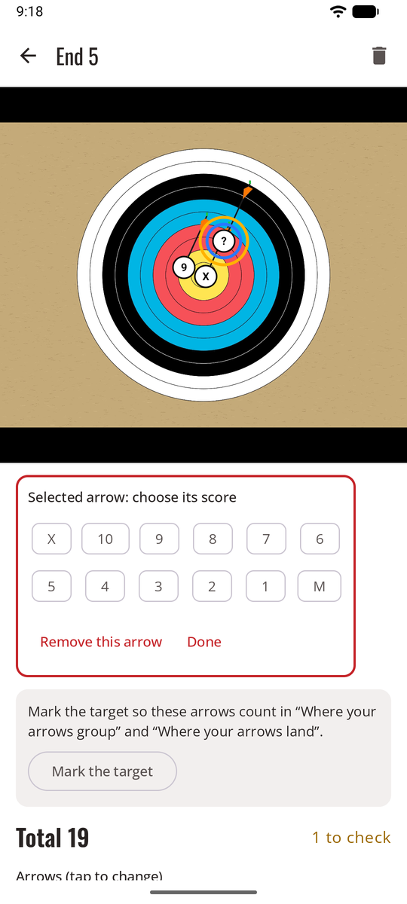
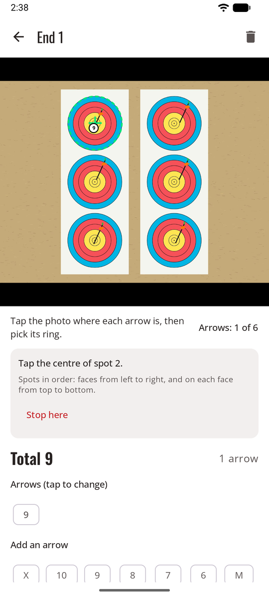

# Manual scoring

No AI at all, and nothing leaves the phone. You still photograph the end, then tap each arrow on the photo and pick its ring: two taps per arrow. The photo keeps the proof. Or skip the photo and just tap the scores.

**Settings → Scoring method → Manual (no AI)** (*Réglages → Méthode de comptage → Manuel (sans IA)*).

<figure markdown>
{ .shot }
<figcaption>Tap the arrow, pick its ring</figcaption>
</figure>

## Score an end on its photo

1. Shoot your end, then **take the photo** as usual (or **From gallery**, *Depuis la galerie*). The camera reminds you that you'll tap your arrows on it.
2. The end opens ready for placing: **Tap the photo where each arrow is, then pick its ring** (*Touchez la photo à l’emplacement de chaque flèche, puis choisissez sa zone*).
3. Tap an arrow on the photo. It gets a **?** marker, and the ring picker opens right under the photo.
4. Pick its ring. The picker closes, ready for the next arrow. The counter shows how many you've placed, for example **Arrows: 4 of 6** (*Flèches : 4 sur 6*).
5. When they're all placed, confirm the end: **Confirm · shoot next end** (*Valider · volée suivante*) goes straight back to the camera.

Pinch to zoom in on a line-cutter before you tap it, and double-tap to zoom out. Tap a marker to change its ring or remove it. An arrow placed without a ring stays marked **?** and counts as *to check*, so it can't slip through as a miss.

## Mark the target

{ .shot width="220" align=right }

Once an arrow is on the photo, **Mark the target** (*Marquer la cible*) gives your arrows their place on the face, so they count in **Where your arrows group** and **Where your arrows land**:

1. Tap the centre of the target.
2. Tap the outer edge of its last ring (ring 6 on a 3-spot face, ring 1 on a full face).
3. On a 3-spot face, do the same for each spot, in order: faces from left to right, and on each face from top to bottom. **Stop here** (*Arrêter ici*) leaves the rest unmarked.

The marks show as green circles. Arrows you place afterwards get their place too. Markers also get smaller on small spots, so close arrows don't hide each other.

## Score an end without a photo

At the camera, tap **No photo** (*Sans photo*). The end opens with the ring keypad at the top: tap one ring per arrow, in any order. The keypad stays in place while the list of arrows grows under it, so you can tap quickly.

## Good to know

- Nothing is sent, ever: no photo, no score, no key. The [Privacy](privacy.md) page in Settings says so.
- It works with no signal at all.
- Ends photographed before you switched to manual open straight into placing.
- You can switch to another method at any time; your manual ends stay as they are.
- Hand-placed arrows count in every statistic. For **Where your arrows group** and the heat map, [mark the target](#mark-the-target) first.
