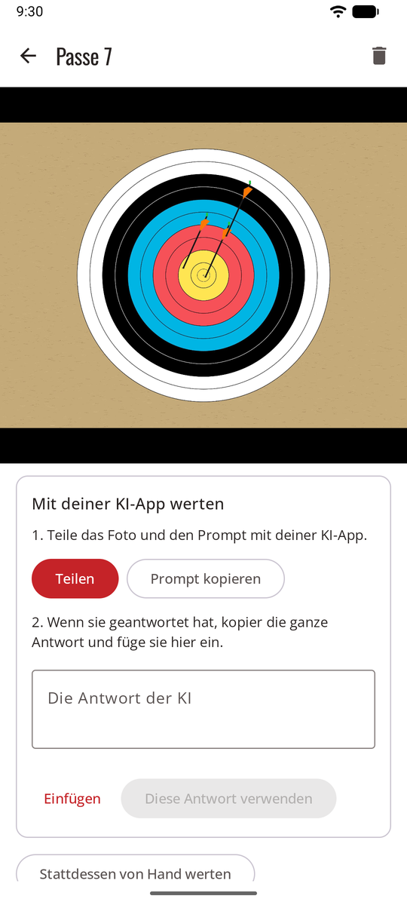

# Mit deiner KI-App teilen { #share-with-your-ai-app }

Kein API-Schlüssel: Die KI-App, die du schon auf deinem Handy nutzt, übernimmt die Wertung. sagitt·AI·re bereitet das Foto und einen fertigen Prompt vor, du teilst beides mit der App und fügst ihre Antwort wieder ein. Die Antwort wird wie eine automatische geprüft, mit eingekreisten unsicheren Pfeilen.

**Einstellungen → Wertungsmethode → Mit deiner KI-App teilen**.

<figure markdown>
{ .shot }
<figcaption>Teilen, dann die Antwort einfügen</figcaption>
</figure>

## Eine Passe werten { #score-an-end }

1. Mach wie gewohnt das Foto der Passe. Die Passe öffnet sich mit der Karte **Mit deiner KI-App werten**.
2. **Teilen**, und wähl deine KI-App in der Liste. Das Foto und der Prompt gehen mit, und der Prompt wird außerdem kopiert, falls die App nur das Foto annimmt: Dann füg ihn selbst in der App ein.
3. Schick es in der App ab und warte auf die Antwort.
4. Kopier die **ganze** Antwort, geh zurück zu sagitt·AI·re und tipp auf **Einfügen**, dann auf **Diese Antwort verwenden**.
5. [Prüf die eingekreisten Pfeile](review.md) und bestätige die Passe.

**Prompt kopieren** kopiert nur den Prompt, falls du das Foto lieber selbst in der App hinzufügst.

## Gut zu wissen { #good-to-know }

- **Nimm eine App, die Bilder lesen kann** und lange Antworten gibt. Der Prompt verlangt einen Textblock in einem festen Format (JSON); sagitt·AI·re liest ihn auch, wenn die App ein, zwei Sätze drumherum schreibt.
- **„Im eingefügten Text wurde keine Antwort gefunden“**: Kopier die ganze Antwort, nicht nur einen Teil.
- **„Positionen müssen Anteile zwischen 0 und 1 sein…“**: Bitte die App, mit demselben Prompt noch einmal zu antworten.
- **Du überlegst es dir anders:** **Stattdessen von Hand werten** steht unter der Karte.
- Bei der [automatischen Methode](scoring-api.md) bietet eine Passe, deren Wertung fehlschlägt, **Stattdessen mit einer KI-App teilen** an.

## Datenschutz { #privacy }

Du teilst das Foto selbst, also geht es über **dein eigenes Konto in dieser App**, zu deren Bedingungen. sagitt·AI·re teilt dieselbe Kopie, die es auch für die automatische Wertung senden würde: ohne Standort oder Handydaten, und auf die Scheibe zugeschnitten, wenn **Nur den Scheibenbereich senden** eingeschaltet ist (siehe [Datenschutz](privacy.md)). Die geteilte Kopie wird vom Handy gelöscht, sobald die Antwort verwendet ist.
