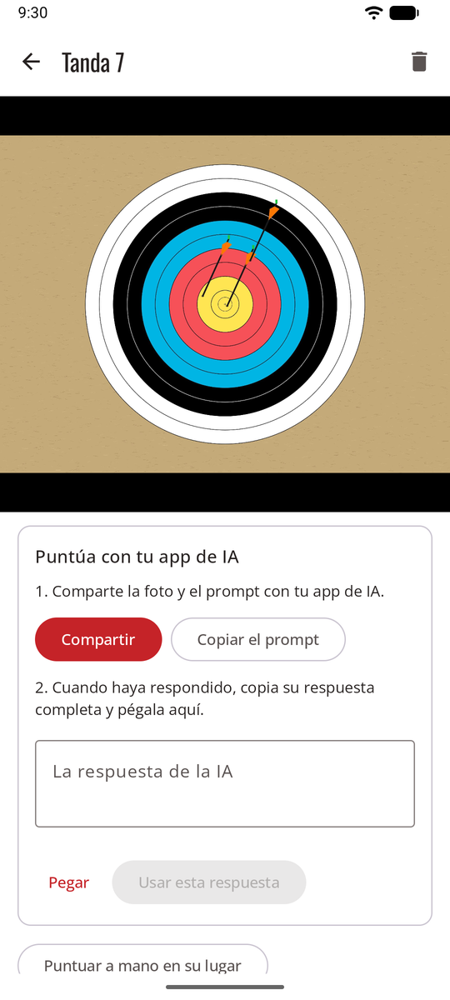

# Compartir con tu app de IA { #share-with-your-ai-app }

Sin clave de API: la app de IA que ya usas en tu teléfono hace la puntuación. sagitt·AI·re prepara la foto y un prompt listo para usar, tú los compartes con la app y pegas su respuesta de vuelta. La respuesta se revisa como una automática, con las flechas dudosas rodeadas.

**Ajustes → Método de puntuación → Compartir con tu app de IA**.

<figure markdown>
{ .shot }
<figcaption>Comparte y luego pega la respuesta</figcaption>
</figure>

## Puntuar una tanda { #score-an-end }

1. Haz la foto de la tanda como siempre. La tanda se abre con la tarjeta **Puntúa con tu app de IA**.
2. **Compartir**, y elige tu app de IA en la lista. La foto y el prompt van con ella, y el prompt también se copia, por si la app solo acepta la foto: en ese caso pégalo tú mismo en la app.
3. Envíalo en la app y espera la respuesta.
4. Copia la respuesta **completa**, vuelve a sagitt·AI·re y toca **Pegar** y luego **Usar esta respuesta**.
5. [Revisa las flechas rodeadas](review.md) y confirma la tanda.

**Copiar el prompt** copia solo el prompt, por si prefieres añadir la foto tú mismo en la app.

## Conviene saber { #good-to-know }

- **Usa una app que pueda leer imágenes** y dar una respuesta larga. El prompt pide un bloque de texto en un formato fijo (JSON); sagitt·AI·re lo lee aunque la app añada una o dos frases alrededor.
- **«No se ha encontrado ninguna respuesta en el texto pegado»**: copia la respuesta completa, no solo una parte.
- **«Las posiciones deben ser fracciones…»**: pide a la app que responda de nuevo con el mismo prompt.
- **Si cambias de idea:** **Puntuar a mano en su lugar** está debajo de la tarjeta.
- Con el [método automático](scoring-api.md), una tanda que no se consigue puntuar ofrece **Compartir con una app de IA**.

## Privacidad { #privacy }

Compartes la foto tú mismo, así que pasa por **tu propia cuenta en esa app**, según sus condiciones. sagitt·AI·re comparte la misma copia que enviaría para la puntuación automática: sin ubicación ni datos del teléfono, y recortada a la diana si **Enviar solo el área de la diana** está activado (consulta [Privacidad](privacy.md)). La copia compartida se elimina del teléfono una vez usada la respuesta.
