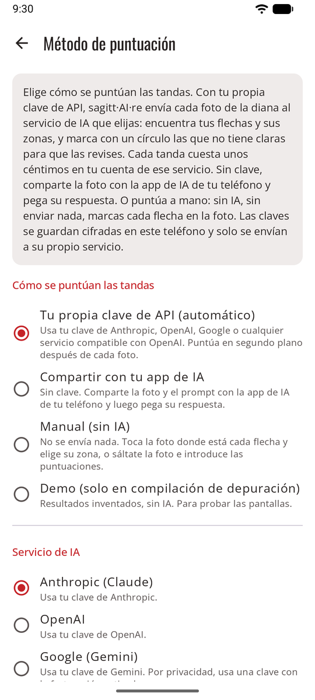

# Tres formas de puntuar { #three-ways-to-score }

sagitt·AI·re puntúa una tanda de una de estas tres formas. Eliges en **Ajustes → Método de puntuación**, y puedes cambiar en cualquier momento: las sesiones pasadas conservan sus puntuaciones.

{ .shot width="240" }

| | [Tu propia clave de API](scoring-api.md) | [Compartir con tu app de IA](scoring-share.md) | [Manual](scoring-manual.md) |
|---|---|---|---|
| **En la app** | Tu propia clave de API (automático) | Compartir con tu app de IA | Manual (sin IA) |
| **Necesitas** | Una clave de un servicio de IA | Una app de IA en tu teléfono | Nada |
| **Después de la foto** | Se puntúa en segundo plano, lista para revisar unos segundos después | Compartes, la app de IA responde, pegas la respuesta | Tocas cada flecha en la foto y eliges su zona |
| **Flechas dudosas rodeadas** | Sí | Sí | Tú decides cada zona |
| **Sin cobertura** | Espera a tener red | Necesita la red de la app de IA | Funciona en cualquier lugar |
| **Qué sale del teléfono** | La foto, tu configuración y tu clave, solo a ese servicio | La foto y el prompt, compartidos por ti | Nada |
| **Coste** | Unos céntimos por tanda, en tu cuenta con el servicio | Lo que te cueste tu app de IA | Gratis |

**Puntuar a mano siempre es posible.** Sea cual sea el método, cualquier tanda se puede puntuar a mano: **Puntuar a mano en su lugar** mientras esperas, o después de una puntuación fallida.

## ¿Cuál elegir? { #which-one }

- **Lo quieres automático** y no te importan unos céntimos por tanda: [tu propia clave de API](scoring-api.md).
- **Ya pagas una app de chat con IA** y no quieres una clave de API: [compartir con tu app de IA](scoring-share.md).
- **No quieres nada de IA**, o tiras donde no hay cobertura: [manual](scoring-manual.md). La foto sigue siendo útil: colocas tus flechas en ella y guarda la prueba.
