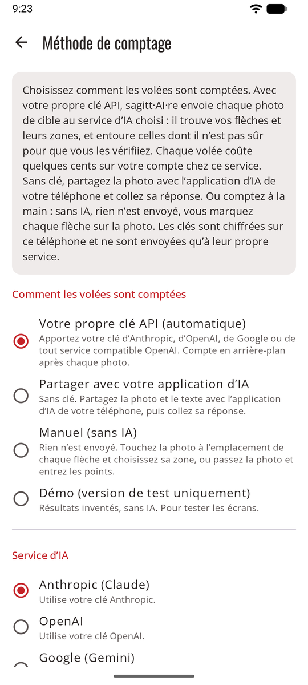

# Trois façons de compter

sagitt·AI·re compte une volée de l’une de trois façons. Vous choisissez dans **Réglages → Méthode de comptage**, et vous pouvez changer à tout moment : les séances passées gardent leurs scores.

{ .shot width="240" }

| | [Votre propre clé API](scoring-api.md) | [Partager avec votre application d’IA](scoring-share.md) | [Manuel](scoring-manual.md) |
|---|---|---|---|
| **Dans l’application** | **Votre propre clé API (automatique)** | **Partager avec votre application d’IA** | **Manuel (sans IA)** |
| **Il vous faut** | Une clé d’un service d’IA | Une application d’IA sur votre téléphone | Rien |
| **Après la photo** | Comptée en arrière-plan, prête à vérifier quelques secondes plus tard | Vous partagez, l’application d’IA répond, vous collez la réponse | Vous touchez chaque flèche sur la photo et choisissez sa zone |
| **Flèches incertaines entourées** | Oui | Oui | Vous décidez de chaque zone |
| **Sans réseau** | Attend le réseau | L’application d’IA a besoin du réseau | Fonctionne partout |
| **Ce qui sort du téléphone** | La photo, les paramètres de la séance et votre clé, vers ce service seulement | La photo et le texte, partagés par vous | Rien |
| **Coût** | Quelques cents par volée, sur votre compte chez le service | Ce que vous coûte déjà votre application d’IA | Gratuit |

**La saisie à la main est toujours possible.** Quelle que soit la méthode, n’importe quelle volée peut être saisie à la main : **Saisir à la main** pendant l’attente, ou après un comptage qui a échoué.

## Laquelle choisir ?

- **Vous voulez que ce soit automatique** et quelques cents par volée ne vous dérangent pas : [votre propre clé API](scoring-api.md).
- **Vous payez déjà une application de conversation avec une IA** et ne voulez pas de clé API : [partagez avec votre application d’IA](scoring-share.md).
- **Vous ne voulez pas d’IA du tout**, ou vous tirez là où il n’y a pas de réseau : [le comptage manuel](scoring-manual.md). La photo reste utile : vous y placez vos flèches, et elle garde la preuve.
