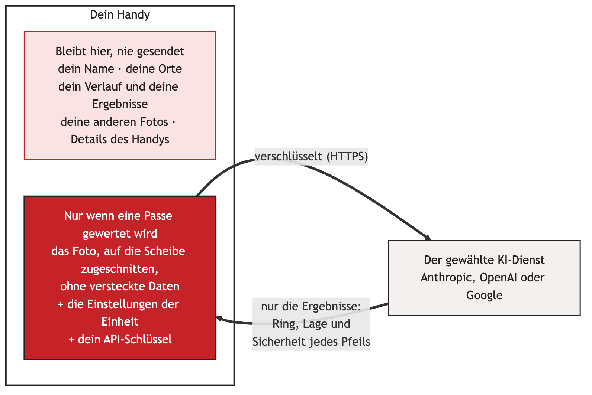

# Sicherheit { #security }

sagitt·AI·re ist so gebaut, dass es außerhalb deines Handys kaum etwas zu schützen gibt, und was es doch verlässt, ist auf das Nötigste beschränkt. Hier steht in einfachen Worten, was dich und deine Daten schützt.

{ width="640" }

## Was dich schützt { #what-protects-you }

-   :material-account-off-outline: **Kein Konto, nichts zum Einbrechen**

    ---

    sagitt·AI·re hat keinen Server und keine Benutzerkonten. Es gibt keine Online-Datenbank mit Bogenschützen, die ein Datenleck haben könnte.

-   :material-cellphone-lock: **Deine Daten bleiben auf deinem Handy**

    ---

    Einheiten, Ergebnisse, Orte, Bögen und Fotos liegen im privaten Speicher der App, geschützt durch die Sperre deines Handys. Kein Cloud-Backup, keine Kopie auf ein neues Handy, außer du exportierst.

-   :material-lock-outline: **Nur verschlüsselte Verbindungen**

    ---

    Die App lehnt unverschlüsselte Verbindungen ab und spricht nur mit dem einen KI-Dienst, den du gewählt hast, unter seiner eigenen Adresse oder der https-Adresse, die du angegeben hast. Bei der Wertung von Hand spricht sie mit niemandem.

-   :material-key-chain-variant: **Dein Schlüssel, sicher verwahrt**

    ---

    Dein API-Schlüssel wird mit dem sicheren Schlüsselspeicher deines Handys verschlüsselt (bei den meisten Handys ein eigener Sicherheitschip). Er wird nie wieder angezeigt, nie exportiert und nur an den Dienst gesendet, zu dem er gehört. Änderst du die Adresse eines Dienstes, wird sein Schlüssel gelöscht, damit er nicht zur neuen Adresse mitwandert.

-   :material-incognito: **Nichts über dein Handy oder dich**

    ---

    Fotos verlieren ihre versteckten Daten (Standort, Handymodell). Die technischen Angaben, die Apps meist über das Handy mitsenden, werden durch „unknown“ (unbekannt) ersetzt. Dein Name, deine Orte und dein Verlauf werden nie gesendet.

-   :material-crop: **Nur die Scheibe**

    ---

    Standardmäßig wird das Foto vor dem Senden auf das Quadrat um den Rahmenkreis zugeschnitten, sodass das meiste rund um die Scheibe auf deinem Handy bleibt. Halte trotzdem Personen aus dem Bild.

-   :material-robot-outline: **Die KI kann nur antworten**

    ---

    Die KI bekommt ein Foto und schickt Ergebnisse zurück, sonst nichts. Sie kann deine Daten nicht lesen, nichts öffnen und nichts auf deinem Handy tun. Eine Antwort, die nicht im erwarteten Format ist, wird abgelehnt.

-   :material-check-decagram-outline: **Du hast das letzte Wort**

    ---

    Kein Ergebnis zählt, bevor du die Passe bestätigst. Unsichere Pfeile werden eingekreist, damit du sie prüfst.

-   :material-broom: **Nichts bleibt herumliegen**

    ---

    Kopien zum Teilen werden nach dem Gebrauch gelöscht, und eine verworfene Einheit nimmt ihre Fotos mit.

-   :material-package-variant-closed-check: **Geprüfte Bausteine**

    ---

    Jede Bibliothek in der App wird bei jedem Build mit einem gespeicherten Fingerabdruck abgeglichen, und die vollständige Liste wird mit jedem Build aufbewahrt.

## Was Bogenschützen fragen { #questions-archers-ask }

**Was, wenn ich mein Handy verliere?**
Deine Daten sind durch die Bildschirmsperre deines Handys geschützt, wie deine anderen Apps. Lösch zur Sicherheit deinen API-Schlüssel auf der Website des KI-Dienstes: Dann funktioniert er sofort nicht mehr. Mit einem Ausgabenlimit beim Dienst kann niemand je mehr als diesen Betrag ausgeben.

**Ich nutze einen anderen Dienst unter meiner eigenen Adresse. Ist das sicher?**
sagitt·AI·re akzeptiert nur `https://`-Adressen, ohne Benutzernamen oder Passwort darin. Der gespeicherte Schlüssel wird immer nur an diese Adresse gesendet, und Adressen sind nicht in Exporten enthalten, sodass eine wiederhergestellte Datei deinen Schlüssel nirgendwo anders hinschicken kann. Wähl einen Dienst, dem du vertraust: Er bekommt das Foto und deinen Schlüssel, wie die großen Dienste.

**Kann der KI-Dienst meinen Verlauf sehen?**
Nein. Er bekommt nur das Foto der Passe, die gewertet wird, deine Einstellungen für diese Passe (Auflage, Anzahl der Pfeile, Wertungsregel, Pfeilbeschreibung) und deinen Schlüssel. Unter [Datenschutz](privacy.md) steht, was jeder Dienst damit macht.

**Verfolgt mich sagitt·AI·re oder zeigt es Werbung?**
Nein. Es gibt keine Analyse, keine Werbung und kein Tracking. Die App fragt nicht nach deinem Standort, deinen Kontakten, deinem Mikrofon oder deinen Dateien.

**Welche Berechtigungen braucht sie?**
Nur die Kamera, um die Scheibe zu fotografieren, und den Internetzugang, um mit einem KI-Dienst zu werten. Die Wertung von Hand braucht kein Internet. Zum Importieren eines Fotos dient die Fotoauswahl von Android, die sagitt·AI·re nur das Foto gibt, das du auswählst.

**Prüft jemand die App?**
Jede Änderung wird automatisch getestet, mit mehr als 75 Tests zur Wertung, zu den Anweisungen an die KI und dazu, was genau das Handy verlässt. Das Design wurde auf Datenschutz und Sicherheit geprüft, und die verwendeten Bibliotheken werden aktuell gehalten.

## Eine gute Gewohnheit { #a-good-habit }

!!! tip "Drei Minuten, einmal"
    1. Erstell einen API-Schlüssel **nur für sagitt·AI·re**.
    2. Leg beim Dienst ein **monatliches Ausgabenlimit** fest.
    3. Nutz für Google Gemini ein Projekt mit **aktivierter Abrechnung**, damit deine Fotos nicht zur Verbesserung der Produkte von Google verwendet werden.
