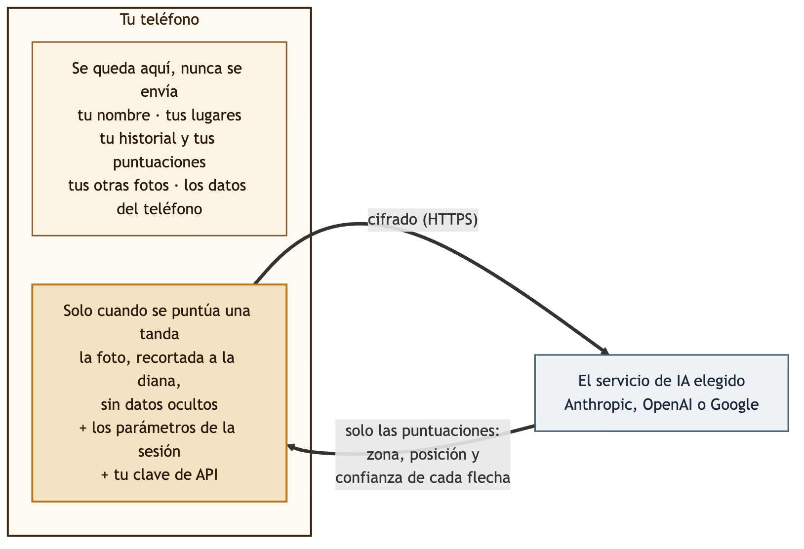

# Seguridad { #security }

sagitt·AI·re está pensado para que haya muy poco que proteger fuera de tu teléfono, y lo que sale de él se reduce al mínimo. Esto es lo que te protege a ti y a tus datos, en palabras sencillas.

{ width="640" }

## Lo que te protege { #what-protects-you }

-   :material-account-off-outline: **Sin cuenta, nada que asaltar**

    ---

    sagitt·AI·re no tiene servidor ni cuentas de usuario. No hay ninguna base de datos de arqueros en línea que pueda filtrarse.

-   :material-cellphone-lock: **Tus registros se quedan en tu teléfono**

    ---

    Las sesiones, puntuaciones, lugares, arcos y fotos viven en el almacenamiento privado de la app, protegidos por el bloqueo de tu teléfono. Sin copia en la nube, sin copia a un teléfono nuevo salvo que exportes.

-   :material-lock-outline: **Solo conexiones cifradas**

    ---

    La app rechaza las conexiones sin cifrar y solo habla con el servicio de IA que elegiste, en su propia dirección o en la dirección https que indicaste. Con la puntuación manual, no habla con nadie.

-   :material-key-chain-variant: **Tu clave, bajo llave**

    ---

    Tu clave de API se cifra con el almacén de claves seguro de tu teléfono (en la mayoría de los teléfonos, un chip de seguridad dedicado). No se vuelve a mostrar, nunca se exporta y solo se envía al servicio al que pertenece. Si cambias la dirección de un servicio, su clave se elimina, para que no pueda ir a la nueva.

-   :material-incognito: **Nada sobre tu teléfono ni sobre ti**

    ---

    Las fotos pierden sus datos ocultos (ubicación, modelo de teléfono). Los detalles técnicos que las apps suelen enviar sobre el teléfono se sustituyen por «desconocido». Tu nombre, tus lugares y tu historial nunca se envían.

-   :material-crop: **Solo la diana**

    ---

    Por defecto, la foto se recorta a la diana antes de enviarse, así que las personas y las cosas que la rodean se quedan en tu teléfono.

-   :material-robot-outline: **La IA solo puede responder**

    ---

    La IA recibe una foto y devuelve puntuaciones, nada más. No puede leer tus datos, abrir nada ni actuar en tu teléfono. Una respuesta que no tiene el formato esperado se rechaza.

-   :material-check-decagram-outline: **Tú tienes la última palabra**

    ---

    Ninguna puntuación cuenta hasta que confirmas la tanda. Las flechas dudosas aparecen rodeadas para que las revises.

-   :material-broom: **Nada tirado por ahí**

    ---

    Las copias hechas para compartir se eliminan una vez usadas, y una sesión descartada se lleva sus fotos con ella.

-   :material-package-variant-closed-check: **Piezas comprobadas**

    ---

    Cada biblioteca incluida en la app se comprueba con una huella registrada en cada compilación, y la lista completa se guarda con cada compilación.

## Preguntas que hacen los arqueros { #questions-archers-ask }

**¿Y si pierdo el teléfono?**
Tus registros están protegidos por la pantalla de bloqueo de tu teléfono, como tus otras apps. Por seguridad, elimina tu clave de API en el sitio web del servicio de IA: deja de funcionar al instante. Con un límite de gasto en el servicio, nadie podría gastar nunca más de esa cantidad.

**Uso otro servicio en mi propia dirección. ¿Es seguro?**
sagitt·AI·re solo acepta direcciones `https://`, sin nombre de usuario ni contraseña dentro. La clave que guardas solo se envía a esa dirección, y las direcciones no van en las exportaciones, así que un archivo que restaures no puede enviar tu clave a otro sitio. Elige un servicio de confianza: recibe la foto y tu clave, como los servicios principales.

**¿Puede el servicio de IA ver mi historial?**
No. Solo recibe la foto de la tanda que se está puntuando, tu configuración para esa tanda (diana, número de flechas, regla de puntuación, descripción de las flechas) y tu clave. Consulta [Privacidad](privacy.md) para saber qué hace cada servicio con ello.

**¿sagitt·AI·re me rastrea o muestra anuncios?**
No. No hay analítica, ni publicidad, ni rastreo. La app no pide tu ubicación, tus contactos, el micrófono ni tus archivos.

**¿Qué permisos necesita?**
Solo la cámara, para fotografiar la diana, y el acceso a internet, para puntuar con un servicio de IA. La puntuación manual no usa internet. Importar una foto usa el selector de fotos de Android, que solo le da a sagitt·AI·re la foto que eliges.

**¿Alguien revisa la app?**
Cada cambio se prueba automáticamente, con más de 75 pruebas que cubren la puntuación, las instrucciones enviadas a la IA y exactamente lo que sale del teléfono. El diseño se revisó en cuanto a privacidad y seguridad, y las bibliotecas que usa se mantienen al día.

## Un buen hábito { #a-good-habit }

!!! tip "Tres minutos, una sola vez"
    1. Crea una clave de API **solo para sagitt·AI·re**.
    2. Pon un **límite de gasto mensual** en el servicio.
    3. Para Google Gemini, usa un proyecto con la **facturación activada**, para que tus fotos no se usen para mejorar los productos de Google.
