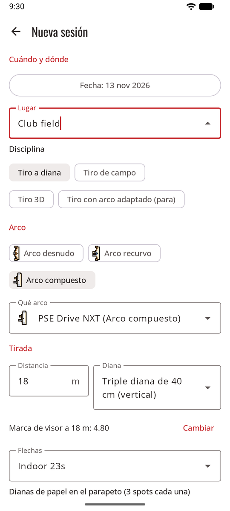
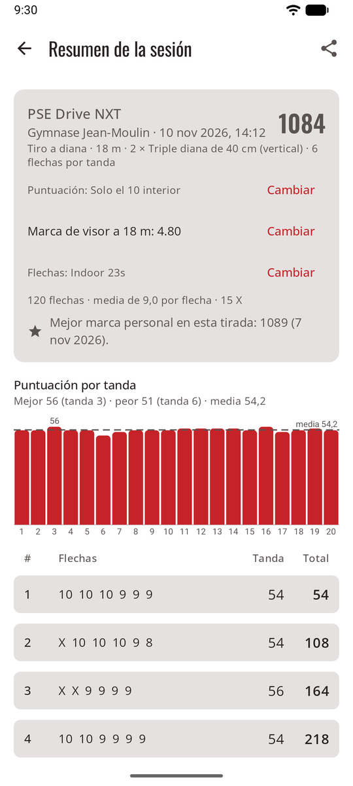
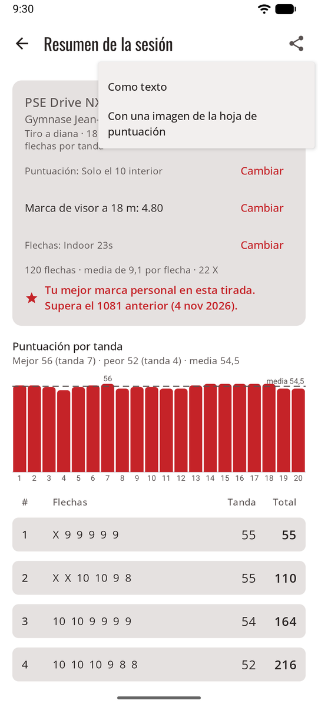
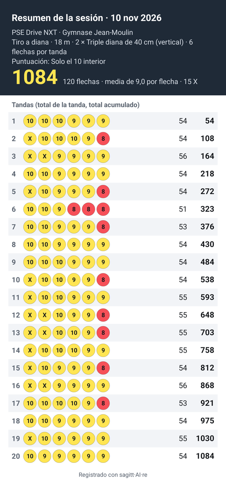
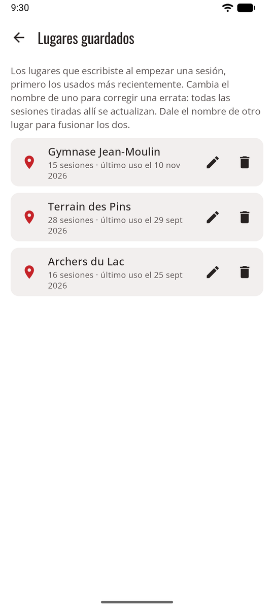

# Sesiones { #sessions }

Una sesión es una visita al campo de tiro: un lugar, una fecha, un arco y una tirada, y las tandas que tiras. En el modo juego, la **línea de tiro** empieza una, y **Tirar ya** va directo a la cámara.

<figure markdown>
{ .shot }
<figcaption><b>Nueva sesión.</b> Los valores predeterminados del arco completan el resto.</figcaption>
</figure>
<figure markdown>
{ .shot }
<figcaption><b>La sesión.</b> Total, gráfico y hoja de puntuación.</figcaption>
</figure>

## Empieza una sesión { #start-a-session }

En Inicio, toca **Empezar sesión** y completa:

- **Lugar**: escribe uno nuevo o elige uno que ya usaste. Para corregir una errata, juntar dos nombres del mismo campo de tiro o quitar uno, consulta [Lugares guardados](#saved-places).
- **Fecha**: ahora, por defecto.
- **Disciplina**: tiro a diana (la predeterminada), tiro de campo, tiro 3D o tiro con arco adaptado (para).
- **Tipo de arco** (arco desnudo, arco recurvo o arco compuesto, cada uno con su pequeño dibujo) y **arco**. Los valores predeterminados del arco completan el resto. Consulta [Arcos](bows.md).
- Debajo de la distancia, la **marca de visor** del arco para esa distancia, y las **flechas** cuando el arco tiene juegos de flechas: el juego que usó la última vez. Consulta [Marcas de visor, juegos de flechas y registro de ajustes](bows.md#sight-marks-arrow-sets-and-tuning-log).
- **Distancia**, **diana**, **dianas de papel** (en las triples dianas: cuántas hay en el parapeto, por ejemplo 2 dianas = 6 spots) y **flechas por tanda** (cualquier número, a menudo 3 o 6). Las dianas siguen la disciplina: dianas de tiro a diana, dianas de **campo** (80, 60, 40 cm, o 20 cm en columnas de tres) o el animal **3D**. Consulta [Campo y 3D](rules.md#field-and-3d).
- **Regla de puntuación**: viene de Ajustes y del tipo de arco. Consulta [Reglas de puntuación](rules.md).

## Tira una tanda { #shoot-an-end }

1. Tira tu tanda y ve hasta la diana.
2. Toca **Tomar foto**. Ponte delante de la diana y encaja la diana en el círculo de la pantalla. También puedes elegir una foto con **De la galería**, o puntuar la tanda a mano.
3. Lo que pasa después depende del [método de puntuación](scoring.md): se puntúa en segundo plano, se comparte con tu app de IA o colocas tú las flechas.
4. [Revisa la tanda](review.md) y confírmala. **Confirmar · tirar la siguiente tanda** vuelve directo a la cámara.

Con la puntuación automática no tienes que esperar: tira la siguiente tanda mientras se puntúa la anterior. Cada tanda muestra su estado en la hoja de puntuación (consulta [Tu propia clave de API](scoring-api.md#at-the-range)).

## La pantalla de la sesión { #the-session-screen }

- **Hoja de puntuación:** tanda a tanda, con el total acumulado. Toca una tanda para volver a ver su foto y sus flechas.
- Gráfico de **Puntuación por tanda**, con la línea de la media, y las mejores y peores tandas.
- **Cambiar** la regla de puntuación en cualquier momento. Todos los totales se vuelven a calcular.
- La **marca de visor** a esta distancia y las **flechas** tiradas, cada una con **Cambiar**.
- **Terminar**. Las tandas sin confirmar no cuentan hasta que las confirmes, cosa que puedes hacer más tarde.
- **Descartar esta sesión** la borra, después de preguntarte.
- **Mejor marca personal:** una vez terminada, la sesión te dice dónde queda en su tirada (misma distancia, diana, dianas de papel y número de flechas): tu mejor marca personal, y qué puntuación ha superado; igual a ella; o la mejor marca que tienes que superar.

## Comparte una sesión { #share-a-session }

{ .shot width="220" align=right }

El botón **Compartir esta sesión**, arriba en una sesión con al menos una tanda confirmada, abre el menú para compartir de tu teléfono: correo, mensajes, un chat con tu entrenador.

- **Como texto**: la fecha, el arco y el lugar, la tirada, la regla de puntuación, el total, la media y el número de X, y luego cada tanda con sus flechas, su total y el total acumulado.
- **Con una imagen de la hoja de puntuación**: el mismo texto, más una imagen con los totales y cada flecha en el color de su zona.

{ .shot width="220" }

Solo se comparte lo que muestra la pantalla de la sesión, y solo con la app que elijas: nunca las fotos de tus tandas.

Una sesión en curso aparece en Inicio con **Reanudar**. Si la app se cierra durante una sesión, no se pierde nada.

## Lugares guardados { #saved-places }

{ .shot width="220" align=right }

**Ajustes → Lugares guardados** muestra todos los lugares que has escrito, primero los usados más recientemente, con cuántas sesiones has tirado en cada uno.

- **Cambiar el nombre** (el lápiz, o toca el lugar): corrige una errata en todas partes a la vez, porque todas las sesiones tiradas allí cambian también.
- **Fusionar:** dale a un lugar el nombre de otro (*campo del club* y *Campo del Club*, por ejemplo). sagitt·AI·re te avisa antes, y el botón dice **Fusionar**. Las sesiones de los dos quedan bajo un solo nombre.
- **Eliminar** (la papelera), después de preguntarte: el lugar sale de la lista, y las sesiones tiradas allí se conservan, sin lugar.
