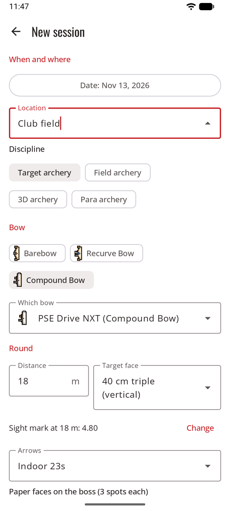
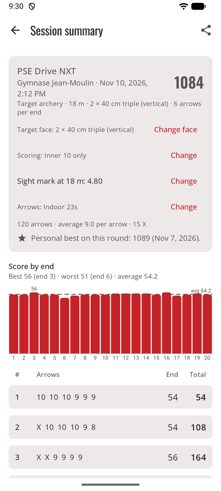
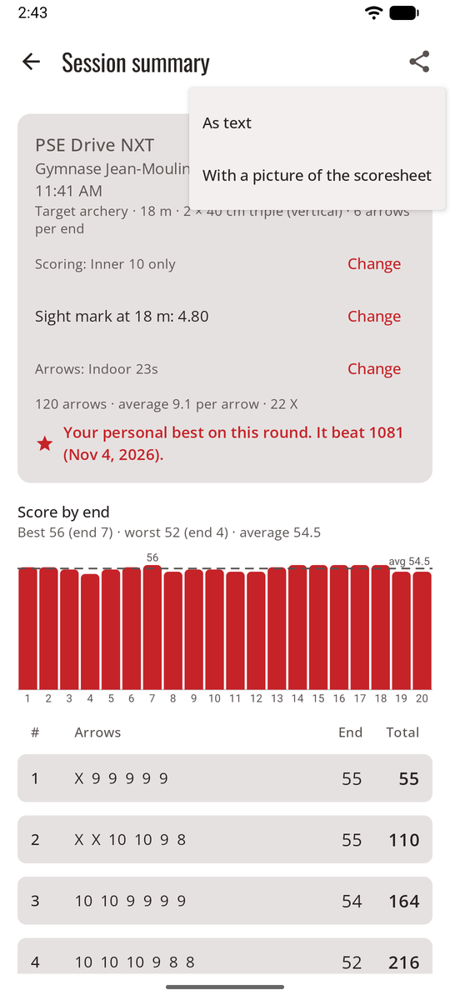
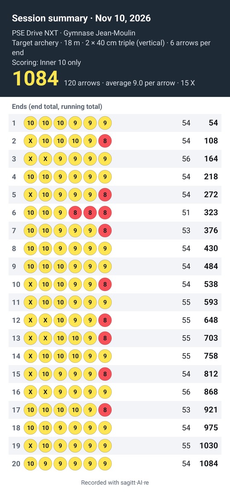
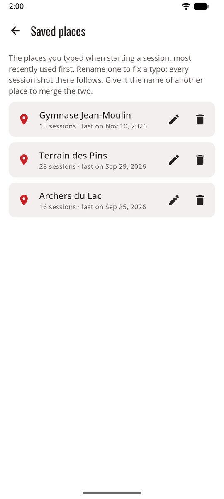

# Sessions

A session is one visit to the range: a place, a date, a bow and a round, and the ends you shoot. In game mode, the **shooting line** starts one, and **Shoot now** goes straight to the camera.

<figure markdown>
{ .shot }
<figcaption><b>New session.</b> Your last session's setup fills in the rest.</figcaption>
</figure>
<figure markdown>
{ .shot }
<figcaption><b>The session.</b> Total, chart and scoresheet.</figcaption>
</figure>

## Start a session

On the Dashboard, tap **Start session**, then fill in:

- **Location**: type a new one, or pick one you used before. To fix a typo, merge two names for the same range, or remove one, see [Saved places](#saved-places).
- **Date**: now by default.
- **Discipline**: target archery (the default), field archery, 3D archery or para archery.
- **Bow type** (barebow, recurve bow or compound bow, each with its small drawing) and **bow**. See [Bows](bows.md).
- Under the distance, the bow's **sight mark** for it, and the **arrows** when the bow has arrow sets: the set it used last time. See [Sight marks, arrow sets and tuning log](bows.md#sight-marks-arrow-sets-and-tuning-log).
- **Distance**, **target face**, **paper faces** (for 3-spot faces: how many are on the boss, for example 2 faces = 6 spots), and **arrows per end** (any number, often 3 or 6). The faces follow the discipline: target faces, **field** faces (80, 60, 40 cm, or 20 cm in columns of three), or the **3D** animal. See [Field and 3D](rules.md#field-and-3d). These fields start from your last session of the same discipline; the bow doesn't set them.
- **Scoring rule**: set from Settings and the bow type. See [Scoring rules](rules.md).

## Shoot an end

1. Shoot your end and walk to the target.
2. Tap **Take photo**. Stand in front of the target and fit the face in the circle on screen. You can also pick a photo with **From gallery**, or score the end by hand.
3. What happens next depends on the [scoring method](scoring.md): scored in the background, shared with your AI app, or placed by you.
4. [Check the end](review.md) and confirm it. **Confirm · shoot next end** goes straight back to the camera.

With automatic scoring you don't have to wait: shoot the next end while the previous one is being scored. Each end shows its status in the scoresheet (see [Your own API key](scoring-api.md#at-the-range)).

## The session screen

- **Scoresheet:** end by end, with the running total. Tap an end to see its photo and arrows again.
- **Score by end** chart, with the average line, and the best and worst ends.
- **Change** the scoring rule at any time. All the totals are recalculated.
- **Change face**: if you shot at another face than the one set, pick the right one (same kind of face: target or field). Points are recalculated from the rings already recorded; arrows whose ring isn't on the new face, and misses that may score on a larger face, are marked for review. Possible once every end is scored.
- The **sight mark** at this distance and the **arrows** shot, each with **Change**.
- **Finish**. Ends that aren't confirmed don't count until you confirm them, which you can still do later.
- **Discard this session** deletes it, after asking.
- **Personal best:** once finished, the session says where it stands on its round (same distance, face, paper faces and number of arrows): your personal best, and which score it beat; equal to it; or the best to beat.

## Share a session

{ .shot width="220" align=right }

The **Share** button, at the top of a session with at least one confirmed end, opens your phone's share sheet: email, messages, a chat with your coach.

- **As text**: the date, bow and place, round, scoring rule, total, average and X count, then every end with its arrows, its total and the running total.
- **With a picture of the scoresheet**: the same text, plus a picture with the totals and every arrow in its ring's colour.

{ .shot width="220" }

Only what the session screen shows is shared, and only to the app you pick: never the photos of your ends.

A session in progress shows on the Dashboard with **Resume**. If the app is closed during a session, nothing is lost.

## Saved places

{ .shot width="220" align=right }

**Settings → Saved places** lists every place you've typed, most recently used first, with how many sessions you shot there.

- **Rename** (the pencil, or tap the place): fixes a typo everywhere at once, since every session shot there follows.
- **Merge:** give a place the name of another one (*club field* and *Club Field*, say). sagitt·AI·re says so first, and the button reads **Merge**. The sessions of both end up under one name.
- **Delete** (the bin), after asking: the place leaves the list, and the sessions shot there are kept, with no place.
