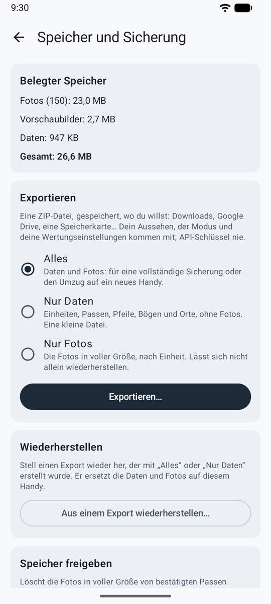
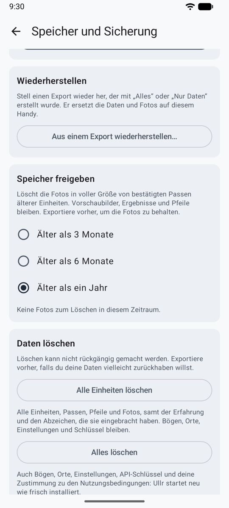

# Speicher und Sicherung { #storage-and-backup }

Alles wird nur auf deinem Handy gespeichert, und wenn du die App deinstallierst, wird es gelöscht. **Einstellungen → Speicher und Sicherung** zeigt den belegten Speicher und hält deine Daten sicher.

<figure markdown>
{ .shot }
<figcaption><b>Exportieren und wiederherstellen</b></figcaption>
</figure>

## Export { #export }

Exportiere **Alles**, **Nur Daten** oder **Nur Fotos**, als eine ZIP-Datei, gespeichert wo du willst: Downloads, Google Drive, eine Speicherkarte. Dein Design, dein Modus und deine Wertungseinstellungen kommen mit. API-Schlüssel und Dienstadressen nie. Bewahr die Datei an einem privaten Ort auf.

## Wiederherstellen { #restore }

Stell einen Export auf demselben oder einem neuen Handy wieder her. Ullr zeigt, was die Datei enthält, und ändert nichts, bevor du bestätigst. Gib auf einem neuen Handy deinen API-Schlüssel erneut ein (und bei einem OpenAI-kompatiblen Dienst seine Adresse).

## Speicher freigeben { #free-up-space }

Lösch die Fotos in voller Größe von Einheiten, die älter als 3 Monate, 6 Monate oder ein Jahr sind, nach einer Rückfrage. Vorschaubilder, Ergebnisse und Pfeile bleiben. Fotos brauchen etwa 0,6–1,2 MB pro Passe.

## Daten löschen { #erase-data }

<figure markdown>
{ .shot }
<figcaption><b>Daten löschen</b>, ganz unten in Speicher und Sicherung</figcaption>
</figure>

Ganz unten in **Speicher und Sicherung** bietet **Daten löschen** zwei Möglichkeiten:

| Auswahl | Was gelöscht wird | Was bleibt |
|--------|-----------|------------|
| **Alle Einheiten löschen** | Jede Einheit, Passe, jeder Pfeil und jedes Foto, mit der Erfahrung und den Abzeichen, die sie eingebracht haben | Bögen, Orte, Einstellungen und API-Schlüssel |
| **Alles löschen** | Außerdem Bögen, Orte, jede Einstellung, API-Schlüssel und deine Zustimmung zu den Nutzungsbedingungen | Nichts: Ullr startet neu, als wäre es frisch installiert, zuerst mit dem Bildschirm der Nutzungsbedingungen |

Beide fragen vorher nach, und der Knopf bleibt aus, bis du **LÖSCHEN** eingibst, denn Löschen lässt sich nicht rückgängig machen. Exportiere vorher, wenn du deine Daten vielleicht zurückhaben willst. Um nur deine Erfahrung und deine Abzeichen neu zu beginnen und deine Einheiten zu behalten, nutz **Erfahrung und Abzeichen zurücksetzen** an der Trophäenwand (siehe [Spielmodus](game.md#levels-badges-and-trophies)).
