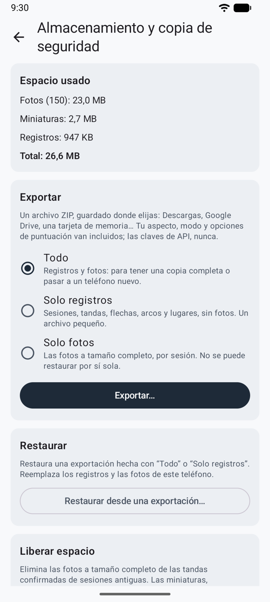
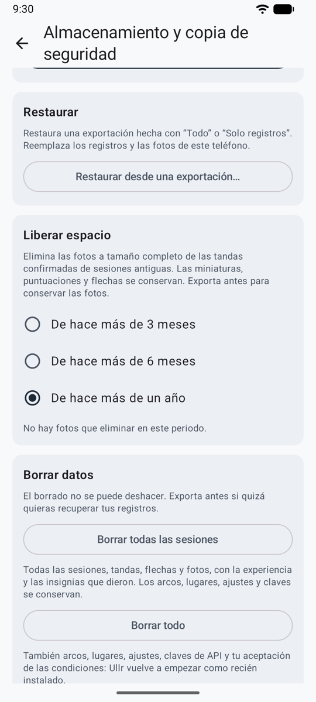

# Almacenamiento y copia de seguridad { #storage-and-backup }

Todo se guarda solo en tu teléfono, y desinstalar la app lo elimina. **Ajustes → Almacenamiento y copia de seguridad** muestra el espacio usado y mantiene tus registros a salvo.

<figure markdown>
{ .shot }
<figcaption><b>Exportar y restaurar</b></figcaption>
</figure>

## Exportar { #export }

Exporta **todo**, **solo registros** o **solo fotos**, como un único archivo ZIP guardado donde elijas: Descargas, Google Drive, una tarjeta de memoria. Tu aspecto, tu modo y tus opciones de puntuación van incluidos. Las claves de API y las direcciones de los servicios, nunca. Guarda el archivo en un lugar privado.

## Restaurar { #restore }

Restaura una exportación en el mismo teléfono o en uno nuevo. Ullr muestra lo que contiene el archivo y no cambia nada hasta que confirmas. En un teléfono nuevo, vuelve a introducir tu clave de API (y, para un servicio compatible con OpenAI, su dirección).

## Liberar espacio { #free-up-space }

Elimina las fotos a tamaño completo de las sesiones de hace más de 3 meses, 6 meses o un año, tras preguntar. Las miniaturas, las puntuaciones y las flechas se quedan. Las fotos ocupan entre 0,6 y 1,2 MB por tanda.

## Borrar datos { #erase-data }

<figure markdown>
{ .shot }
<figcaption><b>Borrar datos</b>, al final de Almacenamiento y copia de seguridad</figcaption>
</figure>

Al final de **Almacenamiento y copia de seguridad**, **Borrar datos** ofrece dos opciones:

| Opción | Qué se va | Qué se queda |
|--------|-----------|------------|
| **Borrar todas las sesiones** | Todas las sesiones, tandas, flechas y fotos, con la experiencia y las insignias que ganaron | Arcos, lugares, ajustes y claves de API |
| **Borrar todo** | Además los arcos, los lugares, todos los ajustes, las claves de API y tu aceptación de las condiciones de uso | Nada: Ullr empieza de nuevo como si estuviera recién instalada, con la pantalla de las condiciones primero |

Las dos preguntan antes, y el botón sigue desactivado hasta que escribes **BORRAR**, porque el borrado no se puede deshacer. Exporta antes si quizá quieras recuperar tus registros. Para reiniciar solo tu experiencia y tus insignias conservando tus sesiones, usa **Reiniciar experiencia e insignias** en el muro de trofeos (consulta [Modo juego](game.md#levels-badges-and-trophies)).
