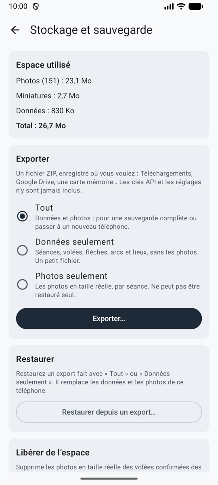

# Stockage et sauvegarde

Tout est enregistré uniquement sur votre téléphone, et désinstaller l’application efface tout. **Réglages → Stockage et sauvegarde** montre l’espace utilisé et met vos données à l’abri.

<figure markdown>
{ .shot }
<figcaption><b>Exporter et restaurer</b></figcaption>
</figure>

## Exporter

Exportez **Tout**, **Données seulement** ou **Photos seulement**, en un seul fichier ZIP enregistré où vous voulez : Téléchargements, Google Drive, une carte mémoire. Votre apparence, le mode et vos choix de comptage suivent ; les clés API et les adresses de service, jamais. Gardez le fichier dans un endroit privé.

## Restaurer

Restaurez un export sur le même téléphone ou sur un nouveau. Ullr montre ce que contient le fichier et ne change rien tant que vous n’avez pas confirmé. Sur un nouveau téléphone, entrez à nouveau votre clé API (et, pour un service compatible OpenAI, son adresse).

## Libérer de l’espace

Supprimez les photos en taille réelle des séances de plus de 3 mois, 6 mois ou un an, après confirmation. Les miniatures, les scores et les flèches restent. Les photos prennent environ 0,6 à 1,2 Mo par volée.
