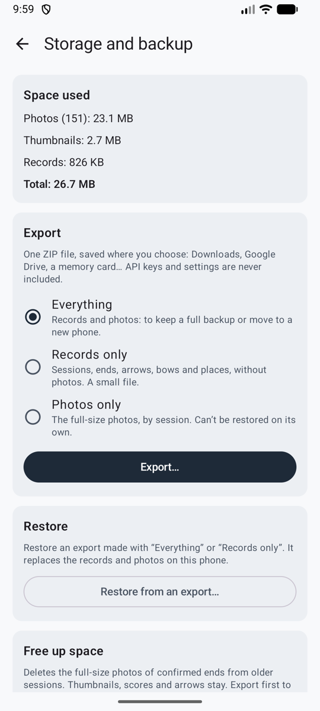

# Storage and backup

Everything is stored on your phone only, and uninstalling the app deletes it. **Settings → Storage and backup** (*Réglages → Stockage et sauvegarde*) shows the space used and keeps your records safe.

<figure markdown>
{ .shot }
<figcaption><b>Export and restore</b></figcaption>
</figure>

## Export

Export **everything**, **records only**, or **photos only**, as one ZIP file saved where you choose: Downloads, Google Drive, a memory card. Your look, mode and scoring choices come along. API keys and service addresses never do. Keep the file somewhere private.

## Restore

Restore an export on the same phone or a new one. Ullr shows what the file holds and changes nothing until you confirm. On a new phone, enter your API key again (and, for an OpenAI-compatible service, its address).

## Free up space

Delete the full-size photos of sessions older than 3 months, 6 months or a year, after asking. Thumbnails, scores and arrows stay. Photos take about 0.6–1.2 MB per end.
