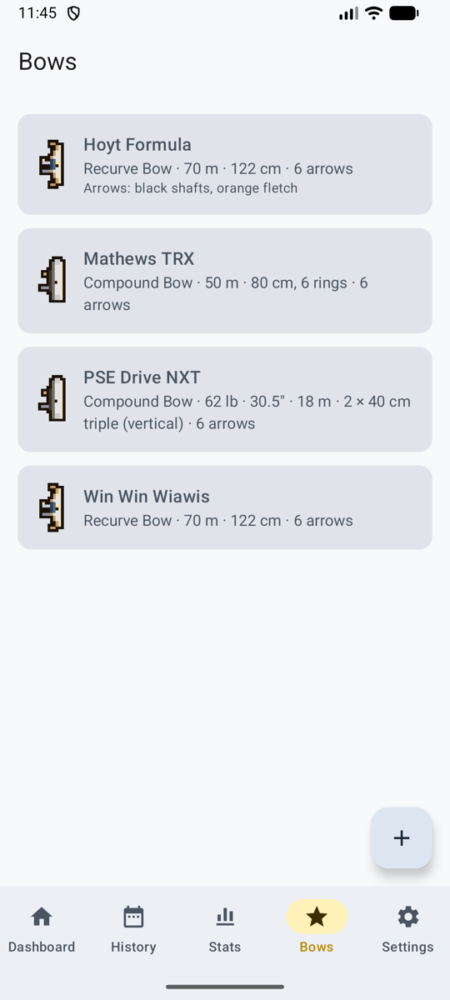
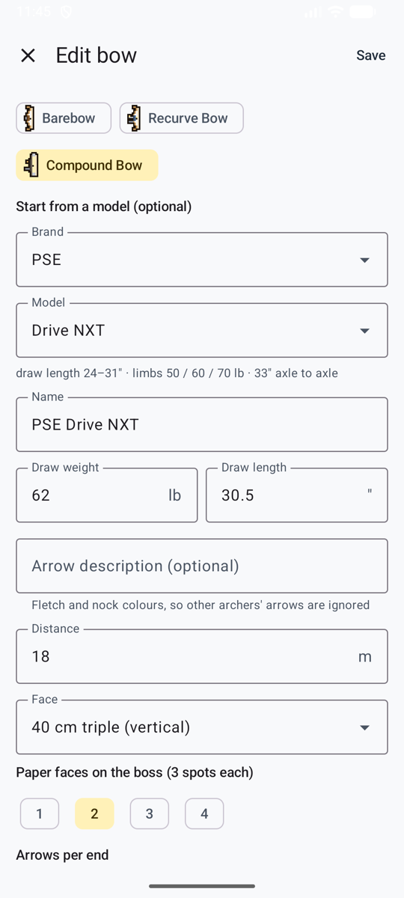
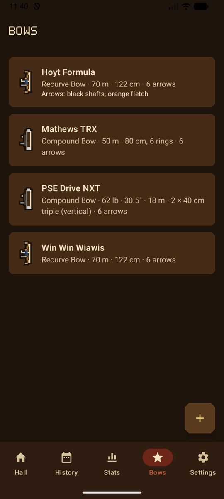
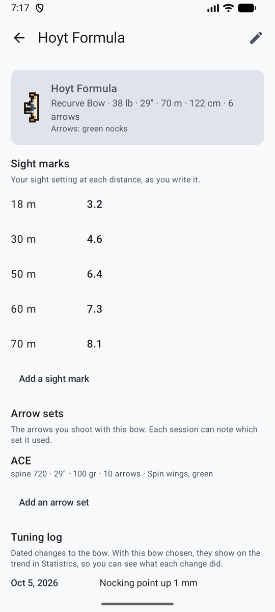
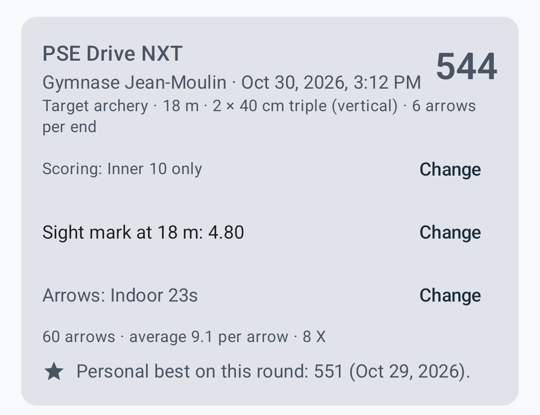

# Bögen { #bows }

Der Tab **Bögen** listet deine Bögen. Tipp auf einen, um seine Seite zu öffnen: seine Einstellungen, **Visiermarken**, **Pfeilsätze** und das **Tuning-Logbuch**. Im Spielmodus hängen sie am **Bogenständer** in der Halle, jeder als sein Typ gezeichnet, und dein Schütze hält den Typ deines ersten Bogens.

<figure markdown>
{ .shot }
<figcaption><b>Deine Bögen</b></figcaption>
</figure>
<figure markdown>
{ .shot }
<figcaption><b>Start mit dem Katalog</b></figcaption>
</figure>
<figure markdown>
{ .shot }
<figcaption><b>Deine Bögen</b>, im Spiel-Look</figcaption>
</figure>

## Einen Bogen hinzufügen { #add-a-bow }

**Bogen hinzufügen**:

- **Name** und **Bogentyp**. Jeder Typ hat eine kleine Zeichnung, die den Bogen in Listen markiert: Blankbogen; Recurve mit Visier und Stabilisator; Compound mit Cams.
- Bei einem Compound kannst du mit **Marke und Modell** aus dem eingebauten Katalog starten (PSE, Hoyt, Mathews, Bowtech). Das füllt den Namen aus, zeigt die Daten des Modells und warnt dich, wenn deine Auszugslänge außerhalb des Bereichs des Modells liegt.
- **Zuggewicht** (lb) und **Auszugslänge** (Zoll). Beide akzeptieren Komma oder Punkt.
- **Pfeilbeschreibung**, zum Beispiel „schwarze Schäfte, orange Befiederung“. Sie wird mit dem Foto gesendet, damit die KI die Pfeile anderer Schützen auf derselben Scheibe ignoriert.
- **Standardwerte:** Auflage, Auflagen auf der Scheibe, Entfernung und Pfeile pro Passe, mit denen neue Einheiten ausgefüllt werden.

## Visiermarken, Pfeilsätze und Tuning-Logbuch { #sight-marks-arrow-sets-and-tuning-log }

<figure markdown>
{ .shot }
<figcaption><b>Die Seite eines Bogens</b></figcaption>
</figure>
<figure markdown>
{ .shot }
<figcaption><b>In der Einheit</b>: die Marke und die Pfeile</figcaption>
</figure>

- **Visiermarken**: deine Visiereinstellung für jede Entfernung, so wie du sie notierst: `5.2`, `3 turns + 12`, oder beim Blankbogen dein String-Walking oder Zielpunkt, mit einer optionalen Notiz. Eine pro Entfernung. Die Marke für den Bogen und die Entfernung der Einheit erscheint, wenn du eine Einheit startest, und in der Einheit selbst, wo du sie mit **Ändern** direkt an der Schießlinie aktualisierst.
- **Pfeilsätze**: Name, Spine wie auf dem Schaft aufgedruckt, Länge, Spitzengewicht, Anzahl der Pfeile, Befiederung und Notizen. Eine neue Einheit beginnt mit dem Satz, den der Bogen zuletzt benutzt hat; wähl im Formular einen anderen oder wechsle ihn in der Einheit mit **Ändern**. **Diesen Satz ausmustern** blendet ihn für neue Einheiten aus und behält ihn bei den Einheiten, die damit geschossen wurden. In der [Statistik](stats.md#filters) kannst du nach Pfeilsatz filtern.
- **Tuning-Logbuch**: datierte Notizen zu dem, was du geändert hast: Standhöhe, Tiller, Nockpunkt, eine neue Sehne. Wenn der Bogen in der [Statistik](stats.md#average-per-arrow-by-session) ausgewählt ist, erscheint jede Notiz im Verlauf, sodass du siehst, was sie bewirkt hat.

## Einen Bogen ändern oder entfernen { #change-or-remove-a-bow }

**Bearbeiten** (der Stift oben rechts auf der Seite des Bogens) öffnet das Formular. Wenn du einen Bogen später änderst, ändern sich frühere Einheiten nicht. **Diesen Bogen entfernen** fragt vorher nach; frühere Einheiten, die damit geschossen wurden, bleiben erhalten.
